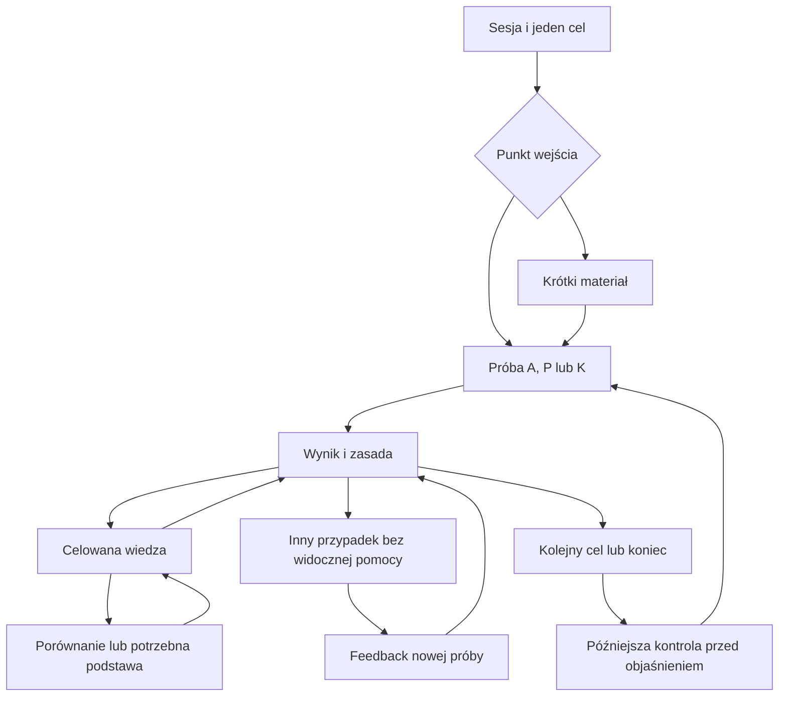
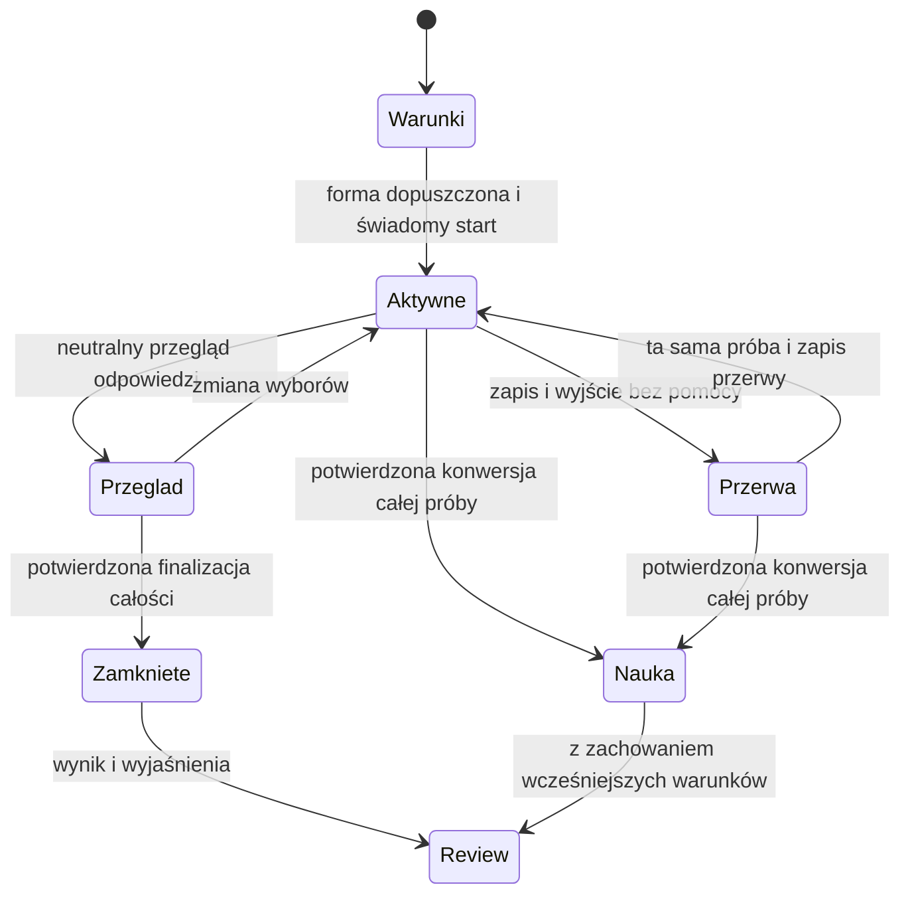

# D02 — Przepływy, nawigacja i stany ekranów

**Projekt:** IREB CPRE Foundation Level Learning System  
**Data:** 2 listopada 2026 · Europe/Warsaw  
**Wersja:** v0.1  
**Status:** projekt do oceny właściciela; G2/G3/G4 otwarte. G1 przyjęte według R06.  
**Autor:** Agent D / AI; kontrola autorska, bez badania użytkowników.

## 1. Organizacja informacji

Nawigacja główna: **Sesja** i **Zakres i dowody**. Sesja prowadzi do jednego następnego działania. Wybór celu jest krótką listą, a nie nowym pulpitem trybów. Nauka ma jeden obszar pracy: materiał, pytanie, feedback lub follow-up. Wiedza jest jego odwracalną gałęzią. Sprawdzenie ma własne warunki, przegląd i wynik.

| Miejsce | Odpowiedzialność | Obecność w nawigacji |
|---|---|---|
| S01 Sesja | Wejście, wznowienie, jeden następny krok, zakończenie | Tak |
| S02 Wybór celu | Zmiana celu, wejście materiał/pytanie, zachowane wcześniejsze potrzeby | Z sesji, bez stałej nowej sekcji |
| S03 Nauka | Materiał, A/P/K, submit, feedback, korekta i follow-up | W obrębie Sesji |
| S04 Wiedza w kontekście | Pojęcie, porównanie, podstawa, źródło i powrót | Wyłącznie kontekstowo |
| S05 Zakres i dowody | Zakres treści, obserwacje przy kryterium, ograniczenia i kontrola później | Tak |
| S06 Sprawdzenie | Warunki → odpowiedzi/flagowanie → przegląd → finalizacja → wynik/review | Z sesji; bez nowego globalnego trybu menu |
| S07 Komunikaty i uwaga | Braki, wycofanie, spór, brak zapisu, zgłoszenie | W miejscu problemu |

Do trzech uzasadnionych relacji przy bieżącej potrzebie to odziedziczona hipoteza uproszczenia F06, nie limit modelu. Interfejs pokazuje najpierw jeden trafny krok. Nigdy nie pokazuje surowego sąsiedztwa grafu ani technicznych R/FR/KRY użytkownikowi.

## 2. Główna pętla Nauki

Strzałka z nowej próby do feedbacku źródła oznacza **powrót**, bez zmiany jego wyniku. Nowy follow-up ma własną tożsamość próby. Wejście od materiału jest opcjonalne. Korektę wolno odłożyć. Późniejsza kontrola wymaga osobnego rzeczywistego czasu i dostępnej treści; diagram nie oznacza już wykonanej retencji.

## 3. Sprawdzenie i jego granice

W Level 1 nie ma zegara. Przerwa w teście tematu jest dozwolona z zachowaniem zakazu pomocy. Przejście do wiedzy przez dowolną drogę, także nawigację do zakresu lub zapisanej lektury, najpierw proponuje konwersję; anulowanie nie ujawnia treści. Wyjście do neutralnego ekranu wznowienia nie wymaga konwersji. Po konwersji nie ma przejścia do Aktywnego stanu **tej samej** niezależnej próby. Nowy test jest inną aktywnością i ponownie sprawdza nowość.

## 4. Specyfikacja miejsc i stanów

### S01 — Sesja

- **Cel / wejście:** rozpocząć lub wznowić pracę; pierwsze otwarcie, powrót albo zakończenie gałęzi.
- **Hierarchia:** kwalifikacja i zakres → jeden cel → sprawdzalny powód → jedna główna akcja → alternatywa wejścia i zmiana celu. Informacja o dwóch kontekstach jest krótka.
- **Akcje:** „Zacznij od wprowadzenia”, „Spróbuj pytania”, „Wybierz inny cel”. Przy przerwanej pracy priorytet ma „Wznów zapisane miejsce”; nic nie tworzy nowej próby bez startu.
- **Jawne / ukryte:** zakres pilota i status materiału jawne. Nie odsłaniać reguły oczekującej odroczonej próby. Nie pokazywać braków jako czerwonej oceny ucznia.
- **Przejścia:** S02, S03, S05 lub warunki S06. Jeśli test jest aktywny/odłożony, ekran staje się neutralną kartą „Wznów sprawdzenie”. Dostęp do wiedzy wymaga konwersji.
- **Zapis / fokus:** ostatni cel, wersje, odpowiedzi, miejsce, potrzeby rewizji. Po krótkiej przerwie odtworzenie zapisanej kotwicy; po długiej wybór wznowienia lub retrieval bez resetu historii. Brak stanu oznacza jawny wybór celu.
- **Komunikat:** „Nie mamy jeszcze odpowiednich prób tego rozróżnienia” albo „Poprzednia samodzielna próba była [data/odstęp]”. Nie wymyślać daty przy braku historii.
- **Ślad:** FR-001–003/020–021/032/038; UC-01/07/16/18; F09 Acceptance tych FR, uzupełniająco B02/AC-001–003/020–021/032/038.

### S02 — Wybór lub zmiana celu

- **Cel / wejście:** świadomie wybrać inny potrzebny temat, bez konfiguracji wielopolowej; z S01/S03/S05.
- **Hierarchia:** nazwa celu → faktyczna dostępność materiału i pomiaru → wejście od materiału albo pytania. Dłuższa lista może być grupowana po EU, bez globalnego wyszukiwania Level 2.
- **Akcje:** „Otwórz wprowadzenie”, „Zacznij od pytania”, „Wróć do sesji”. Zmiana celu w otwartej gałęzi mówi, co jest odłożone; odpowiedzi nie przepadają.
- **Jawne / ukryte:** częściowe pokrycie i materiały objaśniające; rezerwa nie pojawia się na liście, w tytułach ani podglądach.
- **Przejścia / zapis:** nowy cel uruchamia nową aktywność; dotychczasowe próby i potrzeby pozostają. Anulowanie wraca do miejsca, z którego otwarto listę.
- **Błędy / fokus:** brak treści kieruje do S07, a nie generacji. Po otwarciu fokus na nagłówek; po anulowaniu na wywołującą kontrolkę.
- **Ślad:** FR-002–004/021/033/038; UC-01/16/18; produktowe AC F09; semantyka B02/AC-002–004/021/033/038.

### S03 — Jeden obszar Nauki

| Stan | Cel i wejście | Hierarchia oraz akcje | Widoczność / warunek wyjścia |
|---|---|---|---|
| L0 Materiał | Poznać potrzebną regułę; wejście od wprowadzenia lub luki | Znaczenie, warunek, przykład, opcjonalne szczegóły; „Przejdź do pytania” | Bez odhaczania wszystkich akapitów; lektura to ekspozycja |
| L1 A | Dokonać jednej decyzji; dopuszczone K2 | Polecenie, negacja jeśli występuje, waga, 4–5 radio; zmiana, wyczyść, submit | Brak klucza i rationale przed submit; blank dozwolony |
| L2 P | Wybrać k odpowiedzi | Polecenie, k/w, checkboxy, neutralny licznik; submit bez limitera zaznaczeń | W Nauce nadmiar ma tekstową konsekwencję 0 pkt; niedobór dozwolony |
| L3 K | Ocenić m twierdzeń | Polecenie, waga, każdy wiersz jako osobna grupa; Prawda/Fałsz i wyczyść | Domyślnie brak wyboru, nie Fałsz; blank wpływa tylko na swój wiersz |
| L4 Potwierdzenie braków | Świadomie oddać pustą/niepełną lub nadmiarową odpowiedź | Neutralna liczba braków/nadmiaru, „Wróć bez zmiany”, „Oddaj obecną odpowiedź” | Anulowanie nie zatwierdza i nie ujawnia; zła liczba nie jest złą wiedzą |
| L5 Feedback | Zrozumieć oddaną odpowiedź | Uzyskane/maksymalne punkty, zasada/warunek, własna odpowiedź, błędne i pominięte poprawne decyzje; pełne rationale na żądanie | Pierwotny wybór zablokowany; „Spróbuj innego przypadku” lub kontynuacja |
| L6 Sonda warunkowa | Rozdzielić alternatywne przyczyny | Ostrożna hipoteza i krótka sonda z metodą oceny; możliwość pominięcia | Tylko z uzasadnionym C. Po ujawnieniu korekty sprawdza bieżące rozumienie, nie dawną przyczynę |
| L7 Korekta | Usunąć konkretny błąd | Jedna reguła, comparison/przykład, opcjonalna podstawa; nowy przypadek albo odłożenie | Nie wymaga diagnozy misconception; brak wariantu ogranicza obietnicę |
| L8 Follow-up | Wykonać tę samą czynność w zmienionej sytuacji | Pomoc wycofana; nowe zadanie; submit; osobna ocena | Klasyfikacja i swobodne uzasadnienie mają odrębne źródła oceny |
| L9 Wynik follow-up | Zrozumieć poprawę i ograniczenie | Fakt wyniku, źródło oceny, świeżość instrukcji, brak potwierdzenia retencji; powrót do źródła | Nie zamienia źródłowego błędu w sukces; nie potwierdza automatycznie nowej rodziny |
| L10 Zmiana wsparcia | Wyjść z bezproduktywnej gałęzi | Po drugim nieudanym follow-up: inne objaśnienie, uzasadniona podstawa lub przerwa | Bez automatycznego trzeciego podobnego; uczeń może wyjść wcześniej |
| L11 Następny krok | Zamknąć bieżącą pracę | Bilans, jeden nowy cel z powodem, późniejsza kontrola i zakończenie | Luka pozostaje bez blokady; ponowne porównanie potrzeb, nie identyczna gałąź bez nowej przesłanki |

**Zapis wszystkich L:** tożsamość/rewizja itemu i kryterium, odpowiedzi robocze/oddane, scoring, pomoc przed/po submit, znajomość itemu i rodziny, ujawnione fragmenty, rozwinięcia, kolejka, osobne follow-up, miejsce oraz fokus. Cofnięcie i powrót nie tworzą próby. Zmiana klucza jest odrębnym przeliczeniem z podstawą, bez edycji historii.

**Fokus:** po submit do krótkiego wyniku i zasady, nie na początek całej strony; komunikat nie dubluje długiego odczytu w live region. Po rozwinięciu rationale fokus zostaje na kontrolce. Po błędzie formularza do komunikatu z linkiem do właściwego pola. Radio i checkbox nie zatwierdzają automatycznie. Usunięty podczas przerwy element zastępuje najbliższa logiczna kotwica z komunikatem.

**Ślad:** FR-005–018/020–022/029/032–037; UC-02–07/11–15/18; odpowiednie Acceptance F09. B02/AC o tych numerach kontrolują komplet danych. Otwarte L3 wymaga innej treści/rubryki niż ilustracyjne A; samoocena pozostaje samooceną.

### S04 — Wiedza, porównanie i podstawa

- **Cel / wejście:** wyjaśnić konkretną opcję lub wiersz bez utraty próby; z L1–L3 na żądanie pomocy albo z L5 po ocenie.
- **Hierarchia:** stała kotwica „Wróć do pytania” → cel otwarcia → nazwa fragmentu → reguła z warunkiem → przykład/porównanie → najwyżej kilka potrzebnych relacji i źródło na żądanie.
- **Akcje:** „Wstecz” cofa jedną treść, „Wróć do pytania” zamyka całą gałąź; „Pomiń podstawę” bez kary. Jedno okno dialogowe zmienia zawartość zamiast otwierać kolejne modalne okna.
- **Stany:** W0 porównanie; W1 pojęcie; W2 warunkowa podstawa; W3 źródło; W4 chwilowa niedostępność. Niezweryfikowanego R14 nie przedstawiać jako obowiązku.
- **Zapis / przejście:** stałe źródło i stos gałęzi są niezależne od aktualnie czytanego fragmentu. Powrót przywraca item/rewizję, odpowiedź, wynik, zakres ujawnień, rozwinięcia, pozycję i fokus kontrolki, z której otwarto wiedzę. Follow-up nie zastępuje źródła.
- **Fokus i dostępność:** tło inert, nagłówek dialogu osiągalny po wejściu, Tab/Shift+Tab w obrębie okna, Escape jak jawny powrót. Na telefonie pełny widok z dostępną kotwicą powrotu. Bez hover jako jedynego sposobu odczytu.
- **Pomoc:** ujawnienie przed submit zostaje zapisane; samo zamknięcie nie przywraca samodzielności. Po submit nie odbiera wstecz warunków oddanej odpowiedzi. Samo kliknięcie anulowanego wejścia przed ujawnieniem nie jest pomocą.
- **Ślad:** FR-011–019/032–033/036–037; UC-06/13–14/17; F06 wszystkie przejścia; B01/R08–R19/R26 i B02-04.

### S05 — Zakres i dowody

- **Cel / wejście:** ustalić, co objęto materiałem i co faktycznie wykazał uczeń; z nawigacji albo wyniku.
- **Hierarchia:** zakres wydania → kryterium/termin i jego część EO → osobno materiał i dostępny pomiar → obserwacje osoby → ograniczenia i kolejny krok. Pełne techniczne identyfikatory są w dokumentacji, nie w podstawowej narracji.
- **Akcje:** rozwiń podstawę opisu, zobacz konkretne próby, wybierz pracę nad luką. Materiał nieopracowany oznaczyć jako brak korpusu.
- **Stany dowodów:** brak danych; materiał poznany/z pomocą; samodzielne poprawne wykonanie z liczbą/datą; wykonanie w zatwierdzonym innym kontekście; wykonanie po określonej przerwie. Wymiary mogą współwystępować, nie są drabiną. Osobna flaga ponownej kontroli.
- **Czasy:** odstęp od poprzedniej samodzielnej próby i od ostatniego istotnego kontaktu z tym samym kryterium, z historii sprzed próby. „7 dni + 1 minuta” nie daje tygodniowej retencji. Kontakty zewnętrzne są dobrowolną deklaracją, nie wykrytym faktem.
- **Zapis / fokus:** rozwinięty cel i wybrana obserwacja; powrót do tej samej listy i kotwicy. Brak obserwacji nie jest zerem punktów ani czerwonym „nie umiesz”.
- **Ślad:** FR-004/018/020–024/032–035/038; UC-07/10/15–18; F09 AC oraz B01-10/11. Brak trendu łączącego nieporównywalne formy, mastery i prognozy zdania.

### S06 — Test tematu

| Stan | Cel / wejście | Hierarchia i akcje | Zapis, ukrycie i fokus |
|---|---|---|---|
| T0 Warunki | Świadomy start po dopuszczeniu formy | Rzeczywisty zakres, liczba zadań/punktów, nowość, brak limitu, pomoc, przerwy; start lub anulowanie | Nie pokazywać stemów rezerwy przed startem. Fokus nagłówka. Brak puli → S07 |
| T1 Odpowiadanie | Dokonać i zmieniać wybory | Numer pytania, stem, A/P/K, maksymalna waga, neutralny licznik P, flaga powrotu, poprzednie/następne | Robocze odpowiedzi i flagi; brak kluczy, rationale, punktów zdobytych, podpowiadających EO/źródeł, wiedzy i wyszukiwania |
| T2 Przegląd | Sprawdzić kompletność przed finalizacją | Każde pytanie: stan odpowiedzi, braki i flaga; liczba nadmiarów P, bez trafności | „Wróć do odpowiedzi” lub „Zakończ i pokaż wynik”; można oddać mimo braków/nadmiaru/flag |
| T3 Przerwa | Opuścić bez pomocy | Neutralny ekran wznowienia, zachowane miejsce i warunki | Ta sama próba, zapis początku/końca przerwy; bez dopisywania nowych kontaktów dziedzinowych |
| T4 Konwersja | Świadomie zmienić warunki całej próby | Wyjaśniona nieodwracalność, „Wróć bez zmiany” i „Przejdź do Nauki” | Do decyzji żadnej pomocy; anulowanie odtwarza aktywny stan i fokus. Potwierdzenie nie ma drogi powrotu do niezależności |
| T5 Wynik | Zrozumieć zamkniętą formę | Suma punktów/mianownik, procent punktów, czas/brak limitu, przerwy, nowość i ograniczenia; review dowolnego pytania | Odpowiedzi zamknięte. Fokus wyniku. Przegląd nie tworzy nowej próby ani nie przepisuje wyniku |
| T6 Review | Wyjaśnić konkretne decyzje | Ten sam L5 ze źródłem w zakończonym teście, rationale wszystkich decyzji i celowana naprawa | „Wróć do wyniku sprawdzenia”. Nowy follow-up osobno. Ujawnienie wpływa na przyszłą ekspozycję |
| T7 Nauka po konwersji | Kontynuować edukacyjnie | Zapisane odpowiedzi i ich warunki, dostępne wyjaśnienia, ewentualne nowe treningowe próby | Brak etykiety ukończonego niezależnego testu; części sprzed konwersji zachowują swoje warunki |

Flaga jest **zawsze dostępna**, jej użycie fakultatywne. Brak flagi nie jest blankiem odpowiedzi. Neutralny słownik językowy bez definicji RE, jeśli dopuszcza go profil, można odnotować bez konwersji i bez utraty samodzielności. Nie budujemy słownika; Glossary CPRE pozostaje pomocą dziedzinową.

**Ślad:** FR-007–010/018–019/024–029/032–036/038; UC-08/09/11/13/16/17. UC-08 pełny mock pozostaje Level 2; T0–T7 realizują wspólny mechanizm i test tematu Level 1. Nie deklarujemy odtworzenia UI certyfikatora.

### S07 — Negatywne i graniczne stany

| Stan / rodzaj | Komunikat uczniowski | Dozwolone działanie / zapis / fokus |
|---|---|---|
| N1 Brak treści, LUKA-01 | „Tego materiału jeszcze nie ma. To ograniczenie materiału.” | Dostępny cel lub powrót; bez oceny wiedzy; fokus nagłówka komunikatu |
| N2 Brak review/praw/klucza, LUKA-02/04/08 | „Ten materiał nie jest dostępny do tej próby.” | Nie pokazywać pozornie punktowanego pytania. Wstrzymanie całego itemu, nie ukrycie kłopotliwego wiersza |
| N3 Brak/cykl relacji, LUKA-03 | Link pominięty albo „Nie mamy sprawdzonego objaśnienia tego związku” | Pozostaje samowystarczalne rationale; powrót do kotwicy; bez wymuszenia podstawy |
| N4 Brak wariantu, LUKA-05 | „Brakuje nowego zadania do tej kontroli.” | Świadome utrwalanie znanego lub inny cel; bez wyniku transferu |
| N5 Brak dowodów, LUKA-06 | „Jeszcze tego nie sprawdziliśmy.” | Dostępna ocenialna próba lub jawny brak korpusu; bez czerwonej diagnozy |
| N6 Niepełna historia, LUKA-07 | „Wynik jest zachowany; nowość lub odstęp nie są potwierdzone.” | Bez rekonstrukcji fikcyjnych danych; nie przyznawać silniejszego wniosku |
| N7 Chwilowa niedostępność, LUKA-09 | „Materiał jest teraz niedostępny. Twoja odpowiedź jest zachowana.” | Ponów odczyt lub wróć; nie utożsamiać z brakiem authoringu |
| N8 Wadliwa reprezentacja/przeciek, LUKA-10 | „Nie możemy potwierdzić równoważnych warunków tej wersji.” | Zatrzymać użycie reprezentacji, zachować ekspozycję i odpowiedzi; bez oceny bariery jako niewiedzy |
| N9 Za mała pula, LUKA-11 | „Nie mamy odpowiedniego zestawu do tego zakresu.” | Mniejszy jawny wycinek albo znany trening; bez cichego losowania/generacji |
| N10 Wycofanie przy powrocie | „Materiał został wycofany. Historia odpowiedzi pozostaje.” | Oznaczona historia i inny bezpieczny cel; nie uruchamiać nowej próby tej wersji |
| N11 Uwaga ucznia | „Co budzi wątpliwość?” | Wersja i kontekst dołączone; komentarz opcjonalny; zgłoszenie nie zmienia klucza |
| N12 Wiarygodny nierozstrzygnięty spór | „Klucz wymaga sprawdzenia.” | Wstrzymać nowe użycie i mocne wnioski; później jawna korekta albo obserwacja niediagnostyczna |
| N13 Błąd zapisu aktywności | „Nie udało się zachować ostatniej zmiany.” | Zatrzymać pozorne potwierdzenie; zachować roboczy wybór, ponowić zapis; nie przyznawać fikcyjnego dowodu |
| N14 Dwa nieudane follow-up | „Zmieńmy sposób wyjaśnienia albo wróćmy później.” | Nowa forma wsparcia, podstawa lub przerwa; początkowy błąd poza licznikiem |

W N11 potwierdzenie zgłoszenia trafia do krótkiego regionu statusu, fokus wraca do kontrolki źródłowej lub nagłówka review. W N12/N10, gdy kotwica jest niebezpieczna, fokus przechodzi na wyjaśnienie i bezpieczną kontynuację. Stan oczekiwania ma neutralny tekst, nie usuwa odpowiedzi ani nie pokazuje placeholdera rozwiązania.

## 5. Powiązanie wszystkich UC-01–UC-18

| UC | Realizacja w D | Granica pierwszego przyrostu |
|---|---|---|
| UC-01 | S01/S02, instrukcje S03 | Pierwszy przekrój, bez pełnego onboardingu |
| UC-02 | L0 → L1–L3 lub otwarta próba/rubryka | Przykład konstrukcyjny L3 wymaga odrębnego C; nie zastępuje go A |
| UC-03 | Wejście od pytania → L5 → S04 | Mechanizm tak; przykład technik pozyskiwania z Blueprintu nie rozszerza tego korpusu |
| UC-04 | L5/L7/L8/L9 | Bez pewnej diagnozy z jednego błędu |
| UC-05 | S04 porównanie → L8; L10 po dwóch nieudanych follow-up | C musi dostarczyć rozdzielającą sondę, jeśli proponowana jest diagnoza |
| UC-06 | Celowe relacje w S04 | Tekstowe związki; lokalna mapa pozostaje Experimental |
| UC-07 | S01 → retrieval → L5 | Rzeczywiste odroczenie, bez fikcyjnego wyniku |
| UC-08 | T0–T5, A/P/K | Wspólny kontrakt i temat Level 1; pełny timed mock Level 2 |
| UC-09 | T5/T6 → korekta | Review tematu tak; pełnej formy później |
| UC-10 | S05 → jedna priorytetowa praca | Granice zakresu już teraz; pełne przygotowanie Level 2 |
| UC-11 | L2/L3/L5, T5/T6 | Punkty częściowe, formalne zero P i blank K rozdzielone |
| UC-12 | Zwięzłe L5 i wariant na żądanie | Confidence pozostaje fakultatywne Validate; brak deklaracji neutralny |
| UC-13 | Pomoc przed submit albo T4 | Zmiana statusu dowodu, bez kary punktowej |
| UC-14 | S04 → L5 i zachowane miejsce | Ta sama rewizja i próba; R26 |
| UC-15 | Warunki próby + L8 + N4 | Bez fikcyjnej nowości rodzin |
| UC-16 | S01/T3 i historia S05 | Nieaktywność nie dowodzi zapomnienia |
| UC-17 | T0 i kontrola K5, jawny znany fallback | Brak chronionej rezerwy w prototypie |
| UC-18 | L11/S05 → jeden kolejny cel | Ukończenie pracy nie kończy powtórek ani nie oznacza mastery |

Produktowe AC zachowano w D05, dodatek A. D05 zawiera również scenariusze kontroli tych stanów. Atlas ma rzeczywiste makiety reprezentatywnych stanów; nie każdy wariant negatywny jest odrębnym rysunkiem lub implementacją prototypu.
