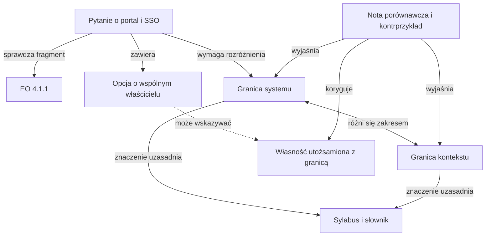

# IREB CPRE Foundation Level — podstawy skutecznej nauki i architektura treści edukacyjnych

**Stan źródeł: 1 listopada 2026 r. · Język nauki: polski · Etap: badanie pedagogiczne i dziedzinowe.**

Raport określa sposób przygotowania do CPRE Foundation Level, model treści i oceny wiedzy oraz badania potrzebne przed projektowaniem produktu. Obejmuje D1–D15 z briefu. Nie stanowi specyfikacji aplikacji. Osobny dokument „00_IREB_CPRE_Fundament_pedagogiczny.md” zawiera samodzielny handoff do kolejnej fazy.

**Główna rekomendacja:** organizować naukę wokół sprawdzalnych celów, krótkiego budowania zrozumienia, samodzielnego odtwarzania, celowanej korekty oraz ponownego wykonania po przerwie i w nowym kontekście. Powiązania wiedzy mają wyjaśniać rozstrzygające różnice i kierować do brakującego elementu. Dodatkowa korzyść wizualnej eksploracji grafu wymaga osobnego sprawdzenia.

## Mapa raportu

| Część | Zawartość |
|---|---|
| D1–D2 | Synteza decyzji; wersje, punktacja, 70 EO i 33 podtematy |
| D3–D5 | Dowody mechanizmów, benchmark 11 systemów, porównanie A–H i pętla nauki |
| D6–D8 | Powiązania wiedzy, bank pytań, diagnostyka, retencja i gotowość |
| D9–D10 | Dziesięć scenariuszy edukacyjnych i siedem specyfikacji semantycznych |
| D11–D12 | Pozyskanie i jakość treści; korpus pilotażowy i pełny przykład |
| D13–D14 | Eksperymenty, rejestr decyzji i zabezpieczenia przed błędami |
| D15 | Samodzielny brief kanoniczny do następnej fazy |
| Rejestr źródeł | Oficjalne dokumenty; literatura; produkty; typy badań i ograniczenia dostępu |

## Jak czytać dowody i zakres raportu

To ustrukturyzowany, krytyczny przegląd integracyjny, a nie zarejestrowany przegląd systematyczny całej literatury. Punktem wyjścia były oficjalne dokumenty IREB, wskazane w briefie publikacje, nowsze syntezy oraz wyszukiwanie badań przeczących prostym interpretacjom. Preferowano metaanalizy, kontrolowane badania i dokumentację producentów do ustalenia mechaniki ich produktów. Literatura medyczna została wykorzystana jako częściowo zbliżony kontekst dorosłych i egzaminów zawodowych, nie jako bezpośredni dowód skuteczności w CPRE. Nie przeprowadzono nowego badania z kandydatami CPRE.

Status twierdzeń:

- **FACT:** zweryfikowana reguła egzaminacyjna, treść oficjalnego dokumentu lub obserwowana właściwość źródła.
- **RESEARCH FINDING:** wynik konkretnego badania; jego zakres ograniczają populacja, porównanie i pomiar.
- **INTERPRETATION:** przeniesienie wyniku na zadania RE i przygotowanie dorosłego kandydata.
- **DESIGN HYPOTHESIS:** proponowany mechanizm edukacyjny albo próg, który wymaga lokalnego testu.
- **RECOMMENDATION:** decyzja wynikająca z połączenia dowodów, kosztu i ryzyka.

Siłę dowodów oceniamy osobno od pewności rekomendacji: silny ogólny efekt spacing nie oznacza silnego dowodu dla określonego harmonogramu CPRE. „ADOPT” oznacza przyjęcie zasady; nie oznacza, że każda jej realizacja będzie skuteczna. „TEST” oznacza najpierw porównanie; „DEFER” — odłożenie do spełnienia warunków; „REJECT” — odrzucenie konkretnego założenia.

Pozyskano pełne publiczne PDF sylabusa EN i PL 3.3.0, regulaminu 5.6.2 oraz słowników EN i PL 2.2.0. Odczyt całego sylabusa EN uzupełniono kontrolą celów, wersji i terminologii PL oraz właściwych haseł słowników; nie wykonano pełnego audytu równoważności każdego zdania EN/PL. Handbook i wnętrze Cockpit pozostają za logowaniem: w raporcie użyto ich publicznych metadanych i opisu funkcji. Bibliografia rozróżnia pełny tekst od abstraktu. Daty „2024, online 2023” odnoszą się do roku tomu i wcześniejszej publikacji elektronicznej. Przegląd kończy się 1 listopada, nie obejmuje przyszłych publikacji z pozostałej części miesiąca.

## D1 — Synteza badawcza i najważniejsze decyzje

### Co wyróżnia przygotowanie do CPRE

**FACT.** Egzamin sprawdza wiedzę z określonego korpusu, lecz nie ogranicza się do definicji. Sylabus obejmuje poziomy L1–L3; pytania mogą łączyć rozdziały. Do zakresu należą także wyróżnione podstawowe terminy słownika. Pytania A, P i K wymagają odmiennej logiki odpowiedzi, a wynik jest sumą punktów o różnych wagach. Wierne przygotowanie wymaga więc zarówno poprawnej terminologii, jak i rozróżniania sytuacji oraz opanowania zasad odpowiedzi. Źródła: [I1](https://hub.ireb.org/media/pages/resources/cpre-foundation-level-syllabus/9c084b1cfd-1787039954/cpre_foundationlevel_syllabus_en_v.3.3.0.pdf), [I3](https://hub.ireb.org/media/pages/resources/cpre-glossary/bb302c52fe-1787039949/ireb_cpre_glossary_en_2.2.pdf), [I5](https://hub.ireb.org/media/pages/resources/cpre-foundation-level-and-agile-primer-examination-regulations/a7858da873-1787039946/cpre_fl_and_primer_examination_regulations_en_v5.6.2.pdf).

**INTERPRETATION.** Doświadczenie analityka jest zasobem, ale nie zwalnia z kalibracji pojęć. W organizacji „walidacja”, „wymaganie niefunkcjonalne” czy „zakres” mogą mieć inne granice znaczeniowe. Efektywna ścieżka dla praktyka powinna wyszukiwać takie różnice, zamiast zakładać brak wiedzy albo pełne opanowanie podstaw.

### Co z początkowej hipotezy się utrzymuje

| Hipoteza | Ocena | Konsekwencja |
|---|---|---|
| Materiał, pytania, wyjaśnienia i powtórki powinny działać razem | Wspierają ją dowody dotyczące poszczególnych mechanizmów; cały pakiet CPRE pozostaje syntezą | ADOPT połączenie, TEST proporcje i czas |
| Po pytaniu należy wyjaśnić klucz i sens pozostałych opcji | Uzasadnione dla korekty i niepełnego rozumienia; pełna długość po każdej próbie nie jest uzasadniona | Przygotować pełny pakiet wyjaśnień, kierować uwagę na rozstrzygnięcie |
| Jedno pytanie może dotyczyć kilku pojęć i EO | Zgodne z sylabusem; nie oznacza niezależnego pomiaru każdego z nich | Oznaczać cel główny, pomocniczy oraz pojęcia jedynie kontekstowe |
| Każdy dystraktor powinien odpowiadać osobnemu pojęciu | Nieuzasadnione | REJECT; może błędnie stosować to samo pojęcie |
| Graf podobny do Obsidian powinien być główną ścieżką | Brak odpowiedniego dowodu | DEFER; najpierw powiązania kierowane zadaniem |
| Bardzo duża baza pytań jest warunkiem skuteczności | Liczba nie zapewnia pokrycia, poprawności ani transferu | Budować według macierzy pokrycia i rodzin rozumowania |
| Adaptacja musi być zaawansowana | Nie wykazano dla tego korpusu | Najpierw jawne reguły i porównanie z dobrym planem stałym |
| Poprawa wyniku na znanych pytaniach oznacza gotowość | Miesza naukę z pamięcią itemu | REJECT; wymagane nowe i odroczone próby |

Badania testowania i spacing są najbardziej przekonującą podstawą rdzenia. Metaanaliza Yang i in. (2021) wspiera quizzing w edukacji, a przegląd Trumble i in. (2024) wskazuje zbieżne korzyści w kształceniu zawodów medycznych. Nie można przeliczyć tych wyników na wzrost zdawalności CPRE. Metaanaliza Ruitenburg i in. opublikowana 29.10.2026 potwierdza dodatnie średnie efekty trzech strategii w szkołach, jednocześnie pokazując znaczenie rodzaju zadania i warunków. Źródła: [L03](https://doi.org/10.1037/bul0000309), [L05](https://doi.org/10.1007/s10648-026-10225-5), [L06](https://doi.org/10.1007/s10459-023-10274-3).

### Rekomendowana metodyka

Podstawą jest **nauka kierowana celami, z budową zrozumienia i successive relearning**: uczący się wraca do tego samego rozróżnienia lub umiejętności w oddzielnych sesjach, ponownie wykonując zadanie samodzielnie. Pytania pełnią funkcję narzędzia uczenia i oceny, ale próby służące ocenie gotowości pozostają odseparowane od treningu. Nowicjusz częściej zaczyna od krótkiego przykładu; praktyk może zacząć od próby diagnostycznej. Obie ścieżki muszą doprowadzić do pokrycia zakresu i dowodów wykonania na odpowiednim poziomie. [L01](https://doi.org/10.1177/1529100612453266), [L11](https://doi.org/10.1007/s10648-019-09465-5), [L13](https://doi.org/10.1037/bul0000151), [L16](https://doi.org/10.1177/09637214221100484).

Minimalna pętla to: **ustal cel i potrzebne wsparcie → zbuduj rozumienie → odpowiedz bez pomocy → otrzymaj korektę → sprawdź na innym przypadku → wróć po przerwie**. Porównanie pojęć i wyjaśnienie prerequisite są działaniami wewnątrz tej pętli, gdy rozwiązują konkretny problem. Nie wymagamy dziewięciu obowiązkowych etapów po każdym pytaniu.

Największa niepewność dotyczy nie zasad retrieval i spacing, lecz ich praktycznej kompozycji: liczby prób, kosztu wyjaśnień, początku ścieżki, wartości mapy i trafności diagnozy. Pierwszy korpus powinien służyć rozstrzygnięciu tych kwestii. **Nie powinien jeszcze wydawać werdyktu o gotowości do całego egzaminu.**

### Istniejący punkt odniesienia

Oficjalny IREB Cockpit deklaruje tryb nauki z objaśnieniem opcji i powiązaniem z EO oraz sylabusem/Handbookiem, a także symulację bez podpowiedzi. Jest więc bezpośrednim punktem odniesienia dla pomysłu „pytanie → wyjaśnienie → materiał”. Nie sprawdzono działania po zalogowaniu, jakości banku ani jego własności psychometrycznych. Potencjalny wkład projektu to dobrze zweryfikowane polskie wyjaśnienia, kontrasty pojęciowe, retencja i dowody transferu; jego dodatkową wartość należy wykazać. [I7](https://cpre.ireb.org/en/training-certification/online-self-assesment).

## D2 — Egzamin i blueprint treści

### D2.1 Wersje i dostępność

| Dokument | Ustalona wersja i data | Polski i dostęp | Rola oraz ograniczenie |
|---|---|---|---|
| Syllabus Foundation Level | 3.3.0, 1.04.2026 | PL 3.3.0 publiczny; plik ma skrót „v.3.3” w nazwie, okładka potwierdza 3.3.0 | Granice programu, EO i poziomy; pełny odczyt EN, kontrola celów i terminologii PL |
| Examination Regulations FL i RE@Agile Primer | 5.6.2, 5.02.2024 | Publiczny EN i DE; aktualnego PL w katalogu nie ma | Normatywne formaty i punktacja |
| Glossary | 2.2.0, 1.10.2025 | PL 2.2.0: polskie terminy, angielskie definicje | Kontrolowane znaczenie; oznaczenia foundational L1 |
| Handbook Foundation Level | EN 1.3.2 według katalogu | Konto Cockpit; katalog: EN, DE, FR, PT, bez PL | Treść nieodczytana; data rewizji wnętrza i dokładna zgodność z 3.3.0 do sprawdzenia po uzyskaniu pliku |
| Cockpit Online Self-Assessment | Publiczna strona nie podaje wersji banku | Logowanie; deklarowane języki sylabusa | Opis treningu i symulacji, nie audyt rzeczywistych sesji |

Źródła: [I1](https://hub.ireb.org/media/pages/resources/cpre-foundation-level-syllabus/9c084b1cfd-1787039954/cpre_foundationlevel_syllabus_en_v.3.3.0.pdf)–[I7](https://cpre.ireb.org/en/training-certification/online-self-assesment). Różne numery wersji nie dowodzą niezgodności: dokumenty mają niezależne cykle zmian. Daty na okładkach są datami wersji, nie datami przesłania plików na nowy serwer. Strony informacyjne mogą pozostawać mniej aktualne niż centralny katalog.

**Rezerwacja w Polsce.** Publiczny formularz SJSI dla terminów w listopadzie 2026 oznacza CPRE FL jako 3.0/3.1 w PL i EN. Taka etykieta nie rozstrzyga, jaki szczegółowy zestaw i aktualizacja terminologii zostaną użyte. Bazą tworzenia nowych treści jest aktualne 3.3.0; przed użyciem ich jako przygotowania do konkretnej rezerwacji trzeba potwierdzić u certyfikatora wersję, język, czas i zasady dotyczące słownika. Nie należy samodzielnie wnioskować o okresie przejściowym z historycznych zasad 2.x → 3.0. [I10](https://exam-rejestracja.sjsi.org/registration/session-selection).

### D2.2 Potwierdzone reguły

**FACT, regulamin 5.6.2, §1.1–1.3 i §2, s. 2–6.** Foundation Level ma około 45 pytań, 75 minut, próg 70,00% dostępnych punktów; pojedyncze pytanie ma 1–3 punkty. Brak formalnych warunków wstępnych. Dla języka innego niż ojczysty można wnioskować o 90 minut; nie jest to automatyczny dodatek. Pomoc naukowa jest niedozwolona, z wyjątkiem słowników językowych według regulaminu i warunków organizacyjnych. [I5](https://hub.ireb.org/media/pages/resources/cpre-foundation-level-and-agile-primer-examination-regulations/a7858da873-1787039946/cpre_fl_and_primer_examination_regulations_en_v5.6.2.pdf).

Brak formalnych warunków nie oznacza braku potrzebnej orientacji: preambuła sylabusa oczekuje podstawowej wiedzy o wytwarzaniu systemów w podejściach plan-driven i agile. Całkowitemu nowicjuszowi należy zapewnić krótkie wprowadzenie objaśniające, bez tworzenia dodatkowej bariery certyfikacyjnej. Samodzielne przygotowanie jest dopuszczalne; oficjalnie zalecane szkolenie nie jest wymogiem przystąpienia. [I1](https://hub.ireb.org/media/pages/resources/cpre-foundation-level-syllabus/9c084b1cfd-1787039954/cpre_foundationlevel_syllabus_en_v.3.3.0.pdf), [I8](https://cpre.ireb.org/en/concept/foundationlevel).

| Format | Zadanie | Zasada wyniku przy maksymalnej wadze w |
|---|---|---|
| A — Single Choice | Jedna właściwa odpowiedź spośród 4–5 | Jedna trafna: w; błędna albo więcej niż jedna: 0 |
| P — Multiple Choice | Wybrać wskazane k odpowiedzi; k ≥ 2 | Jeśli wybrano najwyżej k: w/k za każdą trafnie zaznaczoną. Błędna: 0 za tę opcję. Więcej niż k: 0 za całe pytanie |
| K — zestaw stwierdzeń | Ocenić każde z m stwierdzeń, np. prawda/fałsz | w/m za każdą trafną ocenę; błędna, podwójna albo pusta: 0 za to stwierdzenie |

Nie ma odejmowania punktów za błędne odpowiedzi, lecz przekroczenie liczby wyborów w A/P zeruje pytanie. W P można zaznaczyć mniej niż wymagane k. Niezaznaczony dystraktor w P nie daje dodatkowego punktu. K ocenia każdą decyzję oddzielnie. [I5](https://hub.ireb.org/media/pages/resources/cpre-foundation-level-and-agile-primer-examination-regulations/a7858da873-1787039946/cpre_fl_and_primer_examination_regulations_en_v5.6.2.pdf), §2.

**Obliczenia własne ilustrujące te reguły:** w pytaniu P za 3 punkty, z trzema poprawnymi opcjami, wybranie dwóch poprawnych i jednej błędnej daje 2 punkty. Zaznaczenie czwartej opcji zeruje całe pytanie. W K za 2 punkty i cztery stwierdzenia trzy prawidłowe decyzje dają 1,5 punktu. Wyniku egzaminu nie oblicza się jako odsetka pytań w całości poprawnych; należy sumować uzyskane punkty i podzielić przez sumę punktów maksymalnych.

Praktyczna konsekwencja: feedback może analizować wszystkie opcje i przyczyny, ale nie wolno zastępować oficjalnego wyniku własnym „wszystko albo nic”. Dla nauki można równolegle odnotować pełną poprawność rozumowania, jednak jest to inna miara.

### D2.3 Co wiadomo o reprezentatywności

**Potwierdzone:** regulamin dopuszcza negatywne sformułowania A/P, a w P opisuje wybór odpowiedzi najlepiej pasujących do sytuacji. Sylabus dopuszcza jedno pytanie obejmujące wiele rozdziałów. To uzasadnia ćwiczenie warunków, negacji i selekcji odpowiedniej praktyki. Nie uzasadnia tworzenia językowych zagadek.

**Nieustalone publicznie:** aktualne operacyjne udziały A/P/K, wagi poszczególnych EO, docelowy rozkład trudności, parametry itemów, równoważność wszystkich języków i przewidywalność wyniku Cockpit. Czas szkoleniowy i liczba EO nie są ujawnioną tabelą wag egzaminu. Także liczba punktów w historycznym publicznym zestawie nie jest stałą dla wszystkich egzaminów.

**Rozsądne przybliżenie do treningu:** około 45 pytań, 75 minut, jawne wagi 1–3 i punktacja A/P/K, zadania ze wszystkich EU, sensowny udział scenariuszy, interpretacji prostych modeli i kontrastów. Udział formatów ustala autor zestawu i opisuje go jako własny wybór, dopóki nie ma oficjalnego blueprintu. Kalibracja trudności na własnych uczestnikach nie dowodzi równoważności z poufną pulą.

### D2.4 Mapa siedmiu jednostek

Poniższe nazwy EU są nazwami z polskiej wersji sylabusa. Liczby EO i L1/L2/L3 to **wyliczenie własne** z jawnych wykazów celów. Łącznie: **70 EO = 36 L1 + 27 L2 + 7 L3**. Zalecane czasy szkoleniowe sumują się do 17 h 45 min; nie są normą czasu samodzielnej nauki.

| Poziom | Wymagane działanie | Znaczenie dla nauki i oceny |
|---|---|---|
| **L1 — Know** | Zapamiętanie, odtworzenie lub rozpoznanie wskazanej wiedzy | Poprawna nazwa, kategoria lub reguła; nie należy dokładać wymogu zaawansowanego zastosowania |
| **L2 — Understand** | Rozumienie i wyjaśnienie znaczenia oraz związków | Porównanie, klasyfikacja, uzasadnienie odpowiedniej praktyki w zakresie danego EO |
| **L3 — Apply** | Zastosowanie w określonej, zwykle prostej sytuacji | Np. użycie szablonu, wyznaczenie granicy lub utworzenie prostego modelu |

Wyższy poziom obejmuje niższe. Poziomy pochodzą z sylabusa; przykłady działań są ich operacjonalizacją na potrzeby uczenia. Forma zamknięta pytania sama nie czyni go L1. Podczas nauki krótkie samodzielne wytworzenie artefaktu może pomóc sprawdzić L3, mimo że egzamin wykorzystuje formaty A/P/K. Nie oznacza to, że kandydat na egzaminie oddaje własny diagram lub esej. [I1](https://hub.ireb.org/media/pages/resources/cpre-foundation-level-syllabus/9c084b1cfd-1787039954/cpre_foundationlevel_syllabus_en_v.3.3.0.pdf), s. 4–5 i odpowiednie EO.

| EU | Oficjalna nazwa PL | Czas | EO: L1/L2/L3 | Główne zadanie edukacyjne i typowe pomylenia |
|---|---|---:|---:|---|
| 1 | Wprowadzenie i przegląd inżynierii wymagań | 60 min | 6/2/0 | Pojęcia podstawowe, rodzaje wymagań, rola RE; jakość vs ograniczenie, rola vs stanowisko |
| 2 | Podstawowe zasady inżynierii wymagań | 90 min | 2/1/0 | Dziewięć zasad i ich konsekwencje; kontekst vs system, problem vs wymaganie vs rozwiązanie |
| 3 | Artefakty i praktyki dokumentowania | 420 min | 12/8/4 | Dobór reprezentacji i praca z prostym modelem; przypadek użycia vs diagram, abstrakcja vs szczegółowość, jakość jednego wymagania vs zbioru |
| 4 | Praktyki w zakresie opracowywania wymagań | 270 min | 3/8/2 | Źródła, pozyskiwanie, konflikt, walidacja; użytkownik vs interesariusz, zebranie vs wymyślenie, znalezienie defektu vs jego korekta |
| 5 | Proces i struktura pracy | 75 min | 2/3/1 | Dopasowanie procesu do warunków; iteracyjność vs eksploracyjność, reguła kontekstowa vs uniwersalna |
| 6 | Praktyki w zakresie zarządzania wymaganiami | 120 min | 10/4/0 | Cykl życia, wersje, konfiguracje, atrybuty, śledzenie, zmiana i priorytety; status vs wersja, konfiguracja vs baseline |
| 7 | Narzędzia wspierające | 30 min | 1/1/0 | Dobór i wprowadzanie narzędzi; możliwości narzędzia vs uporządkowany proces |

Źródła mapowania: [I1](https://hub.ireb.org/media/pages/resources/cpre-foundation-level-syllabus/9c084b1cfd-1787039954/cpre_foundationlevel_syllabus_en_v.3.3.0.pdf), s. 11, 14, 19, 31, 36, 41, 45; [I2](https://hub.ireb.org/media/pages/resources/cpre-foundation-level-syllabus/68b8837862-1787039957/cpre_foundationlevel_syllabus_pl_v.3.3.pdf), odpowiednie rozdziały. Poziomy należy brać z poszczególnych EO. Nagłówek podrozdziału lub maksymalny poziom całego EU nie określa poziomu każdego zadania.

### D2.5 Pełny indeks EO i proponowanych dowodów nauki

Poniższy indeks nie zastępuje oficjalnego brzmienia celów. Łączy identyfikatory i poziomy z krótką autorską propozycją sprawdzenia wiedzy. Kolumna „dowód” jest **INTERPRETATION**: nie stanowi przepisu na oficjalne pytanie. Odnośniki stron dotyczą wersji EN 3.3.0. Oznaczenie EO jest zachowane także w polskiej wersji dokumentu.

| EO | L | Proponowany dowód i zakres tematyczny |
|---|---|---|
| 1.1.1 | 1 | Rozpoznać znaczenie podstawowego terminu w krótkim opisie |
| 1.1.2 | 2 | Uzasadnić klasyfikację wymagania: funkcja, jakość, ograniczenie |
| 1.2.1 | 2 | Powiązać działanie RE z ograniczanym ryzykiem lub korzyścią |
| 1.2.2 | 1 | Wskazać symptomy niedostatecznego RE |
| 1.3.1 | 1 | Rozpoznać miejsce i przedmiot występowania wymagań |
| 1.4.1 | 1 | Wymienić zadania RE oraz potrzebę dopasowania procesu |
| 1.5.1 | 1 | Rozpoznać odpowiedzialności osoby pełniącej rolę RE |
| 1.6.1 | 1 | Określić obszary kompetencji potrzebnych w RE |
| 2.1.1 | 1 | Odtworzyć nazwy zasad, bez utożsamiania ich z technikami |
| 2.2.1 | 1 | Rozpoznać terminy potrzebne do wyjaśnienia zasad |
| 2.2.2 | 2 | Wyjaśnić konsekwencję konkretnej zasady w sytuacji projektowej |
| 3.1.1 | 1 | Rozpoznać artefakt i jego właściwości |
| 3.1.2 | 1 | Dopasować artefakt do celu i przewidywanej trwałości |
| 3.1.3 | 2 | Odróżnić zmianę abstrakcji od zwiększenia szczegółowości |
| 3.1.4 | 1 | Rozpoznać aspekt wymagań i jego powiązania z innymi |
| 3.1.5 | 1 | Wskazać zasadę dokumentowania naruszoną w przykładzie |
| 3.1.6 | 1 | Wskazać korzyść z wcześniejszego planu artefaktów |
| 3.2.1 | 1 | Rozpoznać zaletę i ograniczenie języka naturalnego |
| 3.2.2 | 2 | Wyjaśnić niejednoznaczność albo brak warunku w zdaniu |
| 3.3.1 | 1 | Odróżnić kategorie szablonów i ich ograniczenia |
| 3.3.2 | 3 | Samodzielnie zapisać wymaganie i user story przy użyciu szablonu |
| 3.3.3 | 3 | Uzupełnić prosty przypadek użycia w formularzu |
| 3.4.1 | 2 | Wyjaśnić, co model uwidacznia, a od czego abstrahuje |
| 3.4.2 | 2 | Uzasadnić zaletę i ograniczenie modelowania |
| 3.4.3 | 1 | Rozpoznawać wymagane nazwy modeli i notacji |
| 3.4.4 | 2 | Uzasadnić dobór typu modelu do pytania o system |
| 3.4.5 | 2 | Poprawnie odczytać prosty model każdego wskazanego typu |
| 3.4.6 | 3 | Zbudować prosty diagram klas dla danych lub domeny |
| 3.4.7 | 3 | Zbudować prosty diagram aktywności dla funkcji lub procesu |
| 3.5.1 | 2 | Wyjaśnić sposób opracowania słownika i jego znaczenie |
| 3.6.1 | 1 | Rozpoznać rodzaje dokumentów wymagań |
| 3.6.2 | 2 | Uzasadnić strukturę dokumentacji w danym kontekście |
| 3.7.1 | 1 | Dopasować typ prototypu do jego przeznaczenia |
| 3.8.1 | 1 | Rozpoznać kryteria jakości pojedynczego wymagania |
| 3.8.2 | 1 | Rozpoznać kryteria odnoszące się do wieloelementowego artefaktu |
| 4.1.1 | 3 | Wyznaczyć granice na podstawie opisu systemu i otoczenia |
| 4.1.2 | 1 | Rozpoznać rodzaje źródeł wymagań |
| 4.1.3 | 3 | Zidentyfikować interesariuszy i przygotować ich listę |
| 4.1.4 | 2 | Wyjaśnić pożytek z zarządzania relacjami z interesariuszami |
| 4.2.1 | 2 | Wyjaśnić, co model Kano zmienia w pozyskiwaniu wymagań |
| 4.2.2 | 2 | Odróżnić wydobywanie istniejącej wiedzy od generowania pomysłów |
| 4.2.3 | 2 | Dobrać technikę pozyskiwania do warunków i ograniczeń |
| 4.3.1 | 1 | Rozpoznać rodzaj konfliktu |
| 4.3.2 | 2 | Wyjaśnić działania potrzebne do rozwiązania konfliktu |
| 4.3.3 | 2 | Uzasadnić adekwatność techniki rozwiązania sporu |
| 4.4.1 | 2 | Wyjaśnić potrzebę walidacji wymagań i dokumentów |
| 4.4.2 | 1 | Rozpoznać cztery aspekty prowadzenia walidacji |
| 4.4.3 | 2 | Uzasadnić dobór techniki walidacji |
| 5.1.1 | 1 | Wymienić czynniki wpływające na proces RE |
| 5.1.2 | 2 | Wyjaśnić wpływ zmiany warunków na proces |
| 5.2.1 | 2 | Rozróżnić wymiary konfiguracji procesu |
| 5.3.1 | 1 | Rozpoznać typowe konfiguracje RE |
| 5.3.2 | 2 | Wyjaśnić kolejność czynności konfigurowania procesu |
| 5.3.3 | 3 | Dobrać i zastosować konfigurację w prostym scenariuszu |
| 6.1.1 | 1 | Rozpoznać cel zarządzania istniejącymi wymaganiami |
| 6.2.1 | 2 | Wyjaśnić potrzebę statusów i dozwolonych przejść |
| 6.3.1 | 2 | Uzasadnić zasady wersjonowania w projekcie |
| 6.4.1 | 1 | Odróżnić użycie konfiguracji i baseline |
| 6.5.1 | 1 | Rozpoznać cel atrybutów wymagań |
| 6.5.2 | 2 | Uzasadnić zestaw atrybutów dla danej sytuacji |
| 6.5.3 | 2 | Wyjaśnić cel i rodzaj widoku wymagań |
| 6.6.1 | 1 | Wskazać powód utrzymywania śledzenia |
| 6.6.2 | 1 | Odróżnić śledzenie jawne od niejawnego |
| 6.6.3 | 1 | Rozpoznać sposób dokumentowania śledzenia jawnego |
| 6.7.1 | 1 | Rozpoznać postępowanie ze zmianą w podejściu liniowym i zwinnym |
| 6.8.1 | 1 | Rozpoznać cel i kryterium priorytetyzacji |
| 6.8.2 | 1 | Odtworzyć kroki priorytetyzacji |
| 6.8.3 | 1 | Odróżnić kategorie technik priorytetyzacji |
| 7.1.1 | 1 | Dopasować kategorię wsparcia narzędziowego do zadania |
| 7.2.1 | 2 | Wyjaśnić warunki sensownego wprowadzenia narzędzia |

Jedna pozycja indeksu nie musi oznaczać jednego celu operacyjnego. EO 2.2.2 obejmuje dziewięć zasad, a EO 3.4.5 wiele typów modeli. Autor treści dzieli takie cele na sprawdzalne składowe, zachowując nadrzędny EO. Dopiero pokrycie wszystkich wymaganych składowych może wspierać ocenę całego EO. To jest podstawa szacowania banku, a nie arbitralny iloczyn liczby celów i liczby fiszek.

### D2.6 Granica między egzaminem, wyjaśnieniem i ekspertyzą

Każda treść otrzymuje jeden z trzech statusów pedagogicznych:

1. **Wymagane:** bezpośrednio uzasadnione przez EO, jego treść lub podstawowy termin słownika; oceniane na określonym poziomie.
2. **Objaśniające:** własny przykład, porównanie lub prerequisite potrzebny do zrozumienia zakresu; nie rozszerza samodzielnie wymagań egzaminu.
3. **Rozszerzające:** przydatne zawodowo, lecz niepotrzebne do osiągnięcia obecnego EO; nie podnosi ciężaru oceny gotowości.

Przykład: tworzenie prostego UML class diagram i activity diagram jest objęte L3. Znajomość nazwy sequence diagram pozostaje w EO 3.4.3, choć w historii 3.3.0 usunięto „interaction model” z celów. Nie wolno z tej zmiany wywnioskować usunięcia całej terminologii sekwencji ani wymagać tworzenia rozbudowanych diagramów sekwencji. BPMN, SysML i zaawansowane elementy UML nie mogą niejawnie stać się kursem modelowania wykraczającym poza FL. [I1](https://hub.ireb.org/media/pages/resources/cpre-foundation-level-syllabus/9c084b1cfd-1787039954/cpre_foundationlevel_syllabus_en_v.3.3.0.pdf) (§3.4 i historia wersji).

Utrzymanie granicy wymaga odpowiedzi na pytania: „który EO lub termin podstawowy wymaga tej wiedzy?”, „na jakim poziomie?”, „czy można poprawnie wykonać zadanie bez tego dodatku?”. Jeśli materiał nie ma uzasadnienia egzaminacyjnego, może pozostać opcjonalnym wyjaśnieniem, ale nie tworzy dodatkowej bramki postępu. Checklisty jakości z EU 3.8 są rekomendowane, niewyczerpujące; nie należy uczyć, że dowolny dodatkowy sensowny atrybut jakości jest z definicji błędem.

### D2.7 Kolejność nauki i ważne zależności

Sylabus dopuszcza inną kolejność nauczania. Proponujemy najpierw wspólny język i rodzaje wymagań, następnie kontekst i interesariuszy, potem krótkie przejście przez źródło → zapis → sprawdzenie → zmianę wymagania. W jego ramach rozwija się EU 3 i 4, później konfigurację procesu i zarządzanie, a narzędzia rozpatruje się jako wsparcie poznanych zadań. Zasady EU 2 wracają w przykładach przez całą naukę.

Przykładowe zależności **pedagogiczne, do sprawdzenia**, to: pojęcie wymagania przed klasyfikacją; system i kontekst przed wyznaczaniem granicy; cel reprezentacji przed doborem modelu; podstawy klas i relacji przed diagramem klas; kryteria jakości przed wyborem walidacji; wersja artefaktu przed konfiguracją i baseline. Zależność nie oznacza konieczności ukończenia całego EU przed przejściem dalej. Dane z krótkiej próby mogą pokazać, że praktyk zna prerequisite. Tę elastyczność uzasadniają zasady scaffolding i różnice wiedzy początkowej, nie domniemana przewaga sztywnego grafu zależności. [L11](https://doi.org/10.1007/s10648-019-09465-5), [G8](https://doi.org/10.1016/j.learninstruc.2009.02.005).

### D2.8 Terminologia polska i aktualizacja

Źródłem etykiet PL jest oficjalny polski sylabus i słownik. Źródłem znaczenia definicyjnego słownika jest tekst EN; polskie objaśnienie autora nie powinno być oznaczone jako oficjalne tłumaczenie definicji. Zachowujemy parę PL–EN, dopuszczalne synonimy, różnice zakresu i wersję źródła. Gdy nazwa zawodowa jest szersza, trzeba nazwać różnicę zamiast automatycznie zastąpić termin IREB.

Przy aktualizacji porównujemy znaczenie i zakres EO, nie tylko numer pliku. Historia 3.1 zawiera zmiany celów i porządkowania modeli, 3.1.1/3.2 dotyczyły głównie formy, a 3.3 zawiera zmiany merytoryczne. Każda zmiana uruchamia przegląd zależnych kluczy, wyjaśnień i relacji. Nie przepisujemy kursu od zera, ale nie pozostawiamy starej odpowiedzi tylko dlatego, że nadal brzmi wiarygodnie. [I1](https://hub.ireb.org/media/pages/resources/cpre-foundation-level-syllabus/9c084b1cfd-1787039954/cpre_foundationlevel_syllabus_en_v.3.3.0.pdf) (s. 6–7), [I3](https://hub.ireb.org/media/pages/resources/cpre-glossary/bb302c52fe-1787039949/ireb_cpre_glossary_en_2.2.pdf) (historia wersji).

### Zmiany istotne dla migracji starszych materiałów

| Wersja i data | Co zmieniono według historii dokumentu | Konsekwencja dla tego projektu |
|---|---|---|
| 3.0.0 — 1.10.2020 | Duża przebudowa obejmująca podejścia plan-driven i agile | Materiały 2.x wymagają pełnego ponownego mapowania, a nie zmiany numeru wersji |
| 3.1.0 — 1.09.2022 | Zmiany identyfikatorów i brzmienia kilku EO; doprecyzowanie abstrakcji, interesariuszy i generowania pomysłów; zebranie modeli niewymagających stosowania w §3.4.6 | Starsze przypisania EO, poziomów i zakresu modeli wymagają przeglądu |
| 3.1.1 — 1.01.2024 | Zmiana identyfikacji wizualnej dokumentu | Sama zmiana numeru nie uzasadnia przepisywania treści |
| 3.2.0 — 26.02.2024 | Korekty układu po zmianie identyfikacji | Nie należy zakładać nowego zakresu egzaminu na podstawie wyglądu PDF |
| 3.3.0 — 1.04.2026 | Usunięcie interaction model z EO3.4.3 i §3.4.6; zaznaczenie rekomendowanego, niewyczerpującego charakteru kryteriów jakości; aktualizacja odwołań i literatury | Sprawdzić mapowanie modeli i wyjaśnienia jakości; sequence diagram pozostaje nazwą L1, a listy jakości nie są zamkniętą taksonomią |

Podstawa: [I1](https://hub.ireb.org/media/pages/resources/cpre-foundation-level-syllabus/9c084b1cfd-1787039954/cpre_foundationlevel_syllabus_en_v.3.3.0.pdf), historia wersji, s. 6–7. Konsekwencje są autorskimi decyzjami redakcyjnymi. Historia dokumentu nie ustanawia sama daty przełączenia konkretnej rezerwacji egzaminu.

### D2.9 Inwentarz podtematów i rozróżnień

**Podstawa:** IREB CPRE Foundation Level Syllabus 3.3.0, 1.04.2026, EN §1–7, s. 11–46; nazwy PL sprawdzono w polskiej wersji. Opracowanie własne; prawa do dokumentu źródłowego należą do autorów i IREB e.V. Numery oznaczają podrozdziały, nie EO.

**FACT:** zakres streszcza syllabus. **INTERPRETATION:** prerequisites i rozróżnienia są propozycjami pedagogicznymi, nie oficjalnym grafem ani potwierdzonymi misconceptions. Poziom wyznacza konkretny EO, nie najwyższa etykieta podrozdziału. [I1](https://hub.ireb.org/media/pages/resources/cpre-foundation-level-syllabus/9c084b1cfd-1787039954/cpre_foundationlevel_syllabus_en_v.3.3.0.pdf), [I2](https://hub.ireb.org/media/pages/resources/cpre-foundation-level-syllabus/68b8837862-1787039957/cpre_foundationlevel_syllabus_pl_v.3.3.pdf).

| Podtemat | Najważniejsze terminy i zakres | Proponowany prerequisite oraz typowe rozróżnienie |
|---|---|---|
| **1.1 Inżynieria wymagań: Co** | Wymaganie, system, interesariusz, RE; wymagania funkcjonalne, jakościowe i ograniczenia. System obejmuje także usługi, procedury i elementy organizacyjne. | Punkt wejścia. Rodzaj wymagania a źródło; wymaganie jakościowe a narzucone rozwiązanie ograniczające przestrzeń projektową. |
| **1.2 Inżynieria wymagań: Dlaczego** | Wartość RE: zrozumienie problemu, ograniczenie ryzyka, podstawa szacowania i testowania. Symptomy: brak, niejasność lub niepoprawność wymagań; przyczyny komunikacyjne i kompetencyjne. | Po 1.1. Symptom wadliwych wymagań a przyczyna; wartość dokumentowania a ilość dokumentacji. |
| **1.3 Inżynieria wymagań: Gdzie** | Zastosowania RE; wymagania biznesowe, interesariuszy, użytkowników, domenowe i systemowe; systemy łączące oprogramowanie, elementy fizyczne i organizację. | Po 1.1. „Biznesowe/systemowe” określa perspektywę; „funkcjonalne/jakościowe” oznacza inny podział. |
| **1.4 Inżynieria wymagań: Jak** | Pozyskiwanie, dokumentowanie, walidacja, zarządzanie; analiza i rozwiązywanie konfliktów należą do pozyskiwania. Dobór procesu oraz wsparcie narzędziowe. | Po 1.1–1.2. Zadanie RE a sztywny etap liniowego procesu. |
| **1.5 Rola i zadania inżyniera wymagań** | Requirements Engineer jako rola: wykonywanie zadań RE, wiedza dziedzinowa RE i łączenie problemu z potencjalnymi rozwiązaniami. | Po 1.4. Rola a stanowisko; analityk, product owner lub programista może wykonywać tę rolę. |
| **1.6 Co warto wiedzieć o RE** | Mapa zakresu: zasady, dokumentacja, opracowanie wymagań, proces, zarządzanie i narzędzia. | Po 1.4. Orientacja w zakresie Foundation a wymóg opanowania całej zawodowej praktyki RE. |
| **2.1 Przegląd zasad** | Dziewięć zasad: orientacja na wartość; interesariusze; wspólne zrozumienie; kontekst; problem–wymaganie–rozwiązanie; walidacja; ewolucja; innowacje; systematyczna i zdyscyplinowana praca. | Po EU1. Rozpoznanie nazw zasad nie zastępuje wyjaśnienia ich konsekwencji w 2.2. |
| **2.2 Wyjaśnienie zasad** | Korzyść i koszt wymagania; potrzeby różnych ról; explicit/implicit shared understanding; system boundary, context boundary i scope; założenia kontekstu; zmienność, innowacja i dobór praktyk. | Po 2.1. Granica systemu a granica kontekstu; potrzeba a rozwiązanie; elastyczność a brak dyscypliny. |
| **3.1 Artefakty w RE** | Cel, reprezentacja, rozmiar, czas życia; artefakty tymczasowe, rozwijane i trwałe. Abstrakcja, szczegółowość, trzy aspekty funkcjonalności: struktura/dane, funkcja/przepływ, stan/zachowanie; kontekst. Dobór artefaktów, spójność, odsyłanie zamiast redundancji. | Po 1.1 i 2.2. Abstrakcja a szczegółowość; dokument a pojedyncze wymaganie; trwałość a niezmienność. |
| **3.2 Artefakty oparte na języku naturalnym** | Zalety ekspresji i dostępności; wieloznaczność, pominięcia, niespójność. Niepełne opisy, rzeczowniki, warunki i porównania; ostrożność ze stroną bierną, kwantyfikatorami i nominalizacjami. | Po 3.1; pomocny słownik. Poprawna gramatyka a jednoznaczne wymaganie; ostrożne użycie a bezwzględny zakaz. |
| **3.3 Artefakty oparte na szablonach** | Phrase, form i document templates; zalety struktury oraz ryzyko mechanicznego wypełniania. L3: wymaganie i user story z szablonu zdaniowego, use case z formularza. | Po 3.2. Szablon zdania a formularz; user story a use case; komplet pól a komplet potrzeb. |
| **3.4 Artefakty oparte na modelach** | Model, oryginał, język, notacja; kontekst, use cases, domena, klasy, aktywności, procesy, statecharts. L2: interpretacja wskazanych modeli; L3: proste diagramy klas i aktywności UML. Pozostałe modele i ograniczenia zakresu opisano pod tabelą. | Po 3.1 i zasadzie kontekstu. Struktura a przepływ; diagram aktywności a stanów; model a jego graficzna reprezentacja. |
| **3.5 Słowniki** | Terminy kontekstowe, specjalne znaczenia, skróty, akronimy, synonimy i homonimy; uzgadnianie, centralna odpowiedzialność, dostępność i utrzymanie słownika. | Po wspólnym zrozumieniu. Synonim a homonim; definicja uzgodniona z interesariuszami a indywidualny zwyczaj autora. |
| **3.6 Dokumenty wymagań i struktura dokumentacji** | Specyfikacje wymagań interesariuszy, użytkowników, systemu i biznesu; vision document; product backlog, sprint backlog, story map. Dobór struktury według procesu, domeny, kontraktu i rozmiaru. | Po 1.3 i 3.1. Specyfikacja użytkowników jako część zakresu interesariuszy; backlog a klasyczny dokument. |
| **3.7 Prototypy w RE** | Exploratory prototypes: wireframes, mock-ups, native prototypes o różnej fidelity, odrzucane po wykorzystaniu. Evolutionary prototypes rozwijane w system. Specyfikacja przez przykład i walidacja. | Po 2.2 i 3.1. Fidelity a cel prototypu; prototyp eksploracyjny a ewolucyjny. |
| **3.8 Kryteria jakości artefaktów i wymagań** | Pojedyncze: adekwatność, konieczność, jednoznaczność, kompletność, zrozumiałość, weryfikowalność. Zbiory dodatkowo: spójność, brak redundancji, kompletność zakresu, modyfikowalność, traceability, zgodność. Adekwatność i zrozumiałość są podstawowe. | Po 3.1–3.3. Kompletność zdania a zestawu; kryterium jakości wymagania a wymaganie jakościowe systemu. |
| **4.1 Źródła wymagań** | Interesariusze, dokumenty, systemy; granice systemu i kontekstu. Role i osoby, reprezentanci oraz persony; stakeholder list, dostępność, znaczenie, ekspertyza, cele; zarządzanie relacjami. | Po 2.2. Interesariusz a użytkownik; persona a realny reprezentant; identyfikacja źródeł jest powtarzana. |
| **4.2 Pozyskiwanie wymagań** | Kano: delighters, satisfiers, dissatisfiers. Gathering: questioning, collaboration, observation, artifact-based. Design/idea-generating: brainstorming, analogie, prototypy, scenariusze, storyboards; design thinking. Dobór kombinacji; jakość i ograniczenia. | Po 4.1. Subconscious a unconscious; kategoria Kano a rodzaj wymagania; pozyskiwanie istniejącej wiedzy a generowanie pomysłów. |
| **4.3 Rozwiązywanie konfliktów** | Konflikty: merytoryczne, danych, interesów, wartości, relacji, strukturalne. Identyfikacja, analiza, rozwiązanie i zapis decyzji. Agreement, compromise, voting, overruling, variants; pomocniczo consider-all-facts, plus-minus-interesting, macierz decyzji. | Po potrzebach interesariuszy. Rozpoznanie typu konfliktu a wybór techniki; kompromis a narzucenie decyzji. |
| **4.4 Walidacja wymagań** | Cztery aspekty: właściwi interesariusze, rozdzielenie wykrywania i korekty wad, różne perspektywy, powtarzanie. Reviews: walkthrough/inspection; eksploracja: prototyp, alpha/beta, A/B, MVP; sample development. | Po 2.2 i 3.8. Kryterium jakości a technika sprawdzania; wykrycie wady a uzgodnienie poprawki. |
| **5.1 Czynniki wpływające** | Proces rozwoju, kontekst, dostępność interesariuszy, wspólne zrozumienie, złożoność, krytyczność, ograniczenia, czas, budżet, zmienność i doświadczenie RE. | Po EU2 i EU4. Warunek doboru procesu a preferencja organizacyjna; niedostępny feedback ogranicza opcje. |
| **5.2 Aspekty procesu RE** | Trzy facets: czas — linear/iterative; cel — prescriptive/explorative; adresat — customer-specific/market-oriented. Kryteria wyboru i ograniczenia kombinacji są heurystykami. | Po 5.1. Iterative nie oznacza automatycznie explorative; linear nie eliminuje zmian. |
| **5.3 Konfigurowanie procesu RE** | Konfiguracje participatory, contractual i product-oriented. Kolejność pracy: czynniki, kryteria facets, konfiguracja, artefakty, praktyki. Dobór i zastosowanie w prostej sytuacji na L3. | Po 5.1–5.2 i EU3–4. Typowa konfiguracja a jedyna dopuszczalna; tailoring a kopiowanie poprzedniego projektu. |
| **6.1 Czym jest zarządzanie wymaganiami?** | Utrzymywanie istniejących wymagań w artefaktach: przechowywanie, zmiany i śledzenie powiązań, odpowiednio do procesu i potrzeb ról. | Po 3.1 i ewolucji. Pozyskanie nowej treści a utrzymanie już zapisanych wymagań. |
| **6.2 Zarządzanie cyklem życia** | Statusy artefaktu, dozwolone przejścia, aktualny stan i historia przejść. | Po 6.1. Status „uzgodnione” a numer wersji; każdy artefakt ma własny cykl życia. |
| **6.3 Kontrola wersji** | Jednoznaczny numer wersji, historia zmian i sposób przechowywania; odtwarzanie wcześniejszego stanu. Wersja i increment. | Po 3.1. Wersja artefaktu a status; wersjonowanie obejmuje także modele i pozostałe artefakty. |
| **6.4 Konfiguracje i baselines** | Spójny zestaw wersji przeznaczony do określonego celu, najwyżej jedna wersja każdego artefaktu. Baseline jest stabilną konfiguracją pod kontrolą zmian. | Po 6.3. Konfiguracja a pojedyncza wersja; baseline a dowolny zestaw dokumentów. |
| **6.5 Atrybuty i widoki** | Metadane dobrane do potrzeb informacyjnych; widoki selective, projective, aggregating i ich kombinacje. | Po 3.1 i 6.1. Treść wymagania a atrybut; wybór wymagań a wybór danych prezentowanych o nich. |
| **6.6 Śledzenie powiązań** | Pochodzenie, następne artefakty i zależne wymagania. Implicit/explicit traceability; identyfikatory, odsyłacze, macierze, tabele, grafy. | Po 3.1 i 6.3. Historia zmian a relacje między artefaktami; kierunek śledzenia a sposób dokumentacji. |
| **6.7 Obsługa zmiany** | Change request, backlog item; decyzja i kontrola zależne od procesu oraz momentu. CCB/CAB w podejściu liniowym, priorytetyzacja przez product ownera w iteracyjnym. | Po 5.2, 6.3–6.6. Możliwość zmiany a brak kontroli; zgłoszenie a zatwierdzenie. |
| **6.8 Priorytetyzacja** | Cele i ograniczenia, kryteria, interesariusze, zakres, technika, wykonanie. Business value, pilność, wysiłek, zależności; techniki ad hoc i analityczne. | Po 4.1 i 6.5. Ocena według kryteriów a wynikowy priorytet; ważność a sam koszt. |
| **7.1 Narzędzia w RE** | Wsparcie zarządzania wymaganiami i procesem, dokumentowania wiedzy, modelowania, współpracy, testowania/symulacji. Narzędzia mogą łączyć kategorie. | Po zadaniach EU3–6. Potrzeba procesu a funkcja narzędzia; jeden produkt nie musi wspierać całego RE. |
| **7.2 Wprowadzanie narzędzi** | Najpierw cele, kontekst, wymagania, odpowiedzialności i procedury; następnie kryteria oceny, koszty cyklu życia, zasoby, pilot i szkolenie. | Po 7.1 i 5.1. Koszt licencji a całkowity koszt; zakup narzędzia a uporządkowanie praktyk. |

**Doprecyzowanie modeli:** EO 3.4.5 obejmuje context, use case, domain, class, activity, process models i statecharts. Foundation stosuje UML activity diagrams do modelowania procesów; zaawansowane elementy data flow nie należą do wymaganego zakresu. Goal models, SysML block definition diagrams, domain story models i sequence diagrams pozostają rozpoznawane na poziomie podstawowym; tworzenia sequence diagrams nie należy dodawać do L3. Nazwa interaction model została usunięta w 3.3.0, lecz sequence diagram pozostał. [I1](https://hub.ireb.org/media/pages/resources/cpre-foundation-level-syllabus/9c084b1cfd-1787039954/cpre_foundationlevel_syllabus_en_v.3.3.0.pdf) (EO 3.4.3–3.4.7; §3.4.4–3.4.6).

**Zastosowanie:** wiersze rozwijać według EO i terminów słownika. Rozróżnienia wymagają recenzji i obserwacji uczniów. Szczegółowych technik niewymienionych w syllabusie nie przedstawiać jako obowiązkowych bez weryfikacji autorytatywnego materiału wspierającego.

## D3 — Macierz mechanizmów uczenia się opartych na dowodach

### D3.1 Jak interpretować siłę dowodów

**RESEARCH FINDING.** Aktywne wydobywanie wiedzy i rozkładanie nauki w czasie mają najszersze, powtarzalne wsparcie spośród rozpatrywanych technik. Przegląd Dunlosky’ego i współautorów wyróżnił obie jako szczególnie użyteczne; późniejsze syntezy potwierdziły korzyści, ale również zależność wyników od materiału, grupy porównawczej i sposobu sprawdzania wiedzy. Nie uzasadnia to zastosowania jednej identycznej procedury do każdego celu edukacyjnego. [Dunlosky i in., 2013](https://doi.org/10.1177/1529100612453266); [Yang i in., 2021](https://doi.org/10.1037/bul0000309).

Ocena **silne dowody** oznacza liczne kontrolowane porównania i zbieżne syntezy. **Umiarkowane dowody** oznaczają korzystny wynik przy wyraźnych moderatorach, węższym zakresie lub mniej licznych badaniach. **Ograniczone albo kontekstowe dowody** dotyczą określonej grupy, zadania lub mniej dojrzałego programu badań. **Hipoteza projektu** oznacza propozycję, której korzyści nie ustalono w przygotowaniu do CPRE. Ta klasyfikacja jest oceną metodologiczną niniejszego raportu, a nie formalną skalą publikacji źródłowych.

Należy odróżniać skuteczność mechanizmu od skuteczności jego konkretnego użycia. Dowód, że feedback pomaga, nie rozstrzyga długości wyjaśnienia każdej opcji. Dowód korzyści map pojęć nie potwierdza swobodnego przeglądania dużej sieci. Dowód skuteczności całych systemów adaptacyjnych nie wskazuje, jaki model opanowania wiedzy zadziała przy niewielkim, nowym banku CPRE.

### D3.2 Macierz decyzji

| Mechanizm | Problem edukacyjny | Siła dowodów i źródło | Zastosowanie do IREB | Ograniczenia i niepożądane efekty | Rekomendacja |
|---|---|---|---|---|---|
| Retrieval practice | Wiedza przeczytana, lecz niedostępna bez materiału | Silne dla retencji; Yang i in. 2021; Agarwal i in. 2021 | Samodzielne przypominanie, pytania, krótkie uzasadnienia i odtwarzanie reguły | Praktyka faktów może słabo przenosić się na niećwiczone rozumowanie | **ADOPT** jako rdzeń |
| Distributed practice | Zapominanie i koncentracja całej nauki przed egzaminem | Silne; Cepeda i in. 2006; Latimier i in. 2021 | Wracać do poznanych celów w oddzielnych sesjach | Nie istnieje jeden optymalny harmonogram dla wszystkich osób i pojęć | **ADOPT** |
| Successive relearning | Jednorazowy sukces uznany za trwałą wiedzę | Umiarkowane, z mocnym zapleczem retrieval i spacing; Rawson i Dunlosky 2022 | Ponownie uzyskiwać poprawne, samodzielne wykonanie po odstępie | Powtarzanie identycznego pytania nie potwierdza transferu | **ADOPT** zasadę; **TEST** kryteria |
| Interleaving | Mylenie podobnych kategorii i metod | Umiarkowane, zależne od rodzaju materiału; Brunmair i Richter 2019 | Mieszać bliskie kategorie i przypadki po ich wstępnym poznaniu | Nie utożsamiać z przypadkową kolejnością lektury; zbyt wczesne mieszanie może utrudniać orientację | **ADOPT** selektywnie |
| Self-explanation | Poprawna odpowiedź bez rozumienia jej uzasadnienia | Umiarkowane; Bisra i in. 2018 | „Jaki warunek rozstrzyga?”; uzasadnienie wykluczenia najbliższej alternatywy | Niepoprawne własne wyjaśnienie wymaga korekty; obowiązek długiej odpowiedzi zawsze zwiększa koszt | **ADOPT** celowane |
| Elaboration i generative learning | Nowa informacja niepowiązana ze znanym modelem | Zależne od czynności; Fiorella i Mayer 2016 | Własny przykład, kontrprzykład, porównanie lub dokończenie argumentu | Gotowa odpowiedź podana przez system nie dowodzi generowania znaczenia przez ucznia | **ADOPT** wybrane działania |
| Worked examples i stopniowe wycofywanie pomocy | Nowicjusz nie wie, jak rozpocząć rozumowanie | Umiarkowane do silnych dla zasad; Sweller i in. 2019; Atkinson i in. 2003 | Pokazać analizę krótkiego przypadku, potem oddawać uczniowi kolejne decyzje | Nadmierne prowadzenie może być zbędne przy większej wiedzy; daleki transfer nie jest gwarantowany | **ADOPT** |
| Corrective feedback | Błąd pozostaje niewyjaśniony albo dystraktor zostaje zapamiętany | Silne ogólnie; Wisniewski i in. 2020; Butler i Roediger 2008 | Poprawna reguła, przyczyna błędu, celowany materiał i kolejna próba | Sama ocena i długa ekspozycja tekstu nie zapewniają zrozumienia | **ADOPT** |
| Feedback Intervention Theory | Komentarz kieruje uwagę na ocenę osoby zamiast poprawy zadania | Umiarkowane, szeroki kontekst performance; Kluger i DeNisi 1996 | Omawiać rozumowanie i możliwą korektę, zachowując neutralny język | Efekt całej kategorii feedbacku jest niejednorodny; pochwała lub krytyka sama nie naprawia luki | **ADOPT** koncentrację na zadaniu |
| Misconception-specific feedback | Utrwalony błędny model pojęcia | Umiarkowane dla refutation texts; Schroeder i Kucera 2022 | Odrzucić wskazane błędne przekonanie i zastąpić je poprawnym wyjaśnieniem | Wybrana opcja jest poszlaką, nie pewną diagnozą przekonania | **ADOPT** treść; **TEST** diagnozę |
| Moment feedbacku | Potrzeba korekty i zachowania samodzielności próby | Kontekstowe; Ryan i in. 2024; Butler i Roediger 2008 | W nauce po pozycji albo krótkim bloku; w symulacji po zakończeniu | Brak uniwersalnej przewagi immediate lub delayed; opóźnienie musi być określone | **TEST** timing; **ADOPT** rozdzielenie kontekstów |
| Pretesting | Uczeń nie dostrzega luki lub celu lektury | Umiarkowane; Pan i Sana 2021 | Krótka próba przed wyjaśnieniem ukierunkowuje uwagę | W badaniach po próbie następowało uczenie materiału; nie zastępuje go ciąg zgadywania | **TEST** jako wejście |
| Productive failure | Brak przygotowania do zrozumienia nowej zasady | Umiarkowane, specyficzne dla konstrukcji zadania; Sinha i Kapur 2021 | Wąska próba problemowa, potem instrukcja odnosząca się do sposobu rozumowania | Nie każdy błąd jest produktywny; słabe fundamenty i brak korekty mogą zniweczyć korzyść | **TEST**, bez obowiązku |
| Mastery learning | Postęp mimo istotnych, nierozwiązanych luk | Umiarkowane ogólnie; Kulik i in. 1990 | Cele i jawne kryteria wykonania, naprawa podstaw przed trudniejszym zastosowaniem | Badania nie walidują konkretnego progu ani pełnej blokady tematów do 100% | **ADOPT** miękkie kryteria; **TEST** progi |
| Formative assessment | Informacja o błędzie nie wpływa na dalszą naukę | Umiarkowane, niejednorodna kategoria; Bennett 2011 | Wynik próby prowadzi do odpowiedniego następnego kroku | Samo częstsze testowanie nie zapewnia trafności decyzji dydaktycznej | **ADOPT** proces |
| Adaptacyjne dobieranie nauki | Nierównomierne luki i zbędne powtórki | Umiarkowane dla klas systemów; Wang i in. 2024; Ma i in. 2014 | Przejrzysty wybór materiału według dowodów, pokrycia i terminu egzaminu | Efekt całego systemu nie izoluje przewagi konkretnego mechanizmu nad dobrym planem stałym | **TEST**; **DEFER** złożone modele |
| Metacognition i kalibracja | Zbyt wysoka pewność albo przedwczesne zakończenie nauki | Umiarkowane; Dunlosky i Rawson 2012; Butler i in. 2008 | Zestawiać pewność z odpowiedzią, uzasadnieniem i późniejszym wykonaniem | Pewność i czas odpowiedzi są wskaźnikami pomocniczymi, nie pomiarem mastery | **ADOPT** pomocniczo |
| Cognitive Load Theory | Jednoczesne przetwarzanie nadmiaru treści i relacji | Umiarkowane do silnych dla konkretnych efektów; Sweller i in. 2019 | Dawkować kontekst, integrować niezbędne wyjaśnienie, dostosowywać prowadzenie | Nie można wyliczyć obciążenia wyłącznie z liczby słów lub krawędzi | **ADOPT** zasady |
| Concept mapping | Brak uporządkowania zależności | Umiarkowane, zróżnicowane; Schroeder i in. 2018 | Lokalna mapa, uzupełnienie relacji albo porównanie sąsiednich pojęć | Tworzenie mapy, studiowanie jej i swobodne przeglądanie grafu to różne interwencje | **TEST** lokalne zadania; **DEFER** graf jako rdzeń |
| Dual coding i multimedia | Relację trudno uchwycić samym opisem | Umiarkowane i kontekstowe; Cromley i Chen 2025 | Trafny, prosty diagram uzupełniający objaśnienie | Ozdobne grafiki i równoległe treści mogą dodać zbędnego przetwarzania | **ADOPT** tam, gdzie pomagają |
| Transfer-appropriate processing | Ćwiczenie innego procesu niż oceniany | Umiarkowane do silnych; Pan i Rickard 2018 | Ćwiczyć wymagane różnicowanie i wybór, następnie realistyczny sposób odpowiadania | Samo podobieństwo formatu nie zapewnia podobieństwa rozumowania | **ADOPT** |
| Desirable difficulties | Preferowanie wyłącznie łatwej i płynnej nauki | Silne dla części składników, parasol teoretyczny; Bjork i Bjork 2011 | Wysiłek wydobycia, odstępy i różnicowanie mają służyć celowi | Trudny język, chaos i arbitralne pułapki nie zyskują wartości przez samą trudność | **ADOPT** warunkowo |
| Deliberate practice | Dużo aktywności bez poprawy słabego elementu | Kontekstowe dla CPRE; Macnamara i in. 2014 | Wąski cel, zadanie, feedback i ponowna próba | Liczba godzin lub pytań nie dowodzi ekspertyzy | **ADOPT** zasadę celowości |
| Jawne cele i samoregulacja | Brak priorytetów, trudność w wyborze następnej nauki | Wsparcie pośrednie; Dunlosky i in. 2013; Bennett 2011 | Określić oczekiwane wykonanie i pokazać dowody postępu | Nie deklarować osobnego efektu punktów, serii dni lub rankingów | **ADOPT** cele; **REJECT** aktywność jako miarę wiedzy |

Bibliograficzne identyfikatory publikacji przywołanych w macierzy znajdują się w rejestrze źródeł raportu. Siła dowodów dla ogólnego mechanizmu zwykle przewyższa pewność jego transferu do polskiej certyfikacji RE.

### D3.3 Co wnoszą nowsze badania

**RESEARCH FINDING.** Metaanaliza Ruitenburg i współautorów, opublikowana 29 października 2026, obejmuje 53 badania i 7303 uczniów szkół podstawowych i średnich. Wykazuje korzyści retrieval, spacing i interleaving, lecz również istotne granice ich działania. W analizowanym zbiorze nie uzyskano istotnych średnich efektów retrieval dla rozumienia i transferu. Jest to ostrzeżenie przed mechanicznym uogólnieniem wyników pamięciowych, a nie dowód, że pytania nie pomagają rozumieć. Analizy moderatorów obejmowały nieliczne podgrupy; z korzystnego wyniku odroczonego feedbacku przy interleaving nie należy wyprowadzać ogólnego zakazu natychmiastowej korekty. [Ruitenburg i in., 2026](https://doi.org/10.1007/s10648-026-10225-5).

Bliższy dorosłym przegląd edukacji zawodów medycznych wspiera retrieval i spacing, ale jego autorzy wskazują heterogeniczność, problemy walidacji testów i częsty brak danych o czasie nauki. Oznacza to, że poprawa wyniku nie zawsze jest dowodem poprawy efektywności na godzinę. [Trumble i in., 2024](https://doi.org/10.1007/s10459-023-10274-3).

**INTERPRETATION.** CPRE wymaga pamięci terminów oraz rozróżniania sytuacji. Program powinien zatem zawierać ćwiczenia odtwarzania i ćwiczenia budowania znaczenia. Powtarzanie definicji ograniczenia nie wystarcza do oceny konkretnego przypadku, w którym ograniczenie może być mylone z wymaganiem jakościowym. Trzeba przećwiczyć kryterium rozróżnienia, a później sprawdzić je w innym kontekście.

**RECOMMENDATION.** Zachować trzy krytyczne kontrole: mierzyć odroczone wykonanie, używać nowych zadań i uwzględniać czas aktywnej nauki. Są one ważniejsze dla tego projektu niż szukanie jednej wartości efektu, która miałaby dowodzić przewagi całego proponowanego programu.

### D3.4 Warunki skuteczności: obciążenie, wcześniejsza wiedza i rodzaj próby

**Cognitive load.** Intrinsic load wynika z liczby współzależnych elementów, które trzeba rozumieć łącznie, i z wiedzy osoby. Dla początkującego rozpoznanie relacji na diagramie klas może wymagać równoczesnej kontroli kilku nowych pojęć; praktyk dysponuje już schematem. Extraneous load dotyczy przetwarzania niepotrzebnego do osiągnięcia celu, np. poszukiwania definicji w wielu odległych fragmentach. Germane processing oznacza wysiłek służący budowie schematu; współczesnego ujęcia nie należy upraszczać do trzech niezależnych „pojemników obciążenia”, które można dodać. [L11](https://doi.org/10.1007/s10648-019-09465-5).

**INTERPRETATION dla korpusu:** łączyć objaśnienie z fragmentem, którego dotyczy, grupować treść według znaczącej relacji, usuwać zbędną redundancję, a szerszy kontekst wprowadzać wtedy, gdy jest potrzebny. Stopniowe ujawnianie może ograniczać nadmiar, ale zbyt silne ukrywanie informacji może zwiększyć split attention i konieczność pamiętania wcześniejszych fragmentów. Worked example pomaga nowicjuszowi; dla osoby znającej regułę powtarzany pełny wykład może być redundantny. Wielkość notatki i grafu nie jest sama w sobie pomiarem obciążenia.

**Dual coding i generative learning.** Trafny schemat może pokazać granicę systemu albo zależność wymagania od źródła, której opis słowny wymaga wielu zdań. Korzyść zależy od informacyjnej funkcji rysunku. Teoria nie uzasadnia ilustracji do każdej definicji ani traktowania wzrokowego i słownego kanału jako nieograniczonej pamięci. Generative learning wymaga działania osoby: własnego przykładu, wyjaśnienia lub relacji. Sama obecność wygenerowanej grafiki nie jest takim działaniem. [L30](https://doi.org/10.1007/s10648-015-9348-9), [L33](https://doi.org/10.1016/j.edurev.2025.100730).

**Rozpoznawanie i odtwarzanie.** Multiple choice może uruchamiać retrieval i wartościowe porównanie, zwłaszcza przy trafnych dystraktorach. Nie jest z definicji gorszą metodą. Odpowiedź własna utrudnia korzystanie z formalnych wskazówek i może ujawnić model pojęcia, lecz jest kosztowniejsza w udzieleniu i ocenie. W CPRE potrzebne są obie funkcje: krótkie samodzielne objaśnienie do nauki i diagnozy oraz A/P/K do ćwiczenia rzeczywistego sposobu odpowiadania. Transfer-appropriate processing dotyczy procesu rozumowania, a nie wyłącznie podobnego wyglądu pytania. [L03](https://doi.org/10.1037/bul0000309), [L13](https://doi.org/10.1037/bul0000151), [G14](https://doi.org/10.1093/biosci/biy037).

**Dorośli a populacje badawcze.** Nie uzyskano odrębnego eksperymentu walidującego całą proponowaną metodę u polskich kandydatów CPRE. Badania uniwersyteckie i medyczne są bliższe pod względem wieku i zewnętrznego egzaminu; nadal różnią się treścią, czasem przygotowania i selekcją uczestników. Metaanalizy szkolne wzmacniają ogólną podstawę mechanizmów, ale ich średnich efektów nie można używać jako prognozy zysku analityka. Motywację można wspierać jawnym celem i informacją o postępie; skuteczność serii dni, rankingów czy narzuconej liczby zadań wymaga osobnej oceny, a nie wynika z retrieval practice.

## D4 — Benchmark produktów edukacyjnych

### D4.1 Jak interpretować porównanie

Wartościowy wzorzec dla CPRE łączy wiarygodną wiedzę dziedzinową z aktywną próbą odpowiedzi, objaśnieniem błędu i powrotem do materiału po czasie. **AMBOSS i UWorld dostarczają najbliższych obserwowalnych przykładów tej integracji; Anki dobrze ilustruje utrwalanie, a RemNote połączenie notatek z promptami.** To ocena dopasowania mechanizmu do zadania, nie ranking udowodnionej skuteczności marek.

W porównaniu oddzielono trzy rodzaje informacji: funkcje opisane w oficjalnej dokumentacji; badania wyników użytkowników; interpretację dla CPRE. Nie testowano płatnych ani zalogowanych wersji. Brak potwierdzenia funkcji lub niezależnego badania oznacza ograniczenie tego przeglądu, nie dowód nieistnienia.

### D4.2 Porównanie mechanizmów

| Produkt | Mechanizm i progresja | Wyjaśnienia i powiązania | Dowody oraz ograniczenie | Co przenieść do CPRE |
|---|---|---|---|---|
| **Anki** | Odtworzenie odpowiedzi przed odsłonięciem; SRS i ocena pamięci pojedynczej karty, w tym FSRS. | Kontekst i jakość odpowiedzi zależą od autora; scheduler sam nie dostarcza poprawnego curriculum. | Przegląd Frappy i wsp. 2026 obejmuje 11 badań, głównie obserwacyjnych; wyniki części egzaminów korzystne, innych mieszane. | Powrót do kluczowych aktów odtworzenia. Opanowanie zastosowania sprawdzać odrębnie. [Dokumentacja](https://docs.ankiweb.net/deck-options.html), [przegląd](https://doi.org/10.1007/s40670-026-02643-5). |
| **SuperMemo** | Harmonogram powtórek i staranne formułowanie materiału; SM-2 to historyczna heurystyka, nie nazwa całego współczesnego produktu. | Praktyczne zasady akcentują zrozumienie przed utrwaleniem i prostotę promptów. | Opisy twórcy potwierdzają mechanizm; nie znaleziono tu niezależnego badania przewagi aktualnego produktu dla CPRE. | Zrozumieć zasadę, następnie utrwalać ją krótkimi pytaniami. Nie rozdrabniać automatycznie wszystkich wyjaśnień. [SM-2](https://super-memory.com/english/ol/sm2.htm), [zasady formułowania wiedzy](https://www.supermemo.com/en/blog/twenty-rules-of-formulating-knowledge). |
| **RemNote** | Połączenie notatek, pojęć i deskryptorów z kartami oraz SRS; dokumentacja 2026 opisuje też FSRS. | Odwołania między pojęciami i wspólny materiał dla notatki oraz promptu. | Dokumentacja produktu; nie ustalono niezależnego efektu Concept/Descriptor Framework ponad dobre notatki i retrieval. | Spójność treści i zadań, link z pytania do konkretnej zasady. Testować koszt granulacji. [Concept/Descriptor Framework](https://help.remnote.com/en/articles/6026154-structuring-knowledge-with-the-concept-descriptor-framework), [FSRS](https://help.remnote.com/en/articles/9124137-the-fsrs-spaced-repetition-algorithm). |
| **Brilliant** | Rozumowanie przez problemy, stopniowe objaśnienia, feedback i sugerowane ścieżki kursów. Konkretnego SRS nie potwierdzono. | Zadanie i jego objaśnienie tworzą jedną sekwencję edukacyjną. | Deklaracje produktu; badanie Koedingera i wsp. przywoływane przy „6x” dotyczy innego MOOC, nie Brilliant. | Krótki scenariusz wymagający decyzji, potem wyjaśnienie. Bez obowiązku wizualnej interaktywności każdego tematu. [Opis](https://brilliant.org/faq/), [badanie MOOC](https://doi.org/10.1145/2724660.2724681). |
| **Khan Academy** | Umiejętności, ćwiczenia, testy jednostek i powracające Mastery Challenges; poziom może wzrosnąć lub spaść. | Materiał i sprawdzanie są związane z umiejętnością; szerszy przegląd różni się od ćwiczenia jednego tematu. | Są badania wyników szkolnej matematyki, m.in. Eames i wsp. 2026; część autorów pracuje u dostawcy. Nie jest to izolowany dowód reguł mastery. | Odróżnić lokalne powodzenie od późniejszej mieszanej kontroli. Nie kopiować progów produktu jako praw nauki. [Mastery Challenges](https://support.khanacademy.org/hc/en-us/articles/360037494231-What-are-Mastery-Challenges), [badanie](https://doi.org/10.1073/pnas.2507708123). |
| **AMBOSS** | Pytania medyczne, biblioteka, Study/Exam Mode i analiza tematów; odpowiedzi z pomocą są oznaczane. | Wyjaśnienia opcji, główna zasada i artykuły. Artykuł może prowadzić do pytań związanych także poprzez odpowiedź błędną. | Bientzle i wsp. 2019 analizowali 23 633 użytkowników; badanie obserwacyjne, selekcja aktywnych osób, współautor z firmy. | Pytanie → zasada → materiał → nowa próba. Odrębna ocena odpowiedzi wspomaganej. [Powiązania](https://support.amboss.com/hc/en-us/articles/360034823632-Qbank-sessions-based-on-Articles), [badanie](https://doi.org/10.2196/13529). |
| **UWorld** | Bank scenariuszy, tryby Tutor/Timed, SRS fiszek i raporty tematów. | Uzasadnienia poprawnych i błędnych odpowiedzi, biblioteka i notatki. | Parry i wsp. 2019: ankieta 170 studentów i rzeczywiste wyniki, korzystny związek korzystania z banku; brak randomizacji. | Jakość uzasadnień i oddzielenie nauki od symulacji. Nie przenosić predykcji wyników USMLE do CPRE. [Funkcje](https://medical.uworld.com/usmle/features/), [badanie](https://doi.org/10.1007/s40670-019-00722-4). |
| **Obsidian** | Organizacja i eksploracja sieci notatek; graf globalny lub lokalny. | Linki między notatkami; nie oznaczają automatycznie zweryfikowanych zależności edukacyjnych. | Dokumentacja funkcji. Nie ustalono dowodu, że oglądanie grafu Obsidian poprawia wyniki certyfikacji. | Lokalne dotarcie do kontekstu. Retrieval i sprawdzanie wiedzy muszą mieć odrębną rolę. [Graph view](https://obsidian.md/help/plugins/graph). |
| **Quizlet** | Learn dostosowuje praktykę do odpowiedzi; dokumentacja z 2026 potwierdza SRS na stronie web. | Różne formaty pytań tworzone ze zbiorów; wiarygodność zależy od materiału wejściowego. | Metaanaliza Özdemira i Seçkin 2024 dotyczy słownictwa: korzystne wyniki, lecz nie nowego SRS z 2026 i nie RE. | Zróżnicowanie promptów i powtórki; odrzucić niesprawdzone zestawy jako źródło prawdy. [Learn](https://help.quizlet.com/hc/en-us/articles/360030986971-Studying-with-Learn), [SRS](https://help.quizlet.com/hc/en-ca/articles/48324742264077-Studying-with-Spaced-Repetition), [przegląd](https://doi.org/10.3389/fpsyg.2024.1349835). |
| **Duolingo** | Prowadzona praktyka językowa, mieszanie starszych i nowych treści, deklarowane dopasowanie trudności Birdbrain. | Feedback ćwiczenia i ponowna praca nad błędem; odmienny od wyjaśnień zawodowych w Qbank. | Ersoy 2021 eksperymentalnie zmieniała liczbę zadanych lekcji; wykazała efekty wysiłku, nie konkretnej funkcji ani marki w RE. | Prosta ścieżka następnego zadania zawierająca powtórki. Nie kopiować presji streaków ani punktów jako miernika wiedzy. [Ścieżka](https://blog.duolingo.com/new-duolingo-home-screen-design/), [Birdbrain](https://blog.duolingo.com/learning-how-to-help-you-learn-introducing-birdbrain/), [badanie](https://doi.org/10.1007/s10683-020-09689-1). |
| **IREB Cockpit** | Training Mode i czasowa Exam Simulation. | Oficjalnie opisane uzasadnienia opcji, powiązanie z EO i wskazanie syllabus/handbook; wynik według EO. | Bezpośrednio właściwy egzamin, ale publiczny opis nie ujawnia wielkości puli, pełnej reprezentatywności ani walidacji prognostycznej. Nie zbadano wnętrza konta. | Obowiązkowy punkt odniesienia dla korpusu i kolejnych badań. Nowy projekt musi wskazać dodatkowy efekt edukacyjny. [Online Self-Assessment](https://cpre.ireb.org/en/training-certification/online-self-assesment). |

### D4.3 Co wynika z benchmarku

**INTERPRETATION:** przewidywana wartość projektu nie wynika z samego połączenia pytań i opisów — oficjalny Cockpit już deklaruje takie połączenie. Hipotezą wartą sprawdzenia jest dopiero systematyczna naprawa nieporozumień, rozłożone powtórki i kontrola rozumienia w nowych scenariuszach przy małym koszcie czasu. Nie ma potrzeby kopiować całego katalogu funkcji medycznych platform.

FSRS i SM-2 należy rozpatrywać jako narzędzia planowania powtórek. Pamięć konkretnej odpowiedzi, rozumienie pojęcia i gotowość do egzaminu są różnymi wnioskami. Wysoka retrievability karty nie potwierdza właściwego wyboru techniki w nowym kontekście. Publiczny [SRS Benchmark](https://github.com/open-spaced-repetition/srs-benchmark) porównuje prognozowanie odtworzenia z logów; nie jest randomizowanym dowodem wpływu na wyniki CPRE. Na etapie małego korpusu jawny plan powtórek może wystarczyć do sprawdzenia metodyki.

Przy wyborze inspiracji ważniejsze są warunki uzyskania wyniku niż wielkość reklamowanego efektu. Badanie aktywnych użytkowników może pomijać osoby, które zrezygnowały; liczba rozwiązanych pytań może odzwierciedlać wcześniejszą wiedzę, dostępny czas i motywację. Efekt programu obejmującego wsparcie nauczyciela, harmonogram i platformę nie dowodzi efektu samej platformy. Z kolei brak przewagi całego produktu nie unieważnia dobrze udokumentowanego mechanizmu, takiego jak retrieval. Ocena dla projektu powinna więc stawiać pytanie: **czy przenoszony mechanizm poprawia wynik na nowych, odroczonych zadaniach CPRE przy porównywalnym nakładzie nauki?**

Najpierw należy zmierzyć prosty wariant: zweryfikowana notatka, pytanie, uzasadnienie i późniejszy nowy item. Dopiero wobec tej podstawy testować nawigację po relacjach, dodatkową personalizację i bardziej rozbudowaną diagnozę. Jeżeli wariant bogatszy nie poprawia retencji, transferu lub czasu dojścia do celu, jego obecność w znanym produkcie nie uzasadnia przyjęcia.

### D4.4 Trzynaście mechanizmów i ich minimalne wymagania

| Mechanizm i problem | Obserwowalny wzorzec | Podstawa i priorytet | Minimum treści | Ryzyko wymagające kontroli |
|---|---|---|---|---|
| **Próba przed rozwiązaniem** — zastępuje bierną znajomość tekstu odtworzeniem. | Anki, Qbank. | Retrieval; **ADOPT**. | Prompt, odpowiedź, wiarygodny feedback. | Wielokrotne porażki bez objaśnienia. |
| **Powrót po czasie** — sprawdza trwałość wiedzy. | Anki, SuperMemo. | Spacing; **ADOPT**. | Ważne cele i zadania powtórkowe. | Optymalizacja harmonogramu przy błędnym materiale. |
| **Wyjaśnienie rozstrzygającej zasady** — wspiera użycie w nowym przypadku. | UWorld. | Badania transferu feedbacku; **ADOPT**. | Reguła, warunek zastosowania, przykład. | Tekst rozbudowany bez nowej wartości. |
| **Feedback opcji** — naprawia nieadekwatny wybór i pominięcie. | AMBOSS, Cockpit. | Ograniczanie pamiętania dystraktorów; **ADOPT** kompletność, **TEST** dawkowanie. | Uzasadnienie każdej opcji. | Uznanie kliknięcia za pewny misconception. |
| **Jedno krótkie sedno pytania** — porządkuje rezultat nauki. | AMBOSS Key Learning Point. | Interpretacja feedback/obciążenia; **ADOPT**. | Zasada z istotnym warunkiem. | Utrwalanie fałszywego uproszczenia. |
| **Pytanie → właściwy fragment wiedzy** — skraca remediację. | AMBOSS. | Wzorzec produktowy i racjonalny transfer; **ADOPT** ślad, **TEST** ścieżkę. | Relacje z rolą i źródłem. | Link do całego rozdziału zamiast luki. |
| **Pojęcie → nowy wariant pytania** — sprawdza efekt naprawy. | AMBOSS. | Retrieval/transfer; **ADOPT**. | Wariant odmienny rozumowaniem lub kontekstem. | Parafraza udająca transfer. |
| **Odrębny dowód wykonania z pomocą** — chroni pomiar. | AMBOSS. | Zasadność pomiarowa; **ADOPT**. | Informacja o ujawnionej wskazówce. | Zniechęcanie do potrzebnej pomocy. |
| **Nauka i symulacja jako różne warunki** — łączy feedback z uczciwym sprawdzeniem. | UWorld, Cockpit. | Integralność oceny; **ADOPT**. | Zamknięty zestaw i omówienie po próbie. | „Czasowy” utożsamiany z „zwalidowanym”. |
| **Późniejszy mieszany przegląd** — weryfikuje rozróżnianie tematów. | Khan Academy. | Warunkowy interleaving; **ADOPT** po fundamentach. | Mylnie utożsamiane kategorie i przekrój EU. | Mieszanie zanim uczeń rozumie składniki. |
| **Spójna podstawa notatki i promptu** — zapobiega sprzecznościom korpusu. | RemNote. | Korzyść autorska; **ADOPT**, granulacja **TEST**. | Zweryfikowana zasada i jej źródło. | Fragmentacja do kart bez sensu. |
| **Kierowana ścieżka obejmująca powtórki** — zmniejsza koszt decyzji. | Duolingo, Khan Academy. | Transfer pośredni; **TEST** względem prostego planu. | EO, miękkie zależności, historia prób. | Niepotrzebne blokady ekspertów. |
| **Lokalny kontekst kontrastów i warunków** — wyjaśnia relacje. | Obsidian, RemNote. | Graf jako prezentacja: **TEST**; globalny graf **DEFER**. | Kilka nazwanych, zweryfikowanych relacji. | Eksploracja zastępująca naukę i retrieval. |

Badania [Butlera i Roedigera (2008)](https://doi.org/10.3758/MC.36.3.604) wskazują, że feedback może ograniczyć utrwalanie błędnych alternatyw. [Butler, Godbole i Marsh (2013)](https://doi.org/10.1037/a0031026) wykazali przewagę wyjaśnienia nad samym kluczem dla nowych pytań wnioskowania, choć nie dla identycznie powtórzonych zadań. To podstawa priorytetu jakości objaśnień; nie dowód, że po każdej odpowiedzi trzeba przeczytać wszystkie dostępne materiały.

### D4.5 Co dokładnie przenosi się z systemów spaced repetition

| Mechanizm | Co opisuje | Co pozostaje poza jego wnioskiem |
|---|---|---|
| **SM-2** | Historyczna heurystyka odstępów, modyfikowanych oceną łatwości przypomnienia konkretnego materiału | Pełna współczesna metodologia SuperMemo, trafność pojęcia i zastosowanie w nowym scenariuszu |
| **FSRS** | Modeluje pamięć karty przez difficulty, stability i retrievability, korzystając z historii powtórek; pożądana retencja wpływa na nakład pracy | Psychometryczna trudność pytania, opanowanie całego EO ani prawdopodobieństwo zdania egzaminu |
| **Anki jako środowisko** | Umożliwia retrieval przed pokazaniem odpowiedzi i zaplanowany powrót; jakość materiału zależy od autora | Kompletny curriculum, pewność poprawności talii oraz niezależna weryfikacja samooceny |

Podstawa opisu: dokumentacja Anki [P01](https://docs.ankiweb.net/deck-options.html), [P02](https://docs.ankiweb.net/stats.html) i pierwotny opis SM-2 [P03](https://super-memory.com/english/ol/sm2.htm). „Difficulty” pamięci karty nie jest tym samym parametrem co trudność itemu w psychometrii. Deklaracje producenta o mniejszej liczbie powtórek lub benchmark predykcji nie są bezpośrednim badaniem efektywności koncepcyjnego uczenia CPRE. [P06](https://help.remnote.com/en/articles/9124137-the-fsrs-spaced-repetition-algorithm), [P18](https://github.com/open-spaced-repetition/srs-benchmark).

**RECOMMENDATION:** planować powroty do konkretnych aktów wiedzy: odtworzenia reguły, rozróżnienia albo użycia. Nie uznawać całej karty pojęciowej za jednakowo zapamiętaną po jednej ocenie „łatwe”. Pojęcie może mieć stabilną definicję i słabe zastosowanie; to wymaga innych prób. W P/K częściowo trafny wynik może łączyć pamięć jednych stwierdzeń z luką w innych. Nie należy bez walidacji tłumaczyć go na jedną ocenę pamięci całego pojęcia.

Zmieniony wariant powinien pozostać połączony z celem i historią nauki, ale trudniejsza nowa sytuacja nie może zostać bezrefleksyjnie zinterpretowana jako „zapomnienie tej samej karty”. Powtarzające się niepowodzenie może wymagać poprawienia wyjaśnienia albo samego promptu, a nie wyłącznie skrócenia odstępu. Przed egzaminem można zapewnić dodatkowy powrót do ważnego zakresu, lecz nie należy obiecywać optymalizacji retencji na konkretną datę bez danych i sprawdzenia.

Dla pierwszego korpusu przyjąć spacing jako zasadę, a wybór dokładnego schedulera pozostawić otwarty. Jeśli prosty harmonogram daje porównywalny odroczony wynik i czas, jego prostota jest wystarczającą zaletą. Jeśli FSRS lub inna polityka pomaga, przewagę powinien pokazać pomiar całego celu, a nie tylko trafności przewidywania kliknięcia.

## D5 — Rekomendowana metodyka nauki

### D5.1 Wybór podejścia i jego status dowodowy

Rekomenduję **naukę kierowaną celami, z celowaną korektą i powtarzanym sprawdzaniem po przerwie**. Każda jednostka powinna doprowadzić do obserwowalnego działania: rozpoznania pojęcia, wyjaśnienia różnicy, oceny stwierdzenia albo doboru praktyki zgodnie z zakresem właściwego celu IREB. Wiedzę początkową wykorzystujemy do wyboru wejścia, a kolejne odpowiedzi do dobrania naprawy i powtórki.

To **INTERPRETATION i RECOMMENDATION**, nie empirycznie zatwierdzony pakiet przygotowania do CPRE. Źródła uzasadniają składniki, natomiast proporcja czytania do pytań, stopień prowadzenia, harmonogram oraz reguły pomijania materiału pozostają **DESIGN HYPOTHESES**. Należy je porównać z dobrym, prostym programem bazowym.

### D5.2 Porównanie modeli A–H

W poniższych tabelach nie przyznajemy pozornie precyzyjnych ocen liczbowych. Brakuje bezpośredniego badania, które porównywałoby wszystkie te modele dla CPRE. Każdy może zawierać skuteczne albo nieskuteczne rozwiązania.

| Model | Skuteczność, rozumienie i retencja | Czas i wysiłek poznawczy | Dopasowanie do uczącego się |
|---|---|---|---|
| A Curriculum First | Zapewnia kontekst; pamięć zależy od późniejszego wydobycia i powrotów | Cały rozdział przed pierwszą próbą może zwiększać czas i odkładać wykrycie luki | Dobre wprowadzenie dla początkującego; nadmiar dla osoby już znającej część zakresu |
| B Question First | Może ukierunkować uwagę i uruchomić wcześniejszą wiedzę; rozumienie wymaga późniejszej instrukcji | Oszczędza czytanie znanego materiału, lecz przy braku fundamentów prowadzi do zgadywania i licznych napraw | Obiecujące dla doświadczonych; dla nowicjusza krótkie pretesty z prowadzeniem |
| C Hybrid | Łączy budowę reprezentacji i jej utrwalanie, jeśli każda czynność ma jasną funkcję | Sprawne małe cykle; koszt rośnie, gdy po każdym pytaniu wymusza pełną sekwencję dodatków | Elastyczne dla obu grup, przy zróżnicowaniu dawki instrukcji |
| D Mastery-Based | Kryteria i korekta zmniejszają ryzyko nierozwiązanych luk; trwałość wymaga ponownych prób | Może wymagać więcej czasu; sztywne blokady zwiększają frustrację i utrudniają szerokie pokrycie | Pomaga przy fundamentach, wymaga możliwości wykazania już posiadanej wiedzy |
| E Adaptive Diagnostic | Potencjalnie trafniejszy wybór kolejnego zadania; zależny od jakości diagnozy | Może usuwać zbędną pracę, ale nietrafna diagnoza kieruje na zbędne materiały | Szczególnie użyteczny przy nierównych kompetencjach; trudniejszy przy bardzo skąpych danych |
| F Knowledge Graph Driven | Może ułatwiać dostrzeganie związków; samo przeglądanie nie zapewnia utrwalenia | Ryzyko kosztownej eksploracji i utraty celu | Początkujący potrzebuje prowadzenia; ekspert może korzystać z lokalnego zgłębiania |
| G Prerequisite-Driven | Uporządkowanie kilku rzeczywistych zależności wspiera zrozumienie | Ogranicza zbyt trudne próby, ale fałszywe zależności wydłużają drogę | Dobre dla nowych obszarów; ekspert powinien móc wykazać znajomość podstaw |
| H Objective-Aligned Successive Relearning | Łączy dowód bieżącego zrozumienia z późniejszą samodzielnością i wariantami zastosowania | Wysiłek kierowany na brakujące działanie; efektywność całości do zmierzenia | Wspólny cel i różne wejścia dla nowicjusza oraz doświadczonego analityka |

| Model | Zgodność z egzaminem i ryzyko powierzchownej nauki | Diagnoza misconceptions | Przygotowanie treści i wykonalność |
|---|---|---|---|
| A | Łatwe planowanie pełnego sylabusa; ryzyko mylenia przeczytania z wiedzą | Słaba bez aktywnych prób | Relatywnie prosty dla ograniczonego korpusu |
| B | Zależy od reprezentatywności banku; wysokie ryzyko pamięci konkretnych pozycji | Dobra dopiero z wyjaśnieniem i pytaniem kontrastowym | Wymaga jakościowego banku i szybkiego dojścia do materiału |
| C | Dobra przy jawnym mapowaniu celów; ryzyko nadal istnieje przy identycznych pytaniach | Naturalne połączenie błędu z naprawą | Umiarkowany nakład spójnych małych pakietów |
| D | Zależna od trafności kryterium; łatwe pytania mogą sztucznie potwierdzać mastery | Korzystna przy wielu dowodach | Potrzebuje kryteriów i wariantów dla każdego ważnego celu |
| E | Wymaga ochrony pełnego pokrycia, aby adaptacja nie zawęziła zakresu | Potencjalnie wysoka, lecz przy małej próbie niepewna | Największe wymagania dotyczą mapowania i niezależnych pytań |
| F | Powiązania muszą pozostawać w granicach sylabusa; eksploracja może je przekroczyć | Relacje pomagają objaśniać pomyłki, nie diagnozują ich same | Bogata sieć jest kosztowna; mały zestaw celowych relacji wykonalny |
| G | Dobre przygotowanie podstaw; nie zastępuje mieszanych prób egzaminacyjnych | Może wskazać brakujący fundament | Oszczędny zestaw zależności możliwy do eksperckiej weryfikacji |
| H | Cele, nowe zadania i oddzielna symulacja ograniczają rozbieżność nauki z egzaminem | Błąd inicjuje hipotezę, a nowa próba ją sprawdza | Wykonalny etapowo; priorytetem są źródła, wyjaśnienia i rodziny zadań |

**RECOMMENDATION.** Model H jest praktyczną syntezą elementów C, D i G, z ograniczoną adaptacją E. A zachowuje rolę mapy pokrycia, B jest możliwym wejściem, a relacje F pomagają w zrozumieniu i naprawie. O wyborze nie przesądza atrakcyjność połączenia wielu teorii. Przesądza możliwość usunięcia zbędnych czynności i dostarczenia wiarygodnego dowodu wykonania celu.

### D5.3 Różne wejścia dla nowicjusza i doświadczonego analityka

Początkujący potrzebuje orientacji w podstawowym słownictwie i krótkiego obrazu procesu RE. Pytania mogą pojawiać się od początku, lecz trudne zadanie poprzedza odpowiednie objaśnienie albo worked example. Kiedy uczeń potrafi wskazać najważniejszą cechę przypadku, pomoc jest ograniczana. Nadmiar samodzielnego poszukiwania przed poznaniem fundamentów może obciążać pamięć roboczą. [Sweller i in., 2019](https://doi.org/10.1007/s10648-019-09465-5).

Doświadczony analityk może wejść przez próbę wiedzy i krótkie uzasadnienie. Doświadczenie zawodowe jest jednak nierównomierne, a nazwy stosowane w organizacji nie muszą być tożsame z terminologią certyfikacji. Rezygnację z pełnego wprowadzenia powinno uzasadniać wykonanie właściwego zadania. Tytuł stanowiska, staż i deklaracja „znam ten temat” są kontekstem, a nie samodzielnym dowodem.

W obu ścieżkach trzeba zachować pokrycie całego sylabusa. Krótka diagnoza jedynie ukierunkowuje start; nie stanowi wiarygodnego dowodu, że wszystkie pominięte tematy są opanowane. Osoba z doświadczeniem może potrzebować niewielu wyjaśnień jednego obszaru i podstawowego wprowadzenia w innym. Nie należy nadawać jej jednej etykiety „expert” obowiązującej we wszystkich jednostkach.

### D5.4 Pętla nauki i warunki przejścia

Rekomendowana pętla obejmuje siedem funkcji. Nie każda wymaga osobnej czynności po każdej odpowiedzi. Łączenie pojęć i naprawa są uruchamiane, kiedy pomagają osiągnąć bieżący cel.

| Etap | Stan wejściowy i cel | Materiał oraz aktywność poznawcza | Dowód, wyjście i następny krok |
|---|---|---|---|
| 1. Ustal cel i sprawdź punkt startu | Nie wiadomo, czy potrzebne jest wprowadzenie | Cel edukacyjny; krótka próba, przykład do oceny lub własne wyjaśnienie | Uzasadniona odpowiedź pozwala skrócić instrukcję; brak odpowiedzi lub niejasny powód prowadzi do etapu 2 |
| 2. Zbuduj zrozumienie | Brakuje definicji, rozróżnienia albo modelu | Zwięzłe objaśnienie, warunki, przykład i kontrprzykład; opcjonalnie worked example | Uczeń wskazuje regułę i jej granicę na prostym przypadku; następnie próbuje bez materiału |
| 3. Wydobądź i zastosuj samodzielnie | Treść została wprowadzona lub wcześniej znana | Pytanie bez widocznej pomocy; okresowo krótka odpowiedź własna lub uzasadnienie | Rejestrujemy odpowiedź i warunki jej udzielenia; przejście do interpretacji i feedbacku |
| 4. Wyjaśnij wynik i napraw lukę | Odpowiedź może być błędna, zgadnięta lub poprawna z właściwym powodem | Krótka zasada rozstrzygająca; przy problemie celowany fragment, porównanie lub brakujący prerequisite | Uczeń potrafi określić, co zmieniło się w jego rozumowaniu; retest w etapie 5 |
| 5. Sprawdź poprawę w innym zadaniu | Po naprawie potrzeba niezależniejszego dowodu | Nowy scenariusz, inna realizacja celu albo kontrastowe stwierdzenie | Poprawne wykonanie bez podpowiedzi daje dowód bieżący; powracający błąd prowadzi do ponownej analizy |
| 6. Powróć po przerwie | Wcześniej uzyskano samodzielny sukces | Wydobycie tego samego celu po czasie, z użyciem odpowiedniego wariantu | Powtarzalne samodzielne wykonanie dostarcza dowodu retencji; błąd uruchamia krótką naprawę |
| 7. Zweryfikuj w mieszanym zestawie | Cele ćwiczono wcześniej osobno | Nowe pytania obejmujące różne obszary; później pełna symulacja bez pomocy | Ocena punktów, pokrycia, czasu i wzorca błędów; po zakończeniu aktualizacja priorytetów nauki |

W etapie 4 feedback dla trafnego wyboru nie musi być równie obszerny jak dla błędu ujawniającego pomylenie pojęć. Jednak poprawna odpowiedź przy niskiej pewności także może wymagać potwierdzenia zasady; badania pokazują wartość informacji zwrotnej w takim przypadku. [Butler, Karpicke i Roediger, 2008](https://doi.org/10.1037/0278-7393.34.4.918).

Etap 5 chroni przed uznaniem przeczytanego rozwiązania za zrozumienie. Etap 6 sprawdza dodatkowo trwałość. Są to dwa różne pytania diagnostyczne. Natychmiastowa poprawna odpowiedź po korekcie nie wystarcza do wniosku, że wiedza pozostanie dostępna za tydzień. Szerszy przegląd rozróżnia bieżące wykonanie i trwałe uczenie się, wskazując, że ich wyniki mogą się rozchodzić. [Soderstrom i Bjork, 2015](https://doi.org/10.1177/1745691615569000).

### D5.5 Funkcje materiału, pytań, wyjaśnień i relacji

**Czytanie** służy zbudowaniu lub naprawieniu modelu pojęcia. Uczeń powinien wiedzieć, na jakie pytanie ma odpowiedzieć po lekturze. Ponowne czytanie całego rozdziału po pojedynczym błędzie bywa niepotrzebne; zakres naprawy należy uzasadnić konkretną luką. Jeśli nie umie rozróżnić dwóch kategorii, właściwszym materiałem może być porównanie z przykładami niż kolejne identyczne definicje.

**Pytania** mają trzy różne role: uczenie, diagnoza i ocena kontrolna. Pytanie szkoleniowe może zostać powtórzone, opatrzone wskazówką i szeroko wyjaśnione. Pytanie kontrolne powinno sprawdzać samodzielność przy nieujawnionym wcześniej rozwiązaniu. Mieszanie tych ról prowadzi do zawyżania oceny gotowości. Do uczenia mogą służyć zarówno odpowiedzi otwarte, jak i zamknięte; forma powinna wywoływać proces potrzebny dla celu.

**Retrieval** wymaga rzeczywistej próby odtworzenia albo zastosowania wiedzy. Odczytanie odpowiedzi z notatki jest pomocą w nauce, lecz nie takim samym dowodem. Trudność powinna mobilizować do wysiłku, pozostając możliwa do pokonania z dostępnymi podstawami. Nie ustanawiamy uniwersalnego procentu poprawnych odpowiedzi, który miałby oznaczać optymalną trudność dla całego korpusu.

**Wyjaśnienia** mają wskazać zasadę, warunek rozstrzygający i powód odrzucenia istotnych alternatyw. Tam, gdzie pojawia się trwałe błędne przekonanie, warto użyć krótkiego tekstu korygującego: błędny model, jego ograniczenie, poprawne ujęcie i przykład. Metaanaliza refutation texts wspiera taką strategię, ale trafność przypisania konkretnego błędnego modelu uczniowi wymaga odrębnego dowodu. [Schroeder i Kucera, 2022](https://doi.org/10.1007/s10648-021-09656-z).

**Relacje wiedzy** służą wskazaniu potrzebnego kontrastu, przykładu lub fundamentu. Mogą być wyrażone zdaniem, tabelą albo małą mapą. Wybór formy powinien zależeć od zadania. Tworzenie własnej mapy jest czynnością generatywną; oglądanie gotowej mapy jest inną interwencją. Obie mogą być użyteczne, ale badania nie ustanawiają swobodnej nawigacji dużym grafem jako koniecznego elementu przygotowania. [Schroeder i in., 2018](https://doi.org/10.1007/s10648-017-9403-9).

### D5.6 Powtórki i symulacje

Powtarzać należy **cel i wymagany sposób rozumowania**, korzystając z odpowiednio różnych zadań. Powrót do tej samej definicji bywa celowy; powrót wyłącznie do tej samej litery odpowiedzi ma niską wartość diagnostyczną. Nowy scenariusz powinien zachowywać badaną zasadę, a zmieniać jej powierzchowną realizację. Jego trudność trzeba oceniać oddzielnie, ponieważ warianty nie stają się automatycznie równoważne.

Zestaw powtórek powinien uwzględniać świeżość dowodu, powracające błędy, znaczenie dla innych celów oraz czas do egzaminu. Jednocześnie musi zapewniać okresowy powrót do całego zakresu. Nauka wyłącznie tematów ostatnio błędnych pozostawia ryzyko zapomnienia obszarów wcześniej mocnych. Jest to **rekomendacja organizacyjna**, której konkretną politykę wyboru trzeba porównać z prostym harmonogramem.

Harmonogram równomierny może być dobrą kontrolą eksperymentalną. Metaanaliza spaced retrieval nie wykazała ogólnej przewagi odstępów rosnących nad równomiernymi. Nie wynika z tego, że żaden harmonogram indywidualny nie pomoże; wynika, że jego przewagę należy wykazać. Algorytm przewidywania odtworzenia pojedynczego materiału nie jest jeszcze modelem zrozumienia celu obejmującego kilka pojęć. [Latimier i in., 2021](https://doi.org/10.1007/s10648-020-09572-8).

Symulacja powinna pojawić się po zbudowaniu odpowiedniej podstawy i służyć sprawdzeniu zintegrowanego wykonania: samodzielności, zarządzania czasem, różnych formatów i pokrycia sylabusa. W jej trakcie nie ma edukacyjnych podpowiedzi. Po zakończeniu następuje analiza, a potem celowana nauka. Poprawa wyniku przy kolejnej ekspozycji tego samego arkusza nie jest niezależnym potwierdzeniem gotowości.

### D5.7 Granice prostoty i walidacji

Najprostszy wiarygodny program zachowuje cztery rzeczy: poprawny materiał z uzasadnieniem źródłowym, samodzielną próbę, korektę powiązaną z celem oraz ponowny sprawdzian po przerwie. Pozostałe działania dodajemy wtedy, gdy rozwiązują rozpoznany problem. Nie każda odpowiedź wymaga mapy, długiej autorefleksji i kilku kolejnych ekranów materiału.

Częstotliwość oraz długość sesji należy dostosować do czynności. Powtórka kilku rozróżnień może być krótka; pełne przeanalizowanie przypadku i próbny egzamin wymagają ciągłości. Brakuje podstaw do wskazania jednej „idealnej” długości sesji CPRE. Konkretne interwały dni lub liczby zadań należy oznaczać jako praktyczne ustawienia pilotażu.

Przed rozbudową korpusu trzeba sprawdzić trzy hipotezy o największym znaczeniu: czy sposób wejścia zależny od wiedzy początkowej skraca naukę bez utraty retencji; czy wyjaśnienie błędnego rozróżnienia poprawia nowe odpowiedzi bardziej niż poprawna odpowiedź z prostym uzasadnieniem; oraz czy warianty i powtórki po czasie ujawniają luki niewidoczne w znanych pytaniach. Główne miary to odroczony wynik na nowych zadaniach, łączny czas aktywnej nauki i powracające błędy. Liczba wykonanych pytań może opisywać aktywność, lecz nie zastępuje tych wyników.

## D6 — Model powiązanej wiedzy

### D6.1 Co wspierają badania nad mapami

**RESEARCH FINDING.** Nesbit i Adesope (2006) oraz Schroeder i in. (2018) wspierają edukacyjną wartość map pojęć, z różnicami zależnymi od aktywności i warunku porównawczego. W drugiej metaanalizie tworzenie map miało większą korzyść względem własnych warunków kontrolnych niż ich studiowanie. To nie jest bezpośredni eksperyment dowodzący, że dla każdego ucznia tworzenie map przewyższa ich czytanie. [G1](https://doi.org/10.3102/00346543076003413), [G2](https://doi.org/10.1007/s10648-017-9403-9).

Karpicke i Blunt (2011) uzyskali przewagę retrieval nad zastosowanym protokołem mapowania. Prerejestrowane ponowne badanie Mayrhofera i in. (2023) pokazało, że różnica znikała po zmianie instrukcji mapowania i dodaniu etapu zapamiętywania. Rozsądny wniosek dotyczy aktywności poznawczej i uczciwego porównania, nie ogłoszenia map albo retrieval jedynym zwycięzcą. [G4](https://doi.org/10.1126/science.1199327), [G5](https://doi.org/10.3389/fpsyg.2023.1258359).

Badania hypertext wskazują koszt podejmowania decyzji nawigacyjnych. Eksperyment Amadieu i in. (2009) sugeruje użyteczność hierarchii zwłaszcza przy niskiej wiedzy początkowej, ale obejmował tylko 24 dorosłych. Nowsze badania nie uzasadniają reguły „każde dodatkowe połączenie szkodzi”: Krieglstein i in. (2022) znaleźli różnice dezorientacji bez istotnych różnic wyniku, a Costley i in. (2025) opisali niższe zbędne obciążenie przy większej liczbie sensownych powiązań. [G7](https://doi.org/10.1016/j.chb.2005.08.012)–[G10](https://doi.org/10.1007/s11251-025-09736-5).

Przegląd educational knowledge graphs opisuje zastosowania oraz problemy konstrukcji i ewaluacji; nie jest metaanalizą przewagi oglądania grafu. Również RCT z 2026 r. dotyczące AI tutor + KG w anatomii nie izoluje samego grafu: randomizowano klasy, porównywane pakiety różniły się kilkoma składnikami, a grupa blended również korzystała z KG. [G11](https://doi.org/10.1016/j.heliyon.2024.e25383), [G12](https://doi.org/10.1186/s12909-026-09469-0). **Nie znaleziono w wykorzystanych źródłach bezpośredniej walidacji swobodnej nawigacji po grafie w nauce CPRE.**

### D6.2 Rozróżnienia potrzebne przed projektowaniem

| Pojęcie | Znaczenie w tym projekcie | Konsekwencja pedagogiczna |
|---|---|---|
| Concept map | Pojęcia połączone nazwanymi relacjami, które można odczytać jako twierdzenia | Można ją studiować, uzupełniać lub odtwarzać z pamięci; są to różne interwencje |
| Knowledge map | Kontrolowana mapa z ograniczonym zestawem relacji | Przydatna do porównania, jeśli rzeczywiście upraszcza zadanie |
| Semantic network / knowledge graph | Jawna struktura znaczeń i powiązań między treściami | Pomaga spójności i kierowaniu remediacją; nie musi być pokazywana w całości |
| Hypertext | Możliwość przechodzenia między fragmentami | Odsyłacz potrzebuje uzasadnienia: czego dowiem się po przejściu |
| Prerequisite graph | Wiedza potrzebna do wykonania określonego zadania na danym poziomie | Zależność jest warunkowa; nie każdy powiązany temat jest prerequisite |
| Cognitive map | Wewnętrzna reprezentacja wiedzy uczącego się | Nie utożsamiać jej z zewnętrznym układem linków |
| Associative learning | Uczenie się powiązań między elementami | Skojarzenie może pomóc pamięci, ale nie wystarczy do poprawnego uzasadnienia relacji |
| Knowledge organization system | Słownik, hierarchia lub klasyfikacja porządkująca znaczenia | Kontroluje nazwy i zakres; sama klasyfikacja nie stanowi ćwiczenia |

**RECOMMENDATION:** przyjąć powiązania semantyczne jako część treści. Dodatkowy sposób ich przedstawiania pozostawić jako hipotezę. Dobra nota „czym różni się granica systemu od granicy kontekstu?” może zrealizować cel skuteczniej niż rozległy graf.

### D6.3 Encje pedagogiczne

1. **Cel edukacyjny:** oficjalne EO, jego poziom i sprawdzalne składowe. To oczekiwane działanie uczącego się, nie etykieta tematu.
2. **Pojęcie:** znaczenie z terminami PL/EN, zakresem, warunkami i istotnymi kontrastami. Termin jest nazwą; kilka terminów może wskazywać jedno pojęcie.
3. **Fragment wyjaśniający:** własne wyjaśnienie, porównanie, przykład, kontrprzykład albo worked example. Rola fragmentu wystarcza; nie trzeba mnożyć typów treści dla każdej długości notatki.
4. **Jednostka nauki:** spójne zadanie uczącego się, łączące cel, potrzebne pojęcia i dowód wykonania.
5. **Pytanie z opcjami lub stwierdzeniami:** całe zadanie wraz z kluczem, punktacją, uzasadnieniami i rodziną wariantów.
6. **Hipoteza błędnego rozumienia:** określone błędne uogólnienie, pomylenie albo niewłaściwa reguła; z oznaczeniem, czy tylko przewidziano je ekspercko, czy rzeczywiście zaobserwowano.
7. **Odwołanie źródłowe:** wskazuje konkretne twierdzenie, które uzasadnia dokument, jego wersja i lokalizacja.

Obserwacje odpowiedzi ucznia są dowodami edukacyjnymi, a nie trwałymi właściwościami pojęcia. To, że pytanie łączy się z trzema pojęciami, nie pozwala przypisać im wszystkim stanu „nieopanowane” po jednym błędzie.

### D6.4 Minimalne relacje

| Rodzina relacji | Co wnosi | Kto lub co musi ją zweryfikować |
|---|---|---|
| Objęte celem | Wyznacza zakres i poziom nauki | Autor domenowy wobec sylabusa lub oznaczenia w słowniku |
| Sprawdza | Łączy zadanie z działaniem, o którym daje ono dowód | Recenzent pyta, czy można rozwiązać zadanie bez tej wiedzy |
| Wymaga wstępnie | Uzasadnia cofnięcie do konkretnej podstawy | Ekspert i obserwacja trudności; zakres zależy od zadania |
| Różni się od | Wskazuje wymiar rozróżnienia, nie tylko podobieństwo nazw | Wymagane zdanie rozstrzygające i kontrastowy przykład |
| Jest rodzajem / jest częścią | Rozróżnia kategorię od składu | Zachować osobne znaczenia tych dwóch relacji |
| Wyjaśnia lub ilustruje | Łączy pojęcie z materiałem o wskazanej roli | Review adekwatności przykładu, warunków i kontrprzykładu |
| Może wskazywać błąd | Łączy wzór odpowiedzi z hipotezą diagnostyczną | Think-aloud, uzasadnienia i próba rozdzielająca |
| Uzasadnione źródłem | Zapewnia kontrolę poprawności i aktualności | Źródło musi wspierać dane twierdzenie, nie tylko zawierać podobne słowo |

Osiem rodzin wystarczy na początek; „jest rodzajem” i „jest częścią” nie zostają utożsamione. APPLIED_IN może być rolą przykładu. RELATED_TO nie powinno samodzielnie uzasadniać kolejnej obowiązkowej lekcji. COMMONLY_CONFUSED_WITH wymaga danych albo jawnej etykiety „hipoteza autora”. VALIDATES lepiej nie używać jako ogólnej relacji: mogłaby mieszać walidację wymagania w RE z potwierdzaniem wiedzy kandydata.

Bezpieczne wnioskowanie ogranicza się głównie do odwrócenia już zatwierdzonego odsyłacza. Wspólny EO może proponować powiązanie do recenzji, ale nie dowodzi prerequisite. Semantyczne podobieństwo terminów nie dowodzi częstego mylenia. Ścieżka relacji może sugerować sondę diagnostyczną; nie uprawnia do automatycznego przeniesienia mastery na wszystkie sąsiednie pojęcia.

### D6.5 Przykład powiązań

Autorskie pytanie dotyczy portalu rezerwacji sal i zewnętrznego SSO. Błędna opcja zalicza SSO do wnętrza portalu dlatego, że oba systemy należą do tej samej uczelni. To może wskazywać pomylenie własności organizacyjnej z granicą rozpatrywanego systemu. Równie dobrze uczeń mógł pominąć fragment opisu. Diagnozę rozstrzyga krótkie pytanie: „Co w tym scenariuszu określa, czy element jest wewnątrz systemu?”.

Ten graf pokazuje związki edukacyjne. Nie określa wyglądu przyszłego produktu. Pełny pakiet treści i autorskich pytań znajduje się w D12. Każda opcja może odsyłać do tego samego kontrastu; nie potrzeba sztucznie przypisywać jej osobnego EO.

### D6.6 Zasady nawigacji i osiem interakcji

Domyślna ścieżka ma cel i warunek zakończenia. Początkujący dostaje tylko relacje potrzebne do obecnego rozróżnienia. Praktyk może rozszerzyć materiał po własnej próbie. Po eksploracji zawsze następuje możliwość powrotu do pytania i samodzielnego sprawdzenia. Liczba klikniętych węzłów nie jest dowodem nauki.

| Interakcja | Użyteczność dla CPRE | Decyzja i ograniczenie |
|---|---|---|
| Pojęcie → pytania | Przekształca lekturę w wykonanie | ADOPT; co najmniej różne sposoby sprawdzenia celu |
| Pytanie → pojęcia | Ujawnia rozstrzygającą wiedzę | ADOPT; pokazać rzeczywiście potrzebne pojęcia |
| Błędna opcja → możliwa przyczyna | Ułatwia celowaną naprawę | ADOPT jako hipoteza, TEST trafność diagnozy |
| Porównanie dwóch mylonych pojęć | Uczy wymiaru różnicowania | ADOPT; tabela lub krótka nota może wystarczyć |
| Brak prerequisite → krótka podstawa | Usuwa wąską przeszkodę | ADOPT ostrożnie; potwierdzić brak sondą |
| Pojęcie → wybrane otoczenie | Integruje wiedzę | TEST; utrzymać zadanie i granicę zakresu |
| Ścieżka przez zależności | Zapewnia prowadzenie nowicjuszowi | ADOPT prostą ścieżkę; TEST personalizację |
| Dawniej poprawne → nowa próba po czasie | Ujawnia pozorne opanowanie i zapominanie | ADOPT; graf wizualny nie jest konieczny |

## D7 — Metodyka banku pytań i oceny wiedzy

### D7.1 Co ma odzwierciedlać bank

Bank powinien odwzorować publicznie potwierdzone **zadania poznawcze, zakres oraz ocenianie IREB**. Sama wizualna postać testu ani obecność podobnie brzmiących terminów nie zapewnia zgodności. Źródłem normatywnym pozostają aktualny syllabus oraz *Foundation Level | RE@Agile Primer Examination Regulations*, wersja 5.6.2, rozdziały 1–2, dostępne przez [oficjalny Download Center](https://cpre.ireb.org/en/downloads-and-resources/downloads).

Do treści zadania przypisuje się czynność poznawczą: rozpoznanie, odtworzenie znaczenia, rozróżnienie, dobór praktyki, ocenę twierdzenia lub zastosowanie w dozwolonym zakresie EO. Nie podnosi się L1 do L3 samym dodaniem historii biznesowej. Poziom ma wynikać z tego, co kandydat musi faktycznie zrobić. Aktualne zmiany syllabus rozstrzygają zakres nawet wtedy, gdy starszy publiczny sample prezentuje szersze wymagania.

### D7.2 Format i punktowanie

| Format | Wymóg autorski | Ocenianie i konsekwencja edukacyjna |
|---|---|---|
| **A — Single Choice** | Jedna prawidłowa odpowiedź spośród 4–5; jednoznaczne polecenie, także gdy zadanie dotyczy odpowiedzi nieprawidłowej. | Pełna waga pytania za prawidłowy pojedynczy wybór; zero za błędny lub nadmiarowy. Nie zakładać, że wszystkie A są za jeden punkt. |
| **P — Multiple Choice** | Co najmniej dwie odpowiedzi prawidłowe; wymagana liczba podana w poleceniu. Warunek „najbardziej odpowiednie” musi być rozstrzygalny kontekstem. | Waga dzielona przez liczbę wymaganych odpowiedzi. Błędny wybór sam nie odejmuje punktów; przekroczenie liczby wyborów daje zero za całe pytanie. Mniejsza liczba wyborów jest dopuszczalna. |
| **K — zestaw stwierdzeń** | Dla każdego twierdzenia decyzja prawda/fałsz lub równoważna. Nie narzucać jako normy zawsze czterech twierdzeń. | Waga dzielona przez liczbę twierdzeń. Błąd, brak decyzji lub zaznaczenie obu pól zeruje wynik danego twierdzenia. |

**Ilustracja autorska:** P o wadze 3 z dwiema wymaganymi odpowiedziami daje 1,5 punktu za jedną trafną przy nieprzekroczonym limicie. K o wadze 3 z czterema twierdzeniami daje 2,25 punktu za trzy poprawne decyzje. Obliczenia wyjaśniają regulamin; nie są oficjalnymi pytaniami.

Wynik punktowy służy symulacji. Diagnoza potrzebuje także zapisu poszczególnych decyzji i użytej pomocy. Można znać część materiału i uzyskać zero przez nadmiarowy wybór P; można uzyskać część punktów K, nie rozumiejąc relacji będącej celem nauki. Tych przypadków nie należy sprowadzać do jednego wskaźnika mastery.

### D7.3 Co wiemy z publicznego przykładu

Odczytany [IREB Set_Public_EN_3.3.1 udostępniony przez iSQI](https://isqi.org/media/a5/83/53/1710759616/IREB_CPRE_FL_Questionnaire_Set_Public_EN_v3.3.1.pdf) ma 45 pytań i 70 punktów. Własne zliczenie nagłówków: 18 A za 19 punktów, 12 P za 21, 15 K za 30. Zestaw zawiera 20 pytań jednopunktowych i 25 dwupunktowych; nie ma trzypunktowych. Obserwujemy pytania negatywne, porównania praktyk, kontekstowe wybory oraz interpretację diagramów. **To charakterystyka jednego publicznego zestawu, nie ujawniony rozkład operacyjnego egzaminu.** Numer wersji pytań nie jest numerem aktualnego syllabus.

W symulacjach autorskich deklarujemy zatem przybliżenie: czas, punktowanie i typy pytań są zgodne z regulaminem; rozkład tematów, trudność i proporcje formatów są opracowaniem eksperckim. Nie ogłaszamy „identycznej trudności” ani „tych samych proporcji”, których źródła publiczne nie potwierdzają.

### D7.4 Jednostką pokrycia jest rozróżnienie lub decyzja

Procedura tworzenia banku obejmuje sześć kroków:

1. Rozłożyć każde EO na konkretne punkty testowania, uwzględniając również wymagane terminy. EO obejmujące kilka umiejętności nie może zostać „pokryte” jedną łatwą definicją.
2. Każdy punkt połączyć z pojęciami, istotną relacją, wymaganym poziomem oraz źródłem.
3. Wybrać odpowiedni format, kierunek rozumowania i scenariusz. Nie tworzyć wszystkich kombinacji mechanicznie.
4. Zaprojektować zadanie treningowe, zadanie w innym kontekście oraz późniejszy niezależny pomiar. Wyjaśnić, czym różnią się poznawczo.
5. Dopisać dystraktory reprezentujące prawdopodobny błąd albo granicę zastosowania; nie wymuszać osobnego misconception dla każdej opcji.
6. Ocenić matrycę jako całość: braki EO, kontrastów, formatów, poziomów, nowych scenariuszy i punktów. Liczba pytań jest wynikiem tej pracy.

**Budżet roboczy:** pilot obejmuje 12 komórek pokrycia — dziewięć pełnych EO i trzy fragmenty innych EO — po pięć pytań treningowych i dwa wstrzymane do pomiaru, razem 84. Plan rozszerzenia: 70 EO × trzy pytania = 210, dodatkowe 30–70 rozróżnień/scenariuszy oraz 135 wstrzymanych pytań na trzy 45-pytaniowe symulacje, razem 375–415. Te liczby wyznaczają pracę autorską; nie są naukowo dowiedzioną wystarczalnością. Po analizie EO, terminów i zależności część celów będzie potrzebować większej liczby zadań.

### D7.5 Pisanie pytań i dystraktorów

Klucz powinien wynikać z podanego przypadku i aktualnej podstawy IREB. Opcje muszą odpowiadać na to samo polecenie i mieć zbliżoną szczegółowość. Należy usuwać przypadkowe wskazówki językowe, nieistotne wymagania czytelnicze i dwuznaczności. Gdy potrzebna jest negacja, trzeba ją uczynić czytelną; nie budować trudności na podwójnej negacji. Dobre zadanie może być trudne z powodu rozróżnienia dwóch rozsądnych praktyk, nie przez ukrycie istotnego warunku.

Podstawę ogólną stanowią [Gierl i wsp. (2017)](https://doi.org/10.3102/0034654317726529), przegląd rozwoju i analizy dystraktorów, oraz [NBME Item-Writing Guide (2024), rozdziały 3–5](https://www.nbme.org/sites/default/files/2021-02/NBME_Item%20Writing%20Guide_R_6.pdf). Reguły medycznej konstrukcji pytań wymagają adaptacji: nie wolno przenieść do CPRE innych znaczeń liter A/P/K lub wykluczyć oficjalnego formatu tylko dlatego, że nie preferuje go inny egzamin.

Dystraktor może przedstawiać prawidłową technikę w nieodpowiednim kontekście, mylenie celu z działaniem albo pominięcie warunku. Jego wybór pozostaje **hipotezą diagnostyczną**. Uczeń mógł nie znać terminu, źle przeczytać polecenie lub zgadywać. Dopiero krótkie wyjaśnienie własne, zadanie kontrastowe lub podobny błąd w nowym wariancie uzasadnia silniejsze przypuszczenie o misconception.

### D7.6 Pakiet wyjaśnienia

Każde pytanie otrzymuje kompletny pakiet, lecz uczeń nie musi czytać go w całości po każdej próbie:

- prawidłowy zestaw decyzji i wynik zgodny z regulaminem;
- rozstrzygająca zasada oraz warunek jej zastosowania;
- powód prawidłowości albo nieadekwatności każdej opcji;
- rozróżnienie „fałszywe zawsze” od „niewłaściwe w tym kontekście”;
- ostrożnie sformułowana hipoteza błędu, jeśli jest zasadna;
- pojęcia bezpośrednio oceniane i pomocnicze, EO, źródło oraz wersja;
- konkretny materiał naprawczy i następne zadanie weryfikujące.

Dla A zwykle najważniejsza jest relacja klucza do wybranej alternatywy. Dla P trzeba wyjaśnić również pominięte odpowiedzi prawidłowe i wpływ limitu wyborów. Dla K potrzebne są odrębne uzasadnienia poszczególnych twierdzeń, a następnie wspólna zasada. W symulacji feedback pojawia się po zakończeniu próby. W nauce można podać go po pytaniu lub krótkim bloku; nie ma podstaw, by zawsze zakładać przewagę jednego momentu.

### D7.7 Powtarzanie a transfer

Identyczny item jest użyteczny do utrwalenia i sprawdzenia pamięci, lecz nie dostarcza nowego dowodu zastosowania wiedzy. Parafraza także może zachować wszystkie wskazówki. **Wariant znaczący** zmienia warunek, rolę interesariusza, ograniczenie, rodzaj informacji albo decyzję, zachowując właściwy cel. Wstrzymany zestaw powinien unikać nie tylko kopii, lecz również bliskich rodzin zadań treningowych. Po pierwszym pokazaniu item przestaje być nieznanym pomiarem.

Bank rozwija się na podstawie luk, powtarzających się błędów i nadmiernej ekspozycji. Nie premiuje się liczby wygenerowanych tekstów. LLM może proponować nowe scenariusze, ale zmiana scenariusza wymaga ponownej walidacji klucza i dystraktorów. Drugie potwierdzenie przez model nie jest niezależnym dowodem merytorycznym.

### D7.8 Psychometria proporcjonalna do skali

Początkowo podstawą są przegląd źródłowy, niezależne recenzje i obserwacja procesu odpowiedzi. **Trudność przypisana ekspercko** pozostaje przewidywaniem; **trudność empiryczna** opisuje wyniki określonej populacji w określonych warunkach. Nie są wymienne.

Na kolejnych etapach obserwujemy łatwość/trudność, skorygowaną relację itemu do reszty wyniku, rozkład wyborów oraz czas i zgłoszenia niejednoznaczności. P/K analizujemy zarówno jako punktowane itemy, jak i zestawy decyzji. Zależnych odpowiedzi opcji nie traktujemy jak dodatkowych niezależnych osób. Ujemna dyskryminacja uruchamia sprawdzenie klucza, języka i zakresu, nie automatyczne usunięcie.

Propozycja organizacyjna, **nie naukowe minima**: dwóch niezależnych recenzentów; około 5–8 cognitive interviews; pilot 20–40 osób dla wykonalności; następnie dążenie do około 100 niezależnych pierwszych odpowiedzi na item przed ostrożnym monitoringiem CTT. Nawet wtedy niepewność jest duża. Przy 50% poprawnych odpowiedzi własne obliczenie 95% przedziału Wilsona daje około 30–70% dla n=20 i 40–60% dla n=100. To nie przedział prawdopodobieństwa zdania przez konkretnego ucznia.

[Guo i wsp. (2022)](https://doi.org/10.1002/ets2.12355) opisują trudności estymacji dyskryminacji w małych próbach. [Schroeders i Gnambs (2025)](https://doi.org/10.1177/25152459251314798) zalecają planowanie próby dla IRT zależnie od modelu, parametrów, itemów i braków danych. Dlatego **DEFER** dla zaawansowanego IRT/CAT do uzasadnionego etapu kalibracji. Żaden arbitralny próg N nie gwarantuje poprawnego modelu.

Rzetelność wyniku należy szacować dla konkretnej formy i populacji; wysoka spójność powtarzalnych definicji nie zapewnia content validity całego syllabus. Nie wolno podawać precyzyjnego „prawdopodobieństwa zdania” bez osobnej walidacji z rzeczywistymi wynikami, kontrolą niepewności i późniejszą kontrolą kalibracji.

### D7.9 Symulacje i wykorzystanie ich wyników

Każda autorska forma powinna mieć jawny blueprint obejmujący wszystkie EU, istotne rozróżnienia oraz wymagane poziomy. Liczba pytań danego obszaru, suma jego punktów i czasochłonność są różnymi wielkościami. Temat z wieloma wielopunktowymi K może mieć mało nagłówków pytań, ale znaczący udział wyniku. Nie wolno wnioskować o wagach egzaminu z czasu zalecanego szkolenia ani z rozkładu pojedynczego sample.

W przygotowaniu form potrzebne są: porównanie pokrycia, przegląd przewidywanej trudności, sprawdzenie sumy punktów i prawidłowości progu, brak zadań ujawniających rozwiązania innych oraz kontrola rodzin wariantów. Dwie formy o tej samej liczbie zadań nie stają się przez to równoległe psychometrycznie. Na początku określamy je jako ekspercko zrównoważone, bez obietnicy równoważnej trudności.

Próba obejmuje samodzielne rozwiązanie bez edukacyjnych wskazówek, zgodny czas i język planowanego egzaminu. Jeśli była przerwa lub pomoc, wynik nadal może być przydatny do nauki, lecz trzeba odnotować zmienione warunki. Rozwiązania i powiązane materiały otwierają etap analizy po zakończeniu.

W analizie należy oddzielić cztery straty: brak wiedzy, nieadekwatne zastosowanie, niepoprawne wykonanie instrukcji formatu oraz niedokończenie w czasie. Jeden błąd nie ustala przyczyny; uczeń i dodatkowe zadanie pomagają ją potwierdzić. Sam czas odpowiedzi jest sygnałem do sprawdzenia — długi czas może oznaczać rozważne rozumowanie, a krótki zarówno biegłość, jak i zgadywanie.

Po omówieniu wynik nie zastępuje nowej niezależnej próby. Powtórzone zadania mogą wejść do nauki, ale kolejną ocenę gotowości należy oprzeć na wstrzymanej formie i odroczonym sprawdzeniu słabych obszarów. Trzy symulacje to roboczy budżet korpusu, nie gwarancja osiągnięcia gotowości ani obowiązek wykonywania ich w krótkich odstępach.

### D7.10 Pochodzenie i prawa do treści

Publiczny dostęp nie oznacza dowolnej licencji. Aktualny syllabus dopuszcza wskazane użycie jako podstawy materiałów pochodnych z atrybucją, zachowując zastrzeżenia reprodukcji. Public sample 3.3.1, s. 2, dopuszcza nieodpłatne rozpowszechnianie niezmodyfikowanej całości lub części z przypisaniem IREB. Uprawnienie tego dokumentu nie przechodzi automatycznie na adaptacje, tłumaczenia, płatny kanał, materiały dostawcy szkolenia ani pytania w Cockpit.

Rejestr pochodzenia powinien wskazywać właściciela, wersję, datę weryfikacji i dozwolone działania. Gdy licencja nie jest ustalona, kierujemy do oryginału. Nowy bank tworzymy z oryginalnych scenariuszy i pytań opartych na examinable concepts; nie odtwarzamy charakterystycznego sformułowania chronionego itemu. Poufne pytania operacyjne i brain dumps są wyłączone z procesu.

Item jest dopuszczony dopiero po sprawdzeniu: zgodności EO i poziomu, źródłowej poprawności klucza, jednoznaczności wszystkich opcji, zgodności punktowania, jakości polszczyzny i terminów, kompletności feedbacku, pochodzenia oraz praw. Każda istotna zmiana syllabus uruchamia przegląd powiązanych itemów, także dystraktorów i ich wyjaśnień. Błąd merytoryczny skutkuje wstrzymaniem pytania; wcześniejszych odpowiedzi nie wykorzystuje się dalej bez ustalenia ich znaczenia.

## D8 — Postęp, diagnostyka, powtórki i gotowość

### D8.1 Co uznajemy za dowód wiedzy

**RECOMMENDATION:** stosować opisowy model dowodów dla konkretnego celu operacyjnego, zachowując odrębnie historię ekspozycji i wykorzystanej pomocy. Model nie estymuje ukrytego „procentu znajomości pojęcia”. Rozdzielenie bieżącego wykonania od trwałego uczenia uzasadnia przegląd Soderstroma i Bjorka (2015). [G16](https://doi.org/10.1177/1745691615569000).

| Stan | Uzasadniony wniosek | Następny potrzebny dowód |
|---|---|---|
| Brak wystarczających dowodów | Nie wiadomo jeszcze, co uczeń potrafi; odrębnie wiadomo, czy widział treść | Krótka instrukcja albo próba diagnostyczna |
| Poznane lub wykonane z pomocą | Materiał przedstawiono; ewentualny sukces zależał od wsparcia | Próba bez widocznej odpowiedzi i wskazówek |
| Wykazane samodzielnie | Jest poprawne wykonanie na wymaganym poziomie, najlepiej z adekwatnym powodem | Próba odmiennej realizacji celu |
| Wykazane w nowym kontekście | Wynik nie ogranicza się do jednego zapamiętanego itemu | Odroczona próba |
| Utrzymane po przerwie | Poprawne, samodzielne wykonanie powtórzyło się po odstępie | Dalsze rzadsze sprawdzenia i próba mieszana |

„Wymaga powtórki” jest aktualną flagą, która nie kasuje wcześniejszych dowodów. „Poznane” nie znaczy „zrozumiane”. Jedno poprawne A może wynikać ze zgadywania lub eliminacji opartej na wskazówkach formalnych. Merytoryczna eliminacja alternatyw jest pełnoprawnym rozumowaniem. Z kolei jeden błąd w wielowymiarowym pytaniu nie dowodzi braku wszystkich powiązanych umiejętności. Badania Couch i in. (2018) pokazują, że formaty rozpoznawania mogą ukrywać częściowe rozumienie; nie zmienia to oficjalnego scoringu IREB. [G14](https://doi.org/10.1093/biosci/biy037).

**DESIGN HYPOTHESIS:** początkowym kryterium mocniejszego dowodu mogą być poprawne wykonania w dwóch odmiennych rodzinach zadań i przynajmniej jeden sukces odroczony. To robocza reguła pilotażu, nie naukowa stała. Dla L1 wystarczy dobrze zróżnicowane rozpoznanie/odtworzenie; nie trzeba sztucznie żądać L3. Dla celów tworzenia modelu sam poprawny wybór definicji nie wystarcza.

### D8.2 Sygnały i granice diagnozy

| Obserwacja | Co można ustalić | Co pozostaje hipotezą | Próba rozstrzygająca |
|---|---|---|---|
| Za dużo zaznaczeń w P | Instrukcja liczby odpowiedzi została naruszona | Brak znajomości formatu, pośpiech, pomyłka w obsłudze | Prosty item o znanej treści, z tą samą regułą wyboru |
| Błąd przy wysokiej pewności | Odpowiedź była błędna mimo wysokiej deklarowanej pewności | Utrwalona misconception | Poprosić o regułę, potem dać kontrprzykład; kalibrację oceniać na zbiorze prób |
| Poprawnie, ale z niską pewnością | Jest pozytywny, niepewny dowód | Zgadywanie albo słabo dostępna wiedza | Krótkie uzasadnienie i kolejna odroczona próba |
| Wciąż ten sam dystraktor | Powtarza się wzorzec | Pomylenie dwóch pojęć lub zapamiętana pułapka | Dwa scenariusze rozdzielające przewidywane przyczyny |
| Długi czas odpowiedzi | Wykonanie trwało długo | Trudność, staranność, język lub rozproszenie | Porównać z innymi zadaniami i zapytać o tok rozumowania |
| Błąd tylko przy negacji | Istnieje zależność od formy | Nieprzeczytanie NIE | Równoważne pytanie pozytywne; nie uznawać jednej pary za diagnozę pewną |
| P/K słabsze niż A | Niższy wynik w tym konkretnym zestawie P/K | Niepełna wiedza, trudność treści albo problem formatu | Porównać podobną treść i poziom; analizować decyzje oraz wyjaśnienia, uwzględniając scoring |
| Wersja PL i EN dają rozbieżne wyniki | Możliwy problem terminologiczny | Błąd tłumaczenia lub osoby | Review obu wersji przez eksperta, bez karania za wadliwy item |

Kategorie „brak faktu”, „pomylenie pojęć”, „zła aplikacja reguły”, „niepełne rozumowanie”, „język”, „czas” i „nadmierna pewność” są użyteczne jako pytania diagnostyczne. Nie są automatycznie rozpoznawalnymi stanami psychicznymi. Nawet autodeklaracja „źle przeczytałem” może maskować brak wiedzy. Walidacja dystraktorów jako sond misconceptions wymaga zewnętrznego kryterium, np. rzeczywistych wyjaśnień. Przykład takiego procesu daje Klingbeil i in. (2024). [G13](https://doi.org/10.1007/s11858-024-01556-0).

Pewność należy zbierać przed feedbackiem, opcjonalnie w prostych kategoriach albo jako ocenę prawdopodobieństwa. Nie dolicza się jej do punktów egzaminacyjnych. Mierzymy odsetek błędów z wysoką pewnością i zestawiamy deklaracje z rzeczywistą trafnością na odpowiednio licznych próbach. Feedback jest przydatny również przy poprawnych odpowiedziach z niską pewnością. [G15](https://doi.org/10.1037/0278-7393.34.4.918).

### D8.3 Powtórki i adaptacja

Nie ma jednego potwierdzonego kalendarza dni dla CPRE. Spacing ma mocną podstawę, natomiast przewaga zawsze rosnących odstępów nad stałymi nie wynika ogólnie z metaanalizy Latimier i in. (2021). Harmonogram powinien uwzględniać czas do egzaminu i rzeczywistą zdolność odtworzenia. Zmieniać można zadanie, zachowując ten sam cel; należy oddzielić pamięć konkretnej karty od rozumienia pojęcia. [L07](https://doi.org/10.1037/0033-2909.132.3.354), [L08](https://doi.org/10.1007/s10648-020-09572-8).

Prosta polityka priorytetów, jako **INTERPRETATION**:

1. Zatrzymać błędy wynikające z wadliwego materiału i poprawić treść, zanim utrwali je kolejna seria.
2. Zapewnić pokrycie niepoznanych wymaganych celów i podstawowej terminologii, aby sama adaptacja do wcześniejszych odpowiedzi nie pozostawiła niewidocznych luk.
3. Naprawiać powracające pomylenia i błędy z wysoką pewnością, zwłaszcza gdy uniemożliwiają zrozumienie kolejnych zadań.
4. Wracać po przerwie do wcześniej wykazanej wiedzy; po sukcesie zmniejszać pilność, po błędzie przeprowadzić krótką korektę i ponowną próbę.
5. Zachować mieszane, reprezentatywne próby całego zakresu. Uczeń nie powinien ćwiczyć bez końca wyłącznie listy swoich dawnych błędów.
6. Chronić nieznane rodziny pytań do walidacji. Brak nowego wariantu obniża siłę dowodu transferu, a nie powinien być maskowany kolejną parafrazą.

Można na początku użyć wspólnego planu powrotów w kolejnych dniach i prostych odstępstw od niego. Nie ma potrzeby wyliczania skomplikowanego rankingu z kilkunastu wag, których nikt nie zweryfikował. „Znaczenie egzaminacyjne” wynika z oficjalnego zakresu i potrzebnej umiejętności; nie wolno przedstawiać domyślnej wagi jako znanej częstotliwości pojawiania się EO na egzaminie.

Istnieją dodatnie syntezy adaptive learning, w tym Wang i in. (2024), lecz dotyczą całych klas systemów i zróżnicowanych kontroli. Nie potwierdzają automatycznie przewagi nowego algorytmu CPRE nad dobrze przygotowanym planem stałym przy tych samych treściach i budżecie czasu. BKT/IRT można odłożyć, nie odrzucając samej adaptacji. Trafna prognoza następnej odpowiedzi nie dowodzi trafnej interpretacji parametru jako opanowania wiedzy. [L26](https://doi.org/10.1177/07356331241240459), [G17](https://www.cs.cmu.edu/~shayand/papers/EDM2017.pdf).

### D8.4 Przygotowanie do egzaminu i pomiar gotowości

Gotowość jest profilem dowodów, nie pojedynczym wynikiem. Profil powinien obejmować:

- **Zakres:** wymagane składowe wszystkich EU/EO i podstawowe terminy słownika; jawne luki i niepełne pokrycie.
- **Jakość wykonania:** nowe zadania bez pomocy, na właściwym poziomie poznawczym; różne rodziny scenariuszy.
- **Retencję:** odroczone wykonanie, nie jedynie serię sukcesów po przeczytaniu odpowiedzi.
- **Warunki egzaminacyjne:** czas, brak wskazówek, formaty A/P/K, oficjalna punktacja i założenia językowe.
- **Stabilność:** wyniki kolejnych różnych zestawów, ich zakres, daty i historia ekspozycji.
- **Luki jakościowe:** konkretne powracające pomylenia, formaty sprawiające kłopot, nietrafna pewność.

**Robocza konserwatywna reguła do walidacji:** trzy różne, wcześniej niewidziane zestawy, każdy blisko 45 pytań, obejmujące wszystkie EU według jawnego planu próbkowania i rozwiązywane w odpowiednim limicie czasu; każdy wynik co najmniej 80% punktów, przy braku znanych krytycznych luk i potwierdzonej retencji. Jeden taki zestaw nie mierzy niezależnie wszystkich 70 EO i ich składowych: pokrycie ocenia się łącznie z historią nauki. Nowość chroni się na poziomie rodzin scenariuszy, nie tylko parafraz. 80% jest proponowanym marginesem nad progiem 70%, a nie oficjalnym wymogiem, wynikiem metaanalizy ani gwarancją zdania. To samo dotyczy liczby trzech prób. Jeśli bank nie został dobrze zrecenzowany, nawet 95% jest słabym dowodem.

Przy małej liczbie pytań w EU nie należy publikować nadmiernie precyzyjnego mastery tego obszaru. Jedna porażka w EU 7 może dać bardzo niski procent bez wiarygodnego oszacowania całego zakresu. Raportujemy obserwację i brak danych, a nie fałszywie dokładny ranking wiedzy.

Do wiarygodnego prawdopodobieństwa zdania potrzebne byłyby rzeczywiste wyniki certyfikacyjne, odpowiednio liczna i reprezentatywna próba, niezależna walidacja, kalibracja oraz kontrola zmian wersji. Nie wolno zastąpić tego przeliczeniem „uzyskałeś 82%, masz 92% szans”. Również prosty przedział dwumianowy dla 45 rzekomo równych pytań nie odpowiada egzaminowi z wagami, punktami częściowymi i zależnościami między stwierdzeniami.

Tuż przed egzaminem priorytetem jest zamknięcie rozpoznanych luk, terminologia, nieznane jeszcze próby i reguły A/P/K. Jeżeli zostało zbyt mało czasu na odroczony pomiar, należy jawnie powiedzieć, że dowód retencji jest słabszy. Krótkie sesje nadają się do pojedynczych powrotów; dłuższa sesja jest potrzebna do modelowania, analizy scenariusza i pełnej symulacji. Długość wynika z zadania, a nie z uniwersalnej recepty „każda nauka trwa 10 minut”.

## D9 — Katalog pedagogicznych przypadków użycia

Poniższe scenariusze są **rekomendacjami pedagogicznymi**, a ich szczegółowa realizacja wymaga pilotażu. Przykłady są autorskie; nie stanowią pytań IREB ani rekonstrukcji poufnego egzaminu. Odwołania EO sprawdzono w angielskim *CPRE Foundation Level Syllabus 3.3.0*. Podane polskie opisy celów są parafrazami, nie oficjalnym tłumaczeniem. Dokumenty: [IREB Downloads](https://cpre.ireb.org/en/downloads-and-resources/downloads).

W każdym scenariuszu oddzielamy wykonanie z pomocą, samodzielną odpowiedź, zastosowanie w nowym kontekście i utrzymanie wiedzy po przerwie. Rozdzielenie chwilowego wykonania od trwałego uczenia ma podstawę w przeglądzie Soderstroma i Bjorka (2015), [Learning Versus Performance](https://doi.org/10.1177/1745691615569000). Żaden pojedynczy przypadek nie wystarcza do oszacowania szansy zdania.

### UC-01 Pierwszy kontakt z IREB

1. **Sytuacja początkowa:** kandydat rozpoczyna przygotowanie bez uporządkowanej wiedzy RE albo zna praktykę zawodową, lecz nie standard. Przykład: product manager utożsamia wymagania wyłącznie z zapisami backlogu.
2. **Problem:** nie zna granic materiału, terminów ani sposobu wykazywania wiedzy; może błędnie oceniać własne doświadczenie.
3. **Cel:** zorientować się w siedmiu EU, rozpoznać trzy poziomy poznawcze i ustalić bezpieczny punkt rozpoczęcia; pierwsze cele to EO 1.1.1–1.1.2.
4. **Sekwencja:** krótkie objaśnienie zakresu → demonstracja A/P/K i punktowania → niewielka próba orientacyjna bez konsekwencji → sprawdzenie podstawowej terminologii → wybór ścieżki z większą lub mniejszą ilością instrukcji. Doświadczenie deklarowane jest wskazówką, nie dowodem.
5. **Treści:** mapa zakresu, nota o egzaminie, podstawowe terminy PL/EN, rozróżnienie treści egzaminacyjnej i kontekstu zawodowego.
6. **Pytania:** łatwe sondy terminologiczne oraz kilka prostych rozróżnień, np. funkcja systemu a wymaganie jakościowe; zadania zapoznające z formatem oznaczone osobno.
7. **Relacje:** tylko główne zależności między fundamentami i kolejnymi tematami; pełna sieć pojęć nie jest potrzebna.
8. **Feedback i naprawa:** wyjaśnienie różnicy między niewiedzą, inną terminologią i nieznajomością formatu; wskazanie pierwszego celu do nauki.
9. **Dowód sukcesu:** kandydat rozumie zakres i instrukcje, potrafi wskazać, czego jeszcze nie sprawdzono, oraz rozpoczyna odpowiedni blok.
10. **Ryzyka:** długi pretest przed instrukcją, etykieta „zaawansowany” po kilku trafieniach, interpretowanie wyniku orientacyjnego jako readiness.

### UC-02 Nauka całkowicie nowego pojęcia

1. **Sytuacja początkowa:** uczeń poznaje interesariusza i nie rozumie, dlaczego grupa ta wykracza poza użytkowników. Docelowo ma identyfikować interesariuszy i tworzyć listę: EO 4.1.3, L3.
2. **Problem:** pojedyncza definicja nie pokazuje granic kategorii ani zastosowania do nowej sytuacji.
3. **Cel:** rozpoznać interesariuszy na podstawie wpływu i oddziaływania systemu oraz uzasadnić ich uwzględnienie.
4. **Sekwencja:** krótkie wyjaśnienie → przepracowany przykład systemu umawiania napraw → wskazanie użytkowników i innych zainteresowanych ról → samodzielne uzupełnienie listy dla innego procesu → odroczona próba.
5. **Treści:** karta pojęcia; przykład klienta, dyspozytora, serwisanta i podmiotu nadzorującego; kontrprzykład istniejącego systemu jako źródła wymagań, nie osoby lub organizacji.
6. **Pytania:** najpierw krótka odpowiedź własna, potem autorski item rozróżniający kompletne i niekompletne listy. Sama reprodukcja definicji nie wystarcza dla L3.
7. **Relacje:** interesariusz ↔ źródło wymagań; kontekst systemu → rozpoznanie istotnych ról; użytkownik jako szczególny przypadek interesariusza.
8. **Feedback i naprawa:** wyjaśnić każdą pominiętą rolę, odnosząc ją do opisu sytuacji; nie dopisywać dowolnych ról bez przesłanek.
9. **Dowód sukcesu:** samodzielna lista w nowym scenariuszu obejmuje istotne role oraz uzasadnienia, a uczeń odróżnia je od innych źródeł.
10. **Ryzyka:** uczenie gotowej listy „typowych interesariuszy” bez granic systemu; zwiększanie liczby pozycji zamiast trafności.

### UC-03 Nauka rozpoczynana od pytań

1. **Sytuacja początkowa:** doświadczony analityk chce rozpocząć od problemu; badany cel to dobór techniki pozyskiwania wymagań, EO 4.2.3, L2.
2. **Problem:** doświadczenie może pomagać, ale sprzyjać regule „wywiad jest zawsze najlepszy”.
3. **Cel:** wybierać technikę z uwzględnieniem warunków, zamiast kierować się jedną ulubioną praktyką.
4. **Sekwencja:** autorska sytuacja i odpowiedź bez pomocy → krótka deklaracja pewności → identyfikacja rozstrzygającej informacji → celowana instrukcja, jeśli potrzebna → nowy wariant.
5. **Treści:** porównanie wywiadu i obserwacji; warunki dostępności ludzi i wykonywanej pracy; krótki przykład wiedzy trudnej do zwerbalizowania.
6. **Pytania:** sytuacja rutynowej pracy dostępnej do obserwacji oraz wariant, w którym obserwowanie jest niemożliwe. Zmiana warunku ma zmienić uzasadnienie wyboru.
7. **Relacje:** technika → warunki zastosowania → rodzaj źródła; bez obowiązku czytania całego EU 4.
8. **Feedback i naprawa:** wskazać cechę kontekstu, która wspiera odpowiedź; po poprawnej odpowiedzi z niską pewnością również wyjaśnić regułę.
9. **Dowód sukcesu:** trafny wybór i adekwatne uzasadnienie w zmienionej sytuacji; wynik nie zależy od rozpoznania znanego stemu.
10. **Ryzyka:** question-first bez informacji zwrotnej, frustracja nowicjusza, pytanie niejednoznaczne ze względu na brak warunków. Gdy uczeń nie zna technik, wraca do krótkiej instrukcji UC-02.

Potrzebę feedbacku po niepewnych trafieniach wspierają Butler, Karpicke i Roediger (2008), [Correcting a Metacognitive Error](https://doi.org/10.1037/0278-7393.34.4.918).

### UC-04 Błąd i celowana remediacja

1. **Sytuacja początkowa:** uczeń akceptuje stwierdzenie, że zatwierdzone wymagania nie potrzebują ponownej walidacji; zakres: EO 4.4.1–4.4.2.
2. **Problem:** odpowiedź może wynikać z utożsamienia walidacji z jednorazowym zatwierdzeniem, przeoczenia sformułowania albo zgadywania.
3. **Cel:** ustalić najbardziej prawdopodobną przyczynę i skorygować zasadę, która prowadzi do błędu.
4. **Sekwencja:** zatrzymać interpretację wyniku → poprosić o krótkie uzasadnienie lub zadać sondę rozdzielającą → wyjaśnić konkretny brak → pokazać kontrprzykład → sprawdzić nowym pytaniem → zaplanować odroczenie.
5. **Treści:** krótka nota o celu i powtarzaniu walidacji; scenariusz zmiany potrzeb interesariusza po wcześniejszym uzgodnieniu.
6. **Pytania:** sonda „czy zmiana uzgodnionego wymagania może wymagać ponownego sprawdzenia?” oraz nowy item z innym kontekstem. Pierwsza sonda służy diagnozie, nie samodzielnemu potwierdzeniu mastery.
7. **Relacje:** walidacja ↔ zmiana wymagań; błędna opcja → hipoteza jednorazowego działania; wyjaśnienie → właściwe źródło.
8. **Feedback i naprawa:** nazwać rozstrzygającą zasadę i granice jej użycia; jeśli problemem było przeczenie, przećwiczyć odczyt instrukcji bez przypisywania braku wiedzy.
9. **Dowód sukcesu:** poprawne uzasadnienie i rozwiązanie nowego wariantu bez pomocy, następnie pozytywny wynik po przerwie.
10. **Ryzyka:** pewna diagnoza z jednego wyboru, powtórzenie identycznego pytania natychmiast po wyświetleniu klucza, automatyczne oznaczenie całego EU jako słabego.

### UC-05 Mylenie podobnych pojęć

1. **Sytuacja początkowa:** uczeń klasyfikuje narzuconą technologię jako wymaganie jakościowe; EO 1.1.2, L2.
2. **Problem:** używa zawodowego skrótu „niefunkcjonalne” bez rozróżnienia jakości i ograniczenia.
3. **Cel:** rozpoznawać kryterium klasyfikacji i uzasadniać granicę między kategoriami.
4. **Sekwencja:** zestawić dwa pojęcia → wskazać wspólny wymiar różnicowania → przepracować parę przykładów → sklasyfikować nowe przykłady w kolejności mieszanej → wyjaśnić wyjątki wynikające z kontekstu.
5. **Treści:** nota porównawcza; czas odpowiedzi jako oczekiwanie jakościowe oraz narzucona technologia jako zawężenie rozwiązania; terminologia PL/EN.
6. **Pytania:** przykłady jednoznaczne, potem wariant zmieniający istotny warunek; zadanie „który fragment przesądza o odpowiedzi?”.
7. **Relacje:** RÓŻNI_SIĘ_OD z nazwanym kryterium; hipoteza mylenia powiązana z regułą, a nie z dowolnym współwystępowaniem terminów.
8. **Feedback i naprawa:** objaśnić znaczenie wypowiedzi; unikać heurystyk „każda liczba oznacza jakość” lub „każde słowo musi oznacza ograniczenie”.
9. **Dowód sukcesu:** poprawna klasyfikacja nowych przykładów obu kategorii i wyjaśnienie cechy rozstrzygającej po odroczeniu.
10. **Ryzyka:** dwa osobne bloki bez porównania, sztucznie niejasne przykłady, ćwiczenie synonimów zamiast znaczenia, przekroczenie zakresu Foundation.

### UC-06 Poznawanie relacji między pojęciami

1. **Sytuacja początkowa:** uczeń zna interesariusza i pyta, jak wiąże się on z granicą systemu i źródłami wymagań; EO 4.1.1–4.1.3.
2. **Problem:** rozpoznaje definicje, ale nie rozumie, dlaczego decyzja o zakresie wpływa na identyfikację źródeł.
3. **Cel:** wyjaśnić konkretną zależność oraz użyć jej w ograniczonym scenariuszu.
4. **Sekwencja:** ustalić pytanie przewodnie → pokazać mały zestaw relacji → przeanalizować zmianę zakresu → odtworzyć zależność własnymi słowami → rozwiązać zadanie → wrócić do celu wyjściowego.
5. **Treści:** przykład systemu rezerwacji współpracującego z istniejącym systemem rozliczeń; krótka mapa albo równoważny opis zależności.
6. **Pytania:** „co trzeba ponownie sprawdzić, gdy rozliczenia zostają włączone do tworzonego systemu?”; odpowiedź wymaga odwołania do konkretnej granicy i kontekstu.
7. **Relacje:** granica systemu → istotny kontekst → źródła; źródła obejmują różne kategorie, których nie należy utożsamiać z interesariuszami.
8. **Feedback i naprawa:** poprawić pojedynczą błędną relację; zaproponować prerequisite tylko wtedy, gdy wyjaśnienie pozostaje niezrozumiałe.
9. **Dowód sukcesu:** uczeń potrafi odtworzyć uzasadniony związek i rozpoznać jego konsekwencję w nowym przypadku.
10. **Ryzyka:** bezcelowe przechodzenie przez sąsiadujące notatki, graf bez podpisów relacji, przypisanie mastery wszystkim odwiedzonym węzłom.

Wartość map pojęć wspierają [Schroeder i in. (2018)](https://doi.org/10.1007/s10648-017-9403-9); dodatkową wartość graficznej prezentacji tej konkretnej ścieżki trzeba sprawdzić względem takich samych powiązanych notatek.

### UC-07 Powrót do zapomnianej wiedzy

1. **Sytuacja początkowa:** wcześniej poprawnie odpowiadano o traceability, lecz po przerwie uczeń nie pamięta jej celów; EO 6.6.1–6.6.3, L1.
2. **Problem:** dawne trafienia nie odzwierciedlają bieżącej dostępności wiedzy.
3. **Cel:** przywrócić samodzielne odtwarzanie bez ponownego przerabiania całego materiału.
4. **Sekwencja:** próba bez pomocy → rozpoznanie konkretnego zapomnianego elementu → krótka ponowna nauka → inna sonda → kolejna próba po przerwie.
5. **Treści:** zwięzła nota o powodach śledzenia zależności, przykład powiązania wymagania ze źródłem i testem, rozróżnienie implicit/explicit.
6. **Pytania:** krótkie przypomnienie powodów, rozpoznanie sposobu dokumentowania oraz nowy autorski item; poziom pozostaje L1, mimo osadzenia w przykładzie.
7. **Relacje:** odwołanie tylko do zapomnianej części, np. celu powiązań albo ich reprezentacji.
8. **Feedback i naprawa:** wskazać, co pozostało poprawne i co wymaga odświeżenia; zwiększyć dostępność wskazówki dopiero po samodzielnej próbie.
9. **Dowód sukcesu:** poprawna późniejsza odpowiedź bez wskazówek; historii wcześniejszej nauki nie kasuje się.
10. **Ryzyka:** przeglądanie znajomych fiszek zamiast retrieval, uznanie natychmiastowej poprawy za trwałość, mechaniczne skracanie odstępów bez końca.

### UC-08 Przygotowanie do rzeczywistego egzaminu

1. **Sytuacja początkowa:** zakres został przepracowany; kandydat potrzebuje realistycznej próby czasowej.
2. **Problem:** dobre wyniki w treningu z pomocą nie pokazują wykonania w ograniczonym czasie i mieszanym zakresie.
3. **Cel:** zmierzyć samodzielne wykonanie przy warunkach zbliżonych do egzaminu.
4. **Sekwencja:** sprawdzić zasady i warunki językowe → przeprowadzić pełną próbę bez pomocy i feedbacku w trakcie → zamknąć odpowiedzi → policzyć punkty → przejść do UC-09.
5. **Treści:** wcześniej dostępna instrukcja; podczas próby tylko materiał stanowiący część zadań.
6. **Pytania:** nowy, przekrojowy zestaw A/P/K, z odpowiednimi wagami 1–3 i jawnym przekrojem wszystkich EU. Typowe warunki Foundation to około 45 pytań i 75 minut; ewentualne oficjalne wydłużenie wymaga osobnego uwzględnienia.
7. **Relacje:** służą autorom do równowagi zestawu; nie dostarczają wskazówek podczas próby.
8. **Feedback i naprawa:** odroczone do zakończenia; punktowanie zgodne z aktualnym regulaminem, a późniejsza analiza edukacyjna może być bardziej szczegółowa.
9. **Dowód sukcesu:** wiarygodny zapis wykonania, czasu, ekspozycji i uzyskanych punktów; jeden wynik ponad 70% nie stanowi gwarancji zdania.
10. **Ryzyka:** znane pytania, nierówne wagi ignorowane w procencie, podpowiedzi w trakcie, udawanie znajomości rozkładu poufnej puli.

Podstawa faktów egzaminacyjnych: IREB, *Examination Regulations 5.6.2*, część dotycząca czasu/progu oraz §2 o typach pytań; [oficjalne dokumenty](https://cpre.ireb.org/en/downloads-and-resources/downloads).

### UC-09 Przegląd ukończonego mock examination

1. **Sytuacja początkowa:** kandydat ma wynik oraz odpowiedzi, ale nie wie, które błędy naprawiać najpierw.
2. **Problem:** suma punktów ukrywa różne przyczyny strat i niepewne trafienia.
3. **Cel:** utworzyć krótki, uzasadniony plan kolejnej nauki oraz sprawdzić jego skuteczność.
4. **Sekwencja:** obejrzeć wynik punktowy → wyodrębnić luki i błędy formatu → zweryfikować hipotezy przyczyn → nadać priorytety → remediacja → nowe zadania → odroczona kontrola.
5. **Treści:** pakiety wyjaśnień do błędów, porównania pojęć, właściwe źródła; nie cały podręcznik do każdego pytania.
6. **Pytania:** nowe warianty dotyczące konkretnych braków, np. różnicy konfiguracji i baseline, EO 6.4.1. Powtórzenie mocka nie jest nowym pomiarem readiness.
7. **Relacje:** pytanie może obejmować kilka celów; sondy rozdzielające wskazują, który element wymaga naprawy.
8. **Feedback i naprawa:** w K analizować poszczególne stwierdzenia; w P oddzielić brak poprawnego wyboru od przekroczenia liczby wymaganych zaznaczeń. Wątpliwy klucz kierować do kontroli treści.
9. **Dowód sukcesu:** uczeń wyjaśnia przyczynę straty i poprawnie rozwiązuje nowy wariant; plan obejmuje również cele niewystarczająco reprezentowane w mocku.
10. **Ryzyka:** czytanie klucza bez ponownego retrieval, uznanie każdego błędu za brak wiedzy, nadmierna koncentracja na jednej próbce.

### UC-10 Ostatnia konsolidacja przed egzaminem

1. **Sytuacja początkowa:** pozostało niewiele czasu; kandydat ma historię nauki i wyniki nowych prób.
2. **Problem:** może tracić czas na znane pytania albo otwierać szerokie tematy spoza Foundation.
3. **Cel:** ograniczyć największe zidentyfikowane ryzyka przy zachowaniu pokrycia wymaganej wiedzy.
4. **Sekwencja:** ocenić niepokryte EO i terminologię → wybrać podstawowe, powracające błędy oraz wiedzę wymagającą przypomnienia → krótkie próby bez pomocy → celowana naprawa → przekrojowa kontrola formatu i tempa.
5. **Treści:** zweryfikowane noty porównawcze, podstawowe terminy, zasady A/P/K; materiały zaawansowane pozostają poza bieżącym zakresem.
6. **Pytania:** nowe zadania z dotychczasowych słabych obszarów i próbka zakresu; ewentualny pełny mock tylko jeśli pozostaje czas na jego sensowny przegląd.
7. **Relacje:** najkrótsza droga do rozstrzygającej wiedzy; eksploracja dalszych skojarzeń jest dobrowolna i drugorzędna.
8. **Feedback i naprawa:** krótka korekta reguły, własne wyjaśnienie i kontrola. Przykład: odróżnić priorytet wymagania od jego statusu, bez rozwijania zaawansowanych metod portfolio.
9. **Dowód sukcesu:** mniejsza liczba powracających błędów, stabilne wykonanie nowych prób i jawna świadomość pozostałych luk.
10. **Ryzyka:** obietnica wyniku na podstawie jednej liczby, sztuczne zwiększanie aktywności, zużycie czasu na materiał bez znaczenia dla sprawdzanych celów.

## D10 — Semantyczne specyfikacje treści edukacyjnych

Poniższe specyfikacje definiują **znaczenie treści i warunki jej przyjęcia**. Nie określają sposobu przechowywania ani prezentacji. Pola mogą być współdzielone: jedna nota porównawcza może służyć kilku kartom, a jeden przykład kilku celom, jeżeli każdy związek jest uzasadniony. Odrębne źródło należy zachować dla twierdzenia oficjalnego, autorskiej parafrazy i hipotezy pedagogicznej.

### D10.1 Educational Concept Card

**Cel:** nauczyć jednej znaczącej różnicy, reguły lub pojęcia potrzebnego do realizacji EO. Karta nie powstaje automatycznie dla każdego terminu.

**Informacje obowiązkowe:**

- Nazwa i zakres znaczenia; oficjalny termin polski oraz angielski, kontrolowane synonimy i terminy odradzane w danym znaczeniu.
- EO i poziom wymaganej czynności; oznaczenie wiedzy egzaminacyjnej, wspierającej lub zaawansowanej.
- Odwołanie do definicji źródłowej oraz wyraźnie autorskie objaśnienie prostym językiem; definicji nie zastępuje się swobodną parafrazą bez oznaczenia.
- Warunki i granice stosowania; co pozwala rozpoznać pojęcie i co nie wystarcza.
- Przykład oraz konieczny kontrast lub kontrprzykład; kontekst wystarczający do jednoznacznej interpretacji.
- Krótka próba odtworzenia i pytanie sprawdzające właściwy poziom; odniesienia do innych wariantów.
- Źródło, wersja, lokalizacja, język i status przeglądu.

**Informacje warunkowe:** prerequisite, częste lub przewidywane pomylenia, dodatkowy przykład, szerszy kontekst zawodowy. Nie wymagamy wszystkich tych elementów, gdy nie pomagają w nauczeniu danego pojęcia.

**Akceptacja:** ekspert potrafi wskazać, jakich błędów karta ma zapobiegać; przykład nie wymaga ukrytych założeń; wymagane rozróżnienie można sprawdzić bez cytowania karty z pamięci. Przykładowy zakres: quality requirement wobec constraint, EO 1.1.2. Rozbudowana lista linków nie kompensuje braku wyjaśnienia.

### D10.2 Question Knowledge Package

**Cel:** połączyć zadanie, uczciwy pomiar, wyjaśnienie i naprawę wiedzy w kompletną jednostkę redakcyjną.

**Treść zadania:** pochodzenie i status autorski; typ A/P/K; stem i kontekst; wszystkie opcje/stwierdzenia; jednoznaczny klucz; maksymalna liczba punktów; liczba wymaganych odpowiedzi; wersja językowa i rodzina scenariuszy. Brakujące założenie musi zostać dopisane do zadania, nie wyjaśnione dopiero w kluczu.

**Punktowanie zgodne z regulaminem 5.6.2:**

- **A:** jeden klucz; pełne punkty za jego pojedyncze wskazanie, inaczej zero.
- **P:** liczba poprawnych odpowiedzi jest jawna. Każda prawidłowo wskazana odpowiedź daje maksymalne punkty podzielone przez tę liczbę. Wybór błędny nie daje punktów za tę odpowiedź. Zaznaczenie większej liczby niż wymagana zeruje całe pytanie.
- **K:** punkty maksymalne dzieli się przez liczbę stwierdzeń. Każda poprawna decyzja daje taką część punktów; odpowiedź błędna, obie opcje albo żadna daje zero za dane stwierdzenie, nie automatycznie za całe pytanie.

**Mapa dowodowa:** główny EO i ewentualne pomocnicze; poziom poznawczy; rozstrzygający koncept; konieczne pojęcia wtórne; wymagany rodzaj rozumowania. Opcja może mieć związek z pojęciem lub błędem, ale nie musi sprawdzać nowego pojęcia.

**Warstwa edukacyjna:** uzasadnienie każdej opcji w tym kontekście; rozstrzygająca reguła; ewentualna hipoteza nieporozumienia; krótki materiał naprawczy; nowe pytanie kontrolne; źródło uzasadniające klucz.

**Warstwa jakości:** recenzent i status zatwierdzenia; przewidywana trudność oddzielona od trudności empirycznej; dane o ekspozycji i zmianach; dopuszczony użytek treningowy albo pomiarowy; prawa wykorzystania. Wariant kosmetyczny pozostaje w tej samej rodzinie.

**Akceptacja:** niezależna recenzja klucza i scoringu, zgodność z EO, brak niezamierzonego drugiego klucza, kompletne uzasadnienia oraz dowód samodzielnego autorstwa lub odpowiednich praw. Publikowane statystyki muszą wskazywać próbę i sposób ich uzyskania.

### D10.3 Educational Objective

**Cel:** zachować oficjalny punkt odniesienia dla zakresu oraz oczekiwanego działania.

**Informacje obowiązkowe:** identyfikator EO, EU i sekcja; źródłowe brzmienie lub jednoznaczne odwołanie; wersja syllabus i język; poziom L1/L2/L3; zaakceptowana polska parafraza; operacyjny opis dowodu wykonania; pojęcia i terminy konieczne do celu; granice zakresu.

**Informacje edukacyjne:** prerequisite z uzasadnieniem; rodzaje zadań potrzebne do pokrycia; odmienne sytuacje, które powinny zostać sprawdzone; wyłączenia ograniczające materiał zaawansowany; status pokrycia treścią i pytaniami. EO może obejmować kilka pojęć, a pojęcie wspierać kilka EO.

**Przykład:** EO 4.1.3 wymaga identyfikacji interesariuszy i przygotowania listy na L3. Definicja interesariusza i rozpoznanie terminu są niezbędnym przygotowaniem, lecz nie pełnym dowodem celu.

**Akceptacja:** nie zmieniono poziomu ani czasownika oczekiwanego działania; autor umie wskazać, które zadanie rzeczywiście dostarcza dowodu; wspólne słowo w pytaniu nie wystarcza do przypisania EO. Obowiązkowej podstawowej terminologii nie wolno pomijać tylko dlatego, że nie ma odrębnego numeru EO.

### D10.4 Knowledge Relationship

**Cel:** wyrazić powiązanie, które pomaga wyjaśnić, porównać, sprawdzić albo naprawić wiedzę.

**Informacje obowiązkowe:** dwa określone elementy; nazwa i kierunek relacji; pełne zdanie objaśniające jej sens; warunki obowiązywania; pedagogiczny cel; źródło lub oznaczenie wnioskowania autora; status eksperckiej weryfikacji.

**Dozwolone rdzenie:** zakres EO, sprawdzanie celu, wymaganie wstępne, różnica pojęć, rodzaj/część, wyjaśnianie lub przykład, możliwa interpretacja błędu, uzasadnienie źródłowe. Dla różnicy podać wymiar porównania; dla prerequisite wskazać, do jakiego zadania jest konieczne.

**Przykład:** znajomość istotnego kontekstu pomaga zidentyfikować źródła wymagań. Relacja nie oznacza, że uczeń przed pierwszym przykładem źródła musi opanować wszystkie modele kontekstu.

**Akceptacja:** relacja wnosi więcej niż „dotyczy podobnego tematu”; kierunek ma sens; nie utożsamiono zależności dziedzinowej z kolejnością nauki. Automatycznie można odtworzyć odsyłacz odwrotny, ale nie twierdzenie o mastery. Popularność błędu i konieczność prerequisite wymagają dowodów odrębnych od podobieństwa tekstów.

### D10.5 Misconception

**Cel:** opisać konkretną błędną regułę, którą można rozpoznać i skorygować; nie etykietować osoby.

**Informacje obowiązkowe:** błędne twierdzenie; poprawna zasada; zakres i kontekst; związane pojęcia/EO; status „przewidywane przez autora”, „zaobserwowane” albo „zwalidowane diagnostycznie”; pochodzenie dowodu; pytanie rozdzielające możliwe przyczyny; strategia korekty i kontrolny wariant.

**Przykład:** „każdy interesariusz musi używać systemu”. Sonda pyta o organizację, na którą system oddziałuje, chociaż nie pracuje ona bezpośrednio z rozwiązaniem. Korekta wymaga kontrprzykładu i odtworzenia właściwego kryterium.

**Alternatywne przyczyny:** błędny wybór może wynikać z języka, pominiętej informacji, formatu lub zgadywania. Pakiet nie powinien przypisywać trwałego przekonania bez sprawdzenia.

**Akceptacja:** błędna reguła jest falsyfikowalna, a zadanie kontrolne odróżnia jej korektę od zapamiętania jednej odpowiedzi. Oficjalne źródło uzasadnia zasadę poprawną, lecz nie dowodzi rozpowszechnienia błędu. Walidację diagnozy względem wypowiedzi uczniów ilustruje [Klingbeil i in. (2024)](https://doi.org/10.1007/s11858-024-01556-0).

### D10.6 Learning Unit

**Cel:** zorganizować sensowną całość prowadzącą do określonego działania; jednostka może obejmować kilka blisko powiązanych pojęć.

**Informacje obowiązkowe:** cel i docelowe EO; wymagany stan początkowy; zakres podstawowy i wyłączenia; kolejność instrukcji, przykładu, samodzielnej próby, feedbacku i kontroli; materiały wymagane; kryterium wyjścia; plan powrotu po przerwie.

**Warianty:** nowicjusz otrzymuje więcej przykładu i prowadzenia; osoba z odpowiednią wiedzą może rozpocząć diagnostycznie i pominąć już wykazane podstawy. Długość wynika z potrzeb, nie sztywnego czasu narzuconego każdemu tematowi.

**Dowody wyjścia:** rozróżnić poznanie z pomocą, samodzielne wykonanie, nowe zastosowanie i utrzymanie w czasie. „Wymaga powtórki” jest aktualną flagą, nie wymazaniem historii. Jednostka może zakończyć bieżącą sesję bez udawania, że potwierdzono już trwałość.

**Przykład:** „rozróżnij funkcję, jakość i ograniczenie” tworzy jedną porównawczą jednostkę zamiast trzech oderwanych definicji.

**Akceptacja:** każda aktywność ma rolę w osiągnięciu celu; istnieje samodzielna próba; dodatkowe linki nie zastępują kryterium zakończenia. Uczeń nie musi przechodzić całej jednostki po pojedynczym, dobrze zlokalizowanym błędzie.

### D10.7 Source Reference

**Cel:** umożliwić odtworzenie podstawy twierdzenia i ocenę jego aktualności, znaczenia oraz dozwolonego wykorzystania.

**Informacje obowiązkowe:** autor lub instytucja, dokładny tytuł, typ dokumentu, wersja i data, język, stabilny URL/DOI, sekcja/EO/strona, data sprawdzenia, zakres dostępu, konkretne wspierane twierdzenie oraz status weryfikacji.

**Klasyfikacja:** oficjalny wymóg egzaminacyjny, wyjaśnienie dziedzinowe, wynik badania, autorska parafraza albo autorski przykład. Przy badaniu dopisać populację, typ projektu i istotne ograniczenie. Przy dokumencie normującym egzamin wskazać zastosowanie wersji, nie tylko datę pobrania.

**Pochodzenie i prawa:** oznaczyć licencję lub warunki dostępu, zakres sprawdzonych uprawnień i zamierzony sposób użycia: odsyłacz, krótki cytat, parafraza lub treść autorska. Publiczna dostępność nie oznacza prawa do przeniesienia pytań do korpusu.

**Aktualizacja:** zmiana źródła uruchamia przegląd powiązanych twierdzeń, kluczy i terminologii. Różne numery wersji syllabus, glosariusza i regulaminu nie są same w sobie sprzecznością.

**Akceptacja:** wskazana lokalizacja rzeczywiście wspiera twierdzenie; brak dostępu do pełnej treści jest ujawniony; nie przypisuje się autorskiej ilustracji oficjalnego statusu. Materiał z konta lub płatnego podręcznika, którego nie przeczytano, nie może otrzymać statusu zweryfikowanego źródła.

## D11 — Pozyskanie źródeł i kontrola jakości treści

### D11.1 Cztery poziomy źródeł

| Poziom | Co obejmuje i do czego służy | Wiarygodność i zgodność egzaminacyjna | Dostęp, prawa i właściwe wykorzystanie | Weryfikacja przed użyciem |
|---|---|---|---|---|
| **Tier 1 — podstawa egzaminacyjna** | Syllabus, Glossary, regulamin; oficjalny Handbook jako objaśnienie; public sample jako przykład formy | Najwyższa dla własnej funkcji dokumentu. Syllabus określa zakres, regulamin punktowanie; Handbook nie zastępuje tych dokumentów | Syllabus, słowniki i regulamin publiczne. Handbook i aktualne ćwiczenia Cockpit wymagają konta. Każdy dokument ma własne warunki użycia | Wersja, język, sekcja, status źródła i ewentualna różnica względem konkretnej rezerwacji |
| **Tier 2 — uznane objaśnienia dziedziny** | Podręczniki RE i książki wskazane przez IREB; wyjaśnienie, którego nie zapewnia zwięzły syllabus | Wysoka jakość możliwa, ale książka może wykraczać poza FL albo odpowiadać starszej wersji | Zwykle zakup lub biblioteka; posiadanie egzemplarza nie daje prawa kopiowania do własnego korpusu | Porównać każde użyte twierdzenie z aktualnym EO i słownikiem; oznaczyć wyjście poza FL |
| **Tier 3 — materiały uzupełniające** | Publiczne kursy, przykłady praktyczne, materiały szkoleniowe, studia przypadków | Zmienna; akredytacja dostawcy nie weryfikuje automatycznie każdego opublikowanego pytania | Dostęp publiczny, konto lub licencja. Domyślnie linkowanie i własne opracowanie, nie kopiowanie | Autor, źródła, aktualność, niejednoznaczności, prawa, zgodność terminologii |
| **Tier 4 — treści oryginalne** | Polskie wyjaśnienia, kontrasty, scenariusze, pytania, korekty i prompty retrieval | Jakość wynika z udokumentowanej recenzji, nie z płynności tekstu ani autorstwa eksperta/LLM | Własne treści z udokumentowanym pochodzeniem; bez przerabiania chronionych itemów pod pozorem oryginalności | Ślad źródłowy, merytoryka, język, klucz i wszystkie opcje, użyteczność dydaktyczna, pilotaż |

**FACT.** Oficjalna lista lektur zawiera m.in. polskie książki Karoliny Zmitrowicz (2024) oraz Radosława Grębskiego i Joanny Kalabińskiej (2024), opisane jako zgodne z syllabus 3.0. To kandydaci do pozyskania, a nie dowód pełnego pokrycia rewizji 3.3.0. W tym badaniu sprawdzono ich wpisy katalogowe, nie pełne książki. [I11](https://cpre.ireb.org/en/downloads-and-resources/recommended-reading).

**RECOMMENDATION.** Najpierw wykorzystać zwięzły, oficjalny korpus. Dodatkową literaturę pozyskiwać dla konkretnej luki: np. worked example modelowania, porównanie technik pozyskiwania albo wyjaśnienie śledzenia powiązań. Nie włączać rozdziału zaawansowanego podręcznika tylko dlatego, że dotyczy RE. Każdy fragment ma otrzymać etykietę: wymagane do egzaminu, pomocne w zrozumieniu albo rozszerzenie poza FL.

### D11.2 Kolejność prac po tym badaniu

1. **Ustalić podstawę źródłową:** zachować aktualne oficjalne dokumenty, datę przeglądu, numery wersji i warunki korzystania. Dla planowanej rezerwacji potwierdzić wersję i język u certyfikatora. Nie zakładać, że nazwa pliku lub etykieta formularza jest rozstrzygająca.
2. **Pozyskać Handbook legalną ścieżką Cockpit.** Sprawdzić datę rewizji, powiązanie z 3.3.0 i zasady korzystania. Do tego czasu oznaczać zależne od niego objaśnienia jako niezweryfikowane w Handbooku. Brak dostępu nie blokuje autorskich przykładów uzasadnionych syllabus i Glossary.
3. **Rozwinąć inwentarz 70 EO i obowiązkowych terminów.** Dla każdego celu wypisać wymagane czynności i rozróżnienia, źródłowe pojęcia oraz kryteria wykonania. Rozdzielić duże EO na komórki pokrycia; nie dodawać nieistniejących „oficjalnych podcelów”.
4. **Opracować korpus pilotażowy D12.** Najpierw materiały i rozwiązania, następnie dystraktory, warianty i materiały naprawcze. Pozwala to uniknąć pisania wyjaśnienia dopiero po arbitralnym wyborze klucza.
5. **Przeprowadzić niezależną recenzję merytoryczną i polsko-angielską.** Rozbieżność recenzentów rozwiązać z użyciem źródła oraz warunków zadania; nierozstrzygnięte pytanie wstrzymać.
6. **Sprawdzić rozumienie z uczestnikami.** Obserwować tok odpowiedzi, przyczynę wyboru i interpretację słów. Poprawić niezamierzone wskazówki i niejednoznaczności przed eksperymentem skuteczności.
7. **Przetestować najważniejsze mechanizmy z D13.** Dopiero dodatni bilans retencji, transferu i czasu uzasadnia rozwój kosztownych wyjaśnień albo relacji.
8. **Rozszerzyć do pełnego pokrycia FL i przygotować oddzielne formy oceny.** Nie przekształcać opublikowanych zadań treningowych w rzekomo nieznane symulacje.
9. **Utrzymywać przegląd zmian.** Nowa wersja źródła uruchamia porównanie powiązanych twierdzeń, pytań i wyjaśnień, także wtedy, gdy nazwa pojęcia się nie zmieniła. Sprawdzenie aktualności jest potrzebne przed publikacją nowego wydania korpusu i przed deklaracją zgodności z konkretnym egzaminem.

### D11.3 Kryteria akceptacji

**Materiał pojęciowy jest gotowy do pilotażu, gdy:** ma wskazany EO i jego poziom; odróżnia definicję źródłową od parafrazy; podaje rozstrzygającą cechę i granicę zastosowania; zawiera przykład bez sprzecznych założeń; nie rozszerza potajemnie wymagań FL; prowadzi do co najmniej jednej samodzielnej próby; zachowuje wersję, język i lokalizację źródła. Brak kontrprzykładu można zaakceptować, jeżeli nie wnosi on wartości do prostego faktu L1. Nie należy wytwarzać obowiązkowych akapitów bez funkcji edukacyjnej.

**Pytanie jest gotowe do pilotażu, gdy:** klucz i każda opcja mają uzasadnienie; warunki scenariusza wystarczają do rozstrzygnięcia; format i punktacja są poprawne; negacja jest jednoznaczna; opcje nie zdradzają klucza długością lub gramatyką; P podaje wymaganą liczbę odpowiedzi; każde twierdzenie K daje się ocenić jako jedna decyzja; poziom poznawczy odpowiada wymaganej czynności; przypisania EO rozróżniają pomiar od kontekstu; pochodzenie i prawa są ustalone. Dwa poprawne klucze przy rozsądnych interpretacjach oznaczają konieczność zmiany zadania, nie „ambitne pytanie”.

**Po pilotażu:** trzeba odnotować rzeczywiste problemy, dowody jakości i ograniczenia próby. Status „zatwierdzone ekspercko” nie oznacza „skalibrowane psychometrycznie”. Wyniku uczestnika nie wolno interpretować dalej na podstawie pozycji, której klucz okazał się błędny, bez ponownego ustalenia, co rzeczywiście zmierzono.

### D11.4 Rola LLM

LLM może przygotować szkic objaśnienia, zaproponować kontrprzykład, alternatywny scenariusz, hipotezę pomyłki, mapowanie EO albo listę możliwych sprzeczności. Są to materiały do przeglądu. Model nie ustala oficjalnego zakresu, definicji ani punktacji, nie poświadcza oryginalności i nie nadaje własnemu pytaniu statusu poprawnego.

Najbardziej użyteczny proces to: **źródło i cel → szkic → niezależna analiza klucza/opcji → kontrola źródła i języka → próba z człowiekiem**. Reviewer powinien móc ocenić zadanie bez sugestii generatora o „oczywistym” rozwiązaniu. Zgodność dwóch modeli nie zastępuje takiej kontroli. Niepotwierdzona diagnoza ma brzmieć „ta odpowiedź może wynikać z…”, a nie „nie rozumiesz…”. To decyzje jakościowe projektu, nie deklaracja naukowo wykazanej skuteczności konkretnego procesu LLM.

## D12 — Minimum Viable Learning Corpus

### D12.1 Cel i zakres pierwszego korpusu

Pierwszy korpus ma sprawdzić, czy zwięzłe objaśnienie, pytanie, korekta, relacja i powtórka pomagają osiągnąć trwały wynik na nowych zadaniach. **Nie jest pełnym przygotowaniem do egzaminu i nie uprawnia do oceny gotowości do całego FL.**

Wybór obejmuje rodzaje wymagań, kontekst i granice, jakość wymagań, walidację oraz śledzenie powiązań. Daje terminologię, rozróżnienia, przykłady i zastosowanie L3, a także naturalne połączenia między EU1, EU2, EU3, EU4 i EU6. Nie rości sobie reprezentatywności dla modelowania UML, wszystkich technik pozyskiwania, procesu, priorytetyzacji czy narzędzi.

| Obszar i liczba komórek pokrycia | Zakres EO | Co ma zostać wykazane |
|---|---|---|
| Rodzaje wymagań — 2 | **Całe EO1.1.2, L2** | Rozróżnienie funkcjonalnych, jakościowych i ograniczeń, także gdy zapis ma formę zdania o systemie |
| Kontekst i granice — 3 | **Całe EO4.1.1, L3**; fragmenty EO2.2.2 i EO3.4.5 | Ustalenie granic prostego systemu; odróżnienie systemu, istotnego kontekstu i otoczenia nieistotnego; czytanie prostego modelu kontekstu |
| Jakość — 3 | **Całe EO3.8.1 i EO3.8.2, L1** | Rozpoznanie kryteriów pojedynczego wymagania i wieloelementowego artefaktu; przykłady objaśniające, bez podnoszenia wymaganego poziomu do L2 |
| Walidacja — 2 | **Całe EO4.4.1, L2 i EO4.4.2, L1**; fragment EO4.4.3 | Uzasadnienie potrzeby walidacji i znajomość jej czterech kluczowych aspektów; kilka przykładów technik bez deklarowania pełnego pokrycia ich doboru |
| Śledzenie powiązań — 2 | **Całe EO6.6.1–6.6.3, L1** | Rozpoznanie korzyści, typów relacji oraz sposobów ich reprezentacji; proste przykłady objaśniające |

To planowane pokrycie **9 pełnych EO i fragmentów 3 kolejnych**, zorganizowane w **12 autorskich komórek pokrycia**. Nie ma równości „jedna komórka = jeden EO”. Całość EO oznacza wszystkie wymagane elementy danego celu, a nie jeden przykładowy wątek; kompletność potwierdzi dopiero audyt przygotowanej treści. Dla EO3.8.1–3.8.2 trzeba uwzględnić cały odpowiedni fragment sylabusa, w tym różne znaczenie kompletności pojedynczego wymagania i zbioru; dla EO6.6.1–3 cały wymagany zakres powodów, typów i reprezentacji. Po redakcji audyt może wykazać konieczność podziału komórki. [I1](https://hub.ireb.org/media/pages/resources/cpre-foundation-level-syllabus/9c084b1cfd-1787039954/cpre_foundationlevel_syllabus_en_v.3.3.0.pdf).

### D12.2 Roboczy budżet treści

| Element | Pierwszy użyteczny zakres | Uzasadnienie i ograniczenie |
|---|---:|---|
| Karty pojęć | 24–32 | Mogą grupować około 40–55 terminów i kryteriów, jeśli uczą jednego rozróżnienia; osobna karta dla każdego słowa byłaby nadmierna |
| Krótkie jednostki/objaśnienia | 8–12 | Integrują karty, przykład i zadanie w spójny cel; nie powielają definicji |
| Notatki porównawcze | Około 6 | Np. quality requirement/constraint, system boundary/context boundary, jakość pojedyncza/zbiorowa |
| Scenariusze i worked examples | Około 12 | Co najmniej jedna sytuacja na komórkę; część z wycofywaniem podpowiedzi |
| Hipotezy misconceptions | 16–24 | Początkowo przewidywania eksperta, później weryfikowane z odpowiedziami uczniów |
| Relacje pojęciowe | Około 40–60 | Każda musi wspierać konkretne wyjaśnienie, porównanie lub kolejność; liczba nie jest celem jakości |
| Pytania treningowe | **60** | 12 komórek × 5 okazji do samodzielnego wykonania; zróżnicować wymagane rozumowanie i rodziny scenariuszy |
| Pytania wstrzymane do pomiaru | **24** | 12 komórek × 2 nowe zadania; osobne rodziny, nie kosmetyczna zmiana treningowego tekstu |
| Razem pytań | **84** | Budżet autorski do walidacji metodyki; nie naukowy próg wystarczalności |
| Wyjaśnienia opcji | Wszystkie decyzje w 84 pytaniach | Liczba wynika z formatów, nie z arbitralnego celu; potrzebna także korekta pominiętych poprawnych opcji |
| Krótkie prompty retrieval | 12–24 | Odtworzenie reguły, kontrast lub przykład; można wykorzystać część istniejących treści bez mnożenia notatek |
| Ślady źródłowe | Każde istotne twierdzenie i klucz | Kilka źródeł może uzasadniać wiele treści; liczymy pokrycie twierdzeń, nie liczbę cytowań |

W treningu muszą wystąpić A, P i K oraz zadania krótkiej odpowiedzi. Nie wymuszamy wszystkich formatów w każdej komórce ani identycznej liczby L1/L2/L3. Poziom EO ogranicza wymaganą biegłość; bardziej rozbudowany przykład może ją objaśniać, lecz nie staje się przez to nowym wymogiem egzaminu. Wśród 84 pozycji należy zaplanować kilka znaczących wariantów tego samego celu, ale nie traktować blisko spokrewnionych itemów jako niezależnych pomiarów.

**Rozszerzenie do pełnego przygotowania:** wstępny budżet 70 EO × 3 okazje treningowe = 210, dodatkowe 30–70 pozycji dla złożonych celów i ważnych kontrastów, plus 135 wstrzymanych pytań do trzech form po 45. Daje to **375–415 pytań**. To sposób planowania nakładu, nie docelowy limit ani obietnica pokrycia. Dodatkowe obowiązkowe terminy, wieloelementowe EO i analiza odpowiedzi mogą wymagać rozszerzenia. Najpierw pokrycie, potem liczba.

### D12.3 Kompletny ilustracyjny pakiet: granica systemu i granica kontekstu

**Status:** oryginalny przykład edukacyjny opracowany dla raportu; nie jest pytaniem IREB, nie był pilotażowany ani kalibrowany. Źródłowo opiera się na syllabus 3.3.0, EU2 Principle 4, EU3.4.1–3.4.2 i EU4.1 oraz Glossary 2.2.0, hasła *system*, *system context*, *system boundary*, *context boundary*, *scope*. Docelowa akceptacja wymaga niezależnej recenzji eksperta. [I1](https://hub.ireb.org/media/pages/resources/cpre-foundation-level-syllabus/9c084b1cfd-1787039954/cpre_foundationlevel_syllabus_en_v.3.3.0.pdf), [I3](https://hub.ireb.org/media/pages/resources/cpre-glossary/bb302c52fe-1787039949/ireb_cpre_glossary_en_2.2.pdf).

#### Karta pojęciowa

**Nazwa:** granica systemu (*system boundary*) i granica kontekstu (*context boundary*). **Cel główny:** EO4.1.1 L3, umiejętność ustalenia granic w prostej sytuacji. **Cele wspierające:** zasada kontekstu z EU2 oraz rozumienie modelu kontekstu z EO3.4.5. Samo rozpoznanie definicji dostarcza słabszego dowodu niż wykonanie całego EO4.1.1.

**Znaczenie, parafraza dydaktyczna:** granica systemu oddziela rozpatrywany system od istotnego otoczenia. Granica kontekstu wyznacza, jaka część otoczenia ma znaczenie dla tego systemu i jego wymagań. Właściciel elementu, jego lokalizacja i to, czy będzie zmieniany w projekcie, same nie przesądzają o jego położeniu względem tych granic. Zakres projektu i granica systemu wymagają osobnego ustalenia.

**Po co to rozróżnienie:** bez niego łatwo przeoczyć zewnętrzną zależność albo przypisać budowanemu rozwiązaniu odpowiedzialność innego systemu. Kontekst może obejmować osoby, organizacje, procesy, reguły i systemy techniczne; nie tylko urządzenia połączone interfejsem.

**Wiedza wstępna:** potoczne rozumienie systemu, wymagania, interesariusza i znaczenia oddziaływania. Nie są potrzebne zaawansowane notacje ani teoria architektury.

**Scenariusz:** uczelnia zamawia portal rezerwacji sal. W tym zadaniu portal obejmuje aplikację internetową, usługę obsługującą rezerwacje i własny rejestr rezerwacji. Istniejący uczelniany SSO pozostaje oddzielnym systemem; portal odbiera z niego potwierdzenie tożsamości. Regulamin rezerwacji uczelni określa, kto i kiedy może rezerwować sale. System płacowy uczelni nie wymienia danych z portalem i w tym przypadku nie wpływa na jego wymagania.

**Przykład:** SSO należy do istotnego kontekstu, choć jest poza granicą portalu. **Kontrprzykład:** system płacowy nie staje się istotnym kontekstem tylko dlatego, że ma tego samego właściciela. **Rozstrzygające pytanie:** co zaliczono do rozpatrywanego systemu i jakie oddziaływania pozostają istotne dla jego wymagań?

**Worked example:** (1) nazwać rozpatrywany system i jego składniki; (2) wskazać obiekty zewnętrzne wpływające na wymagania lub wymieniające informacje; (3) oddzielić je od elementów otoczenia nieistotnych w podanym przypadku. Wynik: aplikacja, usługa i rejestr są wewnątrz portalu; SSO i regulamin są w kontekście; system płacowy pozostaje poza istotnym kontekstem. Zmiana założeń wymaga ponownego rozpatrzenia tego podziału.

**Hipotezy pomyłek:** M1 „zewnętrzny = nieistotny”; M2 „ten sam właściciel = wewnątrz systemu”; M3 „kontekst obejmuje tylko elementy techniczne”. Są to przewidywania do sprawdzenia, nie twierdzenia o częstości błędów kandydatów.

**Relacje:** karta różni dwie granice; przykład ilustruje pojęcia; EO4.1.1 obejmuje wymaganą czynność; pytania sprawdzają wybrane jej składniki; wybory mogą sugerować M1–M3; objaśnienie koryguje dany model; źródła uzasadniają regułę. Pytanie o SSO nie wymaga osobnej karty technologii uwierzytelniania.

#### Pytanie A — 1 punkt

**Polecenie:** Które stwierdzenie najlepiej opisuje SSO w przedstawionym przypadku? Wybierz jedną odpowiedź.

1. SSO znajduje się wewnątrz portalu, ponieważ oba systemy należą do uczelni.
2. SSO jest zewnętrznym elementem istotnego kontekstu portalu.
3. SSO jest poza istotnym kontekstem, ponieważ nie będzie rozwijane w projekcie portalu.
4. Połączenie z SSO sprawia, że nie można ustalić granicy portalu.

**Klucz:** 2. Poprawna odpowiedź daje 1 punkt; inny wybór albo więcej niż jedna odpowiedź — 0. **Czynność poznawcza:** zastosowanie rozróżnienia w prostej klasyfikacji; zadanie wspiera EO4.1.1, ale samo nie dowodzi pełnego L3.

**Uzasadnienia:** (1) własność organizacyjna nie zmienia podanej granicy; (2) SSO jest jawnie oddzielone i wpływa na działanie portalu; (3) zewnętrzna zależność może być istotna bez zmiany jej w tym projekcie; (4) interfejs przecina granicę, nie uniemożliwia jej określenia. Wybranie 1 może wskazywać M2, lecz wymaga potwierdzenia; wybranie 3 może wynikać z M1 albo z mylenia zakresu prac z kontekstem.

#### Pytanie P — 2 punkty

**Polecenie:** Które DWA elementy znajdują się poza opisanym portalem i należą do jego istotnego kontekstu? Wybierz dwie odpowiedzi.

1. Istniejący uczelniany SSO.
2. Własna usługa obsługująca rezerwacje w portalu.
3. Regulamin określający uprawnienia i terminy rezerwacji.
4. System płacowy opisany jako niemający wpływu na portal.
5. Własny rejestr rezerwacji należący do portalu.

**Klucz:** 1 i 3. Przy najwyżej dwóch zaznaczeniach każda wybrana poprawna opcja daje 1 punkt; błędna daje 0. Więcej niż dwa zaznaczenia daje 0 za pytanie. Niewybranie błędnej opcji samo nie daje punktów.

**Uzasadnienia:** (1) zewnętrzny, istotny przepływ tożsamości; (2) składnik systemu zgodnie z założeniem; (3) zewnętrzna reguła wpływa na wymagania; (4) w tym scenariuszu nieistotny; (5) składnik systemu. Pominięcie 3 może sugerować M3, ale może też wynikać z przeoczenia. Wszystkie decyzje służą temu samemu rozróżnieniu; nie oznaczają pięciu niezależnie zmierzonych kompetencji.

#### Pytanie K — 2 punkty

**Polecenie:** Oceń każde twierdzenie jako prawdziwe lub fałszywe w opisanej sytuacji.

| Twierdzenie | Klucz | Wyjaśnienie |
|---|---|---|
| SSO może znajdować się poza granicą portalu i pozostawać istotne dla jego wymagań | Prawda | Taki właśnie podział przyjęto w scenariuszu |
| Element leżący poza granicą systemu można z tego powodu pominąć w analizie wymagań | Fałsz | Zewnętrzne oddziaływania są powodem analizy kontekstu |
| Zmiana regulaminu może zmienić wymagania portalu bez zmiany wskazanych składników portalu | Prawda | Wpływ kontekstu nie wymaga automatycznej zmiany granicy systemu |
| Wspólny właściciel wystarcza, aby uznać każdy system uczelni za istotny kontekst portalu | Fałsz | Istotność wymaga związku z rozpatrywanym systemem i wymaganiami |

Każda poprawna decyzja daje 0,5 punktu; błąd, brak decyzji lub zaznaczenie obu wartości daje 0 za dane twierdzenie. Pozostałe poprawne decyzje zachowują punkty. Suma 1,5/2 opisuje częściowo poprawne wykonanie, nie pełne opanowanie pojęcia.

#### Naprawa, wycofanie pomocy i sprawdzenie transferu

Po M1 należy powiedzieć: „Zewnętrzny element może wpływać na wymagania; w tym przypadku robi to przez przekazanie tożsamości”. Następnie uczeń wskazuje jeden inny możliwy zewnętrzny wpływ i wyjaśnia jego znaczenie. Po M2 zestawiamy dwa systemy tego samego właściciela — SSO i płace — i pytamy, jaka różnica rozstrzyga. Po M3 porównujemy interfejs techniczny z regułą organizacyjną.

**Próba bez materiału:** własnymi słowami odróżnić dwie granice i wykazać je w nowym krótkim opisie. Nie wymaga się dosłownego odtworzenia definicji.

**Ilustracja nowego zadania zastosowania:** hotel zleca system kontroli dostępu. Jego odpowiedzialnością ma być wyliczanie uprawnień z danych rezerwacji i egzekwowanie ich przy drzwiach. Wykonawca dostarcza usługę zarządzania uprawnieniami oraz czytniki, sterowniki i mechanizmy ryglujące. Istniejący system rezerwacji dostarcza daty pobytu i identyfikator gościa; hotel zachowuje za niego odpowiedzialność, a wykonawca nie może go modyfikować. Polityka bezpieczeństwa określa zasady wygasania dostępu. Oddzielny system planowania menu nie wymienia danych z tym rozwiązaniem i nie wpływa na jego wymagania. Uczeń samodzielnie przedstawia granicę systemu i kontekstu oraz uzasadnia zaklasyfikowanie elementów. Następnie rozpatruje zmianę: przedmiotem analizy staje się wyłącznie urządzenie przy drzwiach, a usługa zarządzania uprawnieniami pozostaje oddzielną zależnością. Ma pokazać, jak zmienia się podział i dlaczego.

**Rubryka dowodu L3:** jawnie przyjęta perspektywa zgodna z odpowiedzialnościami; spójnie wyznaczona granica systemu; uwzględnienie istotnego kontekstu technicznego i nietechnicznego; odróżnienie systemu menu jako nieistotnego; uzasadnienie przeniesienia usługi uprawnień do kontekstu po zmianie perspektywy. Ocenia się wyznaczenie granic i argument, nie biegłość rysunkową. Niejasne założenie uczeń powinien nazwać; nie wolno karać za uzasadnioną alternatywę tam, gdzie opis nie przesądza rozwiązania. To przykład próby zastosowania, nie samowystarczalny dowód pełnego EO. Po przerwie potrzebna jest kolejna samodzielna próba; przykładowe 7–14 dni w pilotażu to wybór badawczy, nie uniwersalnie optymalny odstęp.

**Metadane całego pakietu:** język PL z nazwami EN; autorstwo oryginalne; źródła I1/I3, wersje 3.3.0/2.2.0, wskazane sekcje i hasła; przegląd 1.11.2026; oczekiwana trudność ekspercka: podstawowa–średnia, bez kalibracji; materiał pomocniczy oddzielony od próby samodzielnej. Przykłady A/P/K oraz przypadek hotelowy po przeczytaniu stają się dla danej osoby znanym materiałem. Do rzeczywistej niezależnej walidacji potrzebna jest inna, wcześniej nieudostępniona rodzina zadań.

## D13 — Plan empirycznej walidacji metody

### D13.1 Co jest przedmiotem testu

Ogólne dowody retrieval, spacing i feedbacku nie zwalniają z porównania konkretnej metodyki z dobrym prostym rozwiązaniem. **RECOMMENDATION:** sprawdzać dodatkowy efekt kosztownego składnika przy porównywalnej treści, czasie i jakości pytań. Nie porównywać starannie opracowanego pakietu z celowo słabą lekturą, a następnie przypisywać całej różnicy grafowi albo adaptacji. Podstawą wyników są odroczone, nieznane zadania; bieżąca płynność i zadowolenie pozostają informacją uzupełniającą. [L06](https://doi.org/10.1007/s10459-023-10274-3), [L13](https://doi.org/10.1037/bul0000151), [G16](https://doi.org/10.1177/1745691615569000).

Najpierw należy ustalić, czy korpus mierzy to, co zamierzono. Eksperyment na pytaniach z wadliwym kluczem albo nierównych wariantach może dać precyzyjny wynik dotyczący niewłaściwej rzeczy. Zadania pomiarowe powinny zostać przygotowane przed porównaniem metod, z niezależną rubryką i podziałem rodzin scenariuszy na trening i pomiar.

### D13.2 Kolejność i skala badań

**Etap 0 — recenzja i wywiady poznawcze.** Dwóch niezależnych recenzentów oraz orientacyjnie 5–8 osób rozwiązujących wybrane zadania z objaśnianiem toku myślenia. Celem jest znalezienie problemów językowych i niezamierzonych strategii, nie oszacowanie częstości misconceptions w całej populacji. Rekrutacja obejmuje osoby początkujące i doświadczonych analityków; nie łączymy ich wyników bez odnotowania poziomu startowego.

**Etap 1 — wykonalność.** Około 20–40 uczestników lub mniejszy, starannie opisany cykl badań wewnątrzosobowych. To budżet organizacyjny do sprawdzenia materiału, odpływu uczestników, czasu i rozrzutu wyników. Nie jest minimum statystycznym, dowodem braku małego efektu ani gwarancją rozstrzygnięcia porównania. Przy bardzo małej próbie użyteczne są powtarzane obserwacje osoby, lecz nie wolno przedstawiać ich jako wynik populacyjny.

**Etap 2 — jedno główne porównanie.** Na podstawie pilotażu ustalić minimalną różnicę wartą dodatkowego kosztu, zmienność i plan próby. Jeżeli projekt nie ma środków na odpowiednią precyzję, zachować prostszy wariant, a wynik oznaczyć jako nierozstrzygający. Nie wybierać dowolnego N po zobaczeniu korzystnego wyniku.

Przy porównaniu wewnątrzosobowym każdy uczestnik może uczyć się dwóch porównywalnych bloków różnymi metodami. Trzeba zrównoważyć kolejność i przydział tematów; jedna metoda nie może zawsze otrzymywać łatwiejszych pojęć. Transfer strategii między blokami i wcześniejsza wiedza ograniczają interpretację. Alternatywą jest losowanie uczestników do warunków, z kosztem większej próby. Jednostki obserwacji — osoby, pytania i stwierdzenia K — nie są wzajemnie wymienne.

### D13.3 Eksperymenty o największej wartości

Wszystkie poniższe propozycje są **DESIGN HYPOTHESES**. Literatura uzasadnia sens pytania, nie przesądza wyniku w polskim CPRE.

| Eksperyment i hipoteza | Mechanizm i zmienna niezależna | Uczciwe porównanie | Główny pomiar i minimalne praktyczne dane | Confounders i granice interpretacji |
|---|---|---|---|---|
| **E1. Korekta błędnego modelu**: celowane wyjaśnienie zmniejszy powtarzanie tego samego błędu | Tekst podający poprawną regułę vs tekst dodatkowo wyjaśniający, dlaczego przewidywane błędne założenie nie działa; uzasadnienie z refutation texts [L25](https://doi.org/10.1007/s10648-021-09656-z) | Ta sama wiedza docelowa; porównywalny czas lub osobne raportowanie kosztu dłuższej wersji | Powracający błąd i wynik odroczony na nowym kontrastowym zadaniu; co najmniej dwa pasujące przypadki na badaną hipotezę | Nie wiadomo, czy wybrany dystraktor odpowiada rzeczywistemu poglądowi; analizować także własne wyjaśnienie |
| **E2. Znaczące warianty**: zróżnicowane przypadki poprawią transfer | Powtarzanie tego samego itemu vs różne rodziny scenariuszy sprawdzające tę samą regułę; [L13](https://doi.org/10.1037/bul0000151) | Ten sam czas i liczba prób, porównywalny poziom informacji zwrotnej | Nowe zadania po przerwie; osobno pamięć pierwotnego itemu; co najmniej dwie rodziny pomiarowe | Nowe warianty mogą być trudniejsze; nie przypisywać różnicy samemu „zróżnicowaniu” bez przeglądu trudności |
| **E3. Wejście w temat**: wartość question-first będzie zależna od wcześniejszej wiedzy | Krótkie pytanie przed instrukcją vs krótka instrukcja przed pytaniem; [L14](https://doi.org/10.3102/00346543211019105), [L15](https://doi.org/10.1037/xap0000345) | Obie grupy otrzymują tę samą treść i praktykę; ustalony łączny czas | Przy stałym czasie: odroczone nowe wykonanie; wynik startowy oraz doświadczenie każdego uczestnika | Efekt może wynikać z dodatkowej ekspozycji; zawód nie jest wystarczającą miarą prior knowledge |
| **E4. Dodatkowa wartość mapy**: lokalna mapa poprawi różnicowanie ponad zwykłe linki | Te same pojęcia i relacje w nocie vs nota z ich mapą; [G2](https://doi.org/10.1007/s10648-017-9403-9), [G7](https://doi.org/10.1016/j.chb.2005.08.012)–[G10](https://doi.org/10.1007/s11251-025-09736-5) | Identyczny zakres, wskazówki i możliwość retrieval; nie dodawać mapie dodatkowych przykładów | Nowe zadanie rozróżniania po przerwie, czas, dezorientacja; co najmniej dwa porównywalne bloki | Dodatkowy czas oglądania, atrakcyjność, umiejętność czytania map; wynik nie uogólnia się na ogromny graf |
| **E5. Generowanie relacji**: samodzielne odtworzenie relacji będzie lepsze niż bierna ekspozycja | Uzupełnianie mapy lub zdania relacyjnego z pamięci vs studiowanie gotowej relacji; [G4](https://doi.org/10.1126/science.1199327)–[G6](https://doi.org/10.3389/feduc.2024.1287744) | Uczciwa instrukcja, porównywalny czas i późniejsza korekta w obu warunkach | Poprawne wyjaśnienie relacji i nowy przypadek po odstępie | Jeżeli oba warunki różnią się retrieval, wynik nie dowodzi przewagi formy graficznej |
| **E6. Zakres wyjaśnienia opcji**: celowane objaśnienie będzie równie użyteczne przy mniejszym koszcie niż pełny obowiązkowy wykład | Reguła + wybrana i pominięta poprawna opcja vs obowiązkowe przeczytanie wszystkich objaśnień; [L17](https://doi.org/10.3389/fpsyg.2019.03087)–[L20](https://doi.org/10.1111/medu.15287) | Ten sam kompletny pakiet dostępny do konsultacji; jasno określony obowiązkowy zakres | Błędy na nowych wariantach, niepełne rozumienie P/K i czas aktywnej pracy | Różnice czytania, selekcja pomocy, poziom wiedzy; nie zakładać, że krótsza wersja zawsze wygrywa |
| **E7. Adaptacja**: proste reguły poprawią wynik na minutę względem dobrego stałego planu | Wspólny spaced plan vs dobór według luk, recency i zależności; [L26](https://doi.org/10.1177/07356331241240459), [L27](https://doi.org/10.1037/a0037123) | Ten sam zasób treści, budżet czasu i minimalne pokrycie; obie grupy mają spacing | Odroczony wynik całego zakresu, rozkład luk i czas; znana historia ekspozycji | Adaptacja może poświęcić szerokość dla kilku słabych tematów; sam trafniejszy prediction następnej odpowiedzi nie dowodzi lepszego uczenia |

W E3 pierwszy pilot może porównać wynik odroczony przy jednakowym budżecie czasu. Osobne badanie czasu do wspólnego kryterium wymaga zmiennego czasu nauki i uwzględnienia także osób, które nie osiągnęły kryterium w limicie. Nie trzeba przeprowadzać obu projektów jednocześnie.

**Pierwsza kolejność:** E1 i E2, bo jakość korekty i dowód transferu dotyczą prawie każdego pytania. Następnie E3 i E6, które rozstrzygają obciążenie i wejście nowicjusza/praktyka. E4/E5 przed rozbudową grafu. E7 dopiero przy stabilnych treściach, wystarczających wariantach i sensownym prostym planie porównawczym. Nie uruchamiać wszystkich naraz w jednym małym pilotażu.

### D13.4 Pomiar, analiza i decyzja

Podstawowy pomiar odroczony można zaplanować po 7–14 dniach, a dodatkowy po około miesiącu, jeżeli odpowiada to horyzontowi egzaminu. To praktyczne wybory projektu, nie naukowo ustalone optima. Pomiar natychmiastowy jest potrzebny do wykrycia niezrozumienia, lecz nie zastępuje odroczonego.

| Miara | Jak interpretować |
|---|---|
| Punkty na nowych A/P/K | Wynik zgodny z regulaminem; przechowywać także decyzje składowe i ekspozycję |
| Krótkie własne wyjaśnienie | Niezależna rubryka poprawnej reguły i warunku; reviewer, jeśli możliwe, nie zna warunku eksperymentu |
| Zadanie zastosowania | Nowy przypadek, adekwatny do poziomu EO; oddzielić błędy pojęciowe od błędów języka lub notacji |
| Retencja | Zmiana od samodzielnego wykonania do odroczonej próby, z uwzględnieniem dodatkowej nauki pomiędzy nimi |
| Czas do kryterium | Cała aktywna praca: instrukcja, pytania, czytanie feedbacku, naprawa i powroty; nie tylko czas klikania odpowiedzi |
| Błędy powracające | Powtórzenie tego samego rozróżnienia w nowej rodzinie, nie jedynie kolejny wybór tej samej litery |
| Kalibracja | Zgodność deklarowanej pewności z trafnością na zbiorze prób; pojedynczy błąd przy wysokiej pewności nie dowodzi złej kalibracji |
| Obciążenie i dezorientacja | Krótka, konsekwentnie stosowana samoocena i obserwacja problemów; nie są zastępstwem wyniku uczenia |

Raportować wielkość różnicy i niepewność, dane brakujące, odpływ i rozkład czasu, nie tylko wartość p. Uwzględnić zależności odpowiedzi jednej osoby oraz podobieństwo rodzin pytań. Rozdzielić analizy zaplanowane od odkrytych po fakcie. Nie usunąć z analizy osób, które potrzebowały więcej czasu, tylko dlatego, że obniżają atrakcyjność wyniku.

**Warunek rozbudowy składnika:** poprawa odroczonego nowego wykonania albo istotna praktycznie oszczędność czasu przy zachowaniu jakości i pokrycia. Dla twierdzenia o zachowaniu jakości, szczególnie w E6, przed badaniem ustalić maksymalny akceptowalny spadek wyniku i pokrycia oraz ocenić przedział niepewności względem tego marginesu. Brak istotnej różnicy w małym pilotażu nie dowodzi równoważności. Oszczędność czasu ocenia się osobno; przy niewystarczającej precyzji wniosek pozostaje nierozstrzygający. Gdy dodatkowy graf wydłuża naukę, a wynik pozostaje nierozstrzygający, utrzymać noty i celowe odsyłacze. Wysoka liczba ukończonych pytań, kliknięć, powrotów i dni aktywności nie jest sukcesem edukacyjnym sama w sobie.

Osobny, późniejszy projekt może badać przewidywanie rzeczywistego zdania egzaminu na podstawie opisanych wskaźników. Wymaga zgody na wykorzystanie wyniku, wersji i warunków egzaminu, niezależnej walidacji i monitorowania kalibracji. Nie wymaga i nie powinien zbierać poufnych pytań operacyjnych.

## D14 — Rejestr decyzji, kompromisy i zabezpieczenia

### D14.1 Najważniejsze decyzje

Pewność dotyczy proponowanej decyzji w tym projekcie. Wysoka pewność przyjęcia retrieval nie oznacza wysokiej pewności konkretnej liczby powtórek. Próg gotowości i wielkość korpusu pozostają jawnie robocze.

| Decyzja edukacyjna | Rekomendacja | Dowody / podstawa | Pewność | Konsekwencja | Potrzebna walidacja |
|---|---|---|---|---|---|
| Zakres nauki | **ADOPT:** EO, poziomy i terminy podstawowe jako podstawa | I1–I5 | Wysoka | Treści poza FL nie stają się obowiązkowe | Kontrola wersji i rezerwacji |
| Retrieval | **ADOPT:** regularne próby bez pomocy | L01–L06 | Wysoka dla zasady | Czytanie prowadzi do wykonania | Dobór pytań i koszt czasu |
| Spacing | **ADOPT:** oddzielne powroty | L07–L08 | Wysoka dla zasady | Wiedza sprawdzana po przerwie | Harmonogram lokalny |
| Successive relearning | **ADOPT:** ponowne wykonanie; **TEST:** kryterium | L16 | Umiarkowana | Historia sukcesów, nie jedna odpowiedź | Liczba prób i odstępy |
| Nowy kontekst | **ADOPT:** odrębny dowód transferu | L13, G16 | Wysoka dla rozróżnienia | Chronione rodziny pomiarowe | E2 i recenzja wariantów |
| Krótka instrukcja i przykłady | **ADOPT:** adekwatne wsparcie | L11–L12 | Umiarkowana–wysoka | Nowicjusz nie musi odkrywać reguły sam | Fading, koszt i poziom startowy |
| Question-first | **TEST:** opcjonalne wejście | L14–L15 | Umiarkowana | Diagnoza może skracać instrukcję | E3, osobno novice/experienced |
| Interleaving | **ADOPT:** kontrasty po wprowadzeniu podstaw | L09, L05 | Umiarkowana | Mieszanie pomaga wyborowi reguły | Kiedy i które cele mieszać |
| Wyjaśnienia opcji | **ADOPT:** komplet treści; **TEST:** obowiązkowy zakres | L17–L20, D7 | Umiarkowana | Pełne uzasadnienie dostępne, uwaga celowana | E6 |
| Misconceptions | **ADOPT:** treść naprawcza; **TEST:** rozpoznanie | L25, G13 | Umiarkowana | Błąd uruchamia hipotezę i sondę | E1, wyjaśnienia uczestników |
| Typowane relacje | **ADOPT:** minimalny zestaw | I1, G1–G11 i argument jakościowy | Umiarkowana | Spójne źródła, kontrasty i remediacja | Audyt użyteczności relacji |
| Lokalna mapa | **TEST** | G1–G10 | Umiarkowana / zależna od zadania | Mapa tylko przy celu poznawczym | E4/E5 |
| Graf całego korpusu jako domyślna ścieżka | **DEFER** | Brak właściwej walidacji CPRE | Wysoka dla odłożenia | Nie inwestować przed testem lokalnym | Przewaga nad prostymi odsyłaczami |
| Jeden dystraktor = osobny koncept | **REJECT** | Logika pomiaru, G13–G14 | Wysoka | Mapowanie zależy od uzasadnienia | Review każdego pytania |
| Prosta adaptacja | **TEST** wobec dobrego planu stałego | L26–L28 | Umiarkowana | Jawne priorytety, zachowane pokrycie | E7 |
| IRT/CAT/BKT jako start | **DEFER** | G17–G18, D7 psychometria | Wysoka dla odłożenia | Najpierw trafność treści i CTT | Dane, model, niezależna kontrola |
| FSRS dla krótkiego odtwarzania | **TEST**, bez utożsamiania z mastery | Dokumentacja Anki, L07–L08 | Umiarkowana | Pomoc w pamięci kart | Transfer na nowe zadania |
| Pięć opisowych stanów | **ADOPT:** jawne dowody; **TEST:** przejścia | G16, D8 | Umiarkowana | Brak pozornej precyzji procentowej | Trafność reguł na pilotażu |
| Jedna poprawna odpowiedź = mastery | **REJECT** | L13, G14–G16 | Wysoka | Potrzebne różne i odroczone dowody | Bez potrzeby testowania tej obietnicy |
| Symulacje A/P/K z wagami | **ADOPT** | I5 i obserwacja I9 | Wysoka | Wierność potwierdzonym regułom | Audyt punktacji i blueprintu |
| 3 nieznane próby ≥80% | **TEST:** wskaźnik opisowy | Robocza rekomendacja, D8 | Niska–umiarkowana | Margines, bez obietnicy zdania | Osobna walidacja prognostyczna |
| Korpus 84 pytań | **TEST:** budżet pilotażu | Macierz pokrycia D12 | Umiarkowana dla użyteczności | Najpierw metoda, potem skala | Audyt pokrycia i E1/E2 |
| LLM jako autor szkicu | **ADOPT:** z kontrolą; **REJECT:** samopotwierdzanie | Zasady jakości i źródła IREB | Wysoka dla kontroli | Żaden klucz bez źródła i review | Analiza błędów procesu |
| Wynik na znanych pytaniach jako gotowość | **REJECT** | L13, G16 | Wysoka | Oddzielenie treningu od pomiaru | Monitorowanie ekspozycji |
| Gamifikacja aktywności jako miara uczenia | **REJECT** | Niezgodność miary z celem | Wysoka | Celem wynik i retencja, nie liczba działań | Wpływ motywacyjny można badać osobno |

### D14.2 Szesnaście ryzyk i konkretne zabezpieczenia

| Ryzyko | Jak rozpoznać problem | Zabezpieczenie pedagogiczne |
|---|---|---|
| 1. Zapamiętywanie pytań | Wysoki wynik znanych itemów, słabe nowe przypadki | Rodziny wariantów, uzasadnienie reguły, wstrzymane zestawy |
| 2. Czytanie bez retrieval | Ukończone materiały bez samodzielnego wykonania | Każda jednostka kończy się odpowiednim dowodem nauki |
| 3. Fałszywa pewność po ekspozycji | Poczucie łatwości rośnie szybciej niż wynik odroczony | Próba bez materiału, nowe pytania, kalibracja na zbiorze prób |
| 4. Nadmierna nawigacja | Coraz więcej relacji bez poprawy bieżącego rozróżnienia | Cel eksploracji, ograniczony zakres, powrót do zadania |
| 5. Zbyt długi feedback | Czas czytania rośnie bez korzyści dla błędu | Krótka reguła i celowane wyjaśnienie; pełny pakiet jako materiał odniesienia |
| 6. Nadmierna atomizacja | Definicje znane, relacja i zastosowanie niezrozumiałe | Karta obejmuje użyteczne rozróżnienie; jednostka integruje części |
| 7. Wadliwe pytania | Rozsądni recenzenci wskazują różne klucze | Niezależny review, jawne założenia, wstrzymanie niejednoznacznej pozycji |
| 8. Trivial flashcards | Dobre odtwarzanie słów, brak decyzji w scenariuszu | Prompty faktów tylko tam, gdzie potrzebne; scenariusze i kontrasty dla L2/L3 |
| 9. Zbyt wczesne mieszanie | Uczeń nie zna jeszcze kryteriów żadnej kategorii | Krótkie wprowadzenie i przykłady przed kontrastowym interleaving |
| 10. Niewiarygodny mastery score | „90% opanowania” po kilku podobnych pytaniach | Stany dowodów, liczba i warunki prób, jawne braki danych |
| 11. Błędne mapowanie sylabusa | Poziom nagłówka zastępuje poziom EO; terminy wypadają z zakresu | Inwentarz źródłowy i recenzja każdej składowej |
| 12. Nadmierny nacisk na wybrane tematy | Mocne ulubione obszary, niewidoczne luki w innych EU | Obowiązkowy audyt pokrycia i mieszane próby całego zakresu |
| 13. Kopia formatu bez rozumowania | Wszystkie A/P/K sprawdzają proste nazwy | Matryca czynności poznawczych, scenariuszy i bliskich alternatyw |
| 14. Halucynacje AI | Przekonujące wyjaśnienie bez podstawy lub z fałszywą referencją | Źródło dla klucza i opcji, oddzielny reviewer, status niezweryfikowane |
| 15. Nadmierna liczba etapów | Prosty poprawny wynik uruchamia obowiązkową długą procedurę | Uruchamiać naprawę i relacje tylko wtedy, gdy rozwiązują problem |
| 16. Aktywność zamiast uczenia | Sukces mierzony seriami dni i liczbą odpowiedzi | Odroczony wynik, transfer, czas do kryterium i pokrycie jako miary główne |

Najbardziej niebezpieczna kombinacja w tym projekcie to **niepoprawny item, przekonujące wyjaśnienie i zawyżony wskaźnik mastery**. Wszystkie trzy elementy mogą wzmacniać ten sam błędny model. Priorytetem są zatem źródłowa poprawność, niezależne nowe próby i możliwość jawnego stwierdzenia „brak wystarczających danych”. Kosztowne relacje i estymatory powinny powstawać dopiero na takiej podstawie.

## D15 — Samodzielny brief do następnej fazy projektu

**Dokument kanoniczny: fundament pedagogiczny IREB CPRE Foundation Level.** Stan: 1 listopada 2026, wersja opracowania 1.0. Odbiorca: zespół przygotowujący treści i przyszły agent product design. Zakres: polskojęzyczne przygotowanie do Foundation Level. Podstawa: badanie domeny, nauki o uczeniu, oceniania i produktów edukacyjnych; nie lokalnie potwierdzona skuteczność gotowego programu.

### Cel i miara powodzenia

System edukacyjny ma umożliwić dorosłemu kandydatowi nabycie wymaganej wiedzy, rozumienie różnic, właściwe zastosowanie, korektę błędów i utrzymanie wiedzy do egzaminu. Ma uczciwie opisywać dowody gotowości. Najważniejszym wynikiem jest **samodzielne wykonanie nowych zadań po przerwie przy rozsądnym koszcie czasu**, z pokryciem właściwego zakresu. Przeczytane strony, ukończone pytania, kliknięcia i serie aktywności są informacją o pracy, nie miarą wiedzy.

### Obowiązująca podstawa domenowa

Zweryfikowano syllabus **3.3.0 z 1.04.2026**, regulamin **5.6.2 z 5.02.2024** i Glossary **2.2.0 z 1.10.2025**. Syllabus dostępny po polsku. Polski słownik 2.2.0 zawiera polskie terminy i angielskie definicje. Katalog podaje Handbook EN **1.3.2**, wymagający konta Cockpit; jego wnętrze nie zostało przejrzane. Różne wersje dokumentów nie oznaczają niezgodności.

W syllabus występuje **70 jawnych EO: 36 L1, 27 L2, 7 L3**, w siedmiu EU. Liczby są własnym zliczeniem wykazów. Zakres obejmuje też podstawowe terminy wskazane w Glossary. Złożony EO może wymagać kilku składowych; jeden item nie potwierdza automatycznie całego celu. Kolejność sylabusa nie jest obowiązkową kolejnością nauki. Przed powiązaniem treści z konkretną rezerwacją trzeba potwierdzić aktualne warunki certyfikatora; publiczne polskie etykiety zapisów nie wszędzie odzwierciedlają numer najnowszej rewizji.

Regulamin przewiduje około **45 pytań, 75 minut, próg 70% punktów i wagi 1–3**. A wymaga jednej odpowiedzi; błędny lub nadmiarowy wybór daje zero. P podaje liczbę k poprawnych odpowiedzi: przy najwyżej k zaznaczeniach każda trafnie wybrana opcja daje część punktów; więcej niż k daje zero za całe pytanie. K punktuje każde poprawnie ocenione twierdzenie osobno. Nie wolno zastępować tego jednym procentem poprawnych pytań. Publiczny sample 3.3.1 ma 45 pytań i 70 punktów; jego proporcje A/P/K nie określają poufnej puli.

Źródła domenowe: [oficjalny katalog](https://cpre.ireb.org/en/downloads-and-resources/downloads), [Glossary](https://cpre.ireb.org/en/downloads-and-resources/glossary), [opis Cockpit](https://cpre.ireb.org/en/training-certification/online-self-assesment), [oficjalny public sample udostępniony przez iSQI](https://isqi.org/media/a5/83/53/1710759616/IREB_CPRE_FL_Questionnaire_Set_Public_EN_v3.3.1.pdf).

### Zasady pedagogiczne do zachowania

1. **Nauka kierowana celami.** Każda jednostka prowadzi do obserwowalnego wykonania zgodnego z EO i poziomem. Materiał dzieli się na egzaminacyjny, objaśniający i rozszerzający; tylko pierwszy określa wymagany zakres.
2. **Retrieval i spacing jako rdzeń.** Czytanie służy budowie zrozumienia, po czym następuje próba bez pomocy i powrót w oddzielnej sesji. Retrieval nie jest ograniczone do MCQ ani definicji.
3. **Różne wejścia, wspólne kryteria.** Początkujący częściej potrzebuje krótkiej instrukcji i przykładu. Praktyk może zacząć od zadania, ale doświadczenie zawodowe nie zastępuje dowodu znajomości terminologii i zakresu.
4. **Korekta prowadzi do kolejnej próby.** Wyjaśnienie podaje poprawną regułę, warunek rozstrzygający oraz przyczynę nieadekwatności opcji. Jego pełna treść musi być przygotowana, lecz nie musi być obowiązkowo czytana w całości po każdym trafieniu.
5. **Błąd jest przesłanką diagnostyczną.** Misconception wymaga potwierdzenia wyjaśnieniem lub nowym zadaniem. Każda opcja nie musi wskazywać osobnego pojęcia. Jeden błąd nie obniża automatycznie wszystkich powiązanych EO.
6. **Wiedza powiązana ma funkcję.** Relacje służą kontrastom, prerequisite, przykładom, źródłom i celowanej naprawie. Ich wartość nie zależy od pokazywania globalnego grafu.
7. **Pomoc i samodzielność są rozróżnione.** Poprawna odpowiedź po podpowiedzi jest użytecznym etapem nauki, ale słabszym dowodem opanowania.
8. **Pomiar chroni nowość.** Do oceny potrzebne są nieznane rodziny zadań i odroczone wykonanie. Parafraza znanego stemu może nie wystarczyć. Po pokazaniu rozwiązania zadanie staje się częścią treningu.
9. **Gotowość pozostaje profilem dowodów.** Pokrycie, retencja, nowe zadania, formaty, czas i stabilność wyników są oceniane łącznie. Opisowe kryterium nie jest statystycznym prawdopodobieństwem zdania.
10. **Poprawność i pochodzenie są warunkiem publikacji.** Każde istotne twierdzenie i klucz muszą mieć zweryfikowane źródło. LLM tworzy szkice; poprawność nadaje kontrola materiału. Prawa publicznego sample nie obejmują automatycznie innych pytań.

Podstawy badawcze: [Yang i in. 2021 — testing](https://doi.org/10.1037/bul0000309), [Latimier i in. 2021 — spaced retrieval](https://doi.org/10.1007/s10648-020-09572-8), [Pan i Rickard 2018 — transfer](https://doi.org/10.1037/bul0000151), [Sweller i in. 2019 — cognitive load](https://doi.org/10.1007/s10648-019-09465-5), [Schroeder i in. 2018 — concept maps](https://doi.org/10.1007/s10648-017-9403-9), [Ruitenburg i in. 2026 — granice trzech strategii w szkołach](https://doi.org/10.1007/s10648-026-10225-5). To dowody dotyczące składników i warunków, nie bezpośrednia walidacja programu CPRE.

### Minimalna pętla i treści

**Cel i punkt startu → potrzebne objaśnienie → samodzielne wydobycie lub zastosowanie → korekta → nowy przypadek → powrót po przerwie.** Powiązania i prerequisite pojawiają się wtedy, gdy usuwają konkretną przeszkodę. Pełna symulacja stanowi oddzielny kontekst z informacją zwrotną dopiero po zakończeniu.

Potrzebne są: cel edukacyjny z kryteriami; pojęcie z terminami PL/EN; fragment wyjaśniający lub porównawczy; przykład i worked scenario; jednostka nauki; pytanie z opcjami, scoringiem i uzasadnieniami; hipoteza błędnego rozumienia; znacząca relacja; odwołanie źródłowe. Krótka nota, szczegółowe wyjaśnienie i fiszka mogą korzystać z tego samego rdzenia znaczeniowego. Nie tworzyć osobnych treści tylko dla zwiększenia liczby notatek.

Pięć stanów dowodów: **brak wystarczających danych; poznane/z pomocą; wykazane samodzielnie; wykazane w nowym kontekście; utrzymane po przerwie**. Powtórka jest flagą potrzeby ponownej kontroli, zachowującą historię. Nie wyliczać „procentu mastery” na podstawie pojedynczych trafień.

### Scenariusze, które trzeba umożliwić edukacyjnie

Pierwsza orientacja; nowe pojęcie; wejście przez pytanie; błąd i naprawa; rozróżnienie podobnych pojęć; poznanie celowej relacji; powrót do zapomnianej wiedzy; samodzielna symulacja; przegląd symulacji; ostatnia konsolidacja. W każdym scenariuszu musi być wskazane, jaki nowy dowód uczenia pozwala zakończyć pracę. Realizację interakcji ustala kolejna faza.

### Pierwszy korpus i nierozstrzygnięte hipotezy

Proponowany pilot: **9 pełnych EO i fragmenty 3 kolejnych**, 12 komórek pokrycia, około 24–32 kart pojęć, 8–12 jednostek, 6 porównań, 12 scenariuszy, 16–24 hipotez pomyłek, 40–60 relacji oraz **84 pytania: 60 treningowych + 24 wstrzymane**. Zakres: rodzaje wymagań, kontekst i granice, jakość, walidacja, traceability. Liczby są budżetem do audytu, nie naukowym minimum. Ten pilot nie przygotowuje do całego egzaminu.

Najpierw badać: jakość korekty błędnego modelu, różnorodność scenariuszy i odroczony transfer. Następnie wejście question-first, długość feedbacku, wartość lokalnej mapy i prostej adaptacji względem stałego planu. Mierzyć także pełny czas pracy. Brak wyraźnej korzyści kosztownego składnika przemawia za prostszą metodą.

Odłożone decyzje: globalny graf jako główny sposób nauki; dokładne progi mastery i readiness; wybór złożonego modelu adaptacji; IRT/CAT/BKT; wielkość docelowego banku przed audytem pokrycia; gamifikacja. Robocze trzy nieznane próby po co najmniej 80% punktów są kandydatem na ostrożny wskaźnik, nie gwarancją wyniku. Nie przesądza się w tej fazie interfejsu ani implementacji.

### Ślad dowodowy i warunek przejścia dalej

Zachować przy każdym istotnym twierdzeniu: źródło, wersję, sekcję/EO/stronę lub hasło, język, status weryfikacji, datę i rozróżnienie definicji od parafrazy. Przy pytaniu zachować także pochodzenie, prawa, rodzinę wariantów, historię ekspozycji oraz status ekspercki/pilotażowy/empiryczny. Przy relacji odróżniać oficjalny związek domenowy od hipotezy dydaktycznej.

Następna faza może projektować doświadczenie dopiero na podstawie tych celów, ograniczeń i pakietów. Jej pierwszym rozstrzygnięciem powinno być, jak prosto umożliwić opisane działania i zebrać wiarygodny dowód uczenia. Rozbudowa treści powinna następować po sprawdzeniu metody na spójnym pilotażu.

## Rejestr źródeł i zakres ich weryfikacji

### Bibliografia I — oficjalna podstawa egzaminacyjna i polski kontekst

**Uznanie autorstwa i praw.** Podstawą opracowania zakresu jest *CPRE Foundation Level Syllabus 3.3.0* autorstwa Stana Bühne, Martina Glinza, Hansa van Loenhouda i Stefana Staala. Prawa do sylabusa przysługują wskazanym autorom i IREB e.V.; dokument oznaczono © IREB. Niniejszy raport jest własnym opracowaniem pedagogicznym wykorzystującym dokument jako podstawę, z zachowaniem atrybucji zgodnie z jego Terms of Use. Prawa do Glossary, regulaminu, Handbooka i public sample pozostają przy ich uprawnionych autorach i organizacjach. Raport nie jest oficjalną publikacją, autoryzacją ani potwierdzeniem akredytacji IREB. Warunki wykorzystania dokumentów nie są wzajemnie zamienne.

#### I1 — IREB (2026), CPRE Foundation Level Syllabus, EN 3.3.0

Autorzy: Stan Bühne, Martin Glinz, Hans van Loenhoud, Stefan Staal. Data wersji: **1.04.2026**. [Oficjalny PDF EN](https://hub.ireb.org/media/pages/resources/cpre-foundation-level-syllabus/9c084b1cfd-1787039954/cpre_foundationlevel_syllabus_en_v.3.3.0.pdf). **Typ:** normatywna podstawa zakresu kształcenia. **Lokalizacje:** s. 2 warunki użycia; s. 3–5 zakres, poziomy i zasady organizacji; s. 6–8 historia; s. 11, 14, 19, 31, 36, 41, 45 wykazy EO; EU1–EU7 szczegóły. **Wynik własnego zliczenia:** 70 EO, 36 L1/27 L2/7 L3. **Dostęp:** pełny tekst 49 stron. **Ograniczenie:** nie ujawnia operacyjnych wag tematycznych, rozkładu trudności ani prywatnej puli pytań.

#### I2 — IREB (2026), CPRE Foundation Level Syllabus, PL 3.3.0

Data wersji: **1.04.2026**, okładka 3.3.0; nazwa pliku skrócona do v.3.3. [Oficjalny PDF PL](https://hub.ireb.org/media/pages/resources/cpre-foundation-level-syllabus/68b8837862-1787039957/cpre_foundationlevel_syllabus_pl_v.3.3.pdf). **Typ:** polska wersja programu. **Rola:** polskie nazwy EU, terminologia i kontrola EO. **Dostęp:** pozyskano pełny PDF, sprawdzono okładkę, cele i istotne fragmenty; brak pełnego audytu równoważności tłumaczenia zdanie po zdaniu. **Ograniczenie:** wątpliwość językowa wymaga porównania konkretnych fragmentów EN/PL; nie wolno samodzielnie nadawać swobodnej parafrazie statusu oficjalnego tłumaczenia.

#### I3 — IREB / Martin Glinz (2025), CPRE Glossary, EN 2.2.0

Data wersji: **1.10.2025**. [Oficjalny PDF EN](https://hub.ireb.org/media/pages/resources/cpre-glossary/bb302c52fe-1787039949/ireb_cpre_glossary_en_2.2.pdf); [słownik internetowy](https://cpre.ireb.org/en/downloads-and-resources/glossary). **Typ:** kontrolowane definicje i odsyłacze. **Lokalizacja:** hasła, oznaczenia foundational; s. ii warunki użycia. **Rola:** rozróżnienie oficjalnego znaczenia od objaśnienia dydaktycznego. **Dostęp:** pełny publiczny PDF, odczyt przedmowy i właściwych haseł. **Ograniczenie:** cały słownik zawiera więcej niż sam minimalny zakres FL; wymagalność określają syllabus i oznaczenia terminów podstawowych.

#### I4 — IREB (2025), CPRE Glossary, PL 2.2.0

Data wersji: **1.10.2025**. [Oficjalny PDF PL](https://hub.ireb.org/media/pages/resources/cpre-glossary/d804142017-1787039952/ireb_cpre_glossary_pl_2.2.pdf). **Typ:** polskie odpowiedniki terminów w słowniku IREB. **Wynik:** terminy są polskie, definicje pozostają po angielsku; materiał nie ustanawia pełnego zbioru oficjalnych polskich definicji zdaniowych. **Dostęp:** pełny publiczny PDF, kontrola układu i właściwych haseł. **Ograniczenie:** polskie objaśnienia w nowym korpusie wymagają oznaczenia jako autorskie i przeglądu terminologicznego.

#### I5 — IREB (2024), Foundation Level / RE@Agile Primer Examination Regulations, 5.6.2

Data: **5.02.2024**. [Oficjalny PDF EN](https://hub.ireb.org/media/pages/resources/cpre-foundation-level-and-agile-primer-examination-regulations/a7858da873-1787039946/cpre_fl_and_primer_examination_regulations_en_v5.6.2.pdf). **Typ:** regulamin egzaminacyjny. **Lokalizacje:** §1.1–1.3, s. 2 czas, próg, warunki; §2.1–2.2, s. 4–6 formaty i punktacja. **Wynik:** około 45 pytań, 75 minut, 70% punktów, wagi 1–3; odmienny scoring A/P/K. **Dostęp:** pełny tekst i wizualna kontrola stron o punktacji. **Ograniczenie:** bieżące szczegóły organizacyjne i przyznanie wydłużenia czasu potwierdza certyfikator.

#### I6 — IREB, Downloads & Resources / Handbook — stan katalogu 1.11.2026

[Oficjalny katalog](https://cpre.ireb.org/en/downloads-and-resources/downloads). **Typ:** metadane dystrybucji dokumentów. **Wynik:** aktualne wskazane wersje syllabus/regulaminu/glossary; Handbook EN 1.3.2, DE 1.3.3, FR 1.3.2, PT 1.3.0; dostęp do Handbooka przez konto Cockpit, brak PL na liście. **Dostęp:** publiczny katalog. **Ograniczenie:** treści Handbooka, jego wewnętrznej daty rewizji i szczegółowej zgodności z 3.3.0 nie przejrzano. Numery wersji tych dokumentów nie muszą być równe.

#### I7 — IREB, Online Self-Assessment — stan 1.11.2026

[Oficjalny opis Cockpit](https://cpre.ireb.org/en/training-certification/online-self-assesment). **Typ:** publiczna dokumentacja usług edukacyjnych IREB. **Wynik:** Training Mode z objaśnieniami opcji i odniesieniami do EO, syllabus/Handbook; Exam Simulation z limitem czasu, bez pomocy, z analizą po próbie. **Dostęp:** pełna publiczna strona. **Ograniczenie:** nie uruchomiono zalogowanych sesji, nie zbadano aktualnej puli, jakości tłumaczeń ani trafności prognostycznej wyniku. Opis funkcji nie jest badaniem skuteczności.

#### I8 — IREB, Foundation Level i proces przygotowania — stan 1.11.2026

[Foundation Level](https://cpre.ireb.org/en/concept/foundationlevel); [Level 1 / Preparation](https://cpre.ireb.org/en/process/level-1). **Typ:** oficjalne wskazówki organizacyjne. **Wynik:** brak formalnych warunków wstępnych, możliwość samodzielnej nauki; szkolenie jest zalecane, nie obowiązkowe. **Dostęp:** publiczne strony. **Ograniczenie:** syllabus oczekuje podstawowej orientacji w wytwarzaniu systemów plan-driven i agile; brak warunku formalnego nie oznacza, że całkowity nowicjusz nie potrzebuje takiego wprowadzenia.

#### I9 — IREB, CPRE Foundation Level Examination, Set_Public_EN_3.3.1

[Oficjalny zestaw udostępniony przez iSQI](https://isqi.org/media/a5/83/53/1710759616/IREB_CPRE_FL_Questionnaire_Set_Public_EN_v3.3.1.pdf). **Typ:** publiczny sample, dokument IREB hostowany przez certyfikatora. **Wynik własnego zliczenia:** 45 pytań, 70 punktów; A18/19 pkt, P12/21 pkt, K15/30 pkt; 20 pytań za 1 i 25 za 2 punkty. **Lokalizacja:** s. 2 warunki, próg 49/70 i licencja nieodpłatnego rozpowszechniania bez zmian z atrybucją. **Dostęp:** publiczny 26-stronicowy PDF. **Ograniczenie:** numer zestawu nie jest wersją syllabus; proporcje nie dowodzą rozkładu operacyjnego egzaminu ani aktualizacji każdego pytania do 3.3.0.

#### I10 — SJSI, polskie materiały i rejestracja — stan 1.11.2026

[IREB — do pobrania](https://sjsi.org/ireb-do-pobrania/); [formularz wyboru terminu](https://exam-rejestracja.sjsi.org/registration/session-selection). **Typ:** dokumentacja i publiczne dane polskiego organizatora. **Wynik:** materiały kierują do IREB; formularz dla terminów listopadowych oznacza FL jako 3.0/3.1 PL/EN. **Ograniczenie:** etykieta nie ustala szczegółowej wersji puli, nie dowodzi użycia starego programu; nie kontaktowano organizatora i nie dokonywano rezerwacji. **Dostęp:** publiczne strony. Potrzebne potwierdzenie konkretnego terminu przed deklaracją zgodności przygotowania.

#### I11 — IREB, Recommended Reading — stan 1.11.2026

[Oficjalna lista lektur](https://cpre.ireb.org/en/downloads-and-resources/recommended-reading). **Typ:** katalog rekomendowanych książek. **Wynik:** zawiera polskie tytuły Karoliny Zmitrowicz (2024) oraz Radosława Grębskiego i Joanny Kalabińskiej (2024), opisane w kontekście syllabus 3.0; wskazuje też uznaną literaturę RE. **Dostęp:** metadane katalogowe; książek nie przeczytano w tym badaniu. **Ograniczenie:** rekomendacja książki nie potwierdza pokrycia wszystkich zmian 3.3.0 ani prawa do reprodukcji jej treści.

### Bibliografia L — nauka o uczeniu się

Stan przeglądu: 1 listopada 2026. „Dostęp” oznacza zakres faktycznie przejrzanego materiału, nie tylko deklarowaną dostępność publikacji. Wyniki odnoszą się do badanych populacji i porównań; nie są bezpośrednimi oszacowaniami skuteczności przygotowania do CPRE. Wielkości efektu nie oznaczają procentowego wzrostu wyniku ani prawdopodobieństwa zdania egzaminu.

#### L01 — Dunlosky i in. (2013)

Dunlosky, J., Rawson, K. A., Marsh, E. J., Nathan, M. J., Willingham, D. T. *Improving Students’ Learning With Effective Learning Techniques: Promising Directions From Cognitive and Educational Psychology*. DOI: [10.1177/1529100612453266](https://doi.org/10.1177/1529100612453266). **Typ:** przegląd dziesięciu technik. **Wynik:** practice testing i distributed practice oceniono jako szczególnie użyteczne; inne techniki zależały silniej od warunków. **Ograniczenie:** synteza z 2013 roku, nie badanie CPRE ani ranking produktów. **Dostęp:** obszerny abstrakt PubMed i metadane; pełnego tekstu nie przejrzano.

#### L02 — Roediger i Karpicke (2006)

Roediger, H. L. III, Karpicke, J. D. *Test-Enhanced Learning: Taking Memory Tests Improves Long-Term Retention*. DOI: [10.1111/j.1467-9280.2006.01693.x](https://doi.org/10.1111/j.1467-9280.2006.01693.x). **Typ:** dwa eksperymenty z tekstami i swobodnym odtwarzaniem. **Wynik:** ponowna lektura pomagała bardziej w próbie natychmiastowej, wcześniejsze testowanie w odroczonej; lektura zwiększała także pewność. **Ograniczenie:** krótkie eksperymenty studenckie, bez pełnego kursu certyfikacyjnego. **Dostęp:** abstrakt i metadane PubMed; nie pełny tekst.

#### L03 — Yang i in. (2021)

Yang, C., Luo, L., Vadillo, M. A., Yu, R., Shanks, D. R. *Testing (quizzing) boosts classroom learning: A systematic and meta-analytic review*. DOI: [10.1037/bul0000309](https://doi.org/10.1037/bul0000309). **Typ:** przegląd systematyczny i metaanaliza 222 badań, 48 478 uczących się. **Wynik:** średni efekt quizzingu g=0,499; istotne były warunki porównania i wykonania. **Ograniczenie:** zróżnicowane zadania i populacje; efekt nie przewiduje zdawalności CPRE. **Dostęp:** pełny abstrakt indeksowany w PubMed i metadane.

#### L04 — Agarwal, Nunes i Blunt (2021)

Agarwal, P. K., Nunes, L. D., Blunt, J. R. *Retrieval Practice Consistently Benefits Student Learning: a Systematic Review of Applied Research in Schools and Classrooms*. DOI: [10.1007/s10648-021-09595-9](https://doi.org/10.1007/s10648-021-09595-9). **Typ:** przegląd 50 eksperymentów. **Wynik:** korzyści retrieval practice występowały w wielu rzeczywistych warunkach edukacyjnych. **Ograniczenie:** tylko niewielka część badań pochodziła spoza populacji WEIRD; to przegląd, nie jedna zbiorcza wielkość efektu. **Dostęp:** abstrakt i metadane; pełny tekst subskrypcyjny.

#### L05 — Ruitenburg i in. (2026)

Ruitenburg, S. K., Goos, M., Lambert, G., Kirschner, P. A., Jarodzka, H., Camp, G. *A Meta-Analysis of the Effectiveness and Boundary Conditions of Retrieval Practice, Distributed Practice, and Interleaved Practice in Authentic School Classrooms*. DOI: [10.1007/s10648-026-10225-5](https://doi.org/10.1007/s10648-026-10225-5). **Typ:** metaanaliza 53 badań; publikacja 29.10.2026. **Wynik:** dodatnie średnie efekty trzech mechanizmów, z ograniczeniami zależnymi od warunków. **Ograniczenie:** szkoły podstawowe/średnie i małe podgrupy moderatorów; brak istotności nie dowodzi zerowego efektu. **Dostęp:** pełny tekst OA.

#### L06 — Trumble i in. (2024; online 2023)

Trumble, E., Lodge, J., Mandrusiak, A., Forbes, R. *Systematic review of distributed practice and retrieval practice in health professions education*. DOI: [10.1007/s10459-023-10274-3](https://doi.org/10.1007/s10459-023-10274-3). **Typ:** przegląd systematyczny, 56 artykułów i 63 eksperymenty. **Wynik:** liczne porównania wspierały distributed/retrieval practice w edukacji zawodów medycznych. **Ograniczenie:** heterogeniczność uniemożliwiła metaanalizę; częste ograniczenia kontroli czasu nauki i walidacji pomiaru. Nie dotyczy CPRE. **Dostęp:** pełny tekst OA.

#### L07 — Cepeda i in. (2006)

Cepeda, N. J., Pashler, H., Vul, E., Wixted, J. T., Rohrer, D. *Distributed practice in verbal recall tasks: A review and quantitative synthesis*. DOI: [10.1037/0033-2909.132.3.354](https://doi.org/10.1037/0033-2909.132.3.354). **Typ:** przegląd ilościowy 317 eksperymentów. **Wynik:** korzyści rozłożenia praktyki zależały również od odległości przyszłego testu; dłuższy horyzont sprzyjał dłuższym odstępom. **Ograniczenie:** głównie odtwarzanie materiału werbalnego, bez uniwersalnego harmonogramu dla wiedzy RE. **Dostęp:** abstrakt i metadane PubMed.

#### L08 — Latimier, Peyre i Ramus (2021; online 2020)

Latimier, A., Peyre, H., Ramus, F. *A Meta-Analytic Review of the Benefit of Spacing out Retrieval Practice Episodes on Retention*. DOI: [10.1007/s10648-020-09572-8](https://doi.org/10.1007/s10648-020-09572-8). **Typ:** metaanaliza 29 badań. **Wynik:** spaced retrieval przewyższało skumulowane powtórki; nie wykazano ogólnej przewagi odstępów rosnących nad jednakowymi. **Ograniczenie:** moderatorami były warunki praktyki; brak średniej przewagi nie oznacza równoważności każdego harmonogramu. **Dostęp:** abstrakt i metadane wydawcy.

#### L09 — Brunmair i Richter (2019)

Brunmair, M., Richter, T. *Similarity matters: A meta-analysis of interleaved learning and its moderators*. DOI: [10.1037/bul0000209](https://doi.org/10.1037/bul0000209). **Typ:** metaanaliza 59 badań, 238 efektów. **Wynik:** średnio dodatni efekt interleaving, silnie zależny od materiału; ważne było różnicowanie kategorii. **Ograniczenie:** wyniki dla tekstów i słów nie uzasadniają dowolnego mieszania tematów; nie badano CPRE. **Dostęp:** abstrakt PubMed i metadane, bez pełnego tekstu.

#### L10 — Bisra i in. (2018)

Bisra, K., Liu, Q., Nesbit, J. C., Salimi, F., Winne, P. H. *Inducing Self-Explanation: a Meta-Analysis*. DOI: [10.1007/s10648-018-9434-x](https://doi.org/10.1007/s10648-018-9434-x). **Typ:** metaanaliza, 69 efektów z 64 raportów. **Wynik:** wywoływanie self-explanation sprzyjało uczeniu się, średnio g=0,55. **Ograniczenie:** zróżnicowane interwencje i zadania; nie wynika stąd potrzeba długiego wyjaśniania każdej poprawnej odpowiedzi ani przewaga na jednostkę czasu. **Dostęp:** abstrakt i metadane; pełny tekst subskrypcyjny.

#### L11 — Sweller, van Merriënboer i Paas (2019)

Sweller, J., van Merriënboer, J. J. G., Paas, F. *Cognitive Architecture and Instructional Design: 20 Years Later*. DOI: [10.1007/s10648-019-09465-5](https://doi.org/10.1007/s10648-019-09465-5). **Typ:** przegląd teorii i badań cognitive load. **Wynik:** uzasadnia ograniczanie zbędnego przetwarzania, przykłady rozwiązane i wsparcie zależne od wiedzy początkowej. **Ograniczenie:** teoria nie pozwala wyliczyć obciążenia z liczby słów lub linków; germane processing nie stanowi osobnego dodatku do pojemności. **Dostęp:** pełny tekst OA.

#### L12 — Atkinson, Renkl i Merrill (2003)

Atkinson, R. K., Renkl, A., Merrill, M. M. *Transitioning From Studying Examples to Solving Problems: Effects of Self-Explanation Prompts and Fading Worked-Out Steps*. DOI: [10.1037/0022-0663.95.4.774](https://doi.org/10.1037/0022-0663.95.4.774). **Typ:** eksperymenty nad przechodzeniem od przykładów do rozwiązywania problemów. **Wynik:** stopniowe usuwanie kroków i pytania o uzasadnienie wspierały określone wyniki transferu. **Ograniczenie:** efekty zależały od zadania; daleki transfer nie jest automatyczny. **Dostęp:** abstrakt w instytucjonalnym repozytorium autorów, nie pełny tekst.

#### L13 — Pan i Rickard (2018)

Pan, S. C., Rickard, T. C. *Transfer of test-enhanced learning: Meta-analytic review and synthesis*. DOI: [10.1037/bul0000151](https://doi.org/10.1037/bul0000151). **Typ:** metaanaliza 122 eksperymentów, 192 efekty. **Wynik:** dodatni średni transfer korzyści testowania; znaczenie miały typ transferu, początkowy sukces i opracowanie odpowiedzi. **Ograniczenie:** transfer nie jest gwarantowany; uwzględnienie możliwego publication bias osłabiało część oszacowań. **Dostęp:** pełny PDF artykułu udostępniony w zasobach retrievalpractice.org.

#### L14 — Sinha i Kapur (2021)

Sinha, T., Kapur, M. *When Problem Solving Followed by Instruction Works: Evidence for Productive Failure*. DOI: [10.3102/00346543211019105](https://doi.org/10.3102/00346543211019105). **Typ:** metaanaliza 53 badań, 166 porównań. **Wynik:** problem solving followed by instruction miało dodatni średni efekt, zależny od zgodności z założeniami metody. **Ograniczenie:** określone domeny i populacje; productive failure nie jest dowolnym błądzeniem ani samym MCQ przed definicją. **Dostęp:** pełny tekst OA.

#### L15 — Pan i Sana (2021)

Pan, S. C., Sana, F. *Pretesting Versus Posttesting: Comparing the Pedagogical Benefits of Errorful Generation and Retrieval Practice*. DOI: [10.1037/xap0000345](https://doi.org/10.1037/xap0000345). **Typ:** pięć eksperymentów, 1573 uczestników. **Wynik:** pretesting i posttesting wspierały uczenie tekstów; pretesting często dawało większą korzyść. **Ograniczenie:** po preteście następował materiał instruktażowy, a pomiary obejmowały krótkie odstępy; nie dowodzi przewagi całego kursu question-first. **Dostęp:** pełny autorski PDF.

#### L16 — Rawson i Dunlosky (2022)

Rawson, K. A., Dunlosky, J. *Successive Relearning: An Underexplored but Potent Technique for Obtaining and Maintaining Knowledge*. DOI: [10.1177/09637214221100484](https://doi.org/10.1177/09637214221100484). **Typ:** przegląd successive relearning. **Wynik:** ponowne osiąganie poprawnego odtworzenia w oddzielnych sesjach może skutecznie utrzymywać wiedzę; ważny jest także koszt czasowy osiągnięcia kryterium. **Ograniczenie:** literatura mniej rozbudowana niż dla retrieval i spacing, często faktograficzna; potrzebny odrębny pomiar zastosowania. **Dostęp:** pełny tekst wydawcy.

#### L17 — Wisniewski, Zierer i Hattie (2020)

Wisniewski, B., Zierer, K., Hattie, J. *The Power of Feedback Revisited: A Meta-Analysis of Educational Feedback Research*. DOI: [10.3389/fpsyg.2019.03087](https://doi.org/10.3389/fpsyg.2019.03087). **Typ:** metaanaliza 435 badań, 994 efektów. **Wynik:** dodatni średni efekt feedbacku d=0,48, przy znaczeniu zawartości informacyjnej. **Ograniczenie:** duża heterogeniczność; ogólna średnia nie potwierdza skuteczności każdego komunikatu, długości wyjaśnienia ani automatycznej personalizacji. **Dostęp:** pełny tekst OA.

#### L18 — Shute (2008)

Shute, V. J. *Focus on Formative Feedback*. DOI: [10.3102/0034654307313795](https://doi.org/10.3102/0034654307313795). **Typ:** przegląd formative feedback. **Wynik:** użyteczna informacja zwrotna pomaga zmienić myślenie lub działanie i wskazuje drogę poprawy, zamiast ograniczać się do oceny. **Ograniczenie:** warunki zadania i uczącego się wpływają na skuteczność; publikacja nie ustanawia jednej najlepszej chwili ani formy feedbacku. **Dostęp:** abstrakt, metadane i indeksowane fragmenty; nie pełny tekst.

#### L19 — Butler i Roediger (2008)

Butler, A. C., Roediger, H. L. III. *Feedback enhances the positive effects and reduces the negative effects of multiple-choice testing*. DOI: [10.3758/MC.36.3.604](https://doi.org/10.3758/MC.36.3.604). **Typ:** eksperymenty z MCQ i późniejszym odtwarzaniem. **Wynik:** feedback natychmiastowy i odroczony poprawiały późniejsze odpowiedzi oraz ograniczały odtwarzanie dystraktorów wobec braku feedbacku. **Ograniczenie:** nie testowano potrzeby obszernych wyjaśnień wszystkich opcji w kursie zawodowym. **Dostęp:** abstrakt wydawcy.

#### L20 — Ryan i in. (2024; online 2023)

Ryan, A. T., i in. *Timing’s not everything: Immediate and delayed feedback are equally beneficial for performance in formative multiple-choice testing*. DOI: [10.1111/medu.15287](https://doi.org/10.1111/medu.15287). **Typ:** badanie 41 studentów medycyny, feedback po pozycji lub bloku. **Wynik:** nie wykazano istotnej różnicy wykonania związanej z momentem informacji zwrotnej. **Ograniczenie:** mała próba i krótkie opóźnienie; brak różnicy nie dowodzi uniwersalnej równoważności. **Dostęp:** pełny tekst OA.

#### L21 — Metcalfe (2017)

Metcalfe, J. *Learning from Errors*. DOI: [10.1146/annurev-psych-010416-044022](https://doi.org/10.1146/annurev-psych-010416-044022). **Typ:** przegląd badań nad uczeniem się z błędów. **Wynik:** błędna próba z właściwą korektą może wspierać późniejsze uczenie; eliminowanie wszystkich błędów nie stanowi celu dydaktycznego samo w sobie. **Ograniczenie:** wiele badań laboratoryjnych; nie wynika stąd korzyść dowolnej trudności, mylącej treści lub niekorygowanych błędów. **Dostęp:** abstrakt i indeksowane fragmenty, bez pełnego tekstu.

#### L22 — Dunlosky i Rawson (2012)

Dunlosky, J., Rawson, K. A. *Overconfidence produces underachievement: Inaccurate self evaluations undermine students’ learning and retention*. DOI: [10.1016/j.learninstruc.2011.08.003](https://doi.org/10.1016/j.learninstruc.2011.08.003). **Typ:** badania uczenia definicji i samooceny. **Wynik:** nadmierna pewność może prowadzić do przedwczesnego kończenia nauki oraz gorszej retencji. **Ograniczenie:** konkretny materiał i procedura; nie waliduje modelu mastery, diagnozy pojedynczej osoby ani wskaźnika gotowości do CPRE. **Dostęp:** metadane oraz indeksowany abstrakt wydawcy i ERIC.

#### L23 — Kulik, Kulik i Bangert-Drowns (1990)

Kulik, C.-L. C., Kulik, J. A., Bangert-Drowns, R. L. *Effectiveness of Mastery Learning Programs: A Meta-Analysis*. DOI: [10.3102/00346543060002265](https://doi.org/10.3102/00346543060002265). **Typ:** metaanaliza 108 kontrolowanych ewaluacji. **Wynik:** programy mastery learning poprawiały wyniki egzaminacyjne w zróżnicowanych warunkach. **Ograniczenie:** starsze, wieloskładnikowe programy; nie potwierdzają konkretnego progu poprawnych odpowiedzi, konieczności sztywnego blokowania postępu ani cyfrowego modelu adaptacyjnego. **Dostęp:** abstrakt wydawcy i metadane ERIC, bez pełnego tekstu.

#### L24 — Murray, Horner i Göbel (2025)

Murray, E., Horner, A. J., Göbel, S. M. *A Meta-analytic Review of the Effectiveness of Spacing and Retrieval Practice for Mathematics Learning*. DOI: [10.1007/s10648-025-10035-1](https://doi.org/10.1007/s10648-025-10035-1). **Typ:** metaanaliza dziedzinowa. **Wynik:** spacing miało dodatni efekt; oszacowanie retrieval z siedmiu badań obejmowało zero. **Ograniczenie:** niewielki zbiór retrieval i specyfika matematyki; wynik ogranicza uogólnienia, nie dowodzi nieskuteczności retrieval w RE. **Dostęp:** abstrakt wydawcy; pełnego PDF nie przejrzano.

#### L25 — Schroeder i Kucera (2022)

Schroeder, N. L., Kucera, A. C. *Refutation Text Facilitates Learning: a Meta-Analysis of Between-Subjects Experiments*. DOI: [10.1007/s10648-021-09656-z](https://doi.org/10.1007/s10648-021-09656-z). **Typ:** metaanaliza 44 porównań, 3869 uczestników. **Wynik:** tekst jawnie korygujący błędny pogląd wspierał uczenie, średnio g=0,41. **Ograniczenie:** głównie koncepty naukowe; skuteczność korekty nie potwierdza trafności rozpoznawania misconception po samym wyborze dystraktora. **Dostęp:** abstrakt i obszerne indeksowane fragmenty PMC, nie pełny tekst.

#### L26 — Wang i in. (2024)

Wang, X., i in. *The Efficacy of Artificial Intelligence-Enabled Adaptive Learning Systems From 2010 to 2022 on Learner Outcomes: A Meta-Analysis*. DOI: [10.1177/07356331241240459](https://doi.org/10.1177/07356331241240459). **Typ:** metaanaliza 45 niezależnych badań. **Wynik:** dodatni średni efekt względem interwencji nieadaptacyjnych, zależny od moderatorów. **Ograniczenie:** wieloskładnikowe systemy i różne porównania; nie izoluje algorytmu ani przewagi nowego rozwiązania CPRE przy identycznej treści i czasie. **Dostęp:** abstrakt i metadane; pełny tekst niedostępny.

#### L27 — Ma i in. (2014)

Ma, W., Adesope, O. O., Nesbit, J. C., Liu, Q. *Intelligent Tutoring Systems and Learning Outcomes: A Meta-Analysis*. DOI: [10.1037/a0037123](https://doi.org/10.1037/a0037123). **Typ:** metaanaliza 107 efektów, 14 321 uczestników. **Wynik:** korzyści ITS zależały od porównania; nie wykazano istotnej przewagi nad indywidualnym tutorem lub małą grupą. **Ograniczenie:** badano kompletne systemy; wynik nie potwierdza konieczności AI lub złożonej adaptacji w CPRE. **Dostęp:** pełny PDF artykułu.

#### L28 — Bennett (2011)

Bennett, R. E. *Formative assessment: a critical review*. DOI: [10.1080/0969594X.2010.513678](https://doi.org/10.1080/0969594X.2010.513678). **Typ:** przegląd krytyczny. **Wynik:** formative assessment obejmuje różne interwencje; definicja, trafność pomiaru i sposób wykorzystania informacji są kluczowe dla oceny rezultatów. **Ograniczenie:** nie jest pojedynczą metaanalizą wspólnej, jednoznacznej procedury; nie dostarcza uniwersalnego efektu gwarantowanego samym częstszym ocenianiem. **Dostęp:** oficjalne metadane ETS i abstrakt ERIC, bez pełnego tekstu.

#### L29 — Bjork i Bjork (2011)

Bjork, E. L., Bjork, R. A. *Making Things Hard on Yourself, But in a Good Way: Creating Desirable Difficulties to Enhance Learning*. W: *Psychology and the Real World*. [PDF autorów](https://bjorklab.psych.ucla.edu/wp-content/uploads/sites/13/2016/04/EBjork_RBjork_2011.pdf). **Typ:** synteza teoretyczna i badawcza. **Wynik:** przejściowo trudniejsza praktyka może sprzyjać trwałemu uczeniu. **Ograniczenie:** trudność musi uruchamiać użyteczny proces i być możliwa do przezwyciężenia; chaos lub niejasność nie stają się wartościowe automatycznie. **Dostęp:** pełny PDF.

#### L30 — Fiorella i Mayer (2016; online 2015)

Fiorella, L., Mayer, R. E. *Eight Ways to Promote Generative Learning*. DOI: [10.1007/s10648-015-9348-9](https://doi.org/10.1007/s10648-015-9348-9). **Typ:** przegląd sposobów aktywnego tworzenia znaczenia. **Wynik:** generative learning polega na organizowaniu i integrowaniu treści przez uczącego się, m.in. przez wyjaśnianie i konstruowanie reprezentacji. **Ograniczenie:** techniki mają różne warunki skuteczności; otrzymanie gotowego materiału nie dowodzi wykonania generatywnej aktywności poznawczej. **Dostęp:** abstrakt i metadane; pełny tekst subskrypcyjny.

#### L31 — Kluger i DeNisi (1996)

Kluger, A. N., DeNisi, A. *The effects of feedback interventions on performance: A historical review, a meta-analysis, and a preliminary feedback intervention theory*. DOI: [10.1037/0033-2909.119.2.254](https://doi.org/10.1037/0033-2909.119.2.254). **Typ:** przegląd, metaanaliza i propozycja FIT. **Wynik:** feedback nie zawsze poprawiał wykonanie; kierowanie uwagi na osobę zamiast zadania może ograniczać korzyść. **Ograniczenie:** szeroki zakres performance, nie tylko edukacja, i niejednorodne interwencje. **Dostęp:** abstrakt w oficjalnym repozytorium autora, bez pełnego tekstu.

#### L32 — Macnamara, Hambrick i Oswald (2014)

Macnamara, B. N., Hambrick, D. Z., Oswald, F. L. *Deliberate Practice and Performance in Music, Games, Sports, Education, and Professions: A Meta-Analysis*. DOI: [10.1177/0956797614535810](https://doi.org/10.1177/0956797614535810). **Typ:** metaanaliza związku praktyki z wykonaniem. **Wynik:** siła związku różniła się między dziedzinami. **Ograniczenie:** głównie dane korelacyjne o ilości praktyki; nie określają przyczynowego efektu pojedynczej celowanej korekty ani jakości ćwiczenia CPRE. **Dostęp:** abstrakt PubMed i metadane.

#### L33 — Cromley i Chen (2025)

Cromley, J. G., Chen, R. *A meta-analysis of Richard Mayer’s multimedia learning research: Searching for boundary conditions of design principles across multiple media types*. DOI: [10.1016/j.edurev.2025.100730](https://doi.org/10.1016/j.edurev.2025.100730). **Typ:** metaanaliza 181 badań. **Wynik:** średnio dodatni efekt zasad multimedia learning, z różnicami między mediami i zasadami. **Ograniczenie:** korpus Mayera i współautorów; nie dowodzi korzyści dowolnego diagramu ani rozbudowanego grafu wiedzy. **Dostęp:** abstrakt w oficjalnym repozytorium autorów, bez pełnego tekstu.

### Bibliografia G — mapy pojęć, diagnostyka i ocena wiedzy

**G1. Nesbit, J. C., i Adesope, O. O. (2006).** *Learning With Concept and Knowledge Maps: A Meta-Analysis.* DOI: [10.3102/00346543076003413](https://doi.org/10.3102/00346543076003413). **Typ:** metaanaliza 55 badań, 5818 uczestników. **Wynik:** dodatnie efekty mapowania, zależne od aktywności i porównania. **Ograniczenie:** duża heterogeniczność; badanie nie waliduje swobodnej nawigacji po grafie. **Dostęp:** pełny [PDF autora](https://www.sfu.ca/~jcnesbit/research/NesbitAdesope2006.pdf). Populacje od klasy czwartej do edukacji pomaturalnej, nie kandydaci CPRE.

**G2. Schroeder, N. L., Nesbit, J. C., Anguiano, C. J., i Adesope, O. O. (2018; online 2017).** *Studying and Constructing Concept Maps: a Meta-Analysis.* DOI: [10.1007/s10648-017-9403-9](https://doi.org/10.1007/s10648-017-9403-9). **Typ:** metaanaliza 142 efektów, n=11 814. **Wynik:** ogółem g=0,58; tworzenie g=0,72, studiowanie g=0,43. **Ograniczenie:** ostatnie wartości odnoszą się do odrębnych porównań, nie bezpośredniego eksperymentu tworzenie–studiowanie. **Dostęp:** abstrakt, metadane i bibliografia; pełny tekst subskrypcyjny.

**G3. Anastasiou, D., Wirngo, C. N., i Bagos, P. (2024).** *The Effectiveness of Concept Maps on Students’ Achievement in Science: A Meta-Analysis.* DOI: [10.1007/s10648-024-09877-y](https://doi.org/10.1007/s10648-024-09877-y). **Typ:** metaanaliza 55 badań, 5364 uczniów klas 3–12. **Wynik:** g=0,776; zróżnicowane efekty. **Ograniczenie:** nauki przyrodnicze i badania z lat 1980–2020; wynik nie generalizuje bezpośrednio na dorosłych. **Dostęp:** pełny tekst OA, wersja oznaczona jako zaktualizowana po korekcie z maja 2024.

**G4. Karpicke, J. D., i Blunt, J. R. (2011).** *Retrieval Practice Produces More Learning than Elaborative Studying with Concept Mapping.* DOI: [10.1126/science.1199327](https://doi.org/10.1126/science.1199327). **Typ:** eksperymenty nad uczeniem tekstów. **Wynik:** retrieval przewyższało zastosowany protokół mapowania, również w zadaniach wymagających wnioskowania. **Ograniczenie:** konkretne warunki, nie każda postać mapowania; ich interpretację kwestionuje G5. **Dostęp:** pełny [PDF autora](https://learninglab.psych.purdue.edu/downloads/2011/2011_Karpicke_Blunt_Science.pdf). Wyniku nie należy przekształcać w twierdzenie o bezwartościowości map pojęć.

**G5. Mayrhofer, R., Kuhbandner, C., i Frischholz, K. (2023).** *Re-examining the testing effect as a learning strategy: the advantage of retrieval practice over concept mapping as a methodological artifact.* DOI: [10.3389/fpsyg.2023.1258359](https://doi.org/10.3389/fpsyg.2023.1258359). **Typ:** prerejestrowany eksperyment. **Wynik:** przewaga retrieval zniknęła po dodaniu zapamiętywania do warunku mapowania. **Ograniczenie:** rezultat określonego porównania; nie obala ogólnych dowodów retrieval practice. **Dostęp:** pełny tekst OA. Uzasadnia kontrolowanie wszystkich czynności i czasu w porównaniu metod.

**G6. Lechuga, M. T., Ortega-Tudela, J. M., i Gómez-Ariza, C. J. (2024).** *Retrieval-based concept mapping makes a difference as a retrieval practice activity: a study with high school students.* DOI: [10.3389/feduc.2024.1287744](https://doi.org/10.3389/feduc.2024.1287744). **Typ:** eksperyment, n=60. **Wynik:** kolejność odtwarzanie mapy → zapis swobodny przewyższyła odwrotną po dwóch tygodniach. **Ograniczenie:** licealiści, mała próba, konkretna sekwencja; bez porównania grafu z linked notes. **Dostęp:** pełny tekst OA.

**G7. DeStefano, D., i LeFevre, J.-A. (2007).** *Cognitive load in hypertext reading: A review.* DOI: [10.1016/j.chb.2005.08.012](https://doi.org/10.1016/j.chb.2005.08.012). **Typ:** przegląd literatury. **Wynik:** nawigacja może obciążać pamięć roboczą; hierarchia i wskazówki bywają pomocne. **Ograniczenie:** stare środowiska i zróżnicowane zadania; złożone mapy nie pomagały niezawodnie. **Dostęp:** abstrakt i fragmenty indeksowane ze strony wydawcy; pełnego tekstu nie uzyskano. Nie dowodzi szkodliwości każdego połączenia ani każdej swobody wyboru.

**G8. Amadieu, F., van Gog, T., Paas, F., Tricot, A., i Mariné, C. (2009).** *Effects of prior knowledge and concept-map structure on disorientation, cognitive load, and learning.* DOI: [10.1016/j.learninstruc.2009.02.005](https://doi.org/10.1016/j.learninstruc.2009.02.005). **Typ:** eksperyment, 24 dorosłych. **Wynik:** hierarchia wspierała orientację i wiedzę pojęciową osób z niską wiedzą wstępną. **Ograniczenie:** bardzo mała próba i temat HIV. **Dostęp:** [abstrakt repozytorium](https://repub.eur.nl/pub/15345) oraz obszerne fragmenty strony wydawcy; bez pełnego PDF.

**G9. Krieglstein, F., Schneider, S., Beege, M., i Rey, G. D. (2022).** *How the design and complexity of concept maps influence cognitive learning processes.* DOI: [10.1007/s11423-022-10083-2](https://doi.org/10.1007/s11423-022-10083-2). **Typ:** eksperyment 2×2, n=122. **Wynik:** słabiej czytelna struktura zwiększała dezorientację; brak istotnych różnic wyników uczenia. **Ograniczenie:** niereprezentatywna próba, głównie studentki kierunku medialnego. **Dostęp:** pełny tekst OA. Nie uzasadnia uniwersalnej reguły, że większa liczba węzłów pogarsza uczenie.

**G10. Costley, J., Kapuza, A., Gorbunova, A., i Shcheglova, I. (2025).** *How adding structure reduces complexity: more interconnections in concept maps do not increase cognitive load.* DOI: [10.1007/s11251-025-09736-5](https://doi.org/10.1007/s11251-025-09736-5). **Typ:** eksperyment, 81 studentów postgraduate. **Wynik:** więcej powiązań obniżyło extraneous load. **Ograniczenie:** nie dowód lepszej zdawalności; badano powiązania organizujące treść, nie dowolne linki. **Dostęp:** abstrakt i bibliografia; pełny tekst subskrypcyjny.

**G11. Abu-Salih, B., i Alotaibi, S. (2024).** *A systematic literature review of knowledge graph construction and application in education.* DOI: [10.1016/j.heliyon.2024.e25383](https://doi.org/10.1016/j.heliyon.2024.e25383). **Typ:** SLR zastosowań educational KG, publikacje 2019–2023. **Wynik:** systematyzuje zastosowania, metody i ograniczenia ewaluacji. **Ograniczenie:** nie metaanaliza przyrostu uczenia dzięki graficznej nawigacji; obejmuje przede wszystkim konstrukcję i wykorzystanie KG. **Dostęp:** [abstrakt PubMed](https://pubmed.ncbi.nlm.nih.gov/38327411/) oraz indeksowane fragmenty pełnego tekstu; pełna strona niedostępna podczas odczytu.

**G12. Zhao, C., Zhu, J., Liu, J., Zhao, W., i Pang, Y. (2026).** *Effectiveness of a generative AI-powered digital tutor integrated with a knowledge graph in anatomy education for nursing students: a randomized controlled trial.* DOI: [10.1186/s12909-026-09469-0](https://doi.org/10.1186/s12909-026-09469-0). **Typ:** randomizacja klas; 362 przydzielonych, 301 ukończyło. **Wynik:** korzyść pakietu AI tutor+KG. **Ograniczenie:** nie izoluje grafu, obecnego także w grupie blended; jedna uczelnia, analiza osób kończących. **Dostęp:** pełny tekst OA.

**G13. Klingbeil, K., i in. (2024).** *Validity of multiple-choice digital formative assessment for assessing students’ (mis)conceptions: evidence from a mixed-methods study in algebra.* DOI: [10.1007/s11858-024-01556-0](https://doi.org/10.1007/s11858-024-01556-0). **Typ:** mixed methods; pięć wywiadów i 616 wyjaśnień pisemnych. **Wynik:** dobrze zaprojektowany krótki test MC trafnie diagnozował wybrane nieporozumienie. **Ograniczenie:** wąska koncepcja algebraiczna, sześć itemów; nie generalizuje na wszystkie kompetencje. **Dostęp:** pełny tekst OA. Diagnozę sprawdzano względem rozumowania uczniów.

**G14. Couch, B. A., Hubbard, J. K., i Brassil, C. E. (2018).** *Multiple–True–False Questions Reveal the Limits of the Multiple–Choice Format for Detecting Students with Incomplete Understandings.* DOI: [10.1093/biosci/biy037](https://doi.org/10.1093/biosci/biy037). **Typ:** crossover experiment w biologii. **Wynik:** poprawny wybór MC może współistnieć z błędnym rozumieniem innych opcji. **Ograniczenie:** MTF z badania nie oznacza automatycznie scoringu IREB K. **Dostęp:** [abstrakt i metadane repozytorium](https://digitalcommons.unl.edu/bioscifacpub/685/); PDF niedostępny podczas odczytu.

**G15. Butler, A. C., Karpicke, J. D., i Roediger, H. L. III (2008).** *Correcting a Metacognitive Error: Feedback Increases Retention of Low-Confidence Correct Responses.* DOI: [10.1037/0278-7393.34.4.918](https://doi.org/10.1037/0278-7393.34.4.918). **Typ:** dwa eksperymenty z MC, oceną pewności i późniejszym odtwarzaniem. **Wynik:** feedback wspiera również retencję niepewnych odpowiedzi poprawnych. **Ograniczenie:** fakty ogólne, nie model kompetencji CPRE. **Dostęp:** pełny [PDF autora](https://learninglab.psych.purdue.edu/downloads/2008/2008_Butler_Karpicke_Roediger_JEPLMC.pdf). Nie uzasadnia traktowania pewności jako dodatkowych punktów egzaminacyjnych.

**G16. Soderstrom, N. C., i Bjork, R. A. (2015).** *Learning Versus Performance: An Integrative Review.* DOI: [10.1177/1745691615569000](https://doi.org/10.1177/1745691615569000). **Typ:** integracyjny przegląd badań pamięci i umiejętności. **Wynik:** wykonanie podczas ćwiczenia może rozmijać się z późniejszą retencją i transferem. **Ograniczenie:** nie ustala liczby prób, progów mastery ani zasad gotowości CPRE. **Dostęp:** pełny [PDF autora](https://bjorklab.psych.ucla.edu/wp-content/uploads/sites/13/2016/11/soderstorm_ra_learningvsperformance.pdf). Wspiera rozdzielenie bieżącego wyniku od dowodu trwałego uczenia.

**G17. Doroudi, S., i Brunskill, E. (2017).** *The Misidentified Identifiability Problem of Bayesian Knowledge Tracing.* [Stabilny PDF autora](https://www.cs.cmu.edu/~shayand/papers/EDM2017.pdf). **Typ:** analiza matematyczna i symulacje. **Wynik:** BKT jest identyfikowalne przy łagodnych warunkach, lecz dopasowanie może być semantycznie niewłaściwe przy niezgodności modelu z uczeniem. **Ograniczenie:** nie badanie skuteczności interwencji; nie dowodzi, że BKT zawsze zawodzi. **Dostęp:** pełny PDF. Trafna predykcja odpowiedzi nie gwarantuje trafnej interpretacji parametru jako mastery.

**G18. Ertuna, L., Glas, C. A. W., i Atar, B. (2026).** *A Comparison of Item Selection Methods and Parameter Estimation Approaches for Online Calibration in Computerized Adaptive Testing.* DOI: [10.1177/00131644261478843](https://doi.org/10.1177/00131644261478843). **Typ:** symulacja Monte Carlo, 108 warunków. **Wynik:** liczba odpowiedzi na item silnie wpływała na dokładność; duży zysk 250→500. **Ograniczenie:** operacyjne CAT, 1PL/2PL; 500 nie jest uniwersalnym minimum IRT. **Dostęp:** pełny tekst OA.

### Bibliografia P — produkty edukacyjne i metodyka banku pytań

Stan sprawdzenia: 1 listopada 2026. Dodatek do D4 i D7. Dokumenty IREB pominięto: należą do serii I. „Dostęp: pełny” oznacza odczytaną publiczną stronę lub publikację, nie audyt produktu po zalogowaniu. Dokumentacja potwierdza deklarowane działanie; nie stanowi dowodu skuteczności edukacyjnej. Rekord P27 wskazuje tę samą publikację co L19; zachowano odsyłacz w kontekście banku pytań, bez traktowania go jako dodatkowego niezależnego dowodu.

#### Dokumentacja produktów i algorytmów

**P01 — Anki Manual (b.d.; sprawdzono 2026), *Deck Options — FSRS*.** URL: <https://docs.ankiweb.net/deck-options.html> . Typ: oficjalna dokumentacja. Opisuje FSRS, ustawianie desired retention i kompromis między oczekiwaną retencją a liczbą powtórek. Ograniczenie: dotyczy planowania przypominania kart; nie dowodzi rozumienia pojęć, skuteczności przygotowania do CPRE ani przewagi całej aplikacji. Dostęp: publiczna dokumentacja.

**P02 — Anki Manual (b.d.; sprawdzono 2026), *Statistics*.** URL: <https://docs.ankiweb.net/stats.html> . Typ: oficjalna dokumentacja. Wyjaśnia stability, difficulty, retrievability i sposób liczenia statystyk retencji. Umożliwia poprawne oddzielenie predykcji pamięci konkretnej karty od szerszego mastery. Ograniczenie: definicje i wskaźniki produktu, bez walidacji transferu do nowych scenariuszy RE. Dostęp: publiczna dokumentacja.

**P03 — Woźniak, P. (1990; adaptacja internetowa 1998), *SuperMemo 2: Algorithm*.** URL: <https://super-memory.com/english/ol/sm2.htm> . Typ: pierwotny opis algorytmu przez autora. Przedstawia historyczną heurystykę odstępów i współczynnika łatwości zależnego od oceny odtworzenia. Ograniczenie: nie opisuje całego współczesnego SuperMemo; nie jest niezależnym badaniem porównawczym ani modelem rozumienia pojęciowego. Dostęp: pełny tekst publiczny.

**P04 — Woźniak, P. (1999; późniejsze aktualizacje), *Effective learning: Twenty rules of formulating knowledge*.** URL: <https://www.supermemo.com/en/blog/twenty-rules-of-formulating-knowledge> . Typ: wskazówki praktyczne twórcy SuperMemo. Zaleca wcześniejsze zrozumienie materiału i jednoznaczne, proste prompty. Ograniczenie: zestaw zaleceń nie jest metaanalizą; nadmierne rozdrobnienie może usuwać kontekst potrzebny do rozumowania egzaminacyjnego. Dostęp: pełny tekst publiczny.

**P05 — Bjornstad, S.; RemNote (17.07.2026), *Structuring Knowledge with the Concept/Descriptor Framework*.** URL: <https://help.remnote.com/en/articles/6026154-structuring-knowledge-with-the-concept-descriptor-framework> . Typ: dokumentacja producenta. Pokazuje powiązanie pojęć, deskryptorów, odsyłaczy i kart oraz uwzględnianie powiązań podczas nauki. Ograniczenie: potwierdza model treści produktu, lecz nie wykazuje przyczynowej przewagi tej struktury nad prostymi, dobrze napisanymi notatkami. Dostęp: pełna strona publiczna.

**P06 — Bjornstad, S.; RemNote (21.08.2026), *The FSRS Spaced Repetition Algorithm*.** URL: <https://help.remnote.com/en/articles/9124137-the-fsrs-spaced-repetition-algorithm> . Typ: dokumentacja producenta. Opisuje pożądaną retencję, optymalizację harmonogramu oraz FSRS v6 oznaczony jako beta w sprawdzonej wersji. Ograniczenie: deklaracji oszczędności powtórek nie należy utożsamiać z niezależnie zmierzonym wzrostem zdawalności CPRE. Dostęp: publiczna dokumentacja.

**P07 — Brilliant (b.d.; sprawdzono 2026), *FAQ / How does learning on Brilliant work?*.** URL: <https://brilliant.org/faq/> . Typ: opis produktu i marketing. Deklaruje naukę przez rozwiązywanie problemów, natychmiastowy feedback i prowadzone ścieżki. Ograniczenie: przywoływana przewaga aktywnego uczenia się nie jest badaniem skuteczności Brilliant; dotyczy odrębnego MOOC opisanego w P24. Dostęp: publiczna strona.

**P08 — AMBOSS (b.d.; sprawdzono 2026), *Reviewing a Qbank session*.** URL: <https://support.amboss.com/hc/en-us/articles/360035979311-Reviewing-a-Qbank-session> . Typ: dokumentacja producenta. Potwierdza wyjaśnienia odpowiedzi i powiązania terminów z artykułami, użyteczne dla kierowanej naprawy błędów. Ograniczenie: opis funkcji nie oddziela ich efektu od jakości materiału, doświadczenia ucznia i intensywności nauki. Dostęp: pełna strona publiczna.

**P09 — AMBOSS (b.d.; sprawdzono 2026), *Qbank sessions based on Articles*.** URL: <https://support.amboss.com/hc/en-us/articles/360034823632-Qbank-sessions-based-on-Articles> . Typ: dokumentacja producenta. Rozróżnia bezpośredni i pośredni związek pytania z artykułem, także przez opcje lub wyjaśnienia. Ograniczenie: powiązanie treści nie oznacza, że każda opcja osobno mierzy dane pojęcie, ani nie dowodzi skuteczności nawigacji grafowej. Dostęp: pełna strona publiczna.

**P10 — AMBOSS (b.d.; sprawdzono 2026), *Using Study Mode & Exam Mode*.** URL: <https://support.amboss.com/hc/en-us/articles/360036038991-Using-Study-Mode-Exam-Mode> . Typ: dokumentacja producenta. Rozdziela praktykę z pomocą od próby egzaminacyjnej, uwzględniając korzystanie ze wskazówek i wyjaśnień. Ograniczenie: tryby i wskaźniki zaprojektowano dla innych egzaminów; ich progi nie przenoszą się automatycznie do IREB. Dostęp: pełna strona publiczna.

**P11 — UWorld (b.d.; sprawdzono 2026), *UWorld USMLE Preparation — Product Features*.** URL: <https://medical.uworld.com/usmle/features/> . Typ: dokumentacja i materiał marketingowy. Opisuje uzasadnienia wszystkich opcji, tryby Tutor/Timed, bibliotekę, fiszki i analitykę. Ograniczenie: połączenie funkcji jest wzorcem organizacji nauki, lecz deklaracje produktu nie dowodzą ich odrębnej skuteczności ani trafności predykcji zdania CPRE. Dostęp: pełna strona publiczna.

**P12 — Khan Academy (20.09.2024), *What are Mastery Challenges?*.** URL: <https://support.khanacademy.org/hc/en-us/articles/360037494231-What-are-Mastery-Challenges> . Typ: dokumentacja producenta. Opisuje mieszane sprawdzanie wcześniej ćwiczonych umiejętności i aktualizację poziomów na podstawie odpowiedzi. Ograniczenie: konkretne reguły liczby pytań oraz progresji są regułami produktu, a nie uniwersalnymi, naukowo ustalonymi kryteriami mastery. Dostęp: pełna strona publiczna.

**P13 — Obsidian Help (b.d.; sprawdzono 2026), *Graph view*.** URL: <https://obsidian.md/help/plugins/graph> . Typ: oficjalna dokumentacja. Opisuje graf globalny i lokalny oraz ograniczanie widocznych powiązań. Ograniczenie: widoczność połączeń między notatkami sama nie zapewnia retrieval practice, trafnego kierowania nauką ani zwalidowanego mastery; źródło nie przedstawia badania efektów edukacyjnych grafu. Dostęp: pełna strona publiczna.

**P14 — Quizlet Help (b.d.; sprawdzono 2026), *Studying with Learn*.** URL: <https://help.quizlet.com/hc/en-us/articles/360030986971-Studying-with-Learn> . Typ: dokumentacja producenta. Deklaruje dostosowanie ćwiczeń do celów i znajomości materiału oraz zróżnicowanie sposobów odpowiadania. Ograniczenie: informacja o personalizacji nie ustala przewagi nad dobrym harmonogramem stałym; wyników badań słownictwa nie należy bezpośrednio przenosić na RE. Dostęp: publiczna dokumentacja.

**P15 — Quizlet Help (b.d.; sprawdzono 2026), *Studying with Spaced Repetition*.** URL: <https://help.quizlet.com/hc/en-ca/articles/48324742264077-Studying-with-Spaced-Repetition> . Typ: dokumentacja producenta. Potwierdza dostępny w wersji web mechanizm rozłożonych powtórek, oparty na ocenianiu przypomnienia. Ograniczenie: starsze badania Quizlet nie walidują tej konkretnej funkcji w stanie z 2026 roku; samoocena nie zastępuje niezależnego sprawdzenia rozumienia. Dostęp: pełna strona publiczna.

**P16 — Duolingo (2020), *Learning how to help you learn: introducing Birdbrain*.** URL: <https://blog.duolingo.com/learning-how-to-help-you-learn-introducing-birdbrain/> . Typ: opis modelu i wyników własnych producenta. Przedstawia personalizację przewidywanej trudności zadań dla ucznia oraz odwołania do testów A/B. Ograniczenie: wpis nie podaje pełnych danych umożliwiających niezależną ocenę efektu; brak walidacji dla CPRE. Dostęp: publiczny opis.

**P17 — Duolingo (2022), *The science behind the changes / home screen redesign*.** URL: <https://blog.duolingo.com/new-duolingo-home-screen-design/> . Typ: uzasadnienie metodyki przez producenta. Opisuje prowadzoną ścieżkę łączącą nowy materiał z powrotem do starszych umiejętności. Ograniczenie: ogólne podstawy spacing i mieszania ćwiczeń nie stanowią dowodu wyższości konkretnego układu produktu ani grywalizacji. Dostęp: publiczny opis.

**P18 — Open Spaced Repetition (repozytorium; sprawdzono 2026), *SRS Benchmark*.** URL: <https://github.com/open-spaced-repetition/srs-benchmark> . Typ: otwarty benchmark algorytmów predykcji pamięci na logach powtórek. Umożliwia porównanie jakości przewidywania odpowiedzi w określonych danych. Ograniczenie: trafność predykcji nie jest równoważna eksperymentalnie wykazanemu przyrostowi uczenia się; wyniki zależą od wersji, danych i metryki. Dostęp: publiczne repozytorium.

#### Badania efektów i granic wnioskowania o produktach

**P19 — Frappa, N.; Chernov, D.; Dillon, M.; Alben, M.G. (2026), *Anki Use and Academic Performance in Medical Education: A Systematic Review of Evidence and Learning Theory*.** Medical Science Educator, 36, 1015–1025. DOI: <https://doi.org/10.1007/s40670-026-02643-5> . Typ: przegląd systematyczny 11 badań. Wynik: korzystne związki z częścią wyników egzaminacyjnych. Ograniczenie: przewaga badań obserwacyjnych i heterogeniczność; brak dowodu przyczynowego dla CPRE. Dostęp: pełny OA.

**P20 — Luu, N.K.; Severance, S. (2026), *A Systematic Review of Spaced Repetition, Retrieval Practice, and Academic Performance in Undergraduate Medical Students*.** Cureus, 18(9), e116147. DOI: <https://doi.org/10.7759/cureus.116147> . Typ: przegląd 21 badań, synteza narracyjna. Wynik: kontrolowane interwencje dostarczają mocniejszych przesłanek niż korelacje samodzielnego korzystania z narzędzi. Ograniczenie: zróżnicowane projekty i obciążenia selekcją; nie metaanaliza. Dostęp: zweryfikowany abstrakt PubMed.

**P21 — Bientzle, M.; Hircin, E.; Kimmerle, J.; Knipfer, C.; Smeets, R.; Gaudin, R.; Holtz, P. (2019), *Association of Online Learning Behavior and Learning Outcomes for Medical Students: Large-Scale Usage Data Analysis*.** JMIR Medical Education, 5(2), e13529. DOI: <https://doi.org/10.2196/13529> . Typ: retrospektywne dane 23 633 użytkowników AMBOSS. Wynik: korzystne związki aktywności i wyników. Ograniczenie: selekcja użytkowników, deklarowane odpowiedzi egzaminacyjne, autor związany z firmą; brak randomizacji. Dostęp: pełny OA.

**P22 — Parry, S.; Pachunka, J.; Beck Dallaghan, G.L. (2019), *Factors Predictive of Performance on USMLE Step 1: Do Commercial Study Aids Improve Scores?*.** Medical Science Educator, 29, 667–672. DOI: <https://doi.org/10.1007/s40670-019-00722-4> . Typ: obserwacyjne badanie 170 studentów. Wynik: wykonanie pytań UWorld wiązało się z wynikiem; wcześniejsze osiągnięcia były szczególnie istotne. Ograniczenie: samoopis korzystania i confounding. Dostęp: zweryfikowane abstrakt i metadane.

**P23 — Özdemir, O.; Seçkin, H. (2024), *Quantifying cognitive and affective impacts of Quizlet on learning outcomes: a systematic review and comprehensive meta-analysis*.** Frontiers in Psychology, 15, 1349835. DOI: <https://doi.org/10.3389/fpsyg.2024.1349835> . Typ: metaanaliza 23 badań. Wynik: korzystne efekty osiągnięć i retencji w uczeniu słownictwa. Ograniczenie: nie dotyczy RE ani konkretnej nowej funkcji SRS z 2026 roku. Dostęp: zweryfikowany abstrakt.

**P24 — Koedinger, K.R.; Kim, J.; Jia, J.Z.; McLaughlin, E.A.; Bier, N.L. (2015), *Learning is Not a Spectator Sport: Doing is Better than Watching for Learning from a MOOC*.** L@S, 111–120. DOI: <https://doi.org/10.1145/2724660.2724681> . Typ: analiza danych MOOC z metodami wnioskowania przyczynowego. Wynik: wykonywanie aktywności silniej wiązało się z uczeniem niż bierna konsumpcja. Ograniczenie: nie badanie Brilliant. Dostęp: abstrakt wydawcy.

**P25 — Eames, T.; Brunskill, E.; Yamkovenko, B.; Weatherholtz, K.; Oreopoulos, P. (2026), *Computer-assisted learning in the real world: How Khan Academy influences student math learning*.** PNAS, 123(1), e2507708123. DOI: <https://doi.org/10.1073/pnas.2507708123> . Typ: panel administracyjny ponad 200 tys. uczniów, identyfikacja quasi-eksperymentalna. Wynik: korzystne związki korzystania z nauką matematyki. Ograniczenie: szkoła, brak randomizacji, współautorzy producenta. Dostęp: zweryfikowany abstrakt. [Korekta z marca 2026](https://doi.org/10.1073/pnas.2604984123) uzupełnia deklarację interesów o nieodpłatny udział E. Brunskill i P. Oreopoulosa w komitecie doradczym Khan Academy w latach 2021–2024; nie zmienia opisanych wyników. Sprawdzono indeksowaną treść korekty.

**P26 — Ersoy, F. (2021), *Returns to effort: experimental evidence from an online language platform*.** Experimental Economics, 24, 1047–1073. DOI: <https://doi.org/10.1007/s10683-020-09689-1> . Typ: eksperymentalny przydział lekcji i analiza instrumentalna w Duolingo. Wynik: dodatkowy wysiłek wpływał na wyniki uczenia języka. Ograniczenie: nie izoluje Birdbrain, streaków ani wszystkich funkcji marki. Dostęp: abstrakt wydawcy; rok tomu 2021, mimo późniejszej migracji strony.

#### Pytania, feedback i psychometria

**P27 — Butler, A.C.; Roediger, H.L. III (2008), *Feedback enhances the positive effects and reduces the negative effects of multiple-choice testing*.** Memory & Cognition, 36(3), 604–616. DOI: <https://doi.org/10.3758/MC.36.3.604> . Typ: eksperyment. Wynik: feedback natychmiastowy i odroczony ograniczał późniejsze intruzje błędnych dystraktorów względem jego braku. Ograniczenie: określone materiały i test odroczony, bez uniwersalnego zwycięzcy czasu feedbacku. Dostęp: zweryfikowany abstrakt.

**P28 — Butler, A.C.; Godbole, N.; Marsh, E.J. (2013; online 2012), *Explanation Feedback Is Better Than Correct Answer Feedback for Promoting Transfer of Learning*.** Journal of Educational Psychology, 105(2), 290–298. DOI: <https://doi.org/10.1037/a0031026> . Typ: dwa eksperymenty. Wynik: wyjaśnienia pomagały w nowych pytaniach wnioskowania po dwóch dniach. Ograniczenie: nie dowodzi konieczności długiego wyjaśniania każdej opcji po każdej odpowiedzi. Dostęp: pełny publiczny PDF.

**P29 — Gierl, M.J.; Bulut, O.; Guo, Q.; Zhang, X. (2017), *Developing, Analyzing, and Using Distractors for Multiple-Choice Tests in Education: A Comprehensive Review*.** Review of Educational Research, 87(6), 1082–1116. DOI: <https://doi.org/10.3102/0034654317726529> . Typ: przegląd. Wynik: systematyzuje tworzenie, analizowanie i wykorzystanie dystraktorów. Ograniczenie: nie przypisywano szczegółowych efektów ilościowych na podstawie samego abstraktu. Dostęp: zweryfikowane metadane i abstrakt; pełny tekst ograniczony.

**P30 — NBME (2024, wydanie 6), *Item-Writing Guide: Constructing Written Test Questions for the Health Sciences*.** URL: <https://www.nbme.org/sites/default/files/2021-02/NBME_Item%20Writing%20Guide_R_6.pdf> . Typ: instytucjonalny przewodnik ekspercki. Wynik: zasady jednoznacznych zadań, unikania wad technicznych i analizy itemów. Ograniczenie: medyczne konwencje i formaty nie są regulaminem CPRE; litera K w innym systemie nie ustanawia zasad IREB. Dostęp: pełny oficjalny PDF.

**P31 — Guo, H.; Lu, R.; Johnson, M.S.; McCaffrey, D.F. (2022), *Alternative Methods for Item Parameter Estimation: From CTT to IRT*.** ETS Research Report RR-22-12. DOI: <https://doi.org/10.1002/ets2.12355> . Typ: badanie symulacyjne. Wynik: estymacja dyskryminacji przy małych próbach jest trudna, a wyniki alternatywnych metod zależą od założeń. Ograniczenie: nie ustanawia uniwersalnej minimalnej próby dla banku CPRE. Dostęp: zweryfikowany abstrakt ETS.

**P32 — Schroeders, U.; Gnambs, T. (2025), *Sample-Size Planning in Item-Response Theory: A Tutorial*.** Advances in Methods and Practices in Psychological Science, 8(1). DOI: <https://doi.org/10.1177/25152459251314798> . Typ: tutorial metodologiczny z symulacjami. Wynik: liczebność planuje się według modelu, celu precyzji, braków danych i rodzaju itemów. Ograniczenie: brak jednego progu N gwarantującego poprawną kalibrację. Dostęp: pełny OA.

**P33 — Haladyna, T.M.; Downing, S.M.; Rodriguez, M.C. (2002), *A Review of Multiple-Choice Item-Writing Guidelines for Classroom Assessment*.** Applied Measurement in Education, 15(3), 309–333. DOI: <https://doi.org/10.1207/S15324818AME1503_5> . Typ: synteza 27 podręczników i 27 badań lub przeglądów. Wynik: porządkuje 31 wskazówek pisania pytań. Ograniczenie: konsensus i przesłanki empiryczne mają różną moc; nie wszystkie zasady są uniwersalne. Dostęp: zweryfikowany abstrakt.

