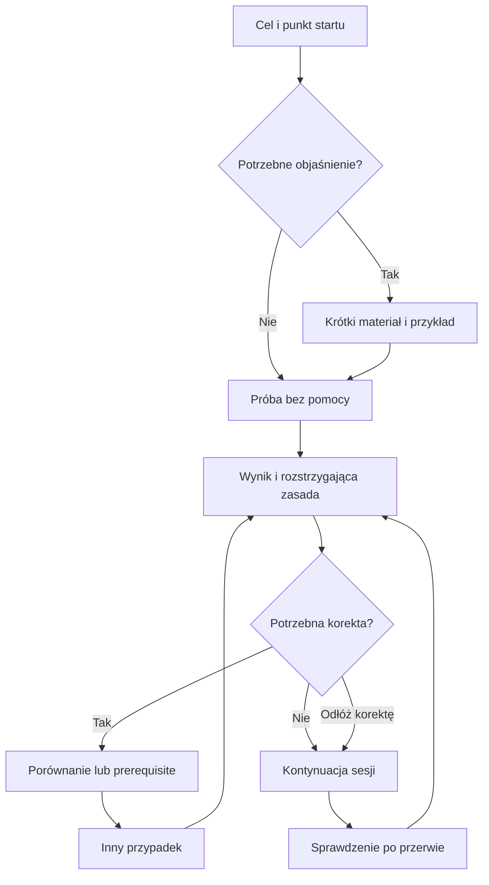

# IREB CPRE Foundation Level — Functional Learning Experience Blueprint

**Stan: 1 listopada 2026 r. · Wersja 1.0 · Język: polski · Faza: Educational Product Design.**

**Rekomendacja:** jedna prowadzona sesja nauki, podporządkowana celom IREB, z krótkim materiałem wtedy, gdy jest potrzebny, samodzielnymi zadaniami, celowaną korektą i powrotem po przerwie. Pytanie otwiera dostęp do powiązanej wiedzy, a powrót z tej wiedzy zachowuje odpowiedź i miejsce w sesji. Oddzielny kontekst **Sprawdzenie** chroni samodzielność pomiaru. Globalny graf nie należy do początkowego zakresu.

Dokument zawiera F01–F16, 38 wymagań funkcjonalnych, 18 scenariuszy, kontrakt informacyjny dla następnej fazy i trzy autorskie przykłady A/P/K. Decyzje dotyczą zachowania produktu i treści. Nie wybierają technologii ani nie projektują systemu informatycznego.

## Jak korzystać z blueprintu

| Potrzeba | Części |
|---|---|
| Zrozumieć decyzję i przebieg pracy ucznia | F01, F03–F06 |
| Sprawdzić ciągłość z poprzednim badaniem i podstawę rekomendacji | F02, źródła, F16 |
| Przełożyć doświadczenie na testowalne wymagania | F07–F12 |
| Projektować architekturę wiedzy i authoring | F13, Handoff B i C |
| Zdecydować, co najpierw sprawdzić | F14–F15 |
| Uzyskać bezpośrednie odpowiedzi na 20 pytań briefu | Końcowa sekcja pytań i odpowiedzi |

Źródła projektu **P0** i **P1** zostały odnalezione i przeczytane: kanon w całości oraz cały raport D1–D15, łącznie z rejestrem bibliograficznym, w podziale pracy zespołu. Nie utożsamiamy przeczytania jego bibliografii z ponownym przeczytaniem wszystkich cytowanych badań. Aktualną kontrolę zewnętrzną ograniczono do reguł egzaminu, istotnych EO, dokumentacji produktów i dostępności. Badanie nie obejmowało zalogowanych sesji produktów, użytkowników ani prototypu. Nie ma zatem wyników walidacji proponowanej aplikacji.

**Statusy twierdzeń:** FACT — potwierdzony fakt, przede wszystkim reguła IREB; RESEARCH FINDING — empiryczny wynik z zakresem opisanym w P1; INTERPRETATION — zastosowanie dowodu do tego projektu; DESIGN HYPOTHESIS — mechanizm lub parametr wymagający lokalnego sprawdzenia; FUNCTIONAL DECISION — świadomie wybrane zachowanie. Status decyzji nie zmienia jej w wynik badania.

## F01 — Executive Product Design Recommendation

### Jedna sesja, dwa konteksty

**FUNCTIONAL DECISION.** Głównym modelem będzie **prowadzona sesja oparta na celach i dowodach uczenia**. System proponuje jedno następne działanie i wyjaśnia powód. Uczeń może zmienić temat albo wybrać wejście przez pytanie. Wewnątrz tej samej sesji przechodzi przez poznanie, próbę, feedback, naprawę i powtórkę. Zakres sylabusa wyznacza to, czego nie wolno pominąć; historia wykonania pomaga wybrać kolejność.

Potrzebne są dwa konteksty zachowania:

1. **Nauka:** materiał, zadania, wskazówki na żądanie, uzasadnienia, pojęcia, porównania i powtórki. Pomoc jest dozwolona i jawnie oznaczana w interpretacji próby.
2. **Sprawdzenie:** wcześniej określony zakres i warunki, brak pomocy merytorycznej, wynik i feedback po zakończeniu. Na początku to sprawdzenie wybranego tematu; pełny timed mock wymaga pełnego korpusu i chronionej rezerwy.

„Pytania”, „czytanie”, „graf”, „naprawa błędów” i „powtórki” nie stają się pięcioma dodatkowymi trybami. Widok zakresu i postępu pomaga podjąć decyzję, ale nie jest osobnym mechanizmem nauki.

### Najważniejsze decyzje

| Decyzja | Dlaczego | Konsekwencja |
|---|---|---|
| Jedna rekomendowana kontynuacja z możliwością zmiany | Ogranicza decyzje organizacyjne, zachowuje sprawczość | Uczeń widzi cel oraz powód: luka, powrót po przerwie albo nowy wariant |
| Początkujący dostaje krótkie objaśnienie; praktyk może zacząć od zadania | Wspólny cel nie wymaga identycznego wejścia | Doświadczenie zawodowe nie nadaje automatycznie statusu znajomości IREB |
| Pełne rationale przygotowane, lecz ujawniane warstwowo | Jakość treści i koszt czytania to osobne kwestie | Po błędzie najpierw rozstrzygająca zasada i własne błędne decyzje |
| Powiązania dobierane do pytania | Istotność edukacyjna nie wynika z liczby linków | Maksymalnie kilka celowych propozycji, bez samoczynnego otwierania kolejnych tematów |
| Wynik punktowy oddzielony od siły dowodu | Znane zadanie lub pomoc nie zmieniają oficjalnego klucza, ale zmieniają interpretację sukcesu | „2/2, po otwarciu wskazówki” jest prawidłowym wynikiem nauki, nie niezależnym pomiarem |
| Nowa rodzina i późniejszy powrót | Ten sam item może sprawdzać pamięć rozwiązania | Bank planuje się według rozróżnień i okazji pomiaru, nie samej liczby pytań |
| Profil dowodów zamiast procentu mastery | Mało obserwacji i złożone EO nie uzasadniają precyzyjnej skali | Widać zakres, samodzielność, nowe konteksty, retencję i ograniczenia |
| Minimalna kontrola publikacji od pierwszego pilota | Wadliwe wyjaśnienie może utrwalać błąd | Brak klucza, pełnego rationale lub źródła blokuje pytanie |

Podstawą są P0 oraz P1 D1, D5–D10. Cockpit i AMBOSS dostarczają udokumentowanych wzorców oddzielenia nauki od testowania i dostępu do wyjaśnień; nie dowodzą skuteczności tej konkretnej kompozycji. [I3, A1–A3]

### Co zbudować i sprawdzić najpierw

Najpierw należy przygotować jedną kompletną pętlę na 2–3 istotnych rozróżnieniach: objaśnienie, niezależna próba, feedback zależny od odpowiedzi, przejście do porównania, powrót, inny przypadek i odroczone sprawdzenie. Można ją przeprowadzić w moderowanym scenariuszu bez aplikacji. Dopiero po usunięciu błędów treści i utraty kontekstu rozszerzyć ją do roboczych 9 pełnych EO i części 3 kolejnych.

Nie zaczynać od globalnego grafu, generatora pytań działającego podczas nauki, modelu „prawdopodobieństwo zdania”, rankingu użytkowników ani wielotrybowego pulpitu. Zaawansowana adaptacja może być osobnym eksperymentem po ustabilizowaniu treści i pomiaru.

Największa niepewność dotyczy **przyrostowej korzyści celowanych odsyłaczy i remediacji przy pełnym koszcie czasu**, a także wiarygodności rodzin wariantów. Prostota interfejsu jest decyzją projektową; przewaga edukacyjna wymaga badania F15.

## F02 — Research Continuity and Evidence Translation

### Macierz ciągłości pedagogiczno-funkcjonalnej

„Konieczna” oznacza konieczność zapewnienia funkcji edukacyjnej, nie jedynego sposobu prezentacji. Siła dowodów dotyczy ustalenia źródłowego; pewność lokalnego rozwiązania jest zwykle niższa.

| Źródło i ustalenie | Status i siła | Konsekwencja dla ucznia | Kandydat funkcjonalny | Konieczność czy wariant | Niepewność | Decyzja i ślad |
|---|---|---|---|---|---|---|
| D1: kryterium powodzenia to nowe samodzielne wykonanie po przerwie | INTERPRETATION oparta na szerokich badaniach | Uczeń musi ponownie wykonać zadanie, nie tylko je obejrzeć | Oddzielne okazje practice/verification/review | Konieczny pomiar; konkretna kolejność jest wariantem | Ile prób potrzeba dla danego EO | ADOPT FR-006, 017–024 |
| D2: zakres EO, L1–L3, podstawowe terminy i punktacja | FACT, wysoka | Zadanie musi wymagać właściwej czynności | Mapowanie kryteriów, formaty A/P/K | Konieczna zgodność | Publiczny sample nie określa poufnego blueprintu | ADOPT FR-004, 007–009, 025–029 |
| D3: retrieval i spacing mają mocne wsparcie ogólne | RESEARCH FINDING; przeniesienie CPRE pośrednie | Próba bez pomocy i późniejszy powrót | Wspólna kolejka nowych celów i rewizji | Konieczna okazja; algorytm jest wariantem | Dokładne interwały i dawka | ADOPT zasadę, TEST parametry FR-020–021 |
| D4: produkty łączą pytania, wyjaśnienia i materiał | FACT o dokumentacji, nie efficacy | Wyjaśnienie powinno być osiągalne w kontekście | Lokalne rozwinięcie z powrotem | Jeden możliwy wzorzec | Rzeczywisty koszt przełączania | ADOPT podstawę, TEST FR-011–014 |
| D5: objective-aligned successive relearning | INTERPRETATION; synteza kilku mechanizmów | Różne wejścia prowadzą do tych samych kryteriów | Jedna sesja, dobór pomocy | Wybrana synteza | Korzyść nad dobrym planem stałym | FUNCTIONAL DECISION: model D z A/B/C, FR-002–006 |
| D6: relacje służą wyjaśnieniu, kontrastowi i prerequisite | RESEARCH FINDING: dowody dla map pojęć umiarkowane i heterogeniczne; lokalna nawigacja CPRE to DESIGN HYPOTHESIS | Uczeń otwiera połączenie z konkretnym pytaniem | Nazwane odsyłacze i porównania | Konieczne powiązanie dla korekty; graf opcjonalny | Korzyść lokalnej nawigacji, globalnego grafu i głębokość eksploracji | ADOPT FR-012–014; global graph DEFER |
| D7: pełny pakiet pytania i chronione rodziny | FACT scoring + INTERPRETATION validity | Uczeń wie, skąd punkty i co faktycznie sprawdzono | Rationale wszystkich opcji, ekspozycja, review | Konieczne | Ile różnych rodzin wystarcza | ADOPT FR-010–019, 034 |
| D8: pięć stanów dowodów, ostrożna diagnoza | DESIGN HYPOTHESIS modelu, silna potrzeba rozdzielenia performance/learning | Uczeń nie myli oglądania z wykazaniem | Opisowe etykiety i historia warunków | Oddzielenie konieczne; pięć etykiet do testu | Zrozumiałość i kryteria przejść | ADOPT rozdział; TEST FR-022–024, 030 |
| D9: dziesięć pedagogicznych UC | Wymagania projektu | Potrzebna ciągła droga od orientacji do konsolidacji | 18 konkretnych scenariuszy, część to warianty | Pokrycie konieczne; liczba ekranów nie wynika z UC | Rzeczywiste punkty tarcia | ADOPT katalog F07 |
| D10: EO, concept, question package, relacje, misconception, source | INTERPRETATION semantyczna | Każdy link i feedback ma znaczenie | Kontrakt informacji dla każdej funkcji | Konieczna treść; fizyczny podział później | Granularność i współdzielenie treści | ADOPT F13; bez przesądzania obiektów bazy |
| D11: źródła i recenzja warunkiem publikacji | FACT o potrzebie źródeł + kontrola jakości projektu | Nie utrwalać przekonującego błędu | Bramka publikacji i wycofanie itemu | Konieczne | Nakład recenzji, licencje | ADOPT FR-033–037 |
| D12: 84 pytania i wybrane EO jako pilot | DESIGN HYPOTHESIS budżetu | Testować ograniczone rozróżnienia, nie całe przygotowanie | Mała pętla, potem pilot tematyczny | Wariant zakresu | Rezerwa przy wielu pomiarach | REVISE: audyt przydziału rodzin w F14 |
| D13: testować korektę, warianty, opóźniony transfer i koszt czasu | RESEARCH-INFORMED plan, nie wynik | Liczy się rezultat po opóźnieniu | Eksperymenty A–F z tym samym materiałem | Konieczna walidacja niepewnej wartości | Moc statystyczna i attrition | ADOPT plan; brak deklaracji przewagi |
| D14: adopt/test/defer/reject | Rejestr decyzji, nie dodatkowy dowód | Interfejs nie obiecuje więcej niż wiadomo | Każde rozszerzenie ma warunek wejścia | Konieczna dyscyplina zakresu | Kiedy rozszerzenie się opłaca | ADOPT F16 |
| D15: funkcjonalny projekt przed wiedzą i implementacją | Wiążąca kolejność projektu | Treści mają zasilać konkretne działania | Handoff B/C według FR | Konieczna | Granice odpowiedzialności faz | ADOPT kontrakt; nie wybierać technologii |

### Korekty wobec poprzedniej fazy

1. **Nie ustanawiamy reguły „trzy wyniki ≥80% = gotowy”.** P1 przedstawiał ją jako roboczą hipotezę. Może pozostać obiektem przyszłego badania; w bieżącym produkcie pokazujemy wyniki i profil dowodów, bez binarnej obietnicy.
2. **Pięć stanów nie tworzy obowiązkowej drabiny.** Samodzielny sukces po długiej przerwie może dostarczyć jednocześnie informacji o retencji i nowym kontekście. Każdą cechę trzeba jednak poprzeć odpowiednią obserwacją.
3. **Pilot poprzedza pełne przygotowanie również funkcjonalnie.** Sprawdzenie tematu nie dostaje etykiety pełnego mock. Rezerwę przydziela się do momentów pomiaru przed użyciem pytań.
4. **Aktualizacja dostępności Handbooka:** P1 potwierdzał tylko metadane za Cockpit. Podczas tej fazy odczytano wybrane części oficjalnego Handbook 1.3.2 udostępnionego przez iSQI. Nie wykonano pełnego przeglądu książki ani pełnego audytu EN/PL; nie rozszerzamy zakresu weryfikacji na nieprzeczytane rozdziały. [I5]
5. **Funkcje dostępności są częścią pętli.** Obsługa czytnikiem, powrót fokusu i alternatywa diagramu nie są pomocą merytoryczną. Nie powinny obniżać statusu samodzielności.

### Aktualna podstawa IREB

Katalog IREB w dniu badania wskazuje Syllabus 3.3.0, Examination Regulations 5.6.2, Glossary 2.2.0 i Handbook 1.3.2. Ponownie sprawdzono pełny regulamin oraz cele użyte w przykładach. Zliczenie jawnych EO potwierdza **70: 36 L1, 27 L2 i 7 L3**. Nie obejmuje ono automatycznie wszystkich rozbić wieloczłonowych EO ani dodatkowej podstawowej terminologii. Dokładną punktację i interpretację limitów zawiera F11. [I0–I2, I4–I6]

### Badanie realnych produktów

Wszystkie obserwacje w poniższej tabeli oznaczają **funkcjonalność opisaną przez dostawcę**. Nie testowano produktów po zalogowaniu. Puste obszary wiedzy o interfejsie pozostają niepotwierdzone. Nie przenosimy do CPRE danych marketingowych o skuteczności, algorytmów punktowych ani liczebności cudzych banków.

| Produkt | Start i najbliższe działanie | Feedback, wiedza, powrót | Powtórka, postęp, kontrola | Znaczenie i ograniczenie dla CPRE |
|---|---|---|---|---|
| IREB Cockpit | Wybór Training albo Exam Simulation | Training: objaśnienia opcji, EO i miejsca dalszej lektury; simulation bez pomocy | Wynik po EO; opis nie określa niezależności rodzin ani retencji | Bezpośredni benchmark; sam „link do materiału” nie wyróżnia projektu. [I3] |
| AMBOSS | Sesja Qbank w Study lub Exam | Key Learning Point; objaśnienia; odsyłacze z terminów do Articles; pomoc może być oznaczona | Tworzenie sesji i analiza wyników; powrót z Article do związanych pytań | Dobry wzorzec pytanie–wiedza; dokładne odtworzenie scroll/focus nie jest potwierdzone. [A1–A3] |
| UWorld | Konfiguracja testu, ustawienia Tutor i czasu | Tutor dostarcza feedback w toku; osobne self-assessments udostępniają wyjaśnienia po zakończeniu. Sam Timed określa warunki czasu | Previous Tests, analiza wykonania, osobne self-assessments | Przenosimy udokumentowany rozdział feedbacku w self-assessment; nie wnioskujemy o nim z samego limitu czasu. [A4] |
| Anki | Praca z kolejką New/Learning/Due | Uczeń odpowiada w pamięci, odsłania rozwiązanie i sam ocenia przypomnienie | Harmonogram i kolejne terminy; duża kontrola talii | Odsłonięcie odpowiedzi nie jest obiektywnym pomiarem EO. [A6] |
| SuperMemo | Nowy materiał, zaplanowane repetitions albo drills | Odtwarzanie i ocena odpowiedzi; drills pozwalają dodatkowo przećwiczyć materiał | Repetitions wynikają z harmonogramu; drills są odrębną praktyką | Przenosimy rozróżnienie zaplanowanego powrotu i dodatkowego ćwiczenia; użytkownik CPRE nie musi zarządzać całą bazą. [A7] |
| RemNote | Nauka kart wyprowadzonych z notatek | Karta zachowuje kontekst notatki; widoczne elementy nadrzędne mogą podpowiadać odpowiedź i można je ukryć | Kolejka flashcards, spaced repetition i ćwiczenie wybranego zakresu | Połączenie treści z praktyką przydatne, lecz kontekst wymaga kontroli wskazówek; użytkownik CPRE nie musi autorować notatek. [A8, A9, A10] |
| Brilliant | Ścieżka tematów; koncept łączy wyjaśnienie z zadaniem | Interaktywne kroki i checkpoints | Sugerowana kolejność; swoboda zależy także od planu produktu | Warto przenieść małą jednostkę działania, nie uznać blokad komercyjnych za metodę nauki. [B1] |
| Khan Academy | Kurs/jednostka/ćwiczenie i próby mieszane | Podsumowanie stanu umiejętności | Mastery Challenges wracają do ćwiczonych umiejętności; mastery to własna definicja produktu | Pokazać, co zmieniła próba; nie kopiować progów ani procentów. [B2–B3] |
| Quizlet | Zestaw → Learn albo Test | Po Test wynik i review; w Learn cel i rodzaj zadań | Progress wspiera trening słabszych terminów; Test nie zachowuje niedokończonej próby po wyjściu | Wybór zakresu przydatny; utrata próby to antywzorzec. Test z fiszek nie chroni niezależności. [B4–B6] |
| Duolingo | Zalecany krok na ścieżce albo Practice | Opcjonalne Explain My Answer; opisany powrót do aktualnego miejsca ścieżki | Powtórki wcześniejszych lekcji i błędów | Przejmujemy prostą kontynuację i rozwijane wyjaśnienie; nie XP, ligi ani streaki. [B7–B9] |
| Obsidian | Notatka/link, local lub global graph | Page preview pozwala podejrzeć stronę bez odejścia; backlinks pokazują kontekst linku | Brak wbudowanej oceny EO w badanych funkcjach | Przenosimy odwracalność i sens odsyłacza; link sam nie jest zweryfikowaną relacją dydaktyczną. [B10–B12] |

### Trzynaście mechanizmów do wykorzystania

Dowód naukowy odnosi się do funkcji edukacyjnej według P1 D3, nie do dokładnego rozwiązania UI. „E” oznacza Essential, „T” — Test, „L” — Later.

| Mechanizm / problem | Wzorzec i cel edukacyjny | Wymagana treść | Koszt lub ryzyko | Decyzja |
|---|---|---|---|---|
| 1. Jeden kolejny krok, bo uczeń nie wie, od czego zacząć | Ścieżki Brilliant/Duolingo; ograniczenie wyboru organizacyjnego | Cel, stan dowodów, uzasadnienie kolejności | Sztywność i pomijanie sprawczości | E + możliwość wyboru, FR-003 |
| 2. Mała jednostka instrukcji z próbą | Brilliant; budowa zrozumienia przed samodzielnością | Wyjaśnienie, przykład, zadanie właściwego poziomu | Nadmierne rozdrobnienie | E, FR-005–006 |
| 3. Krótkie rozstrzygnięcie przed pełnym feedbackiem | AMBOSS/Duolingo; celowana korekta | Reguła, rationale każdej opcji | Uczeń może nie rozwinąć potrzebnej treści | E; długość T, FR-011 |
| 4. Link z opcji do rozróżnienia | AMBOSS: termin w objaśnieniu opcji → Article; Cockpit: objaśnienia i miejsca lektury. Link do konkretnego porównania to nasza decyzja | Opcja–rationale–concept/comparison | Zbędne linki rozpraszają | E, FR-012 |
| 5. Odejście z zachowaniem kontekstu | Obsidian/Duolingo; redukcja kosztu powrotu | Kotwica pytania i pozycja sesji | Kilka otwartych gałęzi komplikuje | E, FR-013 |
| 6. Widoczny fakt użycia pomocy | AMBOSS; uczciwa interpretacja wykonania | Rodzaj i moment pomocy | Stygmatyzacja, jeśli traktowana jak kara | E, FR-018 |
| 7. Test bez feedbacku do zakończenia | Cockpit Exam Simulation / UWorld self-assessments; samodzielna ocena | Osobny zestaw i jawne warunki | Pokusa otwarcia materiału bez zmiany statusu | E: test tematu Level 1, pełny mock Level 2; FR-025–028 |
| 8. Powrót do wcześniejszych celów | Anki/SuperMemo/RemNote/Khan; spacing | Prompt, czas, dowód, nowy wariant | Kolejka kart może zdominować rozumienie | E prosta reguła, FR-020–021 |
| 9. Podsumowanie, co próba wykazała | Khan; kalibracja postępu | Konkretny cel i ograniczenie dowodu | Mocne etykiety sugerują pełne mastery | E, FR-022–023 |
| 10. Naprawa błędu prowadząca do innego zadania | Produkty practice + P1 D5/D7; retrieval i transfer | Rozstrzygnięcie i odmienna rodzina | Większy nakład autorski; pozorna różnorodność | E, FR-016–017 |
| 11. Pojęcie dostępne z notatki i pytania | RemNote/AMBOSS; wspólny rdzeń znaczenia | Terminologia i treść współdzielona semantycznie | Rozjazd dwóch kopii wyjaśnienia | E lokalnie; search Level 2, FR-031/037 |
| 12. Aktywne porównanie dwóch pojęć | P1 D3/D6; discriminative practice | Wymiar różnicy, kontrprzykłady, prompt | Dodatkowy czas, jeśli różnica już znana | E jako dostępna korekta; dozowanie T |
| 13. Wybór zakresu słabszych celów z zachowaniem szerokiego pokrycia | Quizlet/Practice; sprawczość i remediacja | EO, błędy, nowe warianty, niewidziany zakres | Niekończący się trening własnych błędów | E z kontrolą pokrycia, FR-021 |

Nie wybrano dodatkowych produktów: wskazane jedenaście pokrywa potrzebne wzorce. Nie tworzono rankingu „najlepszych na świecie”.

## F03 — Learner Contexts and Learning Jobs

To sytuacje tej samej osoby w różnych momentach nauki, nie marketingowe persony ani odrębne wersje produktu.

| Sytuacja | Zadanie ucznia | Typowy punkt startu | Zachowanie wspólnego modelu | Dowód potrzebny zamiast założenia |
|---|---|---|---|---|
| Brak uporządkowanej wiedzy RE | Zrozumieć sens pojęcia i wykonać pierwsze zadanie | Krótka jednostka i worked example | Mniej decyzji, brak długiego testu wejściowego | Samodzielna próba po wycofaniu pomocy |
| Doświadczony analityk/PO/TPM | Zderzyć język organizacji z IREB | Krótka próba lub konkretna różnica | Możliwość pominięcia znanego objaśnienia; zakres pozostaje pełny | Nowy przypadek zgodny z EO, nie samo stanowisko |
| Wiedza fragmentaryczna | Uzupełnić luki bez ponownego całego kursu | Cel wskazany przez brak pokrycia | Wybór materiału i prerequisite tylko do danego celu | Kryteria składowych EO |
| Preferencja question-first | Rozpoznać, czego nie rozumie | Pytanie treningowe | Błąd otwiera krótką naprawę, nie automatycznie cały rozdział | Wynik i uzasadnienie w innej sytuacji |
| Potrzeba systematycznych powrotów | Utrzymać wiedzę po ukończeniu tematu | Zalecane zadanie odroczone | Próba przed odsłonięciem objaśnienia | Wykonanie z zapisanym odstępem |
| Egzamin blisko | Wybrać najważniejszą pracę przy małym czasie | 1–3 rozpoznane luki albo pełny mock z czasem na review | Bez nowego trybu „cram”; kolejność uwzględnia termin | Braki ujawnione, brak obietnicy retencji bez pomiaru |
| Powtarzane mylenie dwóch pojęć | Zmienić błędną regułę rozróżniania | Porównanie i sonda przeciwstawnych sytuacji | Dwa kontrasty zamiast kolejnych podobnych pytań | Odpowiedzi rozdzielające alternatywne przyczyny |

Wybór wejścia należy do ucznia; system może go zasugerować. Nie wymaga ankiety osobowości, „stylu uczenia”, kalendarza codziennych sesji ani poziomu eksperckości nadanego po kilku odpowiedziach. Opcjonalny termin egzaminu zmienia kolejność, a nie prawdziwość wniosków o wiedzy.

## F04 — Competing Functional Learning Models

Oceny są analizą projektową przy tych samych treściach. Nie są wynikami eksperymentu ani punktacją psychometryczną.

| Kryterium | A Structured Path | B Question-Centered | C Integrated Workspace | D Guided Sessions | Wybrane połączenie |
|---|---|---|---|---|---|
| Skuteczność | Możliwa, jeśli zawiera retrieval i delay | Zależy od feedbacku i wcześniejszej wiedzy | Zależy od selekcji i obciążenia | Zależy od jakości kolejności | Wymaga pilota tak jak pozostałe |
| Zgodność z P0 | Dobra po dodaniu rewizji | Niepełna bez instrukcji i zakresu | Dobra, lecz łatwo dodać nadmiar | Dobra przy jawnych kryteriach EO | Pełna na poziomie funkcji |
| Początkujący | Czytelny start | Ryzyko zgadywania i przeciążenia | Zbyt wiele możliwości | Dobry przy wejściu od przykładu | Materiał jako zalecane wejście |
| Praktyk | Ryzyko zbędnej lektury | Wygodny start | Elastyczny, koszt orientacji | Dobry, jeśli można zmienić propozycję | Opcjonalne wejście przez zadanie |
| Pytanie–wiedza | Zwykle przejście między lekcjami | Naturalne | Naturalne, ale wiele ścieżek | Potrzebne w zadaniu | Lokalne odsyłacze z B/C |
| Obciążenie poznawcze | Mała liczba decyzji | Małe do wystąpienia dużych luk | Potencjalnie wysokie | Niskie przy jednym kroku | Jeden krok i mała gałąź |
| Zrozumiałość | Wysoka | Wysoka | Niższa bez ograniczeń | Wysoka, jeśli jest powód wyboru | „Co teraz i dlaczego” |
| Efektywność czasu | Słabsza przy przymusowej kolejności | Dobra dla trafnie dobranych zadań | Detours mogą kosztować | Potencjalnie dobra | Mierzyć całą pętlę |
| Złożoność funkcjonalna | Niska/średnia | Niska bazowo, rośnie przy naprawie | Wysoka | Średnia | Średnia wewnątrz, mała na zewnątrz |
| Wymagania treści | Sekwencje i ćwiczenia | Mocne rationale i mapowanie | Liczne relacje i prezentacje | Kryteria doboru i dowody | Wyłącznie relacje potrzebne do czynności |
| Rewizja i mastery | Nie wynikają z ukończenia ścieżki | Sam bank ich nie zapewnia | Dostępne, ale nie gwarantowane | Naturalne, jeśli kolejka je uwzględnia | Wspólna historia i odroczone zadania |
| Wierność egzaminu | Potrzebny odrębny test | Łatwo pomylić trening z testem | Wysokie ryzyko ujawnienia pomocy | Wymaga osobnej polityki | Odrębne Sprawdzenie |
| Walidacja małym korpusem | Dobra | Dobra dla znanych tematów | Trudniejsza, wiele zmiennych | Dobra z prostymi regułami | Jedna pętla i kilka rozróżnień |

**Wybór:** D jest organizacją codziennej pracy, A zapewnia kompletność celów, B jest opcjonalnym wejściem, a z C przyjmujemy wyłącznie lokalną integrację i odwracalność nawigacji. Nie powstają cztery tryby odpowiadające modelom.

A z retrieval i zaplanowanymi powrotami jest pełnoprawną, prostszą alternatywą zgodną z P0. D wybrano jako domyślną organizację, ponieważ zakładamy korzyść z łączenia niejednolitych luk, nowych celów i potrzeb rewizji w jednej rekomendacji; tę przewagę trzeba sprawdzić względem dobrego planu stałego. B także może zapewnić pokrycie EO, instrukcję i powtórki, jeśli jawnie je zaprojektowano. Nie wybieramy jednak obowiązkowego początku od pytania: nowicjusz powinien móc najpierw poznać zasadę. Pełne C odroczono z powodu kosztu orientacji i authoringu. D bez jawnych przesłanek także byłby niewystarczający: rekomendacja musi być możliwa do zrozumienia i zastąpienia.

**Alternatywa E:** minimalny stały plan „temat → practice → ustalone powroty” jest kontrolą w badaniu, a nie kolejną sekcją aplikacji. Jeśli dynamiczny wybór nie daje istotnej praktycznie korzyści, można zachować tę prostszą organizację bez zmiany reszty modelu.

## F05 — Recommended Learning Experience Architecture

### Pierwsze otwarcie

Uczeń widzi nazwę kwalifikacji, wersję materiału i uczciwy zakres dostępnego przygotowania. W pilocie komunikat mówi wprost o wybranych tematach. Krótkie objaśnienie przedstawia dwie zasady: w Nauce wolno korzystać z pomocy, w Sprawdzeniu wyniki pojawią się na końcu.

Następna decyzja: **„Zacznij od krótkiego wprowadzenia”** albo **„Zacznij od kilku pytań”**. Dla osoby bez preferencji rekomendowane jest wprowadzenie. Druga droga jest próbą orientacyjną w Nauce i zawiera orientacyjnie 3–6 zadań treningowych z różnych potrzebnych rozróżnień; nie jest placement testem całego sylabusa ani kontekstem Sprawdzenie. Termin egzaminu jest opcjonalny. Instrukcje A/P/K pojawiają się przy pierwszym użyciu formatu; nie trzeba kończyć osobnego kursu obsługi.

Po tym kroku uczeń ma wykonać jedną czynność edukacyjną. Profil, rozbudowana konfiguracja sesji i obejrzenie całej mapy programu nie są warunkami startu. FR-001–002, 029, 038.

### Zwykła sesja

Główna propozycja brzmi na przykład: **„Sprawdź rozróżnienie jakości i ograniczenia — ostatnia samodzielna próba była sześć dni temu”**. Gdy nic nie wymaga powrotu, propozycja dotyczy niepokrytego celu. Alternatywa „Wybierz temat” pozostaje dostępna. Uczeń może określić, że ma mało czasu, ale sesji nie zamienia się w quiz o sztywnej liczbie pytań niezależnej od celu.

W środku sesji system wybiera jedną z trzech czynności: krótkie poznanie, samodzielną próbę albo naprawę. Po zakończeniu pokazuje następny krok. Wyjście zawsze jest dozwolone. Kończy się bieżąca aktywność; dowód retencji czeka na kolejną sesję.

To przebieg dydaktyczny z opcjonalną gałęzią, nie obowiązkowa liczba ekranów. Każdy nowy przypadek wraca do oceny i feedbacku; po drugim nieudanym follow-up tej samej korekty system proponuje zmianę wsparcia lub przerwę, a uczeń może wyjść wcześniej (FR-016). Inny przypadek po korekcie jest etapem nauki. Mocniejsza walidacja korzysta z niezależnego materiału, odpowiedniego odstępu i jawnych warunków.

### Po odpowiedzi: co dzieje się zawsze, a co warunkowo

| Krok | Wyzwolenie | Przebieg |
|---|---|---|
| Wynik wykonania | Po zatwierdzeniu w Nauce, stosownie do rodzaju zadania | A/P/K: zachowaj wybór i pokaż uzyskane oraz dostępne punkty. Zadanie otwarte: pokaż rubrykę, spełnione kryteria i źródło oceny; nie wymyślaj punktacji egzaminacyjnej |
| Rozstrzygnięcie | Zawsze dostępne; po błędzie widoczne od razu | Jedna krótka zasada związana z warunkiem zadania |
| Objaśnienie opcji | Błędne/pominięte poprawne domyślnie; reszta na żądanie | Każda opcja ma pełne rationale w tym kontekście |
| Pojęcie lub comparison | Na żądanie lub zalecenie po błędzie | Link mówi, co wyjaśni, zamiast „czytaj więcej” |
| Prerequisite | Tylko gdy jest zweryfikowana potrzeba | Jeden brakujący element; możliwy powrót bez zakończenia całego działu |
| Sonda misconception | Przy powtarzalnym wzorcu lub niejasnej przyczynie | Odróżnia możliwe powody; bez etykietowania ucznia |
| Nowy przypadek | Zalecany po korekcie, opcjonalny po mocnym sukcesie | Wycofaj pomoc; opisz, czy to nowa rodzina i czy próba jest odroczona |
| Kontynuacja | Zawsze | Powrót do kolejki albo świadome zakończenie sesji |

Pomyłka w liczbie zaznaczeń może najpierw uruchomić krótką korektę formatu. Nie wymaga automatycznie lekcji o domenie. Poprawny, pewny wynik na nowym zadaniu nie wymusza pełnego rationale wszystkich opcji. Poprawna, niepewna odpowiedź zachowuje punkty; system proponuje krótkie wyjaśnienie reguły i późniejszy nowy wariant.

### Ciągłość po przerwach

| Powrót | Zachowanie |
|---|---|
| Po kilku minutach | Przywróć niezatwierdzony wybór, otwartą gałąź i miejsce w sesji; nie dodawaj nowego wyniku |
| Następnego dnia | Zaproponuj zaległą samodzielną próbę albo wznowienie; pokaż powód |
| Po kilku dniach | Zacznij od krótkiego retrieval ważnego wcześniejszego celu; nie odsłaniaj od razu rozwiązania |
| Po długiej przerwie | Pokaż ostatni cel i czas od dowodu; zaproponuj małe ponowne sprawdzenie, zachowaj całą historię |
| Po ukończeniu EU | Ukończenie oznacza zakres wykonanych działań; zaproponuj potrzebne rewizje lub kolejny EO |
| Po mock | Wynik → najwyżej kilka priorytetów → jedna celowana czynność; reszta widoczna na żądanie |
| Po kolejnych porażkach | Zmień poziom wsparcia i typ próby; po dwóch nieudanych follow-up zaproponuj przykład, prerequisite lub przerwę |
| Po mocnych wykonaniach | Zmniejsz powtarzanie identycznych zadań, sprawdź nowy kontekst albo niepokryty zakres |

Liczba dwóch follow-up jest ograniczeniem operacyjnym do walidacji, nie prawem psychologii. Nie blokuje uczniowi dalszej pracy i nie kasuje jego dowodów.

## F06 — Knowledge Navigation and Connected Learning Model

### Ocena alternatyw

| Alternatywa | Wartość dla konkretnego błędu | Obciążenie i rozproszenie | Nowicjusz / praktyk | Kontekst i odkrywanie | Nakład authoringu | Decyzja |
|---|---|---|---|---|---|---|
| A. Zwykłe linki między notatkami | Dobra, jeśli link opisuje potrzebę | Niski próg, ryzyko bezcelowych odejść | Czytelne, ale trzeba wybrać trafny link | Powrót trzeba zapewnić osobno | Umiarkowany | Składnik podstawy |
| B. Kierowane pojęcia powiązane | Wysoka oczekiwana trafność | Niewielka liczba decyzji | Dobre dla obu grup | Sens związku widoczny | Wymaga uzasadnienia relacji | ADOPT |
| C. Lokalna mapa pojęć | Może pomóc w relacji wielostronnej | Więcej interpretacji przestrzennej | Początkujący może potrzebować zadania przewodniego | Dobre przy małym sąsiedztwie | Dodatkowy review semantyki i dostępności | TEST poza rdzeniem |
| D. Swobodny globalny graf | Słaba kontrola trafności | Wysokie ryzyko rozproszenia | Raczej eksploracja dla obeznanego | Łatwo utracić pytanie i cel | Wysoki; wiele krawędzi bez funkcji | DEFER, nie główna nawigacja |
| E. Eksploracja od pytania | Bezpośrednio wiąże błąd z wiedzą | Mała, gdy istnieje kotwica powrotu | Dobry start dla praktyka; nowicjusz potrzebuje treści | Zachowuje problem przewodni | Pełne pakiety pytań | ADOPT |
| F. Wybrane A+B+E | Celowy link w miejscu decyzji | Najmniejszy sensowny zakres | Jeden model z różną ilością wsparcia | Jawne otwarcie, powrót i dalsza próba | Relacje tylko dla wybranej funkcji | REKOMENDACJA |

Samo istnienie linku nie uzasadnia jego pokazania. Pierwszeństwo ma wyjaśnienie wybranej opcji, potem potrzebne rozróżnienie, brakujący prerequisite, przykład i nowa próba. EO i źródło pozostają dostępne do orientacji. Luźna relacja tematyczna nie może wyprzedzać informacji rozstrzygającej błąd. P0; P1 D6; [B10–B12].

### Polityka zachowania kontekstu

Otwierając wiedzę z odpowiedzi, uczeń pozostaje w gałęzi tej aktywności. Dostępne są „Wstecz” do poprzedniego elementu i „Wróć do pytania”. Powrót przywraca pytanie, wersję, wybór, zapisany wynik, rozwinięte rationale, miejsce sesji i logiczny fokus. Podgląd nie tworzy nowej próby. Kolejne powiązanie nie zastępuje kotwicy źródłowej. Po dłuższej eksploracji uczeń może świadomie zmienić temat; system informuje, co zostaje przerwane.

Początkowo proponujemy **do trzech relacji** związanych z bieżącą potrzebą i pojedynczy rekomendowany krok. To hipoteza upraszczająca do testu B, nie limit zawartości modelu wiedzy. Uczeń może otworzyć dalszy kontekst na własne życzenie. Każda relacja powinna odpowiadać na pytanie „po co mam tu wejść?”.

### Jedenaście przejść funkcjonalnych

**Reguła wspólna dla wszystkich przejść:** podczas aktywnego Sprawdzenia nie udostępnia się pomocy merytorycznej żadną z tych dróg. Dotyczy to także podglądów, tytułów, tagów EO, breadcrumbs i opisów, które zdradzałyby rozwiązanie. Wiedza staje się dostępna po zakończeniu całej próby albo po świadomym przekształceniu jej w Naukę (FR-026–027). W Nauce uczeń może poprosić o pomoc również przed odpowiedzią; ujawnienie informacji potrzebnej do jej ustalenia zmienia warunki próby zgodnie z FR-018. Nie zatwierdza odpowiedzi automatycznie. Warunki w ostatniej kolumnie są dodatkowymi ograniczeniami, a nie wyjątkami od tej reguły.

| Przejście i intencja | Warunek / informacja | Co zachować | Korzyść i koszt | Powrót | Kiedy nie oferować |
|---|---|---|---|---|---|
| Pytanie → wyjaśnienie: zrozumieć wynik | Zatwierdzona próba; klucz, punkty, reguła | Własny wybór i warunek zadania | Korekta; koszt czytania | To samo pytanie → dalej | W aktywnym Sprawdzeniu |
| Wyjaśnienie → pojęcie: uzupełnić model | Zweryfikowane mapowanie rationale–concept | Fragment rationale, który otworzył kartę | Trafny kontekst; ryzyko nadmiaru teorii | Do fragmentu rationale | Brak uzasadnionego związku |
| Opcja → rozróżnienie: zrozumieć dystraktor | Opcja ma rationale, comparison tylko jeśli potrzebne | Zaznaczona i poprawna decyzja | Wyjaśnia dlaczego; koszt przełączenia | Do opcji | Nie tworzyć nowego concept tylko dla numeru opcji |
| Pojęcie → pojęcie: wyjaśnić relację | Nazwana relacja, zakres, warunek | Cel eksploracji i ścieżka | Łączy wiedzę; ryzyko dygresji | O krok albo do pytania | Luźne podobieństwo bez celu |
| Pojęcie → prerequisite: naprawić brak | Prerequisite dotyczy konkretnego zadania | Docelowe rozróżnienie | Odblokowanie rozumienia; koszt podstaw | Do brakującego kroku pierwotnej lekcji | Samo sąsiedztwo nie dowodzi konieczności |
| Pojęcie → pytania: sprawdzić zastosowanie | EO, poziom i dostępna pula practice | Rodzaj sprawdzanej umiejętności | Retrieval; ekspozycja na pytanie | Do pojęcia lub sesji według wyboru | Nie ujawniać reserved w zwykłej liście |
| Hipoteza błędu → sonda: rozdzielić przyczyny | Alternatywne wyjaśnienia i zadanie rozstrzygające | Hipoteza i wcześniejsza odpowiedź | Lepsza korekta; koszt dodatkowego pytania | Do dobranej naprawy | Brak sondy; po prostym jednorazowym błędzie wystarczy rationale |
| Aktywność → nowy wariant: sprawdzić korektę | Ten sam cel, inna decyzja/kontekst, historia rodziny | Właściwy EO i warunki pomocy | Generalizacja; zużycie nowego materiału | Do dalszego planu | Brak wariantu: jawnie słabsza próba znana |
| Remediacja → pierwotna sesja | Zakończona lub świadomie pominięta naprawa | Kolejność pozostałych zadań i nowe dowody | Ciągłość; bez kary za pominięcie | Następna sensowna aktywność | Nie wracać do skasowanego/wycofanego itemu |
| Pytanie → EO: zrozumieć cel | EO główny i zakres faktycznie sprawdzony | Pytanie i stan próby | Orientacja; ryzyko zasugerowania klucza | Do pytania | Przed finalizacją Sprawdzenia |
| EO → materiał: uzupełnić zakres | Materiał pokrywa wskazaną składową i poziom | Informacja o brakującym zakresie | Domyka pokrycie; może być długi | Do planu EO lub źródłowej aktywności | Brak treści: nazwać lukę, nie tworzyć automatycznie |

### Aktywność podczas eksploracji

W uzasadnionej naprawie można poprosić o wskazanie różnicy, wybór relacji albo przewidzenie, które pojęcie opisuje nową sytuację. To aktywność retrieval lub discrimination, nie nagroda za obejrzenie grafu. Przykład: „Co musiałoby się zmienić w tym wymaganiu, żeby stało się ograniczeniem?”. Pełna rekonstrukcja mapy pozostaje TEST; nie należy jej wymagać do zaliczenia każdego tematu.

### Jakość interakcji i dostępność

Przyjętym celem późniejszej realizacji jest WCAG 2.2 AA. W tej fazie definiujemy zachowanie: cała pętla działa klawiaturą, każdy wybór ma nazwę i stan, K zachowuje związek odpowiedzi ze stwierdzeniem, wynik i błąd są tekstowe, komunikaty są osiągalne czytnikiem, a zamknięcie wiedzy przywraca logiczny fokus. Diagram przekazuje te same dane w alternatywie tekstowej, bez dodania rozwiązania. Rozwinięcia nie wymagają hover. Uczeń nie musi zapamiętać pytania, aby przeczytać jego objaśnienie. [W0–W6]

Trening pozostaje bez obowiązkowego limitu. Symulacja przechowuje wybrany profil czasu i dostępności; użycie narzędzia asystującego nie oznacza podpowiedzi merytorycznej. Powiększenie treści i wąski ekran nie mogą rozdzielić opcji od instrukcji. Nie przedstawiamy tego zestawu jako zakończonego audytu zgodności: wymaga sprawdzenia w przyszłej realizacji i z osobami używającymi narzędzi asystujących.

## F07 — Katalog szczegółowych scenariuszy uczenia

Katalog przekłada D9 na obserwowalne zachowania. UC-01–UC-10 zachowują wcześniejsze intencje pedagogiczne; UC-11–UC-18 opisują warianty wymagające osobnych reguł, a nie osobnych trybów aplikacji. Wszystkie rozwiązania interakcyjne poniżej mają status **FUNCTIONAL DECISION**, natomiast ich przewaga w CPRE pozostaje **DESIGN HYPOTHESIS**. „Nauka” i „Sprawdzenie” są dwoma kontekstami. Temat, korekta i powtórka są aktywnościami wewnątrz nich.

Odwołania P1/Dx wskazują pełny wcześniejszy raport. Identyfikatory EO i poziomy odnoszą się do syllabus 3.3.0; polskie opisy są parafrazami. Próba otwarta z samooceną ma jawnie słabszy status niż sprawdzenie recenzowaną rubryką. Żaden scenariusz nie nadaje automatycznie statusu opanowania całego EO.

Test tematu w Level 1 należy do Sprawdzenia: bez limitu czasu, bez pomocy w trakcie, z review po zatwierdzeniu całego zestawu. Pełny timed mock należy do Level 2; domyślnie nie dodaje pytań o pewność odpowiedzi.

### UC-01 — Pierwszy kontakt z IREB

1. **Sytuacja ucznia / problem edukacyjny:** kandydat zna pracę z backlogiem, lecz nie zakres CPRE; może utożsamiać doświadczenie zawodowe ze znajomością terminologii i formatu egzaminu.
2. **Pożądany wynik edukacyjny:** rozumie cel przygotowania, różnicę Nauka–Sprawdzenie i sposób rozpoczęcia; nie traktuje orientacji jako diagnozy całego sylabusa.
3. **Wyzwalacz / warunki wstępne:** pierwsze otwarcie; dostępna zweryfikowana nota o wersji i faktycznym zakresie korpusu.
4. **Główna podróż ucznia:** poznaje krótką informację o egzaminie; wybiera „zacznij od podstaw” albo krótką próbę orientacyjną; poznaje instrukcje A/P/K przy pierwszym użyciu; uruchamia zalecany cel, np. EO 1.1.1–1.1.2.
5. **Odpowiedzialność systemu:** pokazać ograniczenia pilota, wyjaśnić punktację bez odsłaniania rezerwy, zaproponować pierwszy krok z powodem.
6. **Decyzje ucznia / ścieżki alternatywne:** może pominąć diagnozę, nie podawać daty egzaminu, wybrać temat; brak odpowiedzi nie blokuje nauki.
7. **Wymagana informacja wiedzy:** wersje dokumentów, siedem EU, EO, podstawowe terminy PL/EN, instrukcje i oryginalne przykłady formatów.
8. **Wytwarzane dowody uczenia:** wybór wejścia, próby i ich warunki; deklarowany staż pozostaje kontekstem, bez kredytu opanowania.
9. **Feedback i remediacja:** odróżnić nieznajomość pojęcia od niezrozumienia instrukcji; pokazać właściwy krótki materiał.
10. **Warunek zakończenia / błędy i wyjątki:** rozpoczęta pierwsza aktywność; brak aktualnych zasad blokuje etykietę aktualnej symulacji, nie czytanie dostępnej treści.
11. **Dowody pedagogiczne:** P1/D3–D5: wcześniejsza wiedza i scaffolding; długość diagnozy jest hipotezą.
12. **Powiązane wymagania / priorytet funkcjonalny:** FR-001–004, FR-029, FR-037–038; **Essential, Level 1**.

### UC-02 — Nauka całkowicie nowego pojęcia

1. **Sytuacja ucznia / problem edukacyjny:** osoba początkująca poznaje kontekst systemu i nie rozumie, dlaczego system zewnętrzny może być istotny, choć nie podlega implementacji.
2. **Pożądany wynik edukacyjny:** rozumie rozróżnienie i zaczyna samodzielnie wyznaczać granice w krótkim opisie; zadanie konstrukcyjne wspiera EO 4.1.1, L3.
3. **Wyzwalacz / warunki wstępne:** wybór celu bez wcześniejszego dowodu; gotowe wyjaśnienie, przykład rozwiązany i rubryka nowej aktywności.
4. **Główna podróż ucznia:** czyta zwięzłą definicję; analizuje przykład systemu rezerwacji; zamyka pomoc; rozmieszcza elementy nowego systemu w kategoriach „wewnątrz / istotne otoczenie / nieistotne otoczenie” i uzasadnia granice.
5. **Odpowiedzialność systemu:** dawkować instrukcję, jasno oddzielić przykład rozwiązany od własnej próby, ujawnić sposób oceny.
6. **Decyzje ucznia / ścieżki alternatywne:** może rozwinąć worked example albo przejść wcześniej do zadania; przy braku podstaw otwiera krótką definicję systemu.
7. **Wymagana informacja wiedzy:** EO i jego składowe, definicje, warunki granic, przykład, kontrprzykład, scenariusz i rubryka.
8. **Wytwarzane dowody uczenia:** ekspozycja, próba konstrukcyjna, użyta pomoc i sposób oceny; poprawna odpowiedź definicyjna nie zalicza L3.
9. **Feedback i remediacja:** wyjaśnić konkretne błędne przyporządkowanie; sprawdzić inne rozróżnienie bez powtórzenia całej lekcji.
10. **Warunek zakończenia / błędy i wyjątki:** uczeń wykonał próbę i zna następny krok; bez kryteriów oceny dopuszczalne jest ćwiczenie refleksyjne bez zaliczenia. Samoocena wymaga zatwierdzonego wzorca lub rubryki i zawsze ma jawny status, odrębny od niezależnej oceny wykonania.
11. **Dowody pedagogiczne:** P1/D3.4, D5.3–5.4: worked examples, fading i rozdzielenie wykonania od retencji.
12. **Powiązane wymagania / priorytet funkcjonalny:** FR-005–006, FR-011, FR-014, FR-017–018, FR-022; **Essential, Level 1**.

### UC-03 — Nauka rozpoczynana od pytania

1. **Sytuacja ucznia / problem edukacyjny:** doświadczony analityk chce sprawdzić wiedzę od razu; jego zwyczajowy wybór techniki pozyskiwania może przesłaniać warunki zadania.
2. **Pożądany wynik edukacyjny:** dobiera technikę na podstawie istotnych ograniczeń, wspierając EO 4.2.3, L2.
3. **Wyzwalacz / warunki wstępne:** wybór „spróbuj pytania”; dostępne recenzowane zadanie z jednoznacznym kontekstem, kluczem i wyjaśnieniami.
4. **Główna podróż ucznia:** czyta scenariusz o pracy trudno werbalizowanej, ale dostępnej do obserwacji; odpowiada; widzi wynik i rozstrzygający warunek; w razie potrzeby otwiera porównanie technik; wybiera inne zadanie albo kontynuuje.
5. **Odpowiedzialność systemu:** nie wyświetlać pomocy automatycznie przed odpowiedzią; udostępnić ją na żądanie, oznaczając próbę jako wspomaganą. Zachować odpowiedź i pokazać uzasadnienie pasujące do wybranej opcji.
6. **Decyzje ucznia / ścieżki alternatywne:** może zadeklarować niepewność, poprosić o materiał przed odpowiedzią lub pominąć rozszerzenie po trafnym wyborze; pomoc zmienia status dowodu.
7. **Wymagana informacja wiedzy:** techniki, warunki zastosowania, relacja pytanie–EO, rationale opcji i nowy przypadek zmieniający istotny warunek.
8. **Wytwarzane dowody uczenia:** pierwszy wybór, nowość zadania, pomoc i opcjonalna pewność; domysł przyczyny nie jest rozpoznanym misconception.
9. **Feedback i remediacja:** po błędzie wskazać warunek, nie wymuszać całego EU; po niepewnym sukcesie potwierdzić zasadę.
10. **Warunek zakończenia / błędy i wyjątki:** następna aktywność wybrana; niejednoznaczny scenariusz można zgłosić, bez automatycznego przypisania winy uczniowi.
11. **Dowody pedagogiczne:** P1/D5.2–5.5: question-first jako wejście, nie samowystarczalna metoda.
12. **Powiązane wymagania / priorytet funkcjonalny:** FR-006–018, FR-030, FR-035; **Essential, Level 1 mechanizm; przykład EO 4.2.3 w Level 2 korpusu**.

### UC-04 — Błędna odpowiedź i celowana korekta

1. **Sytuacja ucznia / problem edukacyjny:** uczeń zaakceptował twierdzenie, że wcześniejsze zatwierdzenie eliminuje potrzebę ponownej walidacji po istotnej zmianie.
2. **Pożądany wynik edukacyjny:** potrafi wyjaśnić potrzebę ponownego sprawdzenia adekwatności wymagań; EO 4.4.1, L2.
3. **Wyzwalacz / warunki wstępne:** zatwierdzona błędna odpowiedź; dostępna zasadna korekta, możliwe przyczyny i alternatywny scenariusz.
4. **Główna podróż ucznia:** widzi punkty i zasadę; opcjonalnie odpowiada na sondę „co zmienia nowe oczekiwanie interesariusza?”; poznaje krótki kontrprzykład; próbuje nowego zadania; wraca do sesji.
5. **Odpowiedzialność systemu:** zachować pierwotny błąd; odróżnić przeoczenie warunku, brak wiedzy i możliwe błędne przekonanie; nie przechodzić automatycznie przez wiele materiałów.
6. **Decyzje ucznia / ścieżki alternatywne:** może wybrać wyjaśnienie opcji, odświeżenie pojęcia, nową próbę albo odłożyć naprawę z jawną konsekwencją.
7. **Wymagana informacja wiedzy:** zasadniczy claim, warunki, źródło, hipotezy błędu, sonda rozdzielająca, nota o walidacji i wariant.
8. **Wytwarzane dowody uczenia:** błąd, odpowiedź na sondę, użyty materiał, nowe wykonanie; natychmiastowa poprawa nie stanowi retencji.
9. **Feedback i remediacja:** korekta dotyczy rozumowania; powtarzalny problem kieruje do krótszej podstawy albo przerwy.
10. **Warunek zakończenia / błędy i wyjątki:** wykonano weryfikację lub świadomie odłożono problem; brak wariantu ujawniony, bez „udowodnionej poprawy”.
11. **Dowody pedagogiczne:** P1/D3, D5, D6: corrective feedback i refutation; diagnoza konkretnej przyczyny wymaga sprawdzenia.
12. **Powiązane wymagania / priorytet funkcjonalny:** FR-010–018, FR-020, FR-033; **Essential, Level 1**.

### UC-05 — Powracające mylenie podobnych pojęć

1. **Sytuacja ucznia / problem edukacyjny:** kandydat wielokrotnie kwalifikuje narzuconą technologię jako wymaganie jakościowe; zawodowe „niefunkcjonalne” zaciera rozróżnienie.
2. **Pożądany wynik edukacyjny:** klasyfikuje jakość i ograniczenie na podstawie znaczenia; EO 1.1.2, L2.
3. **Wyzwalacz / warunki wstępne:** powracający wzorzec lub prośba o porównanie; zatwierdzona para pojęć z kryterium różnicy i kontrastowymi zadaniami.
4. **Główna podróż ucznia:** otwiera krótkie porównanie; wskazuje, czy zapis określa właściwość rozwiązania czy ogranicza przestrzeń wyboru; rozwiązuje zmieszane przykłady; wraca do celu sesji.
5. **Odpowiedzialność systemu:** podać konkretny powód rekomendacji; nie używać etykiety trwałej „masz misconception” ani automatycznie obniżać całego EU.
6. **Decyzje ucznia / ścieżki alternatywne:** może wskazać, że pomylił instrukcję, poprosić o przykład albo pominąć znaną definicję; przy dalszej trudności wybiera podstawę.
7. **Wymagana informacja wiedzy:** definicje PL/EN, wymiar porównania, przykłady obu kategorii, counterexample i jawna hipoteza pomyłki.
8. **Wytwarzane dowody uczenia:** decyzje w różnych przypadkach i uzasadnienia; samo otwarcie tabeli nie zmienia dowodu opanowania.
9. **Feedback i remediacja:** poprawić regułę, np. odrzucić heurystykę „każda liczba oznacza jakość”; nowa para sprawdza rozróżnienie.
10. **Warunek zakończenia / błędy i wyjątki:** uczeń wykazał poprawę albo wie, co odłożył; po kolejnej porażce nie otrzymuje niekończącej się serii parafraz.
11. **Dowody pedagogiczne:** P1/D3 interleaving warunkowy; D6 relacje „różni się od”; trafność doboru porównania do testu.
12. **Powiązane wymagania / priorytet funkcjonalny:** FR-012, FR-014–017, FR-022, FR-037; **Essential, Level 1**.

### UC-06 — Poznawanie relacji między pojęciami

1. **Sytuacja ucznia / problem edukacyjny:** uczeń rozpoznaje interesariusza i kontekst systemu, ale nie umie wyjaśnić wpływu zakresu na poszukiwanie źródeł wymagań.
2. **Pożądany wynik edukacyjny:** wyjaśnia jedną istotną zależność i stosuje ją w zadaniu; zakres pomocniczy EO 4.1.1–4.1.3, bez uznania całych L3 za zaliczone.
3. **Wyzwalacz / warunki wstępne:** dobrowolne rozwinięcie związku; relacja ma zatwierdzony sens i zakres zastosowania.
4. **Główna podróż ucznia:** wybiera pytanie „dlaczego to powiązano?”; poznaje zdanie relacji i przykład zmiany granicy; wskazuje konsekwencję dla źródeł; wraca do pierwotnego pytania.
5. **Odpowiedzialność systemu:** pokazać małe, uzasadnione otoczenie; zachować kontekst; nie wymuszać grafu ani dowolnego spaceru po sąsiadach.
6. **Decyzje ucznia / ścieżki alternatywne:** może przeczytać relację, wykonać krótkie zadanie albo przejść do prerequisite; aktywna mapa jest późniejszym eksperymentem.
7. **Wymagana informacja wiedzy:** końce i rola relacji, jej warunek, przykład, EO i zadanie sprawdzające konsekwencję.
8. **Wytwarzane dowody uczenia:** odpowiedź na aktywne zadanie; liczba odwiedzonych pojęć jest wyłącznie historią aktywności.
9. **Feedback i remediacja:** poprawić konkretne połączenie, np. odróżnić interesariusza od innych źródeł wymagań.
10. **Warunek zakończenia / błędy i wyjątki:** użytkownik wrócił do celu lub świadomie wybrał nowy; niezatwierdzona relacja nie staje się rekomendacją.
11. **Dowody pedagogiczne:** P1/D6: wartość semantyki i warunkowe dowody mapowania; brak walidacji swobodnego globalnego grafu.
12. **Powiązane wymagania / priorytet funkcjonalny:** FR-013–014, FR-017, FR-022, FR-033; **Essential, Level 1 dla tekstowych relacji; mapa Validate, Level 3**.

### UC-07 — Powrót do zapomnianej wiedzy

1. **Sytuacja ucznia / problem edukacyjny:** po kilku dniach kandydat nie pamięta powodów traceability mimo wcześniejszych trafień.
2. **Pożądany wynik edukacyjny:** ponownie rozpoznaje cel śledzenia lub sposób jego dokumentowania; EO 6.6.1–6.6.3, L1, bez wymagania zaawansowanej analizy zmiany.
3. **Wyzwalacz / warunki wstępne:** zaplanowany powrót z podanym powodem; istnieje wcześniejszy dowód, jego data i odpowiednie zadanie.
4. **Główna podróż ucznia:** próbuje odpowiedzieć bez materiału; po błędzie otrzymuje krótką korektę konkretnego elementu; wykonuje inny prompt; kontynuuje sesję i ma kolejny powrót.
5. **Odpowiedzialność systemu:** zachować osobno odstęp od samodzielnej próby i od ostatniego istotnego kontaktu z badanym kryterium; świeża lektura lub korekta wyklucza wniosek o odroczonej retencji. Zachować wcześniejsze sukcesy i dodać potrzebę odświeżenia; nie karać za opóźnienie.
6. **Decyzje ucznia / ścieżki alternatywne:** może odłożyć powtórkę, otworzyć wyjaśnienie lub przejść do innego celu; brak odpowiedzi nie wymusza ponownego całego EU.
7. **Wymagana informacja wiedzy:** cele, terminy implicit/explicit, krótki przykład linków, revision prompt, wariant i źródło.
8. **Wytwarzane dowody uczenia:** wykonanie wraz z oboma odstępami, nowość, pomoc i późniejsza naprawa. Siedem dni od próby plus minuta od objaśnienia oznacza relearning, nie odroczoną retencję. Kontakt zewnętrzny jest jedynie dobrowolnie deklarowany; historyczny sukces nie znika.
9. **Feedback i remediacja:** wskazać zachowaną część wiedzy i element wymagający powrotu; późniejsza samodzielna próba odróżnia naprawę od trwałości.
10. **Warunek zakończenia / błędy i wyjątki:** powtórka wykonana lub świadomie odroczona; przy wyczerpaniu wariantów jawnie obniża się siłę wniosku.
11. **Dowody pedagogiczne:** P1/D3 spacing i successive relearning; harmonogram dni pozostaje hipotezą operacyjną.
12. **Powiązane wymagania / priorytet funkcjonalny:** FR-017–022, FR-032–033; **Essential, Level 1**.

### UC-08 — Realistyczna symulacja na czas

1. **Sytuacja ucznia / problem edukacyjny:** kandydat przepracował szeroki zakres i chce sprawdzić samodzielne wykonanie pod presją czasu.
2. **Pożądany wynik edukacyjny:** otrzymuje wiarygodnie opisany wynik przekrojowej próby oraz dowody dotyczące tempa i formatów, bez prognozy zdania.
3. **Wyzwalacz / warunki wstępne:** wybór symulacji; korpus zapewnia nieujawniony, zrecenzowany zestaw, pokrycie i właściwy profil czasu.
4. **Główna podróż ucznia:** czyta instrukcję; uruchamia czas; odpowiada na A/P/K; oznacza i przegląda pytania; zmienia odpowiedzi do finalizacji; zatwierdza całość albo kończy się limit.
5. **Odpowiedzialność systemu:** ukryć feedback, źródła, EO, wyszukiwanie i pomoc; zachować odpowiedzi; obliczyć punkty zgodnie z regulaminem.
6. **Decyzje ucznia / ścieżki alternatywne:** może porzucić próbę albo zakończyć jej status egzaminacyjny i przejść do nauki; brak rezerwy oferuje wyraźnie nazwany test tematu.
7. **Wymagana informacja wiedzy:** plan próbkowania, format, waga, klucz, scoring, rodziny i historia ekspozycji; objaśnienia dostępne dopiero później.
8. **Wytwarzane dowody uczenia:** odpowiedzi końcowe, czas, warunki, pokrycie i nowość; konfiguracja 45 pytań jest decyzją projektu.
9. **Feedback i remediacja:** po zakończeniu, przez UC-09; w trakcie tylko neutralne komunikaty o odpowiedziach i czasie.
10. **Warunek zakończenia / błędy i wyjątki:** próba zamknięta; pauza lub naruszenie protokołu zmienia etykietę warunków, bez przywrócenia „nieznanej” próby.
11. **Dowody pedagogiczne:** oficjalny regulamin; P1/D7–D8 rozdzielenie uczenia i pomiaru.
12. **Powiązane wymagania / priorytet funkcjonalny:** FR-007–010, FR-018–019, FR-024–029, FR-036; **Essential, Level 2**.

### UC-09 — Przegląd ukończonej symulacji

1. **Sytuacja ucznia / problem edukacyjny:** kandydat zna wynik punktowy, lecz nie wie, które straty wynikają z wiedzy, formatu lub pominięć.
2. **Pożądany wynik edukacyjny:** rozumie wynik i wybiera krótki plan dalszej nauki, np. odróżnienie konfiguracji i baseline, EO 6.4.1, L1.
3. **Wyzwalacz / warunki wstępne:** zamknięta próba; zachowane odpowiedzi, wagi, warunki i kompletne uzasadnienia.
4. **Główna podróż ucznia:** ogląda punkty i ograniczenia; otwiera wybrane błędy; rozróżnia stratę domenową i formalną; poznaje korektę; rozpoczyna najważniejszą aktywność naprawczą.
5. **Odpowiedzialność systemu:** pokazać licznik punktów i mianownik; nie zastąpić go odsetkiem poprawnych pytań; wskazać także EO niewystarczająco reprezentowane.
6. **Decyzje ucznia / ścieżki alternatywne:** może przeglądać również niepewne sukcesy, odłożyć plan albo zgłosić wątpliwy klucz; ponowny arkusz staje się praktyką.
7. **Wymagana informacja wiedzy:** rationale decyzji, składowe EO, scoring, sondy, porównania i niewyeksponowane warianty treningowe.
8. **Wytwarzane dowody uczenia:** pierwotny wynik pozostaje historią; przegląd oznacza ekspozycję; poprawa w znanym pytaniu nie jest nowym wynikiem mocka.
9. **Feedback i remediacja:** w P omówić wybory i pominięcia, w K każde stwierdzenie; wybrać ograniczoną liczbę przyczyn do naprawy.
10. **Warunek zakończenia / błędy i wyjątki:** użytkownik ma następny krok; wadliwe pytanie kierowane do redakcji, ewentualne przeliczenie wyjaśnione.
11. **Dowody pedagogiczne:** P1/D7–D9 formative assessment, exposure i ograniczenia pojedynczej próby.
12. **Powiązane wymagania / priorytet funkcjonalny:** FR-011–024, FR-028–029, FR-035; **Essential, Level 2; analogiczny review testu tematu w Level 1**.

### UC-10 — Ostatnie przygotowanie przed egzaminem

1. **Sytuacja ucznia / problem edukacyjny:** do egzaminu pozostało niewiele dni; uczeń może wybierać znajome pytania dla poprawy samopoczucia zamiast istotnych braków.
2. **Pożądany wynik edukacyjny:** ogranicza najważniejsze ujawnione ryzyka i rozumie pozostałe luki, bez obietnicy wyniku.
3. **Wyzwalacz / warunki wstępne:** wskazana bliskość egzaminu albo wybór końcowego przeglądu; istnieje historia pokrycia i wykonań.
4. **Główna podróż ucznia:** sprawdza niepokryte EO, powtórki i niepewne wyniki; wybiera priorytet; odpowiada na krótki mieszany zestaw; naprawia wąski problem; decyduje o dalszej nauce.
5. **Odpowiedzialność systemu:** wyjaśnić kolejność; uwzględnić czas na review; nie zużywać rezerwy na przypadkowe podglądy ani sugerować pełnego mocka bez czasu na analizę.
6. **Decyzje ucznia / ścieżki alternatywne:** może wybrać format A/P/K, powtórkę terminów albo słaby cel; brak daty nie blokuje ręcznego wejścia.
7. **Wymagana informacja wiedzy:** pokrycie EO, krótkie porównania, formaty, nowe zadania, jawny zakres materiału i terminy PL/EN.
8. **Wytwarzane dowody uczenia:** bieżące samodzielne odpowiedzi i rzeczywiste odstępy; aktywność ostatniego dnia nie zastępuje retencji.
9. **Feedback i remediacja:** krótka, konkretna korekta, np. priorytet wobec statusu wymagania; bez otwierania materiału zaawansowanego.
10. **Warunek zakończenia / błędy i wyjątki:** wykonany wybrany blok i świadoma lista luk; przy braku danych komunikat „za mało dowodów”, bez dokładnego procentu mastery.
11. **Dowody pedagogiczne:** P1/D5–D8; priorytety i proporcje końcowego przeglądu wymagają walidacji.
12. **Powiązane wymagania / priorytet funkcjonalny:** FR-003–004, FR-017–024, FR-029, FR-038; **Essential, Level 2**.

### UC-11 — Częściowo poprawna odpowiedź P lub K

1. **Sytuacja ucznia / problem edukacyjny:** odpowiedź zawiera trafne i nietrafne decyzje; etykieta „błąd” ukrywa zakres zachowanej wiedzy.
2. **Pożądany wynik edukacyjny:** uczeń rozumie punkty oraz konkretne decyzje wymagające korekty, np. kryteria jakości pojedynczego wymagania, EO 3.8.1, L1.
3. **Wyzwalacz / warunki wstępne:** zatwierdzenie P/K; dostępny właściwy scoring, liczba wymaganych zaznaczeń P i klucz każdej decyzji.
4. **Główna podróż ucznia:** widzi punkty i sposób ich obliczenia; sprawdza pominiętą poprawną opcję lub źle ocenione stwierdzenie; otwiera rationale; wykonuje krótką próbę dotyczącą luki.
5. **Odpowiedzialność systemu:** stosować odrębne reguły P/K; nie przyznawać w P punktów za niewybrane dystraktory; odróżnić nadmiar zaznaczeń od błędu wiedzy.
6. **Decyzje ucznia / ścieżki alternatywne:** może rozwinąć wszystkie opcje, przećwiczyć format albo kontynuować bez dodatkowej lektury.
7. **Wymagana informacja wiedzy:** waga, liczebności, klucz, uzasadnienie opcji/stwierdzenia, składowa EO i wariant.
8. **Wytwarzane dowody uczenia:** końcowy zestaw decyzji i punkty; częściowy wynik nie przechodzi automatycznie na procent opanowania pojęcia.
9. **Feedback i remediacja:** naprawiać lokalną lukę, zachowując informację o trafnych rozstrzygnięciach; zero formalne nie dowodzi braku całej wiedzy.
10. **Warunek zakończenia / błędy i wyjątki:** uczeń potrafi odczytać wynik i przejść dalej; brak klucza/scoringu wyklucza ocenianie pytania.
11. **Dowody pedagogiczne:** oficjalny regulamin; P1/D7–D8 rozdzielenie punktów od wniosków o wiedzy.
12. **Powiązane wymagania / priorytet funkcjonalny:** FR-008–012, FR-017, FR-022, FR-029; **Essential, Level 1; wariant UC-03/04**.

### UC-12 — Poprawna, lecz niepewna odpowiedź

1. **Sytuacja ucznia / problem edukacyjny:** kandydat wybrał poprawne rozróżnienie jakości i ograniczenia, ale zgadywał między dwiema opcjami.
2. **Pożądany wynik edukacyjny:** potwierdza właściwe uzasadnienie EO 1.1.2, L2 i nie myli szczęśliwego wyboru ze stabilną wiedzą.
3. **Wyzwalacz / warunki wstępne:** opcjonalna deklaracja niepewności przed feedbackiem albo późniejsza prośba o wyjaśnienie; dostępna krótka zasada i nowy przypadek.
4. **Główna podróż ucznia:** odpowiada; widzi poprawny wynik; otrzymuje zwięzłą regułę; może porównać bliską alternatywę; podejmuje inną próbę.
5. **Odpowiedzialność systemu:** nie obniżać oficjalnych punktów za niepewność, nie traktować pewności jako dowodu poprawnego rozumowania, nie wymagać deklaracji przy każdym pytaniu. Zbieranie pewności dotyczy domyślnie Nauki lub wydzielonego eksperymentu, nie timed mocka.
6. **Decyzje ucznia / ścieżki alternatywne:** wybiera korektę rozumowania, kolejny przykład albo kontynuację; brak oceny pewności nie blokuje wyników.
7. **Wymagana informacja wiedzy:** rationale najbliższych alternatyw, warunki rozróżnienia, opcjonalna sonda oraz rodzina wariantu.
8. **Wytwarzane dowody uczenia:** poprawność i pewność jako osobne obserwacje; późniejsze zadanie oceniane według nowości, pomocy i recency korekty.
9. **Feedback i remediacja:** krótko potwierdzić, dlaczego wybór działa; nie narzucać długiej naprawy tylko z powodu ostrożnej samooceny.
10. **Warunek zakończenia / błędy i wyjątki:** uczeń zna regułę lub świadomie kontynuuje; system nie wnioskuje niepewności wyłącznie z długiego czasu odpowiedzi.
11. **Dowody pedagogiczne:** P1/G15 i D5.4 wspierają feedback po niepewnym trafieniu; obowiązkowe confidence prompts nie są uzasadnione.
12. **Powiązane wymagania / priorytet funkcjonalny:** FR-011–017, FR-022, FR-030; **Essential feedback, Level 1; pomiar pewności Validate**.

### UC-13 — Materiał otwarty przed odpowiedzią

1. **Sytuacja ucznia / problem edukacyjny:** przed wyborem granicy systemu uczeń otwiera podpowiedź albo porównanie, które pomaga rozwiązać bieżące pytanie.
2. **Pożądany wynik edukacyjny:** może korzystać z potrzebnej pomocy i rozumie, dlaczego ta próba nie dowodzi samodzielnego wykonania.
3. **Wyzwalacz / warunki wstępne:** prośba o pomoc w Nauce; dostępny właściwy materiał i możliwość określenia jego wpływu na odpowiedź.
4. **Główna podróż ucznia:** wybiera materiał; widzi krótki komunikat o statusie próby; czyta; wraca do zachowanych wyborów; zatwierdza; otrzymuje wynik i propozycję innego zadania.
5. **Odpowiedzialność systemu:** rejestrować pomoc przed odpowiedzią, nie karać punktowo, nie przywracać niezależności po zamknięciu panelu.
6. **Decyzje ucznia / ścieżki alternatywne:** może anulować otwarcie przed ujawnieniem treści; w Sprawdzeniu pomoc wymaga zakończenia ocenianej próby i przejścia do Nauki.
7. **Wymagana informacja wiedzy:** neutralny kontekst wobec znaczącej wskazówki, materiał, pytanie, EO, scoring i nowy wariant.
8. **Wytwarzane dowody uczenia:** odpowiedź z pomocą, rodzaj ujawnionej treści i kolejne wykonania; sam link bez ujawnienia nie jest pomocą.
9. **Feedback i remediacja:** potwierdzić rozumowanie i zaproponować zadanie bez widocznej pomocy; późniejszy sukces bezpośrednio po korekcie nadal nie oznacza retencji.
10. **Warunek zakończenia / błędy i wyjątki:** próba zachowana z właściwym statusem; niezamierzone ujawnienie oznaczane tak samo jak zamierzone.
11. **Dowody pedagogiczne:** P1/D5–D8 rozdzielenie warunków wykonania; AMBOSS potwierdza precedens rejestrowania pomocy.
12. **Powiązane wymagania / priorytet funkcjonalny:** FR-010, FR-013, FR-017–019, FR-027; **Essential, Level 1**.

### UC-14 — Powrót z pojęcia do pierwotnej aktywności

1. **Sytuacja ucznia / problem edukacyjny:** po błędzie uczeń przeszedł z opcji do porównania granic, potem do prerequisite; może utracić pytanie i cel sesji.
2. **Pożądany wynik edukacyjny:** wraca bez rekonstrukcji wcześniejszych wyborów i wie, jaki krok kończy korektę.
3. **Wyzwalacz / warunki wstępne:** otwarcie relacji z pytania; dostępne źródło przejścia i zachowany kontekst nauki.
4. **Główna podróż ucznia:** ogląda celowany fragment; opcjonalnie zagłębia się o kolejną relację; wykonuje nowy prompt albo rezygnuje; wybiera „wróć do pytania”; kontynuuje sesję.
5. **Odpowiedzialność systemu:** przywrócić treść, odpowiedzi, wynik, rozwinięte wyjaśnienie, miejsce w sesji oraz pozycję i fokus; pozostawić dostępną bezpośrednią drogę powrotu.
6. **Decyzje ucznia / ścieżki alternatywne:** może wrócić krokowo, bezpośrednio do pytania lub świadomie zmienić główny cel; opuszczenie eksploracji nie kasuje wyniku.
7. **Wymagana informacja wiedzy:** kierunkowe relacje, cel materiału i wariant; informacja o punkcie powrotu należy do kontekstu aktywności, nie do definicji pojęcia.
8. **Wytwarzane dowody uczenia:** widziane materiały i wykonane próby; sam udany powrót jest miarą użyteczności, nie wiedzy.
9. **Feedback i remediacja:** po powrocie jedno jasne działanie: nowy wariant lub dalsza sesja; oryginał pozostaje materiałem wyjaśniającym.
10. **Warunek zakończenia / błędy i wyjątki:** stan źródłowy odtworzony; niedostępna relacja pozwala natychmiast wrócić bez utraty odpowiedzi.
11. **Dowody pedagogiczne:** P1/D3.4 i D6, ograniczanie zbędnego kosztu nawigacji; szczegółowy powrót to decyzja funkcjonalna.
12. **Powiązane wymagania / priorytet funkcjonalny:** FR-012–014, FR-017, FR-032–033, FR-036; **Essential, Level 1**.

### UC-15 — Sukces w znanych pytaniach, porażka w nowych wariantach

1. **Sytuacja ucznia / problem edukacyjny:** uczeń bezbłędnie rozpoznaje zapamiętany item o wymaganiu jakościowym, lecz myli kategorię w innym kontekście.
2. **Pożądany wynik edukacyjny:** opiera decyzję na kryterium EO 1.1.2, L2 i rozumie ograniczoną wartość powtarzania znanych pozycji.
3. **Wyzwalacz / warunki wstępne:** rozbieżny wzorzec albo deklaracja „znam to pytanie”; historia ekspozycji i ocena rodzin wariantów.
4. **Główna podróż ucznia:** widzi wyjaśnienie różnicy dowodów; wykonuje zadanie kontrastowe; analizuje decydujący warunek; próbuje innej rodziny; wraca do nauki.
5. **Odpowiedzialność systemu:** pokazywać znajomość pozycji odrębnie od EO, nie zerować wcześniejszych trafień, nie nazywać każdej parafrazy nowym transferem.
6. **Decyzje ucznia / ścieżki alternatywne:** może nadal powtarzać znane itemy dla utrwalenia, wybierając świadomie słabszą funkcję pomiarową; może zgłosić pytanie z zewnętrznego źródła jako znajome.
7. **Wymagana informacja wiedzy:** rodziny i bliskość wariantów, wspólny cel, odmienny kontekst, trudność oceniona ekspercko oraz porównanie pojęć.
8. **Wytwarzane dowody uczenia:** powtarzalny sukces znanego itemu, wynik nowej rodziny i warunki instrukcji; błędu trudniejszego zadania nie nazywa się automatycznie zapomnieniem.
9. **Feedback i remediacja:** korygować kryterium, nie ćwiczyć liter odpowiedzi; sprawdzić także możliwą wadę nowego zadania.
10. **Warunek zakończenia / błędy i wyjątki:** nowy dowód lub jawny brak dostępnej niezależnej próby; brak wariantu nie jest maskowany generacją.
11. **Dowody pedagogiczne:** P1/D4.5, D5.6, D7–D8: ekspozycja, transfer i nierównoważność wariantów.
12. **Powiązane wymagania / priorytet funkcjonalny:** FR-014–019, FR-022–024, FR-033; **Essential, Level 1**.

### UC-16 — Powrót po dłuższej przerwie

1. **Sytuacja ucznia / problem edukacyjny:** kandydat wraca po kilku tygodniach; ma niedokończony temat i stare dowody, ale nie zna aktualnego poziomu dostępności wiedzy.
2. **Pożądany wynik edukacyjny:** odzyskuje orientację i wykonuje małe sprawdzenie bez przymusu ponownego całego kursu.
3. **Wyzwalacz / warunki wstępne:** powrót po dłuższej nieaktywności; istnieje historia, aktualny korpus i możliwość sprawdzenia wersji.
4. **Główna podróż ucznia:** widzi ostatni cel i uzasadniony następny krok; wybiera krótką powtórkę albo wznowienie; odpowiada np. o traceability; koryguje lukę; kontynuuje.
5. **Odpowiedzialność systemu:** zachować historię, oznaczyć niepewność świeżości, ograniczyć obciążenie pierwszej sesji; zmienione treści wskazać osobno.
6. **Decyzje ucznia / ścieżki alternatywne:** może odłożyć część powtórek, zmienić termin egzaminu lub wybrać nowy temat; nie musi „spłacić” całej kolejki.
7. **Wymagana informacja wiedzy:** poprzedni cel, historia pomocy oraz oddzielne czasy od ostatniej samodzielnej próby i istotnego kontaktu z kryterium, pokrycie, aktualność źródeł, nowe warianty i krótkie materiały.
8. **Wytwarzane dowody uczenia:** bieżące odpowiedzi z oboma odstępami; nieaktywność w aplikacji nie dowodzi braku nauki zewnętrznej. Można przyjąć dobrowolną deklarację, zachowując jej niezweryfikowany status. Świeże przypomnienie przed odpowiedzią daje dowód relearning, a sam upływ czasu nie dowodzi zapomnienia ani nie kasuje wcześniejszych sukcesów.
9. **Feedback i remediacja:** odświeżyć tylko ujawnioną lukę; prawidłowe wykonanie pozwala skrócić instrukcję.
10. **Warunek zakończenia / błędy i wyjątki:** wznowiona sensowna sesja; przerwany dawny mock pozostaje przerwanym mockiem, nie wraca jako nowy.
11. **Dowody pedagogiczne:** P1/D5–D8: spacing, niepewność pomiaru i miękkie prowadzenie; wielkość sesji powrotnej do walidacji.
12. **Powiązane wymagania / priorytet funkcjonalny:** FR-003, FR-020–023, FR-027, FR-032–033; **Essential, Level 1**.

### UC-17 — Pytanie z rezerwy zostało ujawnione

1. **Sytuacja ucznia / problem edukacyjny:** uczeń zobaczył treść zastrzeżonego zadania, jego odpowiedź lub bliski wariant; późniejszy wynik mógłby pozornie wyglądać na niezależny.
2. **Pożądany wynik edukacyjny:** może nadal używać materiału do nauki, a wynik jest interpretowany uczciwie.
3. **Wyzwalacz / warunki wstępne:** zarejestrowane ujawnienie, zakończony review albo deklaracja wcześniejszej znajomości; znana rodzina i rola zadania.
4. **Główna podróż ucznia:** otrzymuje krótką informację o zmianie przeznaczenia; kontynuuje naukę albo wybiera inne sprawdzenie; gdy brak pełnego nowego zestawu, widzi ograniczony test.
5. **Odpowiedzialność systemu:** wykluczyć ujawnioną pozycję i istotnie bliskie warianty z nieznanej rezerwy dla tej osoby; chronić także wyszukiwanie, preview i tłumaczenia.
6. **Decyzje ucznia / ścieżki alternatywne:** może oznaczyć „znam to”, ćwiczyć nadal lub zakończyć; nie może przywrócić nowości resetem historii.
7. **Wymagana informacja wiedzy:** tożsamość pozycji, rodzina, wersje językowe, stopień ujawnienia, rola assessment i alternatywny zbiór.
8. **Wytwarzane dowody uczenia:** nowość oceniona przy rozpoczęciu; pokazanie stemu wtedy wyklucza nowość przyszłych prób, nie unieważnia bieżącej automatycznie.
9. **Feedback i remediacja:** wyjaśnić zmianę warunków bez oskarżania o nieuczciwość; nie utożsamiać poznania pojęcia z ekspozycją itemu.
10. **Warunek zakończenia / błędy i wyjątki:** status i dostępne próby są spójne; ekspozycji poza aplikacją nie da się w pełni wykryć.
11. **Dowody pedagogiczne:** P1/D7–D8: niezależność oceny i wpływ znajomości materiału.
12. **Powiązane wymagania / priorytet funkcjonalny:** FR-018–019, FR-024–028, FR-033; **Essential, Level 1 ochrona; Level 2 pełne mocki**.

### UC-18 — Temat ukończony, ale powtórki pozostają

1. **Sytuacja ucznia / problem edukacyjny:** uczeń zakończył jednostkę o jakości wymagań, lecz ma wcześniejsze nieodświeżone rozróżnienia rodzajów wymagań.
2. **Pożądany wynik edukacyjny:** rozumie, że ukończenie jednostki nie kończy utrwalania, i podejmuje rozsądny następny krok.
3. **Wyzwalacz / warunki wstępne:** zakończenie bieżącego bloku; dostępne pokrycie, historia prób i kolejka powrotów.
4. **Główna podróż ucznia:** widzi zwięzły bilans wykonanych celów i brakujących dowodów; otrzymuje jedną rekomendację z powodem; wykonuje powtórkę albo wybiera nowy temat.
5. **Odpowiedzialność systemu:** rozróżnić „przerobiono materiał” od „sprawdzono samodzielnie” i „utrzymano po przerwie”; równoważyć zaległości, naprawę i pokrywanie syllabus.
6. **Decyzje ucznia / ścieżki alternatywne:** może odłożyć powtórkę; gdy żadna nie jest należna, przechodzi do niepokrytego celu, nowego wariantu albo kończy sesję.
7. **Wymagana informacja wiedzy:** EO i składowe jednostki, historia jakości dowodów, daty, relacje i dostępność zadań.
8. **Wytwarzane dowody uczenia:** ukończenie aktywności i ewentualny wynik powtórki jako osobne zdarzenia; nie tworzyć dodatkowego mastery za zamknięcie tematu.
9. **Feedback i remediacja:** informacja „temat przepracowany; rozróżnienie sprawdzimy później”; przy porażce działa UC-07, bez cofania całego kursu.
10. **Warunek zakończenia / błędy i wyjątki:** wybrana kontynuacja lub świadome zakończenie; brak zadań wyświetla ograniczenie korpusu zamiast sztucznej kompletności.
11. **Dowody pedagogiczne:** P1/D5–D8: pokrycie, retention i rozdzielenie activity completion od learning.
12. **Powiązane wymagania / priorytet funkcjonalny:** FR-003–004, FR-020–024, FR-033, FR-038; **Essential, Level 1**.

### Reguła wspólna zakończenia i minimalizacji

Ukończenie UC oznacza osiągnięcie jego warunku operacyjnego, nie zawsze potwierdzenie wiedzy. Uczeń może zakończyć korektę świadomym odłożeniem tematu, a system zachowuje brakujący dowód i kolejny możliwy krok. FR-013 i FR-032 zapewniają ciągłość we wszystkich scenariuszach; FR-033 zapobiega fabrykowaniu treści, a FR-036 obowiązuje każdy wybór, komunikat, przejście i powrót. Dodatkowe UC nie wprowadzają nowych obszarów nawigacji.

## F08 — Functional Capability Map

Mapa grupuje zachowania, nie menu ani moduły techniczne. Obejmuje wszystkie domeny A–L z briefu. Złożoność i nakład oznaczono jakościowo: N — niski, Ś — średni, W — wysoki. Są to osądy planistyczne, nie zmierzone estymaty. Każda funkcja zależy też od kontroli jakości treści CAP-19 i dostępności CAP-20.

### Zakres i zależności

| Capability / domena / FR | Problem ucznia | Mechanizm i oczekiwane zachowanie | Minimalna informacja | Zależności |
|---|---|---|---|---|
| CAP-01 Orientacja / A / 001–002,029,038 | Nie zna egzaminu ani punktu startu | Krótkie wprowadzenie, wybór materiał/próba, instrukcja formatu przy użyciu | Wersja, zakres, zasady, mały pakiet startowy | CAP-02,05,19 |
| CAP-02 Kierowanie sesją / A,J / 003,021 | Nie wie, co dalej | Jedna uzasadniona propozycja, możliwość zmiany | Cel, stan dowodów, dostępność treści, kolejka powrotów | CAP-03,11,13,18 |
| CAP-03 Kontrola pokrycia / A,H / 004,038 | Nie widzi niepoznanych obszarów | Siedem EU, EO/składowe i podstawowa terminologia, zakres pilota | Wersjonowany zakres, operacyjne kryteria, mapowanie dowodów | CAP-19 |
| CAP-04 Uczenie pojęcia / B / 005,037 | Definicja nie wyjaśnia zastosowania | Krótkie objaśnienie, warunki, przykład, rozwinięcie | Concept, termin, przykład, EO, źródło | CAP-03,09,19 |
| CAP-05 Samodzielne zadanie / B,C / 006–010 | Czytanie nie sprawdza wiedzy | A/P/K i adekwatne zadania otwarte; jawne zatwierdzenie | Pakiet pytania, klucz/rubryka, poziom, scoring | CAP-03,12,19,20 |
| CAP-06 Feedback / C / 011 | Wynik nie tłumaczy błędu | Reguła i istotne decyzje teraz, pełne rationale na żądanie | Wszystkie rationale, reguła, punkty, odpowiedź | CAP-05,19 |
| CAP-07 Opcja–wiedza / D,E / 012 | Link do rozdziału jest zbyt ogólny | Opcja prowadzi do właściwej zasady lub porównania | Rationale–concept/comparison z uzasadnieniem | CAP-06,09,10 |
| CAP-08 Diagnoza i naprawa / D / 015–017,030 | Ten sam błąd wraca | Hipoteza z alternatywami; krótka korekta, inna próba, wyjście z pętli | Hipoteza, sonda, przykład, rodzina kontrolna | CAP-05–07,09,12 |
| CAP-09 Relacje dydaktyczne / E / 014 | Myli pojęcia lub brakuje podstaw | Kierowane comparison/prerequisite i aktywne rozróżnienie | Teza relacji, kierunek, warunek, konkretne zadanie | CAP-04,19 |
| CAP-10 Odwracalna eksploracja / E,J / 013 | Traci pytanie i cel | Powrót przywraca własną odpowiedź, wynik i miejsce | Kontekst aktywności oraz ścieżka odejścia | CAP-05–09,18 |
| CAP-11 Powtórka / F / 020–021 | Wiedza nie utrzymuje się po nauce | Próba przed objaśnieniem; jawny odstęp i uzasadnienie doboru | Ostatni niezależny dowód, cel, prompt, wariant | CAP-03,05,08,12 |
| CAP-12 Integralność próby / K / 018–019 | Znany lub podpowiedziany item zawyża wynik | Oddzielny opis pomocy, wcześniejszej ekspozycji i nowości | Rodzina, wersja, moment ujawnienia, neutralność metadanych | CAP-05,19 |
| CAP-13 Dowody wiedzy / H / 022–023 | Myli ukończenie z opanowaniem | Opisy dowodów wraz z brakami i zakresem | Kryteria EO, próby, warunki, daty, metoda oceny | CAP-03,05,12 |
| CAP-14 Gotowość / H / 024 | Chce uczciwie ocenić przygotowanie | Profil pokrycia, nowych zadań, retencji i czasu | Zakres korpusu, wyniki, porównywalność prób | CAP-11–13,15–16 |
| CAP-15 Sprawdzenie i mock / G / 025–027 | Trening nie odtwarza samodzielnej próby | Bramka wejścia, jawny plan, czas, brak feedbacku do końca, przerwanie | Zatwierdzona rezerwa, plan próby, reguły i profil czasu | CAP-03,05,12,19 |
| CAP-16 Review mocka / G,D / 028 | Wynik nie daje planu pracy | Rozkład punktów i kilka priorytetów naprawy | Odpowiedzi, rationale, mierzone EO, dostępne nowe warianty | CAP-06–09,13,15 |
| CAP-17 Znajdowanie wiedzy / I / 031,037 | Nie zna polskiego lub angielskiego terminu | Wyszukiwanie treści i terminów z oznaczeniem zakresu | Terminy, synonimy, wersja, widoczność materiału | CAP-04,12,19 |
| CAP-18 Ciągłość sesji / J / 032 | Nie pamięta miejsca po przerwie | Wznowienie albo krótka ponowna kontrola, bez resetowania historii | Ostatnia aktywność, stan odpowiedzi, czas, plan | CAP-02,10–13 |
| CAP-19 Minimalna jakość / K,L / 033–035,037 | Przekonujące treści bywają błędne | Publish gate, zgłoszenie, wstrzymanie, korekta wpływu | Źródła, prawa, wersje, reviewer, zależności twierdzeń | Wszystkie pakiety treści |
| CAP-20 Dostępność / wszystkie / 036 | Forma utrudnia wykonanie zamiast je mierzyć | Klawiatura, sensowne etykiety, tekstowy feedback, dostępny powrót i czas | Alternatywy diagramów, instrukcje, treść statusów | Wszystkie przepływy |

### Ocena wartości i kosztu

Dowód „P” oznacza zasadę z P0/P1; „F” — regułę IREB; „D” — dokumentację produktu; „H” — hipotezę produktu. Nie sumujemy tych oznaczeń w pozornie obiektywny score.

| Capability | Obciążenie ucznia / authoring | Egzamin i podstawa | Ryzyko pominięcia | Prostsza alternatywa | Priorytet |
|---|---|---|---|---|---|
| 01 | N / N–Ś | Bezpośrednie; F/P | Złe reguły i niewłaściwe wejście | Krótkie objaśnienie przy pierwszym zadaniu | Essential Level 1 |
| 02 | N / Ś | Pośrednie; P/D/H | Losowa lub jednostronna nauka | Dobry stały plan z powrotami | Essential; reguły Validate |
| 03 | N przy rozwinięciu / W | Bezpośrednie; F/P | Niewidoczne luki | Lista EO z pokryciem | Essential Level 1 dla zakresu pilota, Level 2 pełny |
| 04 | N–Ś / Ś | Bezpośrednie przez EO; P | Same klucze bez zrozumienia | Jedna karta i przykład | Essential Level 1 |
| 05 | Ś / W | Bezpośrednie; F/P | Brak dowodu samodzielnego wykonania | A/P/K i prosta rubryka zamiast edytora modeli | Essential Level 1 |
| 06 | N domyślnie / W | Bezpośrednie; P/D | Utrwalanie dystraktorów | Krótki, dobry feedback bez panelu | Essential; długość Validate |
| 07 | N / Ś | Celowana korekta; P/D/H | Odejście do zbyt szerokiego materiału | Rationale zawierające porównanie | Essential lokalnie; benefit Validate |
| 08 | Ś / W | Pośrednie; P/H | Powtarzanie tej samej pomyłki | Sama reguła + inny przypadek | Essential naprawa; diagnoza Validate |
| 09 | N–Ś / Ś–W | Zależne od EO; P/H | Nieusunięte źródło trudności | Tekstowe porównanie dwóch pojęć | Essential selektywnie |
| 10 | N / N semantycznie | Pośrednie; D/H | Koszt rekonstrukcji pytania | Powrót jedną jawną akcją | Essential Level 1 |
| 11 | Ś / Ś | Retencja; P mocne ogólnie | Sukces tylko bezpośrednio po lekcji | Ustalony kalendarz zamiast schedulerów | Essential Level 1 |
| 12 | N / Ś | Trafność wyniku; P/F/D | Fałszywa pewność | Osobne zestawy i jawna etykieta znajomości | Essential Level 1 |
| 13 | N–Ś / W kryteria | Trafność interpretacji; P/H | „Kliknięte = umiane” | Lista zaobserwowanych dowodów | Essential; etykiety Validate |
| 14 | N–Ś / W dla pełnego zakresu | Przygotowanie; P/H | Wniosek z jednego score | Wyniki i jawne luki bez werdyktu | Essential Level 2; w pilocie ograniczenie |
| 15 | Ś / W | Bezpośrednie; F/P/D | Brak praktyki warunków egzaminu | Mały sprawdzian zakresu, jawnie nazwany | Level 1 check; pełny mock Level 2 |
| 16 | Ś / Ś po pełnym pakiecie | Powrót do nauki; P/D | Sam wynik bez naprawy | Trzy priorytety i linki do rationale | Essential Level 2 |
| 17 | N / Ś | Orientacja; P/D | Trudność znalezienia terminu | Lista terminów z bieżącej jednostki | Kontekst Level 1; global search Later Level 2 |
| 18 | N / N semantycznie | Ciągłość; potrzeba projektu | Porzucone sesje i zbędna repetycja | Zapisane miejsce i proste wznowienie | Essential Level 1 |
| 19 | N ucznia / W redakcji | Poprawność; F/P | Wspólne utrwalanie błędów i zła ocena | Ręczny przegląd pakietu bez pełnego CMS | Essential Level 1 |
| 20 | Zmniejsza / Ś | Uczciwość dostępu; W3C | Pomiar barier interakcji zamiast wiedzy | Proste, semantyczne kontrolki i treść | Essential Level 1 |

### Zdolności świadomie niewłączone

Globalny graf, edycja własnej bazy notatek, rozbudowane filtry sesji, własne kursy i udostępnianie społecznościowe powielają funkcje innych kategorii produktów. Nie rozwiązują luki w minimalnej pętli. Wieloaspektowy model adaptacji, IRT/CAT/BKT i predykcja zdania wymagają danych, których projekt jeszcze nie ma. Mapę lokalną i opcjonalną pewność można testować osobno. Generowanie klucza lub uzasadnienia na żywo bez recenzji jest odrzucone jako źródło autorytatywnej treści. Pełne rozstrzygnięcia i warunki ponownego rozważenia znajdują się w F16.

## F09 — Katalog wymagań funkcjonalnych

**Status:** wybrana specyfikacja funkcjonalna; mechanizmy produktu wymagają walidacji opisanej w F15. Identyfikatory są stabilne. „System” oznacza przyszłą aplikację, bez rozstrzygania sposobu realizacji. P0 oznacza kanoniczny fundament, P1 — pełny raport pedagogiczny; D wskazuje sekcję P1. Reguły punktowania przywoływane poniżej określa F11 na podstawie IREB Examination Regulations 5.6.2. Etapy zakresu zapisujemy jako **Level 1 / Level 2** zgodnie z F14; oznaczenia **L1/L2/L3** odnoszą się wyłącznie do poziomów poznawczych EO.

### Priorytety i zależności

| Pakiet FR | Priorytet i etap | Główna zależność funkcjonalna |
|---|---|---|
| 001–006 | Essential; Level 1 w zakresie pilota | Zweryfikowane cele, materiał wprowadzający, kryteria dowodu |
| 007–012 | Essential; Level 1 | Zatwierdzone pytania, klucze, punktacja i komplet wyjaśnień |
| 013–018 | Essential; Level 1 | Wynik próby, poprawne relacje, warianty i warunki pomocy |
| 019–023 | Essential; Level 1 w zakresie pilota | Historia ekspozycji, kryteria EO, rzeczywiste odstępy czasu |
| 024 | Essential; ograniczenia już Level 1, pełny profil Level 2 | Pokrycie całego zakresu i wiarygodne próby |
| 025–028 | Essential; wspólny kontrakt i test tematu Level 1, pełna symulacja Level 2 | Zatwierdzony zakres, warunki i odpowiednia pula; pełny blueprint oraz pełna forma rezerwowa dopiero dla mocku |
| 029 | Essential; Level 1 | Poprawny model A/P/K i ćwiczenia instrukcji |
| 030 | Validate; fakultatywnie w Nauce lub badaniu formatywnym | Pobranie deklaracji przed ujawnieniem wyniku; bez dodatkowych pytań o pewność w standardowym pełnym mocku |
| 031 | Later; globalne wyszukiwanie Level 2 | Kontrolowane terminy, opublikowany korpus, ochrona rezerwy |
| 032–038 | Essential; Level 1, proporcjonalnie do korpusu | Ciągłość, kompletność, redakcja, dostępność i jawne ograniczenia |

Zależności nie ustanawiają sztywnej kolejności nauki. Przykładowo brak globalnego wyszukiwania nie blokuje kontekstowego pojęcia, lecz brak zweryfikowanego klucza blokuje publikację pytania. Źródłowe minima i zachowanie przy brakach zawarto też w F13.

### FR-001 — Orientacja i warunki przygotowania

- **Capability:** A — orientacja. **Problem:** uczeń nie zna zakresu ani różnicy między nauką i sprawdzeniem. **Oczekiwany wynik:** rozpoczyna właściwą aktywność ze świadomością ograniczeń korpusu.
- **Trigger:** pierwsze wejście lub otwarcie informacji o egzaminie. **Preconditions:** zatwierdzona wersja podstawy IREB i deklaracja zakresu produktu.
- **Zachowanie:** pokazać Foundation Level, język, wersję programu, dwa konteksty, zwięzłe zasady oraz jeden wybór startu. Termin egzaminu i profil czasu są opcjonalne. Standard symulacji wynosi 75 minut; profil 90 minut wymaga jawnego wyboru planowanego wydłużenia i komunikatu o zasadach certyfikatora.
- **Alternatywa:** brak terminu nie blokuje nauki; inne dostosowanie czasu ma własną etykietę warunków. Wersja egzaminu niepotwierdzona u organizatora pozostaje niepotwierdzona.
- **Informacja potrzebna:** wersje, zakres, reguły, źródła, ograniczenia pilota. **Dowód nauki:** tylko zapoznanie/orientacja i deklaracje użytkownika, bez dowodu opanowania EO.
- **Source alignment:** P0 „Obowiązująca podstawa domenowa”; P1 D2; F11. **Priorytet:** Essential, Level 1. **Niepewność:** optymalna długość orientacji.
- **Acceptance:** Given brak daty egzaminu, When uczeń wybiera start, Then nauka jest dostępna. Given wybrano EN, When nie wybrano wydłużenia, Then system nie przyznaje automatycznie 90 minut. Given pilot, When wyświetlono zakres, Then nie pada deklaracja pełnego przygotowania.

### FR-002 — Krótki wybór punktu startu

- **Capability:** A — rozpoczęcie. **Problem:** początkujący i praktyk potrzebują różnych wejść bez długiego testu. **Wynik:** pierwszy krok odpowiada aktualnej potrzebie, a nie samej samoocenie doświadczenia.
- **Trigger:** zakończenie orientacji lub prośba o zmianę punktu startu. **Preconditions:** co najmniej jedno zatwierdzone wejście w naukę; krótki zestaw diagnostyczny jest wymagany wyłącznie dla opcjonalnej gałęzi diagnozy.
- **Zachowanie:** umożliwić rozpoczęcie od objaśnienia, pytania albo pomijalnej diagnozy. Robocze 3–6 zadań służy ustaleniu pierwszej aktywności, nie ocenie całego programu. Doświadczenie zawodowe nie nadaje statusu opanowania.
- **Alternatywa:** po pominięciu diagnozy zaproponować podstawowe pojęcie; przy braku danych pozostać przy „jeszcze niesprawdzone”. Brak zestawu diagnostycznego nie blokuje dostępnego materiału ani zwykłej praktyki. Nie zużywać rezerwy odroczonego pomiaru bez jawnej roli w planie badania.
- **Informacja:** cele próby, wymagania wstępne, pytania diagnostyczne, zakres interpretacji. **Dowód:** odpowiedzi na konkretne zadania, ich nowość i pomoc; deklaracja praktyki jako kontekst.
- **Source alignment:** P0 zasady 1 i 3; P1 D2/D5/D7. **Priorytet:** Essential, Level 1. **Niepewność:** długość i wartość diagnozy — TEST.
- **Acceptance:** Given doświadczony analityk, When deklaruje praktykę, Then żaden EO nie otrzymuje samodzielnego dowodu. Given pominięta albo niedostępna diagnoza i zatwierdzony materiał, When uczeń wybiera naukę, Then dostaje działające wejście bez komunikatu o niepowodzeniu.

### FR-003 — Jeden następny krok z wyjaśnieniem

- **Capability:** A/H — kierowanie nauką. **Problem:** uczeń nie wie, co zrobić teraz. **Wynik:** podejmuje edukacyjnie uzasadnione działanie bez konfiguracji planera.
- **Trigger:** wejście do aplikacji, koniec zadania lub sesji. **Preconditions:** dostępne aktywności i znany albo jawnie nieznany stan dowodów.
- **Zachowanie:** przedstawić jedną główną aktywność oraz krótki powód, np. „Sprawdź po przerwie rozróżnienie jakości i ograniczenia”. Umożliwić wybór tematu, zmianę propozycji albo zakończenie. Rekomendacja wykorzystuje tylko dostępne, zweryfikowane przesłanki.
- **Alternatywa:** przy niewystarczających danych proponować następny niepokryty cel z planu; przy braku treści wskazać brak, zamiast tworzyć zadanie.
- **Informacja:** pokrycie, prerequisite, terminy powtórek, dostępność wariantów, reguły priorytetu. **Dowód:** wybór i powód rekomendacji jako kontekst; wykonanie ma osobny dowód, kliknięcie go nie zastępuje.
- **Source alignment:** P0 minimalna pętla; P1 D5/D8. **Priorytet:** Essential, Level 1; zależy od FR-004/020/021. **Niepewność:** kolejność priorytetów i jej przewaga nad prostym planem.
- **Acceptance:** Given dwa zaległe cele, When podano rekomendację, Then powód wskazuje konkretną potrzebę. Given uczeń wybiera inny temat, When zaczyna, Then poprzednia potrzeba pozostaje widoczna bez blokady i bez utraty historii.

### FR-004 — Pokrycie celów i składowych

- **Capability:** A/H — orientacja w zakresie. **Problem:** jedna poprawna odpowiedź może pozornie zamknąć wieloelementowy EO. **Wynik:** uczeń i redakcja widzą faktycznie sprawdzony zakres.
- **Trigger:** prezentacja tematu, wyniku lub postępu. **Preconditions:** zatwierdzone mapowanie EU, EO, składników i wymaganych terminów.
- **Zachowanie:** odróżniać treści wymagane, objaśniające i rozszerzające; pokazywać, które składowe poznano lub sprawdzono oraz na jakim poziomie. Powiązanie kontekstowe pytania z EO nie oznacza jego pomiaru. Cały EO wymaga zakresu zgodnego z ustalonym kryterium pokrycia.
- **Alternatywa:** brak audytu zakresu oznacza „pokrycie niepotwierdzone”; materiał rozszerzający nie tworzy dodatkowej bramki egzaminacyjnej.
- **Informacja:** hierarchia zakresu, poziomy poznawcze, role mapowań, foundational terms, kryteria kompletności. **Dowód:** obserwacja przypisana do konkretnej składowej i czynności, nie automatycznie do wszystkich linkowanych celów.
- **Source alignment:** P0 zasada 1; P1 D2/D7/D12; Syllabus 3.3.0. **Priorytet:** Essential; Level 1 dla pilota, Level 2 całość. **Niepewność:** wystarczająca liczba i różnorodność dowodów.
- **Acceptance:** Given pytanie o jedną zasadę EO2.2.2, When odpowiedź jest trafna, Then pozostałe zasady nie stają się wykazane. Given definicja granicy, When rozwiązano A, Then system nie zalicza całego EO4.1.1 na poziomie L3.

### FR-005 — Krótkie objaśnienie z rozwinięciem

- **Capability:** B — uczenie pojęcia. **Problem:** brakuje podstaw albo objaśnienie jest zbyt obszerne. **Wynik:** uczeń uzyskuje wiedzę wystarczającą do następnej próby.
- **Trigger:** rozpoczęcie tematu lub wejście z feedbacku. **Preconditions:** opublikowany fragment zgodny z aktualnym zakresem.
- **Zachowanie:** udostępnić zwięzłe znaczenie, istotny warunek i przykład; szczegóły, kontrprzykład i źródło rozwijać na żądanie. Pozwolić przejść do zadania bez obowiązku przeczytania całej notatki. Nazwać, jaki problem rozwiązuje objaśnienie.
- **Alternatywa:** gdy pełne opracowanie nie istnieje, pokazać dostępny zatwierdzony fragment i ograniczenie; nie przedstawiać braku jako nieumiejętności ucznia.
- **Informacja:** pojęcie, terminy PL/EN, objaśnienie, przykład, zakres EO i źródło. **Dowód:** materiał wyświetlony i ewentualna pomoc przed odpowiedzią; samo czytanie nie dowodzi zrozumienia.
- **Source alignment:** P0 zasady 2/3/6; P1 D5/D10. **Priorytet:** Essential, Level 1; zależy od FR-034/037. **Niepewność:** długość podstawowego fragmentu i granica rozwinięcia.
- **Acceptance:** Given otwarto kartę pojęcia, When uczeń przechodzi do zadania, Then nie wymaga się odhaczenia wszystkich akapitów. Given materiał przeczytany bez zadania, When otwiera postęp, Then widzi poznanie, a nie samodzielne wykazanie.

### FR-006 — Retrieval i zastosowanie zgodne z EO

- **Capability:** B/C — samodzielna próba. **Problem:** czytanie i rozpoznawanie definicji zastępują wymagane działanie. **Wynik:** uczeń wykonuje zadanie odpowiednie dla celu.
- **Trigger:** po objaśnieniu, przy weryfikacji lub powtórce. **Preconditions:** zadanie z kryterium oceny i poziomem poznawczym.
- **Zachowanie:** umożliwić odpowiedź bez widocznej pomocy; stosować rozpoznanie, rozróżnienie, krótką odpowiedź lub proste zastosowanie zależnie od EO. Dla odpowiedzi otwartej udostępnić rubrykę po próbie i jawnie wskazać, czy ocenę przeprowadził recenzent, czy sam uczeń.
- **Alternatywa:** jeśli niezależna ocena nie jest dostępna, wynik pozostaje samooceną lub materiałem do przeglądu; nie zastępuje zweryfikowanego dowodu. Uczeń może poprosić o pomoc ze zmianą statusu próby.
- **Informacja:** czynność EO, zadanie, rubryka, warianty uzasadnionej odpowiedzi, sposób oceny. **Dowód:** odpowiedź, kryteria, oceniający, wsparcie i moment względem instrukcji.
- **Source alignment:** P0 zasady 1/2/7; P1 D2/D5/D7. **Priorytet:** Essential, Level 1. **Niepewność:** zgodność samooceny i obiektywnej oceny.
- **Acceptance:** Given otwarta odpowiedź oceniona samodzielnie, When spełniono checklistę, Then źródło oceny pozostaje widoczne. Given EO jakości na poziomie L1, When weryfikowany jest postęp, Then nie wymaga się dodatkowego zaawansowanego projektu jakości.

### FR-007 — Pytanie A

- **Capability:** C — single choice. **Problem:** niejednoznaczny wybór lub błędne naliczenie punktów. **Wynik:** uczeń rozumie rezultat pojedynczej decyzji.
- **Trigger:** otwarcie zatwierdzonego pytania A. **Preconditions:** klucz, waga, 4–5 opcji i wyjaśnienia zgodne z F11.
- **Zachowanie:** pokazać polecenie, maksymalną wagę i opcje; umożliwić wybór jednej, zmianę i wyczyszczenie przed zatwierdzeniem. Oceniać według F11, także gdy polecenie dotyczy jedynej nieprawidłowej opcji. Wynik udostępniać zgodnie z kontekstem nauki albo sprawdzenia.
- **Alternatywa:** pusta odpowiedź może zostać oddana; nadmiarowy stan odpowiedzi, jeśli wystąpi, nie otrzymuje częściowego zaliczenia. Niespójny klucz blokuje item.
- **Informacja:** format A, treść, klucz, polaryzacja polecenia, waga, rationale. **Dowód:** wybór, punktowy rezultat i warunki próby; nie dowód wszystkich pojęć wymienionych w opcjach.
- **Source alignment:** P0 reguły egzaminu; P1 D7; F11, regulamin §2. **Priorytet:** Essential, Level 1; FR-010/011/034. **Niepewność:** zgodność interfejsu konkretnego certyfikatora nie jest deklarowana.
- **Acceptance:** Given A o wadze 3, When wybrano poprawną opcję, Then wynik wynosi 3. Given próba symulacyjna, When zmieniono wybór, Then klucz i osiągnięte punkty pozostają ukryte, a maksymalna waga jest widoczna.

### FR-008 — Pytanie P i częściowe punkty

- **Capability:** C — multiple choice. **Problem:** użytkownik myli liczbę wyborów lub zasady częściowego wyniku. **Wynik:** ćwiczy treść i prawidłowe wykonanie instrukcji.
- **Trigger:** otwarcie P. **Preconditions:** zweryfikowane k, klucz i waga; k co najmniej 2.
- **Zachowanie:** podać k, wagę i neutralny licznik zaznaczeń; umożliwić wybór mniej lub więcej niż k bez automatycznego zmieniania odpowiedzi. W nauce ostrzegać o konsekwencji nadmiaru; w sprawdzeniu ostrzeżenie liczby pojawia się przy finalizacji i nie ujawnia klucza. Scoring dokładnie według F11.
- **Alternatywa:** mniejsza liczba wyborów nie blokuje oddania; przy nadmiarze uczeń może poprawić wybór albo świadomie oddać. Niezaznaczony dystraktor nie daje punktów.
- **Informacja:** k, waga, poprawność i uzasadnienia każdej opcji, rozstrzygające warunki. **Dowód:** pełny zestaw decyzji, pominięcia, nadmiar oraz wynik jako osobne informacje.
- **Source alignment:** P0; P1 D7; regulamin §2, F11. **Priorytet:** Essential, Level 1; FR-010/011/029. **Niepewność:** forma ostrzeżenia to decyzja UX.
- **Acceptance:** Given w=3 i k=2, When wybrano jedną trafną i jedną błędną, Then wynik wynosi 1,5. Given te same metadane, When wybrano trzy opcje, Then całe pytanie otrzymuje 0. Given tylko jedną odpowiedź, When uczeń zatwierdza, Then system jej nie blokuje.

### FR-009 — Pytanie K i decyzje stwierdzeń

- **Capability:** C — true/false set. **Problem:** brak odpowiedzi bywa utożsamiany z fałszem, a jeden błąd zeruje cały zestaw. **Wynik:** uczeń widzi odrębność decyzji i częściowego wyniku.
- **Trigger:** otwarcie K. **Preconditions:** liczba stwierdzeń, etykiety odpowiedzi, waga i klucz każdej pozycji.
- **Zachowanie:** w każdym wierszu pozwolić wybrać jedną z dwóch wartości, zmienić lub wyczyścić wybór. Wiersze bez decyzji mają jawny status. Punkty naliczać według F11; nie zakładać zawsze czterech stwierdzeń.
- **Alternatywa:** niepełny zestaw można oddać po neutralnym komunikacie. Błędna, podwójna lub brakująca decyzja wpływa wyłącznie na swoją pozycję; kompletność nie oznacza poprawności.
- **Informacja:** stwierdzenie, znaczenie etykiet, klucz, rationale, waga i liczba pozycji. **Dowód:** decyzje jednego itemu, status braku i wynik; stwierdzenia nie są automatycznie niezależnymi pomiarami EO.
- **Source alignment:** P0; P1 D7; regulamin §2, F11. **Priorytet:** Essential, Level 1; FR-010/011/036. **Niepewność:** czytelność obszernych zestawów wymaga testu dostępności.
- **Acceptance:** Given w=2 i cztery stwierdzenia, When trzy odpowiedzi są poprawne, a jedna pusta, Then wynik wynosi 1,5. Given pusty wiersz, When prezentowany jest review, Then oznaczenie brzmi „brak odpowiedzi”, a nie „wybrano fałsz”.

### FR-010 — Zatwierdzenie i historia prób

- **Capability:** C/K — integralność odpowiedzi. **Problem:** poprawienie wyboru po obejrzeniu rozwiązania nadpisuje samodzielny wynik. **Wynik:** historia rozróżnia wykonanie i późniejszą naukę.
- **Trigger:** zatwierdzenie odpowiedzi w nauce albo całej próby w sprawdzeniu. **Preconditions:** ustalony kontekst, treść i wersja pytania.
- **Zachowanie:** przed granicą zatwierdzenia pozwalać zmieniać odpowiedź; po niej zachować odpowiedź oddaną, warunki i wynik. Ponowna odpowiedź jest nową próbą z informacją o znajomości. W mock odpowiedzi pozostają edytowalne aż do finalizacji całości lub upływu czasu.
- **Alternatywa:** anulowanie potwierdzenia nie zatwierdza. Korekta wadliwego klucza stosuje FR-035, zamiast cichego przepisania historii.
- **Informacja:** granica zatwierdzenia, wersja itemu, sposób punktowania, status ekspozycji. **Dowód:** oddana odpowiedź z momentem, pomocą i wynikiem; późniejszy wybór w review nie jest nowym samodzielnym dowodem.
- **Source alignment:** P0 zasady 7/8; P1 D7. **Priorytet:** Essential, Level 1; FR-007–009/018/019. **Niepewność:** brak — podstawowy wymóg integralności.
- **Acceptance:** Given błędna oddana odpowiedź, When uczeń otwiera rozwiązanie i zaznacza klucz, Then pierwotna próba pozostaje błędna. Given aktywny mock, When uczeń wraca do pytania przed końcem, Then może zmienić odpowiedź bez otrzymania feedbacku.

### FR-011 — Warstwowy feedback

- **Capability:** C/D — korekta. **Problem:** sama etykieta wyniku nie wyjaśnia błędu, a długa analiza po każdym trafieniu przeciąża. **Wynik:** uczeń otrzymuje minimalne rozstrzygnięcie i dostęp do pełnego uzasadnienia.
- **Trigger:** oddanie zadania w nauce lub zakończenie sprawdzenia. **Preconditions:** opublikowany komplet uzasadnień.
- **Zachowanie:** najpierw wynik i punkty, następnie rozstrzygająca reguła, warunek oraz wybrane błędne i pominięte poprawne decyzje. Pełne uzasadnienia wszystkich opcji są dostępne na żądanie. Po pełnym trafieniu nie wymuszać długiej lektury. Zawsze umożliwić jasne kontynuowanie.
- **Alternatywa:** w mock feedback czeka do zakończenia całości. Niekompletne wyjaśnienie uruchamia FR-033/034, nie generowanie braków.
- **Informacja:** decisive rule, rationale opcji/stwierdzeń, warunki, punktacja i źródła. **Dowód:** zakres ujawnionego feedbacku oraz późniejsza próba; samo przeczytanie korekty nie dowodzi naprawy.
- **Source alignment:** P0 zasada 4; P1 D5/D7; dokumentacja Cockpit. **Priorytet:** Essential, Level 1; FR-010/012. **Niepewność:** długość, kolejność i timing poza mock — TEST.
- **Acceptance:** Given P częściowo poprawne, When pokazano feedback, Then obejmuje pominiętą poprawną opcję i punktację. Given poprawne A, When uczeń wybiera „Dalej”, Then nie musi rozwijać pozostałych uzasadnień.

### FR-012 — Od opcji do właściwego rozróżnienia

- **Capability:** E — nawigacja pytanie–wiedza. **Problem:** ogólny link do rozdziału nie odpowiada na błąd konkretnej opcji. **Wynik:** uczeń trafia bezpośrednio do potrzebnej zasady.
- **Trigger:** wybór „Dlaczego?” przy opcji w review. **Preconditions:** zatwierdzona odpowiedź i zweryfikowane uzasadnienie opcji.
- **Zachowanie:** powiązać opcję z jej rationale, a dalej z pojęciem, porównaniem lub warunkiem, który rozstrzyga ocenę. Kilka opcji może prowadzić do tego samego rozróżnienia; nie wymuszać osobnego pojęcia na każdy dystraktor. Pokazać powód relacji.
- **Alternatywa:** jeśli rationale jest samowystarczalne, dodatkowy link nie jest wymagany. Jeśli potrzebna relacja nie jest zweryfikowana, nie prezentować jej jako obowiązującego wyjaśnienia.
- **Informacja:** znaczenie opcji, role pojęć, porównanie, warunek i źródło relacji. **Dowód:** żądanie objaśnienia i ekspozycja na pomoc, bez automatycznej diagnozy misconception.
- **Source alignment:** P0 zasady 4–6; P1 D6/D7. **Priorytet:** Essential, Level 1; FR-011/013/014. **Niepewność:** najlepsza liczba relacji i ich etykiety.
- **Acceptance:** Given opcja błędna tylko w danym kontekście, When otwarto rationale, Then nie jest opisana jako zawsze fałszywa. Given trzy opcje dotyczą jednego kontrastu, When otwarto wiedzę, Then mogą korzystać ze wspólnego porównania.

### FR-013 — Odwracalna eksploracja i powrót

- **Capability:** E/J — zachowanie kontekstu. **Problem:** uczeń gubi pytanie i miejsce sesji po otwarciu wiedzy. **Wynik:** eksploracja usuwa przeszkodę bez rozpoczynania pracy od nowa.
- **Trigger:** wejście z pytania do pojęcia, a dalej do related concept/prerequisite. **Preconditions:** identyfikowalna aktywność startowa.
- **Zachowanie:** zachować pytanie, pierwotne odpowiedzi, wynik, stan ujawnienia, miejsce sesji i pozycję/fokus. Umożliwić powrót do poprzedniego poziomu oraz bezpośrednio do aktywności startowej. Wykonanie follow-up nie usuwa pytania źródłowego ani nie zastępuje kolejki nowym przypadkowym tematem.
- **Alternatywa:** gdy pytanie wycofano podczas przerwy, pokazać przyczynę oraz bezpieczny punkt kontynuacji. Nie odtwarzać wadliwego aktywnego itemu bez oznaczenia.
- **Informacja:** kontekst startu, ścieżka relacji, statusy pytań i następna aktywność. **Dowód:** otwarte materiały i wykonane follow-up; nawigacja nie jest dowodem opanowania.
- **Source alignment:** P0 zasada 6; P1 D6/D9; wymaganie wizji produktu. **Priorytet:** Essential, Level 1. **Niepewność:** forma interakcji wymaga testu, zachowanie kontekstu jest obowiązkowe.
- **Acceptance:** Given pytanie → porównanie → prerequisite, When uczeń wybiera powrót do pytania, Then odzyskuje te same wybory i wynik. Given obsługa klawiaturą, When wraca, Then fokus znajduje się przy elemencie, z którego rozpoczęto eksplorację.

### FR-014 — Porównanie i potrzebny prerequisite

- **Capability:** E/D — celowane połączenia. **Problem:** zwykła lista powiązanych terminów rozprasza i nie usuwa konkretnej luki. **Wynik:** uczeń rozróżnia pojęcia lub uzupełnia rzeczywiście potrzebną podstawę.
- **Trigger:** prośba o wyjaśnienie relacji albo błąd uzasadniający rekomendację. **Preconditions:** relacja sprawdzona przez redakcję i właściwa dla aktualnego celu.
- **Zachowanie:** podać, co jest porównywane, według jakiego kryterium i dlaczego pomaga teraz. Prerequisite wskazywać jako warunkową pomoc; można go pominąć albo krótko sprawdzić znajomość. Ograniczać domyślny wybór do relacji potrzebnych w bieżącym zadaniu.
- **Alternatywa:** przy braku znaczącej relacji pozostać przy uzasadnieniu. Nie tworzyć obowiązku ukończenia całego EU przed lokalnym tematem.
- **Informacja:** typ relacji, kierunek, uzasadnienie dydaktyczne, warunek użycia, porównanie, źródło i status przeglądu. **Dowód:** odpowiedź w zadaniu rozróżniającym, jeśli wykonana; otwarcie mapy pozostaje ekspozycją.
- **Source alignment:** P0 zasada 6; P1 D2/D6. **Priorytet:** Essential, Level 1; FR-012/013. **Niepewność:** skuteczność doboru relacji — TEST.
- **Acceptance:** Given brak potwierdzonego prerequisite, When system proponuje naprawę, Then nie wymyśla zależności. Given znany prerequisite, When uczeń wybiera pominięcie, Then kontynuuje zadanie bez utraty dotychczasowego postępu.

### FR-015 — Hipoteza pomyłki i jej sprawdzenie

- **Capability:** D — ostrożna diagnoza. **Problem:** pojedynczy dystraktor jest traktowany jak pewny dowód misconception. **Wynik:** korekta odpowiada prawdopodobnej przyczynie, a nie etykiecie przypisanej automatycznie.
- **Trigger:** błąd, powtarzające się rozróżnienie lub prośba ucznia. **Preconditions:** redakcyjnie uzasadniona hipoteza i dostępna aktywność rozróżniająca przyczyny.
- **Zachowanie:** użyć języka „możliwe, że…” i krótko sprawdzić hipotezę przez porównanie, nowe zadanie lub uzasadnienie. Dopuścić przeoczenie instrukcji, nieznany termin, zgadywanie i przypadkowy wybór. Powtarzalny błąd wzmacnia przesłankę, ale nie ustala diagnozy klinicznej ani trwałej cechy ucznia.
- **Alternatywa:** przy braku potwierdzenia zaproponować neutralne objaśnienie; uczeń może wskazać, że pomylił zaznaczenie.
- **Informacja:** hipoteza, przesłanki, alternatywne przyczyny, zadanie potwierdzające i źródłowo poprawna reguła. **Dowód:** obserwacje i stopień uzasadnienia hipotezy, odrębne od punktów.
- **Source alignment:** P0 zasada 5; P1 D7. **Priorytet:** Essential, Level 1; FR-011/016/017. **Niepewność:** trafność hipotez wymaga obserwacji użytkowników.
- **Acceptance:** Given jedna błędna opcja, When wyświetlono interpretację, Then jest hipotezą. Given próba potwierdzająca nie wspiera hipotezy, When zaproponowano dalszy krok, Then nie wymusza się naprawy tej rzekomej pomyłki.

### FR-016 — Krótka remediacja bez nieskończonej pętli

- **Capability:** D — naprawa rozumienia. **Problem:** uczeń powtarza błąd albo jest kierowany do całego rozdziału. **Wynik:** otrzymuje proporcjonalną korektę i możliwość sprawdzenia jej działania.
- **Trigger:** błąd merytoryczny, utrwalająca się konfuzja lub wybór „Wyjaśnij”. **Preconditions:** poprawny materiał naprawczy dopasowany do aktualnej przesłanki.
- **Zachowanie:** wskazać jedną zasadę lub porównanie, użyć potrzebnego przykładu, następnie zaproponować inny przypadek bez widocznej pomocy. Pozwolić pominąć dłuższe objaśnienie. Po drugim nieudanym follow-up tej samej gałęzi naprawy zaproponować inną formę wsparcia, sprawdzenie prerequisite albo przerwę i późniejszy powrót. Początkowy błąd uruchamiający naprawę nie jest jednym z tych dwóch follow-up; uczeń może wyjść wcześniej.
- **Alternatywa:** jeśli nie ma właściwego wariantu, nazwać brak; identyczna powtórka może ćwiczyć, ale nie weryfikuje transferu. Brak automatycznej pętli do wymuszonego trafienia.
- **Informacja:** cel błędu, reguła, porównanie, prerequisite, wariant, warunki zakończenia. **Dowód:** rodzaj wsparcia, kolejne odpowiedzi i bliskość feedbacku; trafienie tuż po korekcie nie jest retencją.
- **Source alignment:** P0 zasady 4/5/7; P1 D5/D7. **Priorytet:** Essential, Level 1. **Niepewność:** długość i próg zmiany strategii — TEST.
- **Acceptance:** Given jeden nieudany follow-up w danej gałęzi naprawy, When drugi follow-up także kończy się niepowodzeniem, Then system proponuje zmianę wsparcia lub przerwę, zamiast automatycznie uruchomić trzeci podobny wariant. Given pominięta remediacja, When uczeń kontynuuje, Then luka pozostaje do późniejszej kontroli bez zablokowania sesji.

### FR-017 — Nowy wariant do weryfikacji

- **Capability:** C/D/F — sprawdzenie rozumienia. **Problem:** uczeń zapamiętuje tekst i pozycję klucza. **Wynik:** wykonuje nowy poznawczo przypadek odpowiadający temu samemu celowi.
- **Trigger:** po korekcie, przy powtórce lub po serii sukcesów na znanych itemach. **Preconditions:** zatwierdzony wariant i określona relacja rodziny zadań.
- **Zachowanie:** dobierać wariant zmieniający istotny warunek, kontekst albo wymagane rozstrzygnięcie. Rozróżniać identyczne zadanie, bliski wariant oraz nową rodzinę. Powiązanie z EO zachować; nie zmieniać wymaganego poziomu tylko po to, by zwiększyć trudność.
- **Alternatywa:** przy braku niezależnego wariantu umożliwić trening ze znaną treścią i jawnie oznaczyć ograniczenie. Nie przeliczać wielokrotnych powtórek na wielokrotne dowody transferu.
- **Informacja:** rodzina, charakter zmiany, kryterium EO, wcześniejsza ekspozycja i potencjalne przecieki. **Dowód:** nowość przy starcie, rzeczywiste działanie, pomoc, odległość od instrukcji.
- **Source alignment:** P0 zasada 8; P1 D7/D12. **Priorytet:** Essential, Level 1; FR-019/022. **Niepewność:** kryterium znaczącej odmienności wymaga recenzji.
- **Acceptance:** Given tylko parafraza poznanego stemu, When rozpoczyna się próba, Then nie jest oznaczona jako niezależna nowa rodzina. Given brak nowego wariantu, When pokazano rekomendację, Then system nie deklaruje pomiaru transferu.

### FR-018 — Pomoc i znajomość a status dowodu

- **Capability:** K — integralność uczenia. **Problem:** wynik po podpowiedzi jest utożsamiany z samodzielnym wykonaniem. **Wynik:** punktacja pozostaje prawidłowa, a interpretacja uczciwa.
- **Trigger:** otwarcie materiału przed odpowiedzią, deklaracja znajomości lub rozpoczęcie znanego itemu. **Preconditions:** jednoznaczna próba i informacja o wsparciu.
- **Zachowanie:** w nauce pozwalać na pomoc, pokazując jej konsekwencję dla dowodu. Nie obniżać za to oficjalnych punktów. Osobno oznaczać użycie pomocy i wcześniejszą znajomość itemu lub rodziny; oba warunki mogą wystąpić jednocześnie. Odpowiedź po zamknięciu materiału nadal zachowuje fakt uprzedniego wsparcia. Natychmiastowe nowe zadanie po korekcie jest bez bieżącej pomocy, lecz nie stanowi retencji.
- **Alternatywa:** zewnętrzna pomoc merytoryczna jest niewykrywalna; umożliwić dobrowolne wskazanie jej użycia i „znam to pytanie”. Neutralny słownik językowy dopuszczony w profilu i technologie wspomagające dostępność nie są pomocą merytoryczną. Nie twierdzić, że aplikacja dowodzi braku pomocy poza nią.
- **Informacja:** moment i zakres wsparcia, ekspozycja, rola aktywności. **Dowód:** wynik oraz osobno warunki interpretacji.
- **Source alignment:** P0 zasady 7/8; P1 D7/D8. **Priorytet:** Essential, Level 1; FR-010/019/022. **Niepewność:** nieobserwowalne działania poza produktem.
- **Acceptance:** Given otwarto klucz przed submit, When wybrano poprawnie, Then punkty są poprawne, ale brak samodzielnego dowodu. Given poprawna odpowiedź na znany item, When aktualizowany jest postęp, Then nie pojawia się nowy dowód transferu. Given znany item i otwarta wskazówka, When uczeń odpowiada, Then historia zachowuje zarówno znajomość, jak i pomoc.

### FR-019 — Ochrona rezerwy i historia ekspozycji

- **Capability:** K — wiarygodność pomiaru. **Problem:** pytania oceniające wyciekają przez podgląd, wyszukiwanie lub bliskie warianty. **Wynik:** status niezależnego pomiaru ma sprawdzalną podstawę.
- **Trigger:** dobór, podgląd lub udostępnienie pytania. **Preconditions:** role itemu, rodziny i dostępna historia.
- **Zachowanie:** chronić treść rezerwową przed zwykłym browsing/search/preview; sprawdzać uprzednią ekspozycję przed rozpoczęciem próby. Pierwsze pokazanie stemu nie odbiera samodzielności właśnie rozpoczętej próbie, lecz oznacza ekspozycję dla kolejnych. Tłumaczenia i bliskie warianty zachowują związek z rodziną. Ogólna nauka pojęcia nie jest przeciekiem itemu.
- **Alternatywa:** przypadkowo ujawnione pytanie zachowuje wartość treningową, ale wypada z rezerwy niezależnego pomiaru dla tego ucznia. Brak historii oznacza niepewną nowość.
- **Informacja:** role, wersje językowe, rodziny, zdarzenia ujawnienia i warunki kwalifikacji. **Dowód:** nowość przed próbą, późniejsza ekspozycja i przyczyna utraty statusu.
- **Source alignment:** P0 zasada 8; P1 D7/D12. **Priorytet:** Essential, Level 1; FR-017/025/031. **Niepewność:** ekspozycja zewnętrzna.
- **Acceptance:** Given pierwszy kontakt z reserved itemem w teście, When pojawia się stem, Then bieżąca próba pozostaje pierwszym pomiarem. Given rozwiązanie ujawnione wcześniej w podglądzie, When dobierany jest test, Then item nie jest wybrany jako nieznany.

### FR-020 — Powtórka z rzeczywistym odstępem

- **Capability:** F — retencja. **Problem:** natychmiastowe powtórzenia pozorują trwałe zapamiętanie. **Wynik:** uczeń wraca do wiedzy po realnej przerwie.
- **Trigger:** osiągnięcie okna powtórki lub ponowne wejście. **Preconditions:** poprzednia obserwacja, jej warunki i dostępna aktywność.
- **Zachowanie:** proponować retrieval przed ponowną lekturą, podając powód i faktyczny odstęp. Oddzielnie ustalać odstęp od poprzedniej samodzielnej próby oraz od ostatniego istotnego kontaktu z tym samym kryterium, obejmującego instrukcję, feedback lub kolejne jego ćwiczenie. Kwalifikację ustalać z historii sprzed bieżącej próby. W pilocie etykieta odroczona wymaga co najmniej 24 godzin od ostatniego takiego kontaktu; późniejsze okna 3–7 i 14 dni są roboczą polityką do badania, nie naukowym optimum. Błąd wywołuje korektę i nowy plan, nie usunięcie historii.
- **Alternatywa:** uczeń może powtórzyć wcześniej, lecz wynik jest oznaczony krótszym odstępem. Świeża lektura rozstrzygającej treści oznacza ponowne uczenie, a nie retencję przez cały czas od dawnej próby. Kontakt z niezwiązanym pojęciem nie resetuje odstępu badanego kryterium. Niepełna historia kontaktów ogranicza pewność kwalifikacji. Jeśli brakuje nowej rodziny, znany item nie otrzymuje etykiety odroczonego transferu.
- **Informacja:** kryterium, ostatnie wykonanie bez pomocy, ostatni istotny kontakt z rozstrzygającą treścią lub ćwiczeniem tego kryterium, reguła terminu, warianty i data egzaminu, jeśli podana. **Dowód:** oba odstępy, źródło informacji o kontaktach, nowość, wsparcie i wynik próby.
- **Source alignment:** P0 zasady 2/8; P1 D5/D8. **Priorytet:** Essential, Level 1; FR-017/022. **Niepewność:** odstępy i priorytety wymagają walidacji.
- **Acceptance:** Given ponowna próba po dziesięciu minutach, When uczeń odpowiada trafnie, Then nie otrzymuje pilotażowej etykiety „utrzymane po przerwie”. Given siedem dni od dawnej próby i minuta od przeczytania rozstrzygającego wyjaśnienia tego samego kryterium, When nowa odpowiedź jest poprawna, Then oba odstępy są zachowane, a wynik nie dostaje etykiety siedmiodniowej retencji. Given błąd po tygodniu, When aktualizowany jest profil, Then poprzedni sukces pozostaje w historii, a pojawia się potrzeba rewizji.

### FR-021 — Równowaga nowej nauki i powtórek

- **Capability:** F/H — dobór aktywności. **Problem:** kolejka błędów blokuje pokrycie programu albo brak zaległości kończy naukę. **Wynik:** sesja rozwija wiedzę i utrwala ją proporcjonalnie.
- **Trigger:** tworzenie kolejnego kroku lub zakończenie powtórki. **Preconditions:** plan zakresu, potrzeby korekty i dostępność materiału.
- **Zachowanie:** uwzględniać blokujący prerequisite, zaległe sprawdzenie, powtarzaną konfuzję oraz niepokryty materiał. Po każdej kompletnej gałęzi naprawy ponownie porównać te potrzeby. Samo utrzymywanie się tej samej luki nie uzasadnia ponownego domyślnego przydzielania identycznej gałęzi bez nowej przesłanki; zaproponować inny potrzebny cel lub powrót później. Wyjątkiem jest zweryfikowany prerequisite blokujący cel właśnie wybrany przez ucznia. Uczeń może świadomie kontynuować dany temat. Jeśli brak due reviews, proponować następny cel albo nowe sprawdzenie zgodne z planem, nie sztuczne zadania dla utrzymania aktywności.
- **Alternatywa:** przy ograniczonym czasie uczeń wybiera krótszą sesję; system wskazuje, co pozostaje. Brak treści kończy dostępną pracę jawnie, bez pozornej kompletności.
- **Informacja:** pokrycie, priorytety, historia prób, zależności, dostępność i czas do egzaminu. **Dowód:** powód doboru; dowód uczenia pochodzi dopiero z zadania.
- **Source alignment:** P0 minimalna pętla i zakres; P1 D5/D8. **Priorytet:** Essential, Level 1; FR-003/004/020. **Niepewność:** równowaga priorytetów — TEST.
- **Acceptance:** Given brak zaległych powtórek i niepokryty cel, When uczeń wybiera kontynuację, Then dostaje nową naukę. Given zakończona gałąź naprawy, dostępny niepokryty cel i brak nowej przesłanki dla powtarzania naprawy ani blokującego prerequisite, When powstaje domyślna rekomendacja, Then nie uruchamia automatycznie tej samej gałęzi i umożliwia dalszy zakres.

### FR-022 — Profil dowodów wiedzy

- **Capability:** H/K — stan wiedzy. **Problem:** obejrzenie, wykonanie z pomocą i samodzielność zlewają się w procent mastery. **Wynik:** postęp odpowiada rzeczywiście zaobserwowanym działaniom.
- **Trigger:** zakończenie aktywności lub korekta danych. **Preconditions:** przypisane kryterium, warunki i sposób oceny.
- **Zachowanie:** rozróżniać brak danych, poznanie/z pomocą, wykonanie samodzielne, nowy kontekst oraz wykonanie po przerwie. Są to wymiary profilu, nie przymusowa drabina. Zachowywać historię, zakres składowych i flagę ponownej kontroli. Odróżniać samoocenę otwartego zadania od zweryfikowanej oceny.
- **Alternatywa:** wynik sprzeczny z wcześniejszymi obserwacjami oznacza niepewność i potrzebę sprawdzenia; nie zeruje wszystkiego ani nie ignoruje błędu.
- **Informacja:** kryteria EO, próby, nowość, pomoc, odstępy i źródło oceny. **Dowód:** kwalifikowane obserwacje, nie sam licznik poprawnych odpowiedzi.
- **Source alignment:** P0 pięć stanów; P1 D8. **Priorytet:** Essential, Level 1; FR-004/010/018/019/020. **Niepewność:** granice wystarczalności dowodu są polityką do badania.
- **Acceptance:** Given samodzielna nowa próba bez wcześniejszej lektury w aplikacji, When jest poprawna, Then nie wymaga się sztucznego przejścia przez „przeczytane”. Given znane zadanie po tygodniu, When wynik jest trafny, Then retencja tego wykonania nie staje się dowodem nowego kontekstu.

### FR-023 — Zrozumiały postęp i jawne braki

- **Capability:** H — komunikacja postępu. **Problem:** uczeń myli ukończenie aktywności z opanowaniem programu. **Wynik:** potrafi wskazać wiedzę sprawdzoną, niepewną i jeszcze niesprawdzoną.
- **Trigger:** otwarcie postępu lub koniec sesji. **Preconditions:** profil z FR-022 i znany zakres korpusu.
- **Zachowanie:** oddzielnie przedstawić zakres poznany, samodzielnie sprawdzony, wymagający powrotu oraz nieobjęty dowodami. Pozwolić sprawdzić, skąd wynika etykieta i jaki krok ją uzupełni. Liczby zakresu mają jawny mianownik i nie są procentem mastery.
- **Alternatywa:** przy małej liczbie obserwacji pokazać „za mało danych”; brak treści redakcyjnej odróżnić od luki ucznia. Nie zmieniać braku danych na czerwony „nie umiesz”.
- **Informacja:** składowe EO, źródła etykiet, zakres dostępny, zakres wymagany i rekomendacja. **Dowód:** wyłącznie obserwacje bazowe; otwarcie dashboardu nie podnosi wyniku.
- **Source alignment:** P0 cel i zasada 9; P1 D8/D12. **Priorytet:** Essential, Level 1; FR-004/022/038. **Niepewność:** zrozumiałość etykiet — F15 eksperyment F.
- **Acceptance:** Given poznane materiały bez retrieval, When uczeń ogląda postęp, Then nie widzi samodzielnego wykazania. Given brak zadania dla EO, When wyświetlono lukę, Then jest opisana jako niedostatek materiału/pomiaru, a nie wykazany brak kompetencji.

### FR-024 — Ostrożny profil gotowości

- **Capability:** H — decyzja o dalszym przygotowaniu. **Problem:** wysoki wynik treningu daje fałszywą pewność zdania. **Wynik:** uczeń widzi mocne dowody i najważniejsze ograniczenia.
- **Trigger:** przegląd przygotowania, zbliżający się egzamin lub zakończenie symulacji. **Preconditions:** określony zakres i warunki użytych prób.
- **Zachowanie:** zestawić pokrycie, samodzielne nowe wykonania, retencję, formaty, czas, pozostałe luki i stabilność. Wyniki prób prezentować z datami, formami i warunkami; nie obliczać p(zdania). Próg wyniku symulacji nie jest etykietą pełnego opanowania.
- **Alternatywa:** w pilocie pokazać wyłącznie gotowość w badanym zakresie i brak podstaw do oceny całego FL. Formy nieporównywalne lub znane nie tworzą jednego pozornie precyzyjnego trendu.
- **Informacja:** blueprint, kwalifikacja prób, pokrycie, wyniki, retencja i ograniczenia form. **Dowód:** agregat z zachowanymi warunkami i niepewnością, bez nowej obserwacji.
- **Source alignment:** P0 zasada 9; P1 D7/D8/D13. **Priorytet:** Essential; granice Level 1, pełny profil Level 2. **Niepewność:** żaden próg gotowości nie jest lokalnie zwalidowany.
- **Acceptance:** Given wynik 90% na poznanej formie, When wyświetlono przygotowanie, Then znajomość jest widoczna i nie pojawia się gwarancja zdania. Given brak danych retencji, When prezentowano mocne mock scores, Then brak retencji nadal pozostaje jawny.

### FR-025 — Warunki uruchomienia sprawdzenia

- **Capability:** G/K — właściwa interpretacja testu. **Problem:** mały albo ujawniony bank jest nazywany pełną symulacją. **Wynik:** nazwa aktywności odpowiada jej zakresowi i jakości.
- **Trigger:** wybór kontekstu Sprawdzenie. **Preconditions:** aktualny audyt dostępnych pytań i ekspozycji ucznia.
- **Zachowanie:** dla każdego Sprawdzenia zadeklarować zakres, liczbę pytań, status nowości oraz limit czasu lub jego brak. Test tematyczny może być bez limitu i wymaga puli odpowiedniej dla wybranego zakresu, bez pełnego blueprintu FL. Pełny mock dopuścić dopiero przy zatwierdzonym blueprintcie obejmującym wszystkie EU, odpowiednich formatach/poziomach i dostępnej nieujawnionej formie. Zaprezentować warunki oraz ograniczenie eksperckiej, nie psychometrycznej równoważności. W pilocie udostępnić wyraźnie nazwany test wybranych tematów.
- **Alternatywa:** gdy materiał niewystarczający, zaproponować test zakresu lub trening znanej formy; nie uzupełniać braków losowymi pytaniami i nie generować ich na żywo. Początkujący może sprawdzić się bez obowiązku ukończenia całego kursu.
- **Informacja:** blueprint, liczebność, zakres, rezerwa, zależności rodzin, wersje i status recenzji. **Dowód:** kwalifikacja warunków przed startem, nie sam wynik.
- **Source alignment:** P0 zasady 8/9; P1 D7/D12. **Priorytet:** Essential; test tematu Level 1, pełny mock Level 2. **Niepewność:** trudność ekspercka nie dowodzi równoważności egzaminu.
- **Acceptance:** Given tylko 24 rezerwowe pytania pilota, When wybierana jest symulacja całego FL, Then produkt jej tak nie nazywa. Given zatwierdzony tematyczny zestaw bez limitu, When uczeń rozpoczyna Sprawdzenie, Then brak profilu 75/90 minut nie blokuje startu. Given wystarczająca forma z ujawnionymi rodzinami, When wymagana jest niezależność, Then proponowany jest fallback albo inna forma.

### FR-026 — Przebieg sprawdzenia bez pomocy

- **Capability:** G — wykonanie sprawdzenia. **Problem:** feedback w trakcie zmienia test w naukę. **Wynik:** próba zachowuje zadeklarowane warunki.
- **Trigger:** świadome rozpoczęcie Sprawdzenia po instrukcji. **Preconditions:** spełnione FR-025 i jawnie wybrane warunki: test tematu bez limitu w Level 1 albo pełny timed mock w Level 2. Ewentualny późniejszy test tematu z limitem wymaga odrębnego oznaczenia warunków i nie udaje pełnej symulacji.
- **Zachowanie:** w każdym Sprawdzeniu udostępnić pytania, ich maksymalne wagi, zmianę odpowiedzi, flagę powrotu i przegląd braków. Ukryć klucze, osiągnięte punkty, EO tags, źródła, wiedzę, hints i wyszukiwanie aż do zakończenia całej próby. Przy limicie pokazać pozostały czas. Finalizacja całości lub upływ zadeklarowanego limitu zamyka edycję. Bez limitu próbę zamyka finalizacja przez ucznia. Obliczyć wynik według F11 i zachować warunki zamkniętej próby.
- **Alternatywa:** dobrowolny submit wymaga potwierdzenia z liczbą braków/nadmiarów bez wskazywania poprawności. Profil 90 minut pełnego mocku nie potwierdza uprawnienia. Można odnotować neutralny słownik językowy zgodny z warunkami certyfikatora, bez definicji RE; nie jest wymagane budowanie narzędzia słownikowego. CPRE Glossary i objaśnienia dziedzinowe pozostają zamknięte.
- **Informacja:** forma, wagi, klucze, limit lub jego brak, reguły zakończenia i dostępność pomocy. **Dowód:** odpowiedzi finalne, zmiany warunków, czas oraz nowość przed startem.
- **Source alignment:** regulamin §1–2 dla mocku; P1 D7; dokumentacja Cockpit; wspólny kontrakt testu tematycznego jest decyzją projektu. **Priorytet:** Essential; wspólny kontrakt i test tematu Level 1, pełna symulacja Level 2. **Niepewność:** nie deklarować identyczności UI certyfikatora.
- **Acceptance:** Given trwa mock, When otwarto pytanie, Then waga jest widoczna, wynik nie. Given test tematu bez limitu, When uczeń odpowiada, Then może zmieniać wybory do finalizacji całości, lecz nie widzi feedbacku. Given upłynął zadeklarowany limit, When uczeń próbuje zmienić odpowiedź, Then nie zmienia ona oddanej próby. Given próba kliknięcia wiedzy w dowolnym aktywnym Sprawdzeniu, Then pomoc nie zostaje ujawniona.

### FR-027 — Przerwanie i przejście w naukę

- **Capability:** G/J/K — warunki próby. **Problem:** zatrzymanie zegara albo otwarcie rozwiązania zachowuje pozór nieprzerwanego egzaminu. **Wynik:** wznowienie i rezygnacja mają jasne konsekwencje.
- **Trigger:** wyjście, utrata sesji, prośba o pauzę, porzucenie lub pomoc merytoryczna. **Preconditions:** rozpoczęte Sprawdzenie z zadeklarowanymi warunkami czasu.
- **Zachowanie:** przy limicie podczas zwykłego wyjścia zegar biegnie; powrót przed końcem odtwarza odpowiedzi i pozostały czas. W pełnym mocku jawna pauza lub awaria uniemożliwiająca utrzymanie warunków oznacza naruszony protokół. Test tematu bez limitu można opuścić i wznowić bez nowej próby, zapisując przerwę i zachowując zakaz pomocy. W każdym Sprawdzeniu przejście do Nauki wymaga potwierdzenia zakończenia niezależnego kontraktu całej próby, po czym umożliwia feedback. Tej samej próby nie przywracać jako niezależnego Sprawdzenia; wcześniejsze obserwacje zachowują swoje pierwotne warunki.
- **Alternatywa:** po upływie limitu dostępny jest rezultat zamkniętej próby; przy nieustalonym stanie czasu wynik ma ograniczoną wiarygodność. W teście bez limitu nie wnioskuje się o wykonaniu w czasie egzaminacyjnym. Porzucenie nie kasuje ekspozycji.
- **Informacja:** limit lub jego brak, czas i przerwy, stan odpowiedzi, przyczyna zmiany warunków i ekspozycja. **Dowód:** rezultat z kwalifikacją przerwy, bez ukrywania warunków.
- **Source alignment:** P0 zasady 7/8; P1 D7; F10/F11. **Priorytet:** Essential; test tematu Level 1, pełny mock Level 2. **Niepewność:** zachowanie recovery wymaga późniejszej weryfikacji produktu.
- **Acceptance:** Given wyjście z mocku na pięć minut, When uczeń wraca, Then czas nie jest cofnięty. Given test tematu bez limitu i bez ujawnionej pomocy, When uczeń wraca po przerwie, Then kontynuuje tę samą próbę z zapisaną przerwą. Given potwierdzona konwersja do Nauki, When otwarto wyjaśnienie, Then ta sama próba nie może odzyskać statusu niezależnego Sprawdzenia. Given porzucony item, Then pozostaje ujawniony.

### FR-028 — Wynik i plan po sprawdzeniu

- **Capability:** G/D/H — wykorzystanie oceny. **Problem:** wynik kończy naukę bez wskazania, co poprawić. **Wynik:** uczeń rozumie rezultat i podejmuje ograniczony, konkretny plan.
- **Trigger:** zakończenie testu lub symulacji. **Preconditions:** zamknięta próba, poprawne klucze i komplet feedbacku.
- **Zachowanie:** pokazać sumę uzyskanych i maksymalnych punktów, odsetek oraz warunki próby. Umożliwić review wszystkich pytań, w tym częściowo poprawnych i pustych. Rozdzielić przesłanki błędu wiedzy, zastosowania, instrukcji i braku czasu. Proponować najważniejszy kolejny krok oraz krótki plan uzupełnienia; inne pytania dostępne na żądanie.
- **Alternatywa:** mała liczba zadań danego EO nie uzasadnia stanowczej diagnozy całego obszaru. Po ujawnieniu rozwiązań następne niezależne sprawdzenie potrzebuje innych rodzin.
- **Informacja:** punktacja, finalne decyzje, składowe EO, wyjaśnienia, warunki i nowy materiał. **Dowód:** wynik próby; review tworzy ekspozycję, a naprawę potwierdza nowe zadanie.
- **Source alignment:** P0 zasady 4/8/9; P1 D7/D8. **Priorytet:** Essential; Level 1 test tematu, Level 2 mock. **Niepewność:** liczba rekomendacji — TEST.
- **Acceptance:** Given wynik częściowy P/K, When otwarto review, Then wyjaśniono uzyskane i nieuzyskane punkty. Given jeden błąd w wieloskładnikowym EO, When powstał plan, Then wskazuje konkretną przesłankę, nie pewne nieopanowanie całego EO.

### FR-029 — Uczenie formatu oddzielnie od domeny

- **Capability:** A/C/G — kompetencja egzaminacyjna. **Problem:** uczeń zna materiał, lecz traci punkty przez wykonanie instrukcji. **Wynik:** rozumie zasady A/P/K bez fałszywej diagnozy domenowej.
- **Trigger:** pierwsze użycie formatu, nadmiar w P, braki w K lub prośba użytkownika. **Preconditions:** zatwierdzone przykłady punktowania.
- **Zachowanie:** udostępnić krótkie ćwiczenie sposobu wyboru, zmiany, oddania i interpretacji wyniku. Odróżnić błąd liczby zaznaczeń od nieznajomości treści. W treningu wyjaśnić regułę na rzeczywistych decyzjach; w mock nie ujawniać poprawności przed końcem.
- **Alternatywa:** uczeń może pominąć instrukcję i wrócić później. Poprawne wykonanie ćwiczenia formatu nie zalicza EO dziedzinowego.
- **Informacja:** instrukcje A/P/K, przykładowe wybory i obliczenia, powód zera lub partial credit. **Dowód:** rozumienie formatu jako osobna kompetencja, wraz z zastrzeżeniem zakresu.
- **Source alignment:** P0 reguły egzaminu; P1 D2/D7; F11. **Priorytet:** Essential, Level 1; FR-007–009. **Niepewność:** moment instrukcji — test przy pierwszym użyciu i po błędzie.
- **Acceptance:** Given P z dwoma trafnymi i nadmiarowym wyborem, When wynik wynosi zero, Then feedback wyjaśnia regułę nadmiaru. Given ukończony tutorial K, When aktualizowany jest profil, Then nie wzrasta opanowanie traceability tylko dlatego, że użyto go w ilustracji.

### FR-030 — Opcjonalna deklaracja pewności

- **Capability:** H/D — kalibracja. **Problem:** przypadkowe trafienie i pewne błędne przekonanie wyglądają identycznie w samym wyniku. **Wynik:** dodatkowy sygnał może poprawić dobór kontroli bez nadmiernej interakcji.
- **Trigger:** wybrane próby w Nauce albo odrębne badanie formatywne. **Preconditions:** deklaracja zbierana przed ujawnieniem klucza, poza standardowym pełnym timed mockiem.
- **Zachowanie:** umożliwić prostą, pomijalną deklarację, np. „pewnie / niepewnie”. Używać jej jako sygnału do rozważenia nowego sprawdzenia, nie jako mnożnika punktów czy dowodu prawdziwości. Nie wymagać uzasadnienia po każdej odpowiedzi. Pełnego mocku nie obciążać dodatkowymi pytaniami o pewność.
- **Alternatywa:** brak deklaracji jest neutralny. Pewność podana po feedbacku nie jest kalibracją sprzed poznania wyniku. Uczeń może wyłączyć tę interakcję. Jeżeli eksperyment bada deklaracje podczas próby z limitem, oznaczyć ją jako zmodyfikowany protokół i nie łączyć bez sprawdzenia porównywalności z trendem standardowych mocków.
- **Informacja:** znaczenie skali, moment deklaracji, wynik i warunki zadania. **Dowód:** samoopis powiązany z próbą; nie samodzielna miara mastery.
- **Source alignment:** P0 ostrożny profil; P1 D3/D8; DESIGN HYPOTHESIS. **Priorytet:** Validate, nigdy obowiązkowe. **Niepewność:** dodatkowa wartość względem kosztu i zmęczenia.
- **Acceptance:** Given deklaracja pominięta, When uczeń zatwierdza odpowiedź, Then nie ma blokady ani kary. Given poprawna odpowiedź „niepewnie”, When naliczane są punkty, Then pozostają pełne, a system może zaproponować inny wariant. Given pewny błąd, Then diagnoza nadal wymaga potwierdzenia. Given standardowy pełny mock, When uczeń odpowiada, Then nie pojawia się dodatkowa prośba o ocenę pewności.

### FR-031 — Znajdowanie wiedzy PL/EN

- **Capability:** I — samodzielne dotarcie do materiału. **Problem:** uczeń pamięta nazwę zawodową lub angielską, lecz nie znajduje właściwego pojęcia. **Wynik:** dociera do zatwierdzonej wiedzy bez wejścia w rezerwę oceniania.
- **Trigger:** wyszukanie terminu lub otwarcie indeksu. **Preconditions:** opublikowany, kontrolowany indeks pojęć i synonimów.
- **Zachowanie:** odnajdywać po polskich i angielskich etykietach, wskazywać preferowany termin i zakres; odróżniać znaczenia, gdy słowo jest niejednoznaczne. Wyszukiwanie obejmuje materiał edukacyjny i dopuszczone pytania treningowe. Kontekstowego słownika z FR-005/012 nie uzależniać od globalnej wyszukiwarki.
- **Alternatywa:** brak wyniku ma komunikat oraz drogę do tematu; nie generować definicji lub „podobnego” niezrecenzowanego pytania. W trakcie sprawdzenia wyszukiwanie jest niedostępne.
- **Informacja:** terminy, synonimy, znaczenia, status publikacji, rola itemu i związki zakresu. **Dowód:** ekspozycja na pomoc; znalezienie materiału nie jest wykazaniem wiedzy.
- **Source alignment:** P0 terminy i zasada 6; P1 D6/D10. **Priorytet:** Later, Level 2; zależy od FR-019/037. **Niepewność:** potrzebność przy małym korpusie.
- **Acceptance:** Given zapytanie po angielskim synonimie, When istnieje kontrolowane powiązanie, Then znalezione jest właściwe pojęcie PL. Given pasujący reserved item, When wyszukiwano, Then jego treść, snippet i odpowiedzi nie są ujawnione.

### FR-032 — Wznowienie po przerwie

- **Capability:** J — ciągłość. **Problem:** uczeń musi odtwarzać miejsce pracy albo długa nieobecność zeruje postęp. **Wynik:** wraca do użytecznej aktywności ze zrozumiałym kontekstem.
- **Trigger:** ponowne otwarcie aplikacji po minutach, dniach lub dłuższej przerwie. **Preconditions:** wcześniejsza aktywność lub profil.
- **Zachowanie:** po krótkiej przerwie zaproponować powrót do niedokończonego miejsca. Po dłuższej pokazać, co było ostatnio robione, oraz krótkie odroczone sprawdzenie albo kontynuację tematu; wybór należy do ucznia. Nie wyzerowywać historii i nie traktować całej zaległej kolejki jako obowiązkowego bloku.
- **Alternatywa:** wycofana treść daje bezpieczny punkt powrotu z wyjaśnieniem. Powrót do mock podlega FR-027, a nie regułom zwykłej sesji nauki.
- **Informacja:** ostatnie miejsce, odpowiedzi i ujawnienia, czas, potrzeby rewizji, aktualny status treści. **Dowód:** czas przerwy; nowe sprawdzenie dopiero tworzy obserwację.
- **Source alignment:** P0 spacing i historia; P1 D5/D8/D9. **Priorytet:** Essential, Level 1; FR-013/020/022. **Niepewność:** granica krótkiej/długiej przerwy i optymalny reset obciążenia.
- **Acceptance:** Given powrót po tygodniu, When otwarto postęp, Then wcześniejsze dowody nadal istnieją. Given niedokończone review, When uczeń wybiera kontynuację, Then wraca do odpowiedniego pytania i feedbacku, bez ponownego naliczania wyniku.

### FR-033 — Zachowanie przy brakach korpusu

- **Capability:** K/L — kompletność semantyczna. **Problem:** system udaje, że nieistniejące lub niezweryfikowane informacje są dostępne. **Wynik:** użytkownik otrzymuje prawdziwy zakres pomocy i bezpieczną kontynuację.
- **Trigger:** brak materiału, relacji, wyjaśnienia, źródła lub niezależnego wariantu. **Preconditions:** możliwa ocena statusu wymaganego elementu.
- **Zachowanie:** rozróżniać brak treści, niezatwierdzoną relację i brak wariantu. Przy niekompletnym kluczu lub zasadniczym rationale wstrzymać pytanie przed użyciem. Brak dodatkowej relacji może pozostawić samowystarczalny feedback. Brak nowego wariantu ujawnić jako ograniczenie pomiaru.
- **Alternatywa:** zaoferować zatwierdzony materiał lub powrót do sesji. Nie tworzyć braków generatywnie, nie ustalać braku kompetencji ucznia na podstawie braku materiału.
- **Informacja:** warunki kompletności dla interakcji, statusy walidacji, zależności krytyczne/opcjonalne. **Dowód:** ograniczenie jakości próby; niepewnego itemu nie używać do silnych wniosków.
- **Source alignment:** P0 zasada 10; P1 D7/D10/D11; F13. **Priorytet:** Essential, Level 1; FR-034/035. **Niepewność:** lokalne kryteria kompletności wymagają audytu.
- **Acceptance:** Given niezweryfikowane rationale klucza, When przygotowywana jest sesja, Then item jest niedopuszczony. Given brak opcjonalnego comparison link, When wyjaśnienie jest kompletne, Then pytanie może działać bez pustej obietnicy linku. Given brak nowego wariantu, Then nie deklaruje się transferu.

### FR-034 — Minimalna bramka publikacji treści

- **Capability:** L — jakość edukacyjna. **Problem:** wiarygodnie brzmiąca treść nie ma sprawdzonego klucza lub zakresu. **Wynik:** opublikowane interakcje mają kompletną podstawę merytoryczną.
- **Trigger:** dodanie lub istotna zmiana materiału. **Preconditions:** dostępny autor, recenzent i źródła.
- **Zachowanie:** wymagać kontroli EO/poziomu, klucza, scoringu, polskiej terminologii, wszystkich uzasadnień, niezbędnych relacji, źródeł, praw i wersji. Rejestrować decyzję recenzenta oraz zakres sprawdzenia. Odróżniać status ekspercki od przetestowanego empirycznie. Istotna zmiana źródła uruchamia przegląd zależnych treści.
- **Alternatywa:** brak warunku krytycznego pozostawia materiał nieopublikowany. Nie potrzeba rozbudowanego CMS, lecz musi istnieć powtarzalna kontrola i możliwość wycofania. Drugi wynik LLM nie zastępuje niezależnej kontroli źródłowej.
- **Informacja:** claim-source trace, wersje, metadane prawa, zależności, kryteria przeglądu i jego wynik. **Dowód:** status jakości materiału, nie dowód umiejętności ucznia.
- **Source alignment:** P0 zasada 10; P1 D7/D10/D11. **Priorytet:** Essential, Level 1; warunek FR-005–017. **Niepewność:** nakład i powtarzalność recenzji należy obserwować.
- **Acceptance:** Given item bez uzasadnienia pominiętej poprawnej opcji P, When zgłoszono publikację, Then bramka jej nie dopuszcza. Given recenzja ekspercka bez danych użytkowników, When pokazano jakość, Then nie pada etykieta psychometrycznie zwalidowanego pytania.

### FR-035 — Wątpliwość, wycofanie i korekta dowodów

- **Capability:** L/K — naprawa jakości. **Problem:** wadliwe pytanie zniekształca historię i dalszą naukę. **Wynik:** błąd zostaje rozpoznany, a jego skutki są przejrzyste.
- **Trigger:** zgłoszenie ucznia, recenzja lub zmiana źródła. **Preconditions:** identyfikowalna wersja treści i użyte przez nią próby.
- **Zachowanie:** umożliwić zgłoszenie z kontekstem; po stwierdzeniu istotnej wady wstrzymać item i zależne wnioski. Pokazać, że wynik wymaga korekty, oraz oddzielić pierwotną ocenę od przeliczenia. Zaktualizować rekomendacje bez karania za błąd produktu. Nowa wersja wymaga ponownej bramki FR-034.
- **Alternatywa:** niepotwierdzona uwaga nie zmienia klucza samoczynnie. Jeśli nie da się wiarygodnie przeliczyć, próbę oznaczyć jako niediagnostyczną i zaproponować nowe zadanie; nie usuwać po cichu historii.
- **Informacja:** zgłoszenie, wersja, decyzja recenzji, zakres wpływu, nowy klucz lub podstawa wyłączenia. **Dowód:** historia korekty i aktualna kwalifikacja obserwacji.
- **Source alignment:** P0 zasada 10; P1 D7/D11. **Priorytet:** Essential, Level 1; FR-010/022/034. **Niepewność:** skutki konkretnej wady wymagają oceny eksperckiej.
- **Acceptance:** Given poprawiony błędny klucz, When oglądany jest dawny wynik, Then korekta jest jawna. Given item wycofany, When dobierana jest kolejna sesja, Then nie trafia do praktyki ani nowej symulacji.

### FR-036 — Dostępna obsługa interakcji

- **Capability:** przekrojowa A–K — dostępność. **Problem:** sposób prezentacji utrudnia odpowiedź, feedback lub powrót. **Wynik:** uczeń może wykonać pełny cykl bez zależności od myszy i koloru.
- **Trigger:** dowolna aktywność. **Preconditions:** treść z czytelną strukturą, etykietami i równoważnymi opisami.
- **Zachowanie:** zapewnić klawiaturowy wybór, zmianę, wyczyszczenie, submit, eksplorację i powrót; czytnik ekranu otrzymuje polecenie, stan zaznaczeń i wynik. Feedback nie polega wyłącznie na kolorze. W K każdy wybór jest jednoznacznie związany ze stwierdzeniem. Informacje o czasie są dostępne bez ciągłego zakłócania odpowiedzi. Odtwarzać fokus po eksploracji.
- **Alternatywa:** zadanie zależne od diagramu wymaga dostępnego odpowiednika zachowującego tę samą czynność; jeśli brak, ujawnić ograniczenie i nie twierdzić, że zapewniono równoważny pomiar.
- **Informacja:** semantyczne etykiety, alternatywne opisy, kolejność czytania, komunikaty i warunki czasu. **Dowód:** oceniać treść, nie trudność obsługi.
- **Source alignment:** wymagania jakości użytkownika; P0 koszt poznawczy; sekcja jakości i źródła dostępności w raporcie. **Priorytet:** Essential, Level 1. **Niepewność:** wymaga testów z technologiami wspomagającymi.
- **Acceptance:** Given tylko klawiatura, When uczeń wykonuje P i otwiera rationale, Then może wrócić i kontynuować. Given czytnik ekranu w K, When zmienia ocenę, Then zna stwierdzenie i aktualną wartość. Given brak rozróżniania kolorów, Then wynik nadal jest zrozumiały.

### FR-037 — Terminologia i znaczenie egzaminacyjne

- **Capability:** B/I/L — spójność języka. **Problem:** zawodowy synonim lub swobodna parafraza zmienia znaczenie wymagane przez IREB. **Wynik:** uczeń łączy polskie nazwy z kontrolowanym znaczeniem.
- **Trigger:** publikacja lub prezentacja pojęcia, opcji, wyjaśnienia. **Preconditions:** sprawdzona para terminów i wersja źródła.
- **Zachowanie:** używać preferowanej etykiety PL i nazwy EN, kontrolować synonimy oraz homonimy. Autorskie polskie objaśnienie oznaczać jako objaśnienie, nie oficjalny przekład angielskiej definicji. Zachować sens negacji, warunków i „najbardziej odpowiednie” w pytaniach. Aktualizacje źródła obejmują również dystraktory.
- **Alternatywa:** nierozstrzygnięta różnica tłumaczenia wymaga redakcyjnego sprawdzenia; nie publikować arbitralnej równoważności. Terminy rozszerzające nie stają się automatycznie egzaminacyjne.
- **Informacja:** termin PL/EN, źródło znaczenia, wersja, status parafrazy, synonimy i zakres foundational. **Dowód:** rozpoznanie terminu lub rozróżnienia, jeśli faktycznie sprawdzone zadaniem.
- **Source alignment:** P0 podstawa domenowa; P1 D2/D10; Glossary 2.2.0. **Priorytet:** Essential, Level 1; FR-034. **Niepewność:** lokalne różnice uzusu zawodowego.
- **Acceptance:** Given polskie objaśnienie autora, When wyświetlono je, Then nie jest przypisane jako oficjalna polska definicja IREB. Given termin ma dwa znaczenia, When używa go pytanie, Then kontekst rozstrzyga właściwe znaczenie albo publikacja jest wstrzymana.

### FR-038 — Jawny zakres pilota i pełnego przygotowania

- **Capability:** A/H/K — uczciwość zakresu. **Problem:** kompletny cykl na małym korpusie wygląda jak kompletny kurs. **Wynik:** uczeń rozumie, co produkt obecnie umożliwia i czego nie sprawdzono.
- **Trigger:** orientacja, wybór tematu, wynik testu lub profil przygotowania. **Preconditions:** audytowany zakres dostępnej treści i funkcji.
- **Zachowanie:** jawnie rozdzielać Essential Educational Loop, Reliable Examination Preparation i Experimental Enhancements. W pilocie określić objęte cele i fragmenty; nie deklarować całego EO, jeśli sprawdzono składnik. Dostępność funkcji nie dowodzi kompletności corpus. Bank 60+24 traktować jako budżet do audytu, nie naukowe minimum.
- **Alternatywa:** przy rozszerzeniu treści etykieta zmienia się dopiero po kontroli pokrycia i warunków mock. Rezerwę 24 pozycji planować pod rzeczywiste role pomiaru; nie używać tych samych zadań jako nieznanych w trzech fazach.
- **Informacja:** zakresy, status audytu, role pytań, braki i kryteria przejścia poziomu. **Dowód:** tylko zakres obserwacji możliwy do uzasadnienia.
- **Source alignment:** P0 „Pierwszy korpus”; P1 D12/D13/D15. **Priorytet:** Essential, Level 1; FR-004/024/025. **Niepewność:** wystarczalność budżetu korpusu.
- **Acceptance:** Given pilot wybranych tematów, When uczeń kończy wszystkie zadania, Then nie otrzymuje deklaracji przygotowania do całego FL. Given 12 komórek i 24 reserved itemy, When planuje się pre/post/delayed, Then system badania nie opisuje trzech pomiarów po 12 jako niezależnie nieznanych.

### Uzupełniające reguły interpretacji katalogu

Wymagania Essential obejmują poprawność efektu, a nie konkretny kształt interfejsu. FR-013 może być spełnione przez kilka różnych wzorców nawigacji, jeśli zachowują wskazany kontekst. FR-034 może początkowo działać jako kontrolowany proces redakcyjny, bez rozbudowanego narzędzia autorskiego. FR-036 wymaga weryfikowalnej dostępności; przywołanie standardu nie jest samo dowodem jej spełnienia.

Próg punktowy egzaminu, etykieta niezależności oraz profil wiedzy są odrębne. Uczeń może osiągnąć poprawny wynik punktowy przy wsparciu, uzyskać zero przez nadmiar wyborów mimo częściowej wiedzy albo wykonać nowe zadanie bez pełnego pokrycia EO. Katalog celowo zachowuje te różnice.

Nie włączono do katalogu funkcji odrzuconych lub odłożonych tylko po to, by zwiększyć liczbę wymagań. Globalny graf, gamifikacja, złożone modele adaptacji i automatyczny tutor należą do rejestru decyzji F16. Żaden z nich nie jest zależnością wymaganej pętli uczenia.

## F10 — Functional State and Transition Rules

### Trzy niezależne warstwy

Stan aktywności opisuje **co uczeń robi**; stan próby — **czy odpowiedź może się jeszcze zmienić i kiedy wolno pokazać pomoc**; dowody wiedzy — **co wolno wywnioskować**. Żaden z tych porządków nie zastępuje pozostałych. Ekspozycja na pytanie jest dodatkową właściwością historii, nie ostatnim stanem lifecycle testu.

| Warstwa aktywności | Dozwolone przejście | Skutek |
|---|---|---|
| Gotowy do działania | Materiał albo samodzielne zadanie | Ustal cel i warunki; samo wejście nie daje punktów |
| Praca z materiałem | Zadanie, relacja, zakończenie | Obejrzenie treści zapisuje ekspozycję, nie kompetencję |
| Odpowiadanie | Zmiana wyboru, zatwierdzenie, pomoc w Nauce, wyjście | Przed zatwierdzeniem brak wyniku; pomoc zmienia warunki próby |
| Review odpowiedzi | Rationale, wiedza, remediacja, nowy przypadek, dalej | Pierwotny wynik pozostaje niezmieniony |
| Eksploracja wiedzy | Inna zweryfikowana relacja, poprzedni krok, pytanie, świadoma zmiana tematu | Zachowaj źródłową kotwicę, bez automatycznej nowej próby |
| Zakończono bieżącą aktywność | Następna aktywność lub wyjście | Można zakończyć sesję z oczekującą przyszłą rewizją |

Remediacja i revision są celami aktywności, nie dodatkowymi ekranowymi stanami. „Czeka na powtórkę” to plan przyszłej okazji pomiaru, nie blokada obecnej nauki.

Wspólny kontrakt Sprawdzenia obejmuje zadeklarowany zakres, brak pomocy i feedbacku do finalizacji całości, możliwość zmiany odpowiedzi przed finalizacją oraz zachowany wynik i późniejsze review. **Test tematu może być bez limitu czasu już w Level 1.** Pełny blueprint FL, profil 75/90 minut i reguły nieprzerwanego timed mocku należą do Level 2. Wyjście z testu bez limitu nie kończy próby, jeśli nie naruszono zadeklarowanych warunków; przerwa pozostaje widoczna (FR-025–027).

| Stan Sprawdzenia | Co wolno | Warunek wyjścia |
|---|---|---|
| Przygotowane | Poznać zakres, instrukcje, limit lub jego brak, dostępność nowej puli | Świadomie uruchomiona próba po bramce odpowiedniej dla jej zakresu |
| W toku | Odpowiadać, zmieniać, oznaczać do review; widzieć instrukcje i maksymalną wagę | Finalizacja całości albo koniec zadeklarowanego limitu; bez limitu — finalizacja przez ucznia |
| Zakończone | Widzieć wynik, warunki i ograniczenia | Można otwierać review; score zamkniętej wersji zachowany |
| Naruszono kontrakt / porzucone / przekształcone w Naukę | Wznowić pracę edukacyjną z odpowiednią etykietą | Nie odzyskuje pierwotnej kwalifikacji pełnej symulacji; po ujawnieniu pomocy także kontraktu niezależnego Sprawdzenia. Wcześniejsze odpowiedzi zachowują swoje warunki |
| Reviewed — flaga zakończonej próby | Otwierać wiedzę i wykonywać nowe próby | Ekspozycja wpływa na przyszłe użycie, nie na niezależność w chwili oryginalnej odpowiedzi |

### Polityki przejść

| Sytuacja | Reguła funkcjonalna | Konsekwencja dowodowa |
|---|---|---|
| Materiał otwarty przed odpowiedzią w Nauce | Dozwolony; komunikat „odpowiedź po skorzystaniu z pomocy” | Punkty według klucza; brak dowodu niezależnej próby tego itemu |
| Pomoc otwarta po zatwierdzeniu odpowiedzi w Nauce albo po zakończeniu całego Sprawdzenia | Dozwolona, zachowuje wynik | Nie unieważnia wstecz warunków odpowiedzi; kolejna próba itemu już znana |
| Hint, comparison lub breadcrumb zdradza zasadę | Zakwalifikuj jako pomoc, również bez przycisku „hint” | Status nie może zależeć wyłącznie od kliknięcia konkretnej kontrolki |
| Screen reader, powiększenie, klawiatura | Narzędzia dostępu, nie pomoc merytoryczna | Nie obniżają samodzielności |
| Neutralny słownik językowy dopuszczony w profilu egzaminu | Odnotowany warunek, bez wbudowanej bazy definicji RE | Nie utożsamiać z otwarciem Glossary CPRE |
| Zmiana wyboru przed submit | Swobodna; ostatni wybór jest odpowiedzią | Brak odrębnych prób za każde kliknięcie |
| Zmiana odpowiedzi po feedbacku | Nowa, jawnie oznaczona próba treningowa | Nie nadpisuje błędu ani nie liczy się jak nowe pytanie |
| Pomyłka przy wysokiej pewności | Pokaż regułę, ewentualnie sondę | Nie rozpoznawaj automatycznie trwałej misconception |
| Sukces przy niskiej pewności | Zachowaj punkty; zaoferuj powód i późniejszy wariant | Nie zamieniaj sukcesu w porażkę; brak pewności nie dowodzi zgadywania |
| Ponowna porażka po naprawie | Zmień rodzaj pomocy/sondy, umożliw wyjście | Nie propaguj porażki do wszystkich połączonych EO |
| Brak zweryfikowanego prerequisite | Nie pokazuj go jako obowiązkowego | Brak relacji nie jest brakiem wiedzy ucznia |
| Nieznane pytanie pokazane pierwszy raz | Nowość określ na podstawie historii sprzed pokazania; potem zapisz ekspozycję | Bieżąca próba może być nowa, przyszła nie |
| Item omyłkowo ujawniony w search/preview | Wycofaj go z rezerwy tej osoby; oceń bliskie warianty | Nie resetuj ekspozycji po zamknięciu podglądu |
| Pytanie było znane spoza aplikacji | Uczeń może zaznaczyć „znam to pytanie” | Ogranicz interpretację nowości; nie obiecuj wykrycia całej ekspozycji zewnętrznej |
| Mock opuszczony bez pauzy | Limit nadal upływa; powrót zachowuje czas i odpowiedzi | Czas i brak pomocy nadal decydują o interpretacji |
| Test tematu bez limitu opuszczony bez pomocy | Zachowaj odpowiedzi; pozwól wznowić tę samą próbę i zapisz przerwę | Nie wnioskuj o wykonaniu w czasie egzaminacyjnym; nowość nadal oceniaj na początku tej samej próby |
| Jawna pauza albo niewiarygodne warunki po awarii w pełnym mocku | Zaznacz naruszony protokół, umożliw naukę | Nie nazywaj wyniku pełną nieprzerwaną symulacją |
| Pomoc zażądana w dowolnym aktywnym Sprawdzeniu | Najpierw informacja o zakończeniu niezależnego kontraktu całej próby; po wyborze ucznia konwersja do Nauki | Ta sama próba nie odzyskuje statusu niezależnego Sprawdzenia; wcześniejsze obserwacje zachowują swoje pierwotne warunki |
| Powrót po długiej nieobecności | Przywróć historię, zaproponuj kontrolę | Brak aktywności sam nie dowodzi zapomnienia |

Konwersja dotyczy lokalnego kontraktu próby, nie uprawnień do zwykłej nauki. Nie wymaga od ucznia potwierdzania każdej dostępnej pomocy; potwierdzenie jest potrzebne wyłącznie przy zmianie warunków już rozpoczętego Sprawdzenia.

## F11 — Examination Practice and Simulation Functional Specification

### Zweryfikowana reguła wyniku

**FACT.** Regulamin 5.6.2 przewiduje około 45 pytań, 75 minut, wagi 1–3 i próg 70% punktów. Profil 90 minut dotyczy uzasadnionego wniosku osoby zdającej w języku innym niż ojczysty, ocenianego przez certyfikatora. Dopuszczone słowniki językowe nie oznaczają zgody na materiały szkoleniowe lub słownik definicji RE. [I2, sekcje 1.2–1.3]

Niech **w** oznacza wagę pytania, **n** liczbę zaznaczeń, **k** wymaganą liczbę poprawnych wyborów P, **m** liczbę stwierdzeń K, a **c** liczbę trafnych zaznaczeń/ocen.

| Format | Reguła punktowa | Częściowe wykonanie |
|---|---|---|
| A | w za jedyny poprawny wybór; w pozostałych przypadkach 0 | Brak, błąd lub nadmiar: 0 |
| P | Gdy n≤k: w×c/k; gdy n>k: 0 | Mniej niż k wolno zaznaczyć; błędny wybór nie daje punktu; niewybrany dystraktor nie daje punktu |
| K | w×c/m | Każde stwierdzenie osobno; błędnie, obie wartości lub brak: 0 dla tego stwierdzenia |

To zasady regulaminowe. Sposób prezentacji licznika, ostrzeżeń, radio buttons lub review opisany dalej jest **FUNCTIONAL DECISION**, a nie deklaracja identyczności z interfejsem certyfikatora. [I2, sekcja 2]

### Własny kontrakt interakcji

Przed odpowiedzią widać typ, instrukcję, liczbę wymaganych wyborów tam, gdzie ma zastosowanie, oraz maksymalną wagę. A umożliwia pojedynczy wybór i jego zmianę/wyczyszczenie. P umożliwia także niepełny i nadmiarowy wybór; pokazuje neutralną liczbę zaznaczeń, nie domyśla się intencji i nie odznacza innej opcji. W Nauce wyjaśnia skutek nadmiaru. W Sprawdzeniu nie podpowiada klucza; przy finalizacji może zwrócić uwagę na niepoprawną liczbę zaznaczeń oraz brakujące odpowiedzi. Uczeń może mimo to zatwierdzić. K pozwala wskazać jedną wartość przy każdym stwierdzeniu oraz wrócić do braku wyboru. Nie trzeba udzielić wszystkich odpowiedzi, aby zakończyć próbę.

System nie dopuszcza dwóch równoczesnych wartości K przy zwykłej obsłudze. Gdy oceniany zapis zawiera taką nieprawidłowość, reguła F11 nadal jednoznacznie ją obsługuje. Instrukcja liczby odpowiedzi nie jest wskazówką merytoryczną. Metadane ujawniające właściwe pojęcie lub klasę odpowiedzi są natomiast ukryte w Sprawdzeniu.

Wynik całej próby to **suma punktów uzyskanych / suma punktów możliwych**. Aplikacja porównuje niezaokrąglony wynik z progiem; zaokrąglenie prezentacji nie może zmienić jego strony. Przy wyniku granicznym pokazuje dokładniejszą wartość. To przyjęta reguła obliczenia w naszym produkcie; nie przypisujemy regulaminowi nieopisanego algorytmu zaokrągleń certyfikatora.

### Przypadki odbiorowe punktacji

To autorskie wektory testowe, nie pytania egzaminacyjne ani dane o rozkładzie operacyjnej puli.

| Przypadek | Waga i klucz | Odpowiedź | Oczekiwane punkty | Co wyjaśnić |
|---|---|---|---:|---|
| A1 | w=3, poprawna b | b | 3 | Jedna trafna decyzja |
| A2 | w=3, poprawna b | a lub brak | 0 | Brak trafnej odpowiedzi |
| A3 | w=3, poprawna b | a+b w nieprawidłowym zapisie | 0 | Nadmiar, bez wybierania za ucznia |
| P1 | w=2, k=2, poprawne a,c | a,c | 2 | Pełne wykonanie |
| P2 | jak wyżej | a,d | 1 | Jedna trafna opcja i jedna nietrafna |
| P3 | jak wyżej | a | 1 | Niepełny wybór zachowuje trafną część |
| P4 | jak wyżej | a,c,d | 0 | Nadmiar zeruje całość, mimo dwóch trafień |
| P5 | w=1, k=3, poprawne a,b,d | a,b | 2/3 | Ułamki pozostają w obliczeniu |
| P6 | w=2, k=2 | same błędne lub brak | 0 | Brak punktów za niezaznaczony dystraktor |
| K1 | w=2, m=4 | 3 poprawne, 1 błędna | 1,5 | Błąd jednego wiersza nie kasuje reszty |
| K2 | w=2, m=4 | 2 poprawne, 1 brak, 1 obie wartości | 1 | Każdy wiersz osobno |
| K3 | w=3, m=4 | 3 poprawne, 1 brak | 2,25 | Waga nie jest liczbą stwierdzeń |
| Suma | A:1/1, P:1/2, K:1,5/2 | Cała próba | 3,5/5 =70% | Wynik punktowy; nie „1 z 3 pytań poprawne” |

### Role pytania i ponowne użycie

| Rola | Dozwolony materiał | Warunki interpretacji |
|---|---|---|
| Start diagnostyczny | Trening, nie chroniona rezerwa pełnego mock | Ustala punkt wejścia, nie gotowość całego zakresu |
| Guided practice | Znane lub nowe zadanie | Pomoc i wcześniejsza instrukcja jawne |
| Independent practice | Bez bieżącej pomocy, historia ekspozycji znana | Znany item nadal może być praktyką, lecz nie nowym pomiarem |
| Revision | Ten sam cel po odstępie; preferowana zmiana zadania | Dokładny odstęp i wcześniejsze kontakty widoczne |
| Verification | Odrębna okazja i potrzebna nowość rodziny | Dopasowanie poziomu/rozróżnienia i brak ujawnionego klucza |
| Sprawdzenie tematu | Zatwierdzony zestaw dla jawnie ograniczonego zakresu | Brak feedbacku do finalizacji całości; może być bez limitu, z zapisaną nowością i warunkami |
| Timed mock | Zatwierdzona, odpowiednio szeroka i wcześniej nieujawniona rezerwa | Protokół i pokrycie sprawdzone przed uruchomieniem |

Jedno pytanie może przejść z assessment do practice po wykorzystaniu. Nie może odzyskać statusu „nieznane” przez reset wyniku, zmianę kolejności opcji, tłumaczenie lub kosmetyczną parafrazę. To status względem konkretnego ucznia; ekspozycja jednej osoby nie zużywa automatycznie banku dla wszystkich. Ogólna znajomość zasady jest celem przygotowania, a nie skażeniem pomiaru. Kontrola rodziny dotyczy zapamiętywalnego rozwiązania i bliskości zadania, nie całego EO.

### Bramka wiarygodnej symulacji

Pełny mock udostępnia się dopiero, gdy zatwierdzono: plan próby obejmujący wszystkie siedem EU, adekwatne zadania z właściwych poziomów, realizację A/P/K, zgodne wagi i czas, jakość językową, klucze i rationale, prawa wykorzystania oraz brak wcześniejszego ujawnienia użytych pozycji i zbyt bliskich rodzin. Pojedyncza forma nie mierzy wszystkich składowych 70 EO; zakres dowodów ocenia się także na podstawie historii nauki.

**Nasza początkowa konfiguracja pełnej formy: 45 pozycji i standardowo 75 minut.** To wybór zgodny z przybliżoną liczbą w regulaminie, a nie twierdzenie, że każdy egzamin zawsze ma dokładnie 45 pozycji. Rozkład tematów, formatów i wag formy autorskiej jest jawny, uzasadniony pokryciem treści i podpisany jako plan przygotowawczy. Nie wolno ogłaszać, że odtwarza poufny rozkład IREB. Publiczny sample 3.3.1 służy analizie formy, nie estymacji takiego rozkładu. [I6]

Warunki „zgodne formalnie”, „recenzowane ekspercko” i „nieznane dla tej osoby” nie oznaczają kalibracji psychometrycznej ani walidacji prognostycznej. W opisie wystarczy: **„Autorska symulacja według opublikowanych zasad; wynik nie jest prognozą zdania”**. Jeśli korpus nie spełnia bramki, produkt oferuje **sprawdzenie wybranych tematów** z rzeczywistą liczbą zadań i zakresem. Nie uzupełnia rezerwy ukrytym losowaniem znanych pytań.

### Wspólny kontrakt i test tematu bez limitu

Każde Sprawdzenie wymaga określenia zakresu, liczby zadań, statusu nowości, warunków pomocy oraz limitu czasu lub jego braku. Od startu do finalizacji całości uczeń może zmieniać odpowiedzi i oznaczać je do review, lecz nie otrzymuje klucza, wyniku, wskazówek ani powiązanej wiedzy. Po finalizacji wynik jest zamknięty i można przejść do wyjaśnień. Te zasady obowiązują także w teście tematu dostępnym w Level 1 (FR-025–028).

Test tematu może być bez limitu: nie wymaga 45 pozycji, pełnego blueprintu FL ani profilu 75/90 minut. Ma własny zatwierdzony zakres i odpowiednią pulę pytań. Dozwolona przerwa zachowuje tę samą próbę i odpowiedzi, a wynik pokazuje warunki przerwy. Otwarcie pomocy wymaga wcześniejszego zakończenia kontraktu Sprawdzenia i przejścia do Nauki. Taka aktywność nie dostarcza dowodu wykonania pełnej formy w czasie egzaminacyjnym. Jeżeli w teście tematu wybrano limit, zasady jego biegu i zakończenia muszą być jawne przed startem.

### Pełny timed mock: przebieg i przerwanie

Przed startem uczeń poznaje zakres, limit, brak pomocy oraz zasady wyjścia. Profil 90 minut wybiera jawnie w związku z planowanym wydłużeniem; aplikacja nie przyznaje uprawnienia i nie włącza go automatycznie po wyborze angielskiego. Inne dostosowania opisuje się osobno. Neutralny słownik językowy może być odnotowany; funkcje wiedzy CPRE pozostają zamknięte.

W toku uczeń dowolnie przegląda pytania, zmienia odpowiedzi i oznacza je do końcowego przeglądu. Widzi pozostały czas, lecz czytnik nie odczytuje każdej sekundy. Nie widzi klucza, trafności, wyniku pytania, istotnych tagów EO, wyjaśnień, kart, wyszukiwarki wiedzy ani ukrytej podpowiedzi w alternatywie tekstowej. Maksymalna waga pozostaje widoczna. Standardowy pełny mock nie dodaje pytań o pewność; badanie takich deklaracji podczas limitowanej próby stanowi osobno oznaczony, zmodyfikowany protokół (FR-030).

Przy dobrowolnej finalizacji system pokazuje liczbę braków i nieprawidłowych wyborów, umożliwia powrót albo zatwierdzenie. Po upływie limitu zamyka aktualny zestaw odpowiedzi bez wydłużania czasu dialogiem potwierdzenia. Wyjście z aktywności nie zatrzymuje zegara. Jawne wstrzymanie, ujawnienie pomocy albo utrata wiarygodności pomiaru czasu zmieniają kwalifikację próby; odpowiedzi nie przepadają. Wynik z naruszonym protokołem może służyć nauce, ale nie trendowi porównywalnych pełnych symulacji.

### Review i dalsza nauka

Najpierw pokazuje się punkty, mianownik, warunki, czas i zakres. Następnie błędne, częściowe oraz nieudzielone odpowiedzi z wyjaśnieniem punktacji. Raport tematu podaje liczbę obserwacji i konkretne składowe, nie precyzyjne mastery przy jednym pytaniu. Można przeglądać także poprawne odpowiedzi.

Plan dalszej pracy zawiera najwyżej trzy jawne priorytety: rozróżnienie do naprawy, cel do uzupełnienia albo format do przećwiczenia. Pierwsza aktywność jest dostępna od razu. Uczeń może zmienić kolejność. Po review kolejne zadania kontrolne muszą pochodzić z odpowiednio nowych rodzin. „Rozwiąż ponownie ten test” pozostaje treningiem znanego zestawu i nie zastępuje nowego mocka.

## F12 — Learning Progression and Readiness Experience

### Sposób pokazywania pięciu stanów

Stany P0 zachowujemy jako **kategorie dowodów**, a nie skalę inteligencji, prawdopodobieństwo znajomości lub pięć obowiązkowych szczebli. Każda etykieta odnosi się do określonej składowej celu. Obserwacja jednej składowej nie obejmuje automatycznie całego EO.

| Kategoria kanonu | Język dla ucznia | Wymagany dowód i ograniczenie |
|---|---|---|
| Brak wystarczających danych | „Jeszcze tego nie sprawdziliśmy” | Brak odpowiednich prób; brak danych nie znaczy brak wiedzy |
| Wprowadzone / z pomocą | „Materiał poznany; potrzebna samodzielna próba” | Treść obejrzana lub zadanie wykonane przy pomocy; to dwa fakty widoczne w szczegółach |
| Wykazane samodzielnie | „Masz samodzielne poprawne próby” | Jawna liczba, rodzaj i daty prób zgodnych z kryterium; pojedynczy sukces opisany jako wstępny |
| Nowy kontekst | „Udało się w innej sytuacji” | Samodzielny sukces w zatwierdzonej, znacząco odmiennej realizacji celu; dla L1 nie wymagać ponadprogramowego L3 |
| Utrzymane po przerwie | „Potwierdzone po przerwie: 7 dni” | Właściwa próba po rzeczywistym odstępie od ostatniego istotnego kontaktu z tym samym kryterium, z informacją o nowości zadania; świeża lektura jego wyjaśnienia nie uzasadnia tej etykiety |

**Robocza reguła wzmocnienia dowodu, DESIGN HYPOTHESIS:** dla konkretnego kryterium poszukujemy co najmniej dwóch samodzielnych sukcesów w istotnie różnych zadaniach/rodzinach, w tym jednego odroczonego. Nie stanowi to zaliczenia całego EO bez pokrycia wszystkich jego kryteriów. Jedna próba pozostaje w historii i może pokazać fakt nowego zastosowania, ale nie otrzymuje etykiety pełnego opanowania. Poprawność samooceniona po zadaniu otwartym pozostaje oddzielona od oceny według klucza lub review eksperta.

Kryteria celów, warunki pomocy, znajomość rodziny i metoda oceny muszą być opisane przed wykorzystaniem wyników. B ma zapewnić możliwość reprezentacji tych rozróżnień, C przygotować kryteria i zadania. Dalsza walidacja może zmienić liczbę potrzebnych obserwacji bez zmiany historycznych faktów.

**Świeżość kontaktu dotyczy tego samego kryterium (FR-020; kontrakt F13).** Zachowujemy dwa odstępy: od poprzedniej samodzielnej próby oraz od ostatniego istotnego kontaktu z rozstrzygającą instrukcją, feedbackiem lub ćwiczeniem tego kryterium. Kwalifikację bieżącej próby ustalamy z historii sprzed jej rozpoczęcia. Siedem dni od dawnej próby i minuta od ponownej lektury oznaczają świeże ponowne uczenie, nie siedmiodniową retencję. Kontakt z niezwiązanym pojęciem nie resetuje tego odstępu; niepełna historia ogranicza pewność wniosku.

Nowy błąd dodaje flagę **„sprawdź ponownie”** przy odpowiednim kryterium. Nie usuwa dawnych sukcesów, nie zeruje innych pojęć i nie dowodzi zapomnienia, jeśli nowe zadanie było trudniejsze albo wadliwe. Odstęp sam również nie tworzy negatywnego wyniku.

### Prosta polityka rewizji

| Rozwiązanie | Zaleta | Ograniczenie | Decyzja |
|---|---|---|---|
| Stałe powroty | Zrozumiałe, łatwe do porównania w pilocie | Nie reagują na wynik i termin | Kontrola eksperymentalna i fallback |
| Jawne reguły według dowodów | Uwzględniają błędy, odstęp, nowe cele i dostępność wariantów | Parametry nadal wymagają testu | Początkowy wybór |
| Zaawansowana adaptacja | Może dobierać pracę bardziej precyzyjnie przy dobrych danych | Złożoność i niepewna interpretacja, bez lokalnej walidacji | DEFER |

Proponowany kalendarz pilota: pierwszy powrót w kolejnej sesji po co najmniej 24 godzinach od ostatniego istotnego kontaktu z danym kryterium według FR-020, później okna 3–7 i około 14 dni stosownie do wyniku i terminu egzaminu. To **parametry badania**, nie optymalny harmonogram wywiedziony z metaanalizy. Wcześniejsze ponowienie po korekcie nadal jest wartościową praktyką, ale nie dostaje tej samej etykiety co opóźniony wynik. Uczeń widzi faktyczny odstęp; pomiar po 24 godzinach nie obiecuje retencji po miesiącu.

Po błędzie plan obejmuje krótką naprawę i nowy późniejszy powrót. Gdy brak nowej rodziny, dopuszczalna jest powtórka znanego zadania z odpowiednią etykietą. Nie wolno ukryć braku materiału pod słowem „adaptacja”. Jeżeli nic nie jest do powtórki, system proponuje niepokryty cel, mieszany nowy przypadek albo zakończenie pracy — nie produkuje sztucznego długu.

### „Co dalej i dlaczego?”

Najpierw system sprawdza, czy materiał jest poprawny i dostępny. Potem proponuje wznowienie sensownie przerwanej aktywności. W ramach aktualnego celu usuwa rzeczywiście blokujący prerequisite. Po zakończeniu tej gałęzi wybiera potrzebne odroczone sprawdzenie, niepokryty cel albo nową realizację celu o zbyt wąskich dowodach.

Minimalna polityka chroniąca pokrycie: po jednej kompletnej gałęzi powtórki/naprawy system ponownie porównuje potrzebę rewizji, niepokryty zakres i dostępność nowych zadań. Samo utrzymywanie się tej samej luki nie jest nową przesłanką do ponownego domyślnego przydzielenia identycznej gałęzi; następna rekomendacja powinna umożliwić inny potrzebny cel lub późniejszy powrót. Wyjątkiem jest zweryfikowany prerequisite blokujący cel właśnie wybrany przez ucznia. Uczeń może świadomie kontynuować naprawę, ale nie musi wyzerować kolejki, by przejść dalej (FR-021). Przy remisie można użyć jawnej kolejności programu i najdłuższego odstępu od samodzielnej próby. Nie stosujemy niezweryfikowanych „wag prawdopodobieństwa wystąpienia EO na egzaminie”.

Przykładowe uzasadnienia są krótkie i sprawdzalne: „Ten cel nie był jeszcze ćwiczony”; „W dwóch różnych zadaniach pomyliłeś jakość z ograniczeniem — sprawdźmy różnicę”; „Poprzednio korzystałeś z podpowiedzi”; „Od ostatniej próby minął tydzień”; „Dotychczas znałeś wszystkie użyte pytania”. Uczeń może wybrać inny cel. Wyboru nie interpretuje się jako wyniku wiedzy.

### Postęp i gotowość

Podstawowy widok pokazuje trzy rzeczy: **zakres pracy, siłę dostępnych dowodów i najbliższe braki**. Można podać policzalne fakty, np. „12 z 70 EO rozpoczętych”, ale trzeba wyjaśnić mianownik i nie utożsamiać go z odsetkiem wiedzy. Wieloczłonowe EO mają dodatkowo pokrycie składowych; podstawowa terminologia nie znika poza mianownikiem. W pilocie widoczny jest zakres pilota i to, ile pełnego programu pozostaje poza nim.

| Wymiar profilu | Co pokazać | Czego nie twierdzić |
|---|---|---|
| Zakres | Poznane i niepokryte EO/składowe/terminy | „Ukończyłeś kurs” jako dowód wiedzy |
| Samodzielność | Liczba adekwatnych prób bez pomocy | „Dobra odpowiedź po hint = samodzielność” |
| Nowość | Nieznane zadania, rodziny, konteksty | „Inna kolejność opcji = nowe zadanie” |
| Retencja | Daty, odstępy, wyniki i kontakty po drodze | „Odpowiedź po 5 minutach = trwała wiedza” |
| Format i czas | Punkty, braki, nadmiary P, ukończenie w danym profilu | „Słabsze K dowodzi gorszej wiedzy”, bez kontroli treści |
| Stabilność | Różne porównywalne formy, ich zakres i warunki | Trend na znanych zestawach jako trend gotowości |
| Niepewność | Mało prób, brak wariantu, niezweryfikowana treść | Liczba z kilkoma miejscami po przecinku zamiast wyjaśnienia |

Komunikat po dobrym mocku może brzmieć: **„W tej nieznanej próbie uzyskałeś 78% punktów w wybranym limicie. Wymaga poprawy rozróżnienie X; celów Y i Z ta próba nie sprawdzała. Nie mamy jeszcze odroczonych dowodów dla obszaru W.”** Nie wynika z niego prawdopodobieństwo zdania. Pilot w ogóle nie wydaje oceny gotowości do pełnego egzaminu.

## F13 — Functional-to-Knowledge Requirements Contract

**Status:** kontrakt funkcjonalny dla fazy B, nie projekt przechowywania wiedzy. **Punkty odniesienia:** P0 — kanoniczny fundament pedagogiczny; P1 — pełny raport, szczególnie D9–D15; katalog FR-001–FR-038 niniejszego blueprintu. **Zakres decyzji:** FUNCTIONAL DECISION i INTERPRETATION, chyba że wskazano wymóg oficjalny. Przejścia stanów, harmonogramy i dobór pomocy pozostają DESIGN HYPOTHESES.

Kontrakt opisuje znaczenie informacji, warunki jej użycia i odpowiedzialność za kompletność. Nie oznacza, że każda nazwana encja ma zostać oddzielnym dokumentem, obiektem albo rekordem. Jeden poprawnie opracowany fragment może obsługiwać kilka funkcji. Architektura nie ma rozmnażać treści, lecz zachować ich sens, pochodzenie i zależności.

### F13.1 Granice odpowiedzialności

**Knowledge Architecture — B:** ustala tożsamość i znaczenie jednostek wiedzy, relacji, klasyfikacji, wersji i warunków kompletności; określa, jak odróżnić mapowanie pomiarowe od wspierającego; projektuje kontrakty potrzebne do znalezienia właściwego objaśnienia lub wariantu. **Content Authoring — C:** pozyskuje źródła, pisze treść, uzasadnia relacje, opracowuje pytania, rozstrzygnięcia i warianty, zapewnia review oraz uprawnienia. B nie może „uzupełnić” brakującego uzasadnienia samą etykietą relacji; C nie może nadać odpowiedzi statusu niezależnego pomiaru bez informacji o ekspozycji.

**Warstwa doświadczenia ucznia:** zachowuje odpowiedzi, pomoc, czas, miejsce sesji i historię ekspozycji. To dane o aktywności, a nie twierdzenia korpusu. B określa ich znaczenie i powiązania potrzebne do interpretacji; nie przejmuje projektowania całej aplikacji. Sama karta konceptu nie wie, czy dany uczeń pamięta jej treść.

### F13.2 Minimalny słownik semantyczny

| Jednostka znaczeniowa | Co musi znaczyć w kontrakcie | Granica, której nie wolno przekroczyć |
|---|---|---|
| Educational Unit | Oficjalna część zakresu, zawierająca EO i podstawową terminologię | EU nie jest jedną umiejętnością ani obowiązkową długością sesji |
| Educational Objective | Oficjalny identyfikator, wersja, wymagane działanie i poziom L1/L2/L3 | Składowa pokrycia nie staje się nowym oficjalnym EO |
| Concept | Znaczące pojęcie, zasada albo rozróżnienie z zakresem i warunkami | Każde słowo i każdy dystraktor nie wymagają osobnego konceptu |
| Terminology / Definition | Preferowany termin PL/EN, synonimy, zakres znaczenia oraz źródłowa definicja lub odwołanie | Parafraza dydaktyczna nie udaje oficjalnego tłumaczenia |
| Explanatory content | Objaśnienie potrzebne do określonego działania, z granicami stosowania | Dłuższy tekst nie jest automatycznie pełniejszym pokryciem EO |
| Concept comparison | Nazwany wymiar różnicy, warunek rozstrzygający i przykłady obu stron | Samo sąsiedztwo dwóch definicji nie jest porównaniem |
| Example / Counterexample | Przypadek pokazujący regułę albo granicę kategorii | Kontrprzykład jest wymagany wtedy, gdy wnosi potrzebny kontrast |
| Worked scenario | Scenariusz wraz z uzasadnionymi krokami rozumowania | Obejrzenie kroków jest nauką z pomocą |
| Learning Unit | Cel, zakres, sekwencja działania i warunek zakończenia bieżącej pracy | Ukończenie jednostki nie potwierdza jeszcze retencji |
| Question / Answer Option | Zadanie z wystarczającymi warunkami; opcja lub stwierdzenie z rolą w rozstrzygnięciu | Opcja może dotyczyć tej samej zasady co pozostałe |
| Scoring rule | Wersjonowana reguła A/P/K, waga i właściwe parametry | Wynik oficjalny i siła dowodu ucznia są rozdzielone |
| Explanation | Reguła decydująca i rationale zadania, opcji lub stwierdzenia | Uzasadnienie nie może dopisać założenia brakującego w zadaniu |
| Misconception hypothesis | Sprawdzalna błędna reguła, alternatywne przyczyny i stan potwierdzenia | Wybór dystraktora nie dowodzi trwałego przekonania |
| Knowledge Relationship | Kierunkowa lub symetryczna teza z sensem, warunkiem, funkcją i weryfikacją | Link tekstowy nie wystarcza do uznania prerequisite |
| Prerequisite | Uzasadniony warunek potrzebny do określonego zadania | Nie oznacza globalnego zakazu rozpoczęcia całego tematu |
| Revision prompt | Zadanie ponownego wydobycia właściwej wiedzy, bez ujawnionej odpowiedzi | Termin powtórki wynika także z historii ucznia |
| Source Reference | Dokładne źródło wspierające konkretne twierdzenie, z wersją i lokalizacją | Sam publiczny URL nie potwierdza praw do reprodukcji |
| Question variant family | Grupa pozycji o wspólnym rozstrzygnięciu/scenariuszu i określonym podobieństwie | Kosmetyczna parafraza i tłumaczenie nie stają się nową rodziną |
| Assessment blueprint | Deklarowany zakres, rozkład zadań/punktów i warunki próby | Plan autorski nie przedstawia poufnego rozkładu egzaminu |
| Learning evidence | Zdarzenie z warunkami, oceną, kryterium EO i ograniczeniami interpretacji | Liczba kliknięć nie staje się dowodem wiedzy |
| Navigation context | Pytanie/aktywność źródłowa, punkt wejścia i punkt powrotu | To kontekst pracy ucznia, nie relacja dziedzinowa między pojęciami |

### F13.3 Wspólne pakiety informacji i zasady dziedziczenia

Wszystkie karty poniżej dziedziczą następujące kontrakty. Odwołanie do pakietu oznacza wymaganie **wszystkich jego informacji koniecznych**, nie samą nazwę. Brak pozycji oznaczonej jako opcjonalna nie unieważnia funkcji; brak krytycznej pozycji blokuje odpowiednią obietnicę.

- **K0 — Zakres:** EU, EO, wersja, poziom, wymagane działanie, składowe pokrycia, terminy podstawowe, status egzaminacyjne/wspierające/poza FL.
- **K1 — Nauka:** pojęcie lub rozróżnienie, definicja/odwołanie, autorskie objaśnienie, warunki, przykład, uzasadniony kontrast, adekwatna próba, źródło i status review.
- **K2 — Pytanie:** stem, wszystkie opcje/stwierdzenia, jednoznaczny klucz, typ, waga, parametry scoringu, główne i pomocnicze EO, czynność poznawcza, rozstrzygająca reguła, rationale każdej opcji, rodzina, język, prawa, wersja i review.
- **K3 — Powiązanie:** element źródłowy i docelowy, rodzaj/kierunek, pełne zdanie wyjaśniające sens, warunki, cel dydaktyczny, uzasadnienie źródłowe lub autorskie, status walidacji.
- **K4 — Naprawa:** konieczne są obserwacja błędu, poprawna reguła, korekta i właściwy follow-up. Błędna reguła jako hipoteza, alternatywne przyczyny, sonda rozdzielająca i stan potwierdzenia są warunkowe — wymagane wtedy, gdy proponuje się diagnozę konkretnej pomyłki. Zwykła korekta nie wymaga pełnego procesu diagnostycznego.
- **K5 — Nowość:** tożsamość i wersja zadania, rodzina i bliskie warianty/tłumaczenia, dopuszczona rola, historia ekspozycji użytkownika, stopień zmiany warunków w kolejnym zadaniu. Ekspozycja itemu/rodziny i istotny kontakt z badanym kryterium są rozdzielone: lektura zasady może pozostawić pytanie nowe, ale zmienia odstęp istotny dla retencji.
- **K6 — Sprawdzenie:** blueprint i deklarowany zakres, reguły czasu i pomocy, instrukcja, komplet zatwierdzonych zadań, warunki interpretacji wyniku, powiązanie z profilem egzaminu. Test tematu Level 1 jest bez limitu czasu, bez pomocy w trakcie i z review dopiero po zatwierdzeniu całości; pełny timed mock pozostaje Level 2.
- **K7 — Dowód i ciągłość:** aktywność źródłowa, odpowiedź, wynik, kryterium EO, sposób oceny, pomoc, ekspozycja przed próbą, wersja treści i ograniczenia. Zachować osobno czas od ostatniej samodzielnej próby oraz od ostatniego istotnego kontaktu z kryterium przed bieżącą próbą; osobno kontekst powrotu i powód rekomendacji.

**Proweniencja P:** każde istotne twierdzenie ma źródło, wersję, lokalizację, język, status sprawdzenia i zakres praw; autorski przykład pozostaje autorski. Pytanie wymaga weryfikacji klucza i każdej opcji. Relacja wymaga własnego uzasadnienia; nie dziedziczy poprawności tylko dlatego, że oba jej końce są poprawne. Wymogi te wynikają z P0 oraz P1 D10–D11.

**Dowód E:** każda interpretacja pozostaje ograniczona do mierzonego kryterium i warunków próby. Otwarcie treści, trafienie po pomocy, znana pozycja, nowy wariant i wynik po przerwie zachowują odrębność. Brak danych oznacza brak uprawnienia do mocniejszego wniosku. Samoocena odpowiedzi otwartej jest oznaczana jako samoocena, nie równoważna niezależnemu sprawdzeniu.

Retencja wymaga odstępu od ostatniego istotnego kontaktu z badanym kryterium, w tym objaśnienia, korekty, wskazówki lub ćwiczenia; nie wystarcza odstęp od wcześniejszej poprawnej próby. **Siedem dni od próby i minuta od objaśnienia oznacza bieżące relearning, nie odroczoną retencję.** Zachowuje się oba czasy. Kontakt poza aplikacją jest wyłącznie dobrowolnie deklarowany; brak deklaracji nie dowodzi braku zewnętrznej nauki. Wniosek o retencji ma jawny zakres znanych warunków.

### F13.4 Macierz pokrycia FR — karty kontraktowe

Każda karta zawiera 14 atrybutów z briefu: identyfikator FR; cel; czynność; informacje; encje; relacje; granularność objaśnienia; metadane egzaminu; proweniencję; dowód ucznia; konieczne/opcjonalne; konsekwencję braków; odpowiedzialność B; odpowiedzialność C. Identyfikator i tytuł są nagłówkiem, pozostałe atrybuty jawnie nazwano.

#### FR-001 — Orientacja

- **Cel / czynność:** zrozumieć zakres i warunki; rozpocząć naukę lub określić opcjonalny termin.
- **Informacje / encje:** K0, krótki opis Nauka/Sprawdzenie, profil czasu; EU, EO, examination profile, instrukcja.
- **Relacje / granularność:** profil → wersja zasad; krótka instrukcja z rozwinięciem, bez wykładu o wszystkich EO.
- **Metadane / proweniencja:** wersje sylabusa i regulaminu, język, standard/dostosowanie czasu; P i jawna data sprawdzenia.
- **Dowód / konieczne–opcjonalne:** zapoznanie z instrukcją nie dowodzi wiedzy; zakres i zasady konieczne, data egzaminu opcjonalna.
- **Brak:** nie zgadywać wersji ani dostosowania; pozostawić naukę z jawnym ograniczeniem zgodności.
- **B / C:** B definiuje semantykę profilu; C opracowuje i sprawdza orientację oraz zastrzeżenia warunków egzaminu.

#### FR-002 — Punkt startu

- **Cel / czynność:** dobrać ilość instrukcji; wybrać krótki pretest albo pominąć go.
- **Informacje / encje:** sondy K2, K0 i warunki interpretacji; pytanie, EO, kryterium początkowe.
- **Relacje / granularność:** sonda → badana składowa → pierwsza jednostka; feedback wskazuje pojedynczy brak.
- **Metadane / proweniencja:** poziom EO, format, rola orientacyjna; P oraz uzasadnione mapowanie.
- **Dowód / konieczne–opcjonalne:** E dla rozwiązanych sond, nieweryfikowane obszary nadal nieznane; doświadczenie deklarowane opcjonalne.
- **Brak:** brak reprezentatywnych sond oznacza start z lekcji, nie pozorną diagnozę.
- **B / C:** B rozdziela prior knowledge, deklarację i wynik; C tworzy krótkie sondy oraz warunki przejścia do objaśnienia.

#### FR-003 — Następny krok

- **Cel / czynność:** rozpocząć sensowną aktywność bez planowania; zaakceptować rekomendację lub wybrać alternatywę.
- **Informacje / encje:** cel, dostępność, prerequisite, revision i K7; aktywność, EO, powód rekomendacji.
- **Relacje / granularność:** potrzeba → odpowiednia aktywność; jedno zdanie „dlaczego teraz”, szczegóły opcjonalnie.
- **Metadane / proweniencja:** właściwy poziom i aktualność zakresu; P dla treści, oznaczenie reguły doboru jako projektowej.
- **Dowód / konieczne–opcjonalne:** wybór nie dowodzi wiedzy; konieczne uzasadnienie i dostępna aktywność, preferencja czasu opcjonalna.
- **Brak:** zaproponować dostępny temat i ujawnić niepełność podstaw rekomendacji.
- **B / C:** B definiuje przesłanki i dostępność; C zapewnia sensowne jednostki oraz zrozumiałe opisy celu.

#### FR-004 — Pokrycie

- **Cel / czynność:** wiedzieć, co wymagane i sprawdzone; przeglądać zakres oraz przejść do luki.
- **Informacje / encje:** pełne K0, status treści i dowodów; EU, EO, termin, składowa, aktywność.
- **Relacje / granularność:** treść wspiera EO, zadanie mierzy kryterium; nazwa celu i konkretna luka, rozwinięcie na żądanie.
- **Metadane / proweniencja:** oficjalne identyfikatory/poziomy, wersja; P z lokalizacją sylabusa.
- **Dowód / konieczne–opcjonalne:** E przypisany mierzonej części; cały inwentarz konieczny dla pełnego zakresu, kolejność sylabusa opcjonalna.
- **Brak:** nieznana komórka jest brakiem pokrycia, nie zerowym wynikiem ucznia.
- **B / C:** B rozróżnia mapowania i części; C uzasadnia każde przypisanie i uzupełnia terminologię bez własnego numerowania EO.

#### FR-005 — Krótkie objaśnienie

- **Cel / czynność:** zrozumieć zasadę; przeczytać minimum, obejrzeć przykład, opcjonalnie rozwinąć.
- **Informacje / encje:** K1 i K0; koncept, definition, explanation, example, learning unit.
- **Relacje / granularność:** pojęcie → objaśnienie → przykład → cel; rdzeń i rozwinięcie zachowują tę samą regułę.
- **Metadane / proweniencja:** poziom, zakres egzaminacyjny/wspierający; P, definicja oddzielona od parafrazy.
- **Dowód / konieczne–opcjonalne:** wyświetlenie to ekspozycja, nie niezależne wykonanie; rdzeń i przykład konieczne, dalsza lektura opcjonalna.
- **Brak:** nie proponować zadania wymagającego niedostępnego objaśnienia jako kompletnej jednostki nauki.
- **B / C:** B ustala spójność warstw; C pisze minimum, przykład i rozwinięcie bez ukrywania warunków rozstrzygających.

#### FR-006 — Retrieval i aplikacja

- **Cel / czynność:** wykazać wymaganą czynność; odpowiedzieć bez pomocy, także własnymi słowami.
- **Informacje / encje:** K0/K2, kryteria poprawności, rubryka i dopuszczalne uzasadnienia; zadanie, EO, rubric.
- **Relacje / granularność:** odpowiedź → kryterium EO; feedback do reguły i warunku, nie tylko podobieństwa słów.
- **Metadane / proweniencja:** L1/L2/L3 i rola zadania; P dla klucza/rubryki.
- **Dowód / konieczne–opcjonalne:** E z metodą oceny; rubryka konieczna dla otwartych, swobodne komentarze opcjonalne.
- **Brak:** nieoceniona wypowiedź pozostaje wykonaniem bez potwierdzenia poprawności.
- **B / C:** B definiuje zgodność kryterium z EO; C tworzy rubrykę, przykłady graniczne i zadania o wymaganej czynności.

#### FR-007 — Format A

- **Cel / czynność:** rozwiązać Single Choice i zrozumieć wynik; wybrać, zmienić, wyczyścić, zatwierdzić.
- **Informacje / encje:** K2, jedna poprawna opcja i waga; question, option, scoring rule.
- **Relacje / granularność:** wybór → klucz → rationale; jedno rozstrzygnięcie i pełne opcje po próbie.
- **Metadane / proweniencja:** typ A, maksymalne punkty, wersja regulaminu; P i kontrola jednoznaczności.
- **Dowód / konieczne–opcjonalne:** E oraz wynik punktowy; klucz/waga/rationale konieczne, hipoteza błędu opcjonalna.
- **Brak:** brak pewnego klucza blokuje punktowane pytanie, nie uruchamia zgadywania.
- **B / C:** B opisuje kontrakt scoringu i decyzji; C zapewnia jeden klucz i recenzuje wszystkie alternatywy.

#### FR-008 — Format P

- **Cel / czynność:** wybrać wskazaną liczbę odpowiedzi; odróżnić błąd treści od nadmiaru zaznaczeń.
- **Informacje / encje:** K2, k poprawnych, liczba wyborów i trafień; question, options, scoring rule.
- **Relacje / granularność:** każda opcja → klucz/rationale; objaśnienie wyniku całego P i decyzji składowych.
- **Metadane / proweniencja:** typ P, jawne k, waga, reguła nadmiaru; P z regulaminu.
- **Dowód / konieczne–opcjonalne:** punkty i decyzje E osobno; k konieczne, diagnoza źródła błędu warunkowa.
- **Brak:** bez k albo kompletnego klucza pytanie nie nadaje się do użycia.
- **B / C:** B rozdziela scoring i sygnały diagnostyczne; C sprawdza wszystkie opcje oraz jednoznaczność instrukcji liczby wyborów.

#### FR-009 — Format K

- **Cel / czynność:** ocenić każde stwierdzenie Prawda/Fałsz; zobaczyć wynik częściowy.
- **Informacje / encje:** K2, m stwierdzeń, klucz każdego i waga; statement, decision, scoring rule.
- **Relacje / granularność:** stwierdzenie → reguła i odpowiednie kryterium; rationale na poziomie wiersza.
- **Metadane / proweniencja:** typ K, liczba stwierdzeń, reguła częściowych punktów; P.
- **Dowód / konieczne–opcjonalne:** decyzje E zachowane, nie traktowane automatycznie jako niezależne próby; klucze i kontekst konieczne.
- **Brak:** nieocenialne stwierdzenie wstrzymuje cały pakiet do poprawy przed publikacją.
- **B / C:** B określa wspólny kontekst i zależności; C pisze pojedyncze rozstrzygalne tezy, z pełnym uzasadnieniem każdego wiersza.

#### FR-010 — Zatwierdzenie odpowiedzi

- **Cel / czynność:** oddzielić pierwsze wykonanie od poprawiania po feedbacku; świadomie zatwierdzić.
- **Informacje / encje:** stan próby, odpowiedzi, wersja pytania, moment ujawnienia; attempt, question, feedback event.
- **Relacje / granularność:** próba → niezmienny zestaw odpowiedzi i wersja; informacja o zatwierdzeniu bez nowej treści domenowej.
- **Metadane / proweniencja:** format i reguła obowiązujące w próbie; P dla ich wersji.
- **Dowód / konieczne–opcjonalne:** E pierwszej próby pozostaje; kolejna próba ma osobny status, komentarz opcjonalny.
- **Brak:** bez rozdziału prób nie wolno interpretować ostatniej poprawionej odpowiedzi jako pierwotnej.
- **B / C:** B definiuje znaczenie prób i ekspozycji; C zapewnia stabilne wersje pytania i objaśnienia.

#### FR-011 — Warstwowy feedback

- **Cel / czynność:** rozumieć wynik bez obowiązkowej długiej lektury; rozwinąć potrzebne uzasadnienie.
- **Informacje / encje:** K2 i wybrana odpowiedź; explanation, option rationale, decisive rule.
- **Relacje / granularność:** wynik → reguła → błędne/pominięte decyzje → pełne rationale.
- **Metadane / proweniencja:** format, waga i składowe punktacji; P dla każdego rozstrzygnięcia.
- **Dowód / konieczne–opcjonalne:** czytanie feedbacku jest pomocą dla kolejnych prób; wszystkie rationale konieczne redakcyjnie, ich rozwinięcie opcjonalne.
- **Brak:** nie publikować pytania z niekompletnym wymaganym pakietem; po wykryciu luki zastosować FR-033/035.
- **B / C:** B definiuje poziomy objaśnień; C pisze krótki rdzeń i pełne uzasadnienia bez sprzeczności.

#### FR-012 — Opcja do rozróżnienia

- **Cel / czynność:** zrozumieć konkretny wybór; otworzyć jego uzasadnienie i potrzebną wiedzę.
- **Informacje / encje:** K2/K3 i ewentualne K1; option, rationale, concept comparison.
- **Relacje / granularność:** opcja → uzasadnienie → rozstrzygająca zasada/porównanie; link z objaśnionym celem.
- **Metadane / proweniencja:** EO główny/pomocniczy i zakres pojęcia; P dla rationale oraz relacji.
- **Dowód / konieczne–opcjonalne:** kliknięcie jest eksploracją; rationale konieczne, osobna karta dla każdej opcji zbędna.
- **Brak:** pokazać dostępne uzasadnienie bez pozornego linku do niesprawdzonej wiedzy.
- **B / C:** B dopuszcza wiele opcji do jednej zasady; C uzasadnia mapowanie zamiast tworzyć automatyczne osobne koncepty.

#### FR-013 — Odwracalna eksploracja

- **Cel / czynność:** zbadać wiedzę i wrócić do tego samego zadania.
- **Informacje / encje:** K7, źródłowa aktywność, opcja, wynik, pozycja i cel odejścia; navigation context.
- **Relacje / granularność:** aktywność → odnośnik → koncept; ścieżka powrotu jest relacją użytkową, nie domenową.
- **Metadane / proweniencja:** kontekst Nauka/Sprawdzenie, status zatwierdzenia i wersje; P dla odwiedzanej wiedzy.
- **Dowód / konieczne–opcjonalne:** ekspozycja treści zachowana; kotwica powrotu konieczna, pełna historia wizualna opcjonalna.
- **Brak:** zachować pytanie źródłowe i umożliwić jawny powrót; nie przechodzić do przypadkowej nowej sesji.
- **B / C:** B opisuje wymagany kontekst i stabilne odwołania; C tworzy tytuły oraz lokalne fragmenty zrozumiałe poza całą lekcją.

#### FR-014 — Porównanie i prerequisite

- **Cel / czynność:** usunąć konkretną przeszkodę; porównać pojęcia albo odświeżyć potrzebną podstawę.
- **Informacje / encje:** K1/K3, kryterium kontrastu i warunek konieczności; comparison, prerequisite.
- **Relacje / granularność:** odróżnij-od z wymiarem; wymaga-do-zadania z uzasadnieniem; jedno porównanie/prerequisite na krok.
- **Metadane / proweniencja:** związek z EO i poziomem; P, relacja autorska wyraźnie oznaczona.
- **Dowód / konieczne–opcjonalne:** lektura nie zalicza obu konceptów; sens relacji konieczny, graf opcjonalny.
- **Brak:** nie wyświetlać niesprawdzonego prerequisite jako obowiązkowej bramki.
- **B / C:** B odróżnia zależność domenową i dydaktyczną; C pisze kontrasty, warunki i zadania sprawdzające użyteczność.

#### FR-015 — Hipoteza pomyłki

- **Cel / czynność:** sprawdzić możliwe źródło błędu; odpowiedzieć na sondę lub krótko uzasadnić wybór.
- **Informacje / encje:** K4; błędna reguła, poprawna reguła, alternatywy, confirmatory activity.
- **Relacje / granularność:** obserwacja sugeruje hipotezę, sonda ją rozróżnia; ostrożny komunikat bez etykietowania osoby.
- **Metadane / proweniencja:** zakres EO i status hipotezy; P dla reguły, osobne pochodzenie dowodu diagnozy.
- **Dowód / konieczne–opcjonalne:** sonda aktualizuje hipotezę, nie automatycznie mastery; alternatywne przyczyny konieczne.
- **Brak:** zaoferować neutralną korektę bez diagnozy konkretnego misconception.
- **B / C:** B opisuje warunki uzasadnienia i obalenia; C tworzy sondę, kontrprzykład oraz rozstrzygający follow-up.

#### FR-016 — Krótka remediacja

- **Cel / czynność:** poprawić regułę i zakończyć naprawę albo świadomie ją odłożyć.
- **Informacje / encje:** K4, mały materiał K1, wariant K5, kryterium wyjścia; remediation unit.
- **Relacje / granularność:** brak → korekta → weryfikacja; jednoznaczny zakres, nie cały rozdział po jednym błędzie.
- **Metadane / proweniencja:** poziom EO, role treningowe zadań; P.
- **Dowód / konieczne–opcjonalne:** natychmiastowa poprawa jest wynikiem nauki; wyjście z powtarzanej porażki konieczne, dodatkowy przykład warunkowy.
- **Brak:** oznaczyć nierozwiązaną lukę i zaproponować dostępną pomoc; nie zapętlać znanego pytania.
- **B / C:** B definiuje powiązanie korekty i kryterium; C przygotowuje alternatywne objaśnienie oraz ograniczoną ścieżkę po niepowodzeniu.

#### FR-017 — Inny wariant

- **Cel / czynność:** sprawdzić regułę poza zapamiętaną odpowiedzią; rozwiązać odmienny przypadek.
- **Informacje / encje:** K2/K5, zachowany cel i zmienione warunki; question, family, comparison of variants.
- **Relacje / granularność:** mierzy-to-samo-kryterium, różni-się-warunkiem; objaśnienie nowego rozstrzygnięcia po odpowiedzi.
- **Metadane / proweniencja:** EO, czynność, rodzina, przewidywana trudność oddzielona od empirycznej; P.
- **Dowód / konieczne–opcjonalne:** E z nowością przy starcie; historia rodziny konieczna, statystyki trudności opcjonalne do pilota.
- **Brak:** użyć znanego zadania tylko jako utrwalenia, bez deklaracji nowego transferu.
- **B / C:** B definiuje znaczącą zmianę; C tworzy różne scenariusze i recenzuje porównywalność kryterium.

#### FR-018 — Pomoc i znajomość

- **Cel / czynność:** korzystać z pomocy bez fałszowania dowodu; otworzyć wiedzę lub zgłosić znajomość pytania.
- **Informacje / encje:** K7, rodzaj i moment pomocy, K5; assistance event, attempt, exposure.
- **Relacje / granularność:** pomoc wspiera daną odpowiedź; krótki opis konsekwencji dowodowej.
- **Metadane / proweniencja:** kontekst próby i scoring bez zmian; P dla udzielonej pomocy.
- **Dowód / konieczne–opcjonalne:** punktacja i samodzielność osobno; rejestr pomocy konieczny, deklaracja znajomości poza systemem dobrowolna.
- **Brak:** nieznane warunki ujawnić i nie przyznawać najmocniejszego statusu niezależności.
- **B / C:** B odróżnia pomoc merytoryczną od dostępności; C oznacza, jaka treść ujawnia istotną regułę lub klucz.

#### FR-019 — Ochrona rezerwy

- **Cel / czynność:** uzyskać uczciwą nową próbę; korzystać z nauki bez przypadkowego ujawnienia rezerwy.
- **Informacje / encje:** K5, role publikacyjne, tłumaczenia, pokrewieństwo; item, family, exposure event.
- **Relacje / granularność:** warianty równoważne i bliskie; wystarcza opis utraty nowości, bez ujawnienia klucza.
- **Metadane / proweniencja:** przeznaczenie trening/pomiar, wersja, język; P i review podobieństwa.
- **Dowód / konieczne–opcjonalne:** nowość dla danej osoby ocenia się przed prezentacją zadania w bieżącej próbie. Pokazanie stemu zapisuje ekspozycję i wyklucza nowość przyszłych prób tej osoby, lecz samo nie unieważnia bieżącej próby. Ochrona search/preview konieczna, deklaracja zewnętrzna opcjonalna.
- **Brak:** nieoznaczona rodzina nie może być zaufaną rezerwą; pozycja pozostaje treningowa.
- **B / C:** B określa znaczenie ekspozycji i pokrewieństwa; C klasyfikuje warianty, unikając sztucznego mnożenia „nowych” itemów.

#### FR-020 — Powtórka po przerwie

- **Cel / czynność:** ponownie wydobyć wiedzę; wykonać wskazaną powtórkę przed objaśnieniem.
- **Informacje / encje:** K0/K5/K7, ostatnia samodzielna próba, ostatni istotny kontakt z kryterium przed bieżącą próbą i aktualna potrzeba; revision prompt, evidence.
- **Relacje / granularność:** prompt → sprawdzane kryterium, potrzeba → powód; jeden jawny powód terminu.
- **Metadane / proweniencja:** poziom EO i rola powtórkowa; P dla treści, harmonogram jako hipoteza.
- **Dowód / konieczne–opcjonalne:** oba rzeczywiste odstępy i warunki, nie tylko planowana data; historia kontaktów w aplikacji konieczna, zewnętrzna nauka wyłącznie dobrowolnie deklarowana, termin egzaminu opcjonalny.
- **Brak:** brak czasu istotnego kontaktu blokuje mocną etykietę retencji; świeża korekta oznacza relearning, nawet przy odległej poprzedniej próbie.
- **B / C:** B definiuje warunki dowodu odroczonego; C opracowuje prompty adekwatne do celu i wystarczające warianty.

#### FR-021 — Równowaga pracy

- **Cel / czynność:** naprawiać braki bez utraty szerokości; przejść z powtórek do nowego celu.
- **Informacje / encje:** K0/K7, dostępne jednostki, zaległości i niepokryte cele; coverage gap, activity.
- **Relacje / granularność:** aktywność realizuje pokrycie/naprawę/retencję; krótkie uzasadnienie wybranej kategorii.
- **Metadane / proweniencja:** zakres całego kursu lub pilota; P dla mapowania.
- **Dowód / konieczne–opcjonalne:** ukończenie kolejki nie oznacza ukończenia sylabusa; status pokrycia konieczny, preferencje opcjonalne.
- **Brak:** pokazać dostępny zakres i brak dalszego materiału, nie komunikat pełnej gotowości.
- **B / C:** B odróżnia potrzeby i luki; C dostarcza sensowne aktywności dla wszystkich deklarowanych części zakresu.

#### FR-022 — Model dowodów

- **Cel / czynność:** rozumieć podstawę stanu wiedzy; sprawdzić, co potwierdzono i w jakich warunkach.
- **Informacje / encje:** K7 i kryteria K0; evidence event, EO component, revision flag.
- **Relacje / granularność:** dowód wspiera określone kryterium; opis warunków oraz ograniczenia, nie mistyczny wynik mastery.
- **Metadane / proweniencja:** poziom, wersje treści/reguły, sposób oceny; P dla kryteriów, autorskie przejścia oznaczone.
- **Dowód / konieczne–opcjonalne:** historia nie znika po błędzie; pomoc, nowość oraz osobne odstępy od samodzielnej próby i istotnego kontaktu z kryterium są konieczne. Niepewność kontaktów zewnętrznych pozostaje jawna; pewność odpowiedzi opcjonalna.
- **Brak:** zachować „brak wystarczających danych” zamiast interpolować z sąsiednich pojęć.
- **B / C:** B definiuje granice wnioskowania; C określa obserwowalne kryteria wykonania i typy zadań, które je sprawdzają.

#### FR-023 — Profil postępu

- **Cel / czynność:** widzieć luki i priorytety; przejść od informacji o postępie do działania.
- **Informacje / encje:** K0/K7, status dostępności treści; coverage, evidence summary, next activity.
- **Relacje / granularność:** stan → dowody → aktywność; prosta etykieta i dostępne wyjaśnienie podstawy.
- **Metadane / proweniencja:** mianownik deklarowanego zakresu, poziomy i wersja; P dla zakresu.
- **Dowód / konieczne–opcjonalne:** viewed/assisted/independent/novel/delayed rozróżnione; luki konieczne, statystyki aktywności drugorzędne.
- **Brak:** nieznany mianownik uniemożliwia deklarację pełnego pokrycia; brak pomiaru pozostaje widoczny.
- **B / C:** B definiuje zrozumiałe znaczenie agregacji; C opracowuje etykiety nieobiecujące więcej niż dowody.

#### FR-024 — Gotowość

- **Cel / czynność:** ocenić pozostałe ryzyka; porównać warunki i wyniki kolejnych prób.
- **Informacje / encje:** K0/K6/K7, retencja, formaty, nowe rodziny i słabe cele; readiness profile.
- **Relacje / granularność:** każda przesłanka → konkretne dowody; kilka wskazówek, z możliwością kontroli źródeł wyniku.
- **Metadane / proweniencja:** zakres, czas, język, ekspozycja, scoring; P dla zasad, brak walidacji prognostycznej jawny.
- **Dowód / konieczne–opcjonalne:** wynik próby nie jest prawdopodobieństwem zdania; warunki i braki konieczne, próg roboczy opcjonalny eksperymentalnie.
- **Brak:** nie wydawać etykiety „gotowy”; wskazać, czego nie sprawdzono.
- **B / C:** B definiuje porównywalność przesłanek; C opisuje ostrożne komunikaty i warunki interpretacji.

#### FR-025 — Dopuszczenie sprawdzenia

- **Cel / czynność:** wybrać wiarygodny test tematu albo pełny mock.
- **Informacje / encje:** K6, liczba i zakres dostępnych K2/K5; blueprint, test form, availability.
- **Relacje / granularność:** zestaw pokrywa zadeklarowany zakres; krótka informacja o możliwości oraz ograniczeniach.
- **Metadane / proweniencja:** A/P/K, punkty, EU/EO, czas, profil wersji; P i review blueprintu.
- **Dowód / konieczne–opcjonalne:** samo uruchomienie bez dowodu wiedzy; komplet wymaganych pozycji konieczny. Test tematu Level 1: bez limitu czasu i pomocy, review po zatwierdzeniu całości; pełny timed mock dopiero Level 2.
- **Brak:** zaoferować jawny test wycinka lub praktykę; nie uzupełniać rezerwy znanymi itemami po cichu.
- **B / C:** B definiuje wystarczalność formy; C zapewnia recenzowane zestawy i uczciwą deklarację reprezentatywności.

#### FR-026 — Przebieg symulacji

- **Cel / czynność:** wykonać próbę w określonych warunkach; zmieniać odpowiedzi, przeglądać zaznaczenia i zatwierdzić całość.
- **Informacje / encje:** K6/K2/K7, status odpowiedzi, limit, instrukcja; assessment attempt.
- **Relacje / granularność:** pozycje należą do formy; podczas próby tylko instrukcje, bez edukacyjnych odsyłaczy i rationale.
- **Metadane / proweniencja:** konfiguracja czasu i scoringu, język, warunki pomocy; P.
- **Dowód / konieczne–opcjonalne:** odpowiedzi i czas E; przestrzeganie warunków konieczne, flagi „sprawdź” opcjonalne.
- **Brak:** niekompletne krytyczne zasady blokują rozpoczęcie; awaria przechodzi do FR-027.
- **B / C:** B określa dostępne/niedostępne warstwy wiedzy; C pisze neutralne instrukcje niepodpowiadające rozwiązań.

#### FR-027 — Przerwanie i konwersja

- **Cel / czynność:** zachować pracę i uczciwość pomiaru; opuścić, porzucić lub przejść w naukę.
- **Informacje / encje:** K7, czas, zdarzenie przerwania, ekspozycja; attempt status, interruption.
- **Relacje / granularność:** przerwana próba → dalsza aktywność; jasny komunikat o nieodwracalnej zmianie statusu.
- **Metadane / proweniencja:** wybrany protokół czasowy i pomocy; rozdzielić oficjalną zasadę od projektowej polityki przerwania.
- **Dowód / konieczne–opcjonalne:** zachować wykonanie z ograniczeniem; status przerwania konieczny, powód podany przez użytkownika opcjonalny.
- **Brak:** niepewnego przebiegu nie traktować jak nieprzerwanej symulacji.
- **B / C:** B definiuje konsekwencje interpretacyjne i ekspozycję; C przygotowuje krótkie objaśnienie alternatyw.

#### FR-028 — Wynik i review

- **Cel / czynność:** zamienić wynik na plan; przejrzeć odpowiedzi i wykonać celowaną naukę.
- **Informacje / encje:** K2/K6/K7, punkty, składowe błędy, K4/K5; result, remediation plan.
- **Relacje / granularność:** strata → możliwy brak → materiał → nowe zadanie; wynik całkowity, potem szczegóły opcji/stwierdzeń.
- **Metadane / proweniencja:** suma wag, reguły, zakres, czas, ekspozycja; P.
- **Dowód / konieczne–opcjonalne:** review ujawnia rozwiązania na przyszłość; scoring konieczny, diagnoza misconception warunkowa.
- **Brak:** niepewny item wyłączyć z interpretacji i pokazać ograniczenie zgodnie z FR-035.
- **B / C:** B rozdziela analizę wyniku i diagnozę; C dostarcza pełne rationale i materiały do ograniczonego planu dalszej nauki.

#### FR-029 — Nauka formatu

- **Cel / czynność:** opanować instrukcje bez mylenia ich z wiedzą RE; wykonać przykłady A/P/K.
- **Informacje / encje:** objaśnione reguły, neutralne zadania demonstracyjne, przykłady częściowych wyników; format tutorial.
- **Relacje / granularność:** decyzja użytkownika → konsekwencja scoringu; prosty przykład dla każdej istotnej reguły.
- **Metadane / proweniencja:** typ, waga, k/m, wersja regulaminu; P i autorski status demonstracji.
- **Dowód / konieczne–opcjonalne:** kompetencja formatu osobno od EO; przykłady nadmiaru/braku konieczne, rozbudowany trening opcjonalny.
- **Brak:** nie diagnozować błędu formatu jako braku pojęcia.
- **B / C:** B oddziela format i domenę; C pisze jednoznaczne demonstracje, które nie zużywają rezerwy.

#### FR-030 — Opcjonalna pewność

- **Cel / czynność:** ujawnić niepewne trafienie; dobrowolnie oznaczyć pewność przed feedbackiem w Nauce lub jawnie wydzielonym eksperymencie. Timed mock domyślnie nie zbiera tych deklaracji.
- **Informacje / encje:** proste definicje wyborów, odpowiedź i moment deklaracji; confidence statement.
- **Relacje / granularność:** deklaracja dotyczy danej próby; feedback wyjaśnia ograniczoną interpretację.
- **Metadane / proweniencja:** kontekst i ekspozycja próby; semantyka skali jako hipoteza projektowa.
- **Dowód / konieczne–opcjonalne:** pewność nie zmienia oficjalnych punktów; opcjonalna, pominięcie nie oznacza niskiej pewności.
- **Brak:** rekomendacja działa bez tej informacji; brak diagnozy złej kalibracji.
- **B / C:** B określa znaczenie odpowiedzi/braku; C przygotowuje krótkie komunikaty oraz feedback po niepewnym trafieniu. Priorytet Validate.

#### FR-031 — Znajdowanie wiedzy

- **Cel / czynność:** odnaleźć znany lub polsko-angielski termin; otworzyć właściwy materiał.
- **Informacje / encje:** K0/K1, aliasy, rozróżnienia znaczeń, publikacja K5; term, concept, learning material.
- **Relacje / granularność:** termin → znaczenie → materiał; krótki kontekst odróżniający wyniki.
- **Metadane / proweniencja:** język, zakres FL, wersja; P i kontrola terminologii.
- **Dowód / konieczne–opcjonalne:** otwarcie rejestruje ekspozycję, nie wiedzę; słownik kontekstowy konieczny, wyszukiwarka globalna Level 2.
- **Brak:** jawne „brak materiału”, bez domyślnie wygenerowanej definicji; rezerwa nie pojawia się w wynikach.
- **B / C:** B definiuje aliasy i rozróżnianie znaczeń; C opracowuje terminologię, tytuły i bezpieczne opisy materiałów.

#### FR-032 — Wznowienie

- **Cel / czynność:** kontynuować po przerwie; wybrać powrót do zadania lub krótką powtórkę.
- **Informacje / encje:** K7, miejsce sesji, rzeczywisty czas, stan ukończenia, dostępna treść; session context.
- **Relacje / granularność:** poprzedni krok → kontynuacja, przerwa → możliwa rewizja; krótkie przypomnienie celu.
- **Metadane / proweniencja:** wersja materiału i kontekst nauka/sprawdzenie; P przy zmianie treści.
- **Dowód / konieczne–opcjonalne:** historia pozostaje; odstęp konieczny dla retencji, termin egzaminu opcjonalny.
- **Brak:** zachować dostępne dowody i zaproponować wybór celu, bez fikcyjnego odtworzenia odpowiedzi.
- **B / C:** B definiuje wymagane powiązania ciągłości; C zapewnia zwięzłe streszczenia celu, bez automatycznego ujawniania klucza wznowionego zadania.

#### FR-033 — Braki informacji

- **Cel / czynność:** uczyć się w granicach dostępnego materiału; rozpoznać brak i wybrać bezpieczną alternatywę.
- **Informacje / encje:** typ braku, krytyczność, status review, dostępne zamienniki; completeness condition.
- **Relacje / granularność:** brak → dotknięta funkcja → dozwolona alternatywa; jasny komunikat bez fikcyjnej treści.
- **Metadane / proweniencja:** dotknięte wersje/EO/pakiety; P i status niedostępne/nieweryfikowane/niekompletne.
- **Dowód / konieczne–opcjonalne:** brak korpusu nie obniża wiedzy użytkownika; typ braku konieczny, data uzupełnienia opcjonalna.
- **Brak:** gdy nieznana sama kompletność, użyć najbardziej zachowawczej interpretacji. Niepełna historia istotnych kontaktów z kryterium pozwala zachować wynik wykonania, ale nie potwierdza mocnego wniosku o retencji.
- **B / C:** B definiuje testy wystarczalności; C rozwiązuje braki treści i weryfikacji, zamiast obchodzić je generowaniem.

#### FR-034 — Bramka publikacji

- **Cel / czynność:** dopuścić tylko materiał wspierający obiecaną funkcję; redaktor ocenia gotowość.
- **Informacje / encje:** K0–K6 odpowiednie do pakietu, źródła, prawa, recenzent, wersja; publication decision.
- **Relacje / granularność:** zatwierdzenie dotyczy konkretnej wersji i użycia; uzasadnienie decyzji dla redaktora.
- **Metadane / proweniencja:** zgodność EO/scoring/język, rola trening/pomiar; P w całości.
- **Dowód / konieczne–opcjonalne:** status ekspercki nie jest kalibracją psychometryczną; krytyczne pola i review konieczne.
- **Brak:** wstrzymanie odpowiedniego zastosowania, np. rezerwy, nie automatyczne publikowanie szkicu.
- **B / C:** B określa kontrakty przyjęcia; C przedstawia treść, dowody i recenzję; nazwa pakietu nie zastępuje kontroli jakości.

#### FR-035 — Wątpliwość i korekta

- **Cel / czynność:** zakwestionować item i uzyskać uczciwą korektę wyniku.
- **Informacje / encje:** wersja pytania, zgłoszenie, ustalenie review, wpływ na próby; issue, correction, affected evidence.
- **Relacje / granularność:** zmiana → klucz/wyjaśnienie → dotknięte wyniki; wskazać, co i dlaczego skorygowano.
- **Metadane / proweniencja:** wcześniejsza/nowa reguła, zakres i wersje; P z podstawą rozstrzygnięcia.
- **Dowód / konieczne–opcjonalne:** zmieniona interpretacja zachowuje historię; ślad wpływu konieczny, komentarz ucznia opcjonalny.
- **Brak:** wstrzymać nowe użycie oraz mocne wnioski z pozycji, której poprawność jest nierozstrzygnięta.
- **B / C:** B określa zakres oddziaływania; C rozstrzyga merytorycznie, poprawia i ponownie recenzuje.

#### FR-036 — Dostępność

- **Cel / czynność:** wykonać równoważne zadanie klawiaturą i technologią asystującą.
- **Informacje / encje:** etykiety, instrukcje, stany, kontekst K, alternatywy treści; accessible representation.
- **Relacje / granularność:** kontrolka → właściwa opcja/stwierdzenie; wynik tekstowy i logiczna kolejność odczytu.
- **Metadane / proweniencja:** format, język, profil czasu; P dla treści i cel WCAG 2.2 AA.
- **Dowód / konieczne–opcjonalne:** czytnik nie jest pomocą merytoryczną; równoważność treści konieczna, dekoracje opcjonalne.
- **Brak:** nie uznawać niedostępności za błąd wiedzy; wadliwy wariant trzeba poprawić.
- **B / C:** B opisuje semantyczną równoważność i kontekst; C pisze alternatywy bez zdradzania rozwiązania oraz jednoznaczne etykiety Prawda/Fałsz.

#### FR-037 — Terminologia PL/EN

- **Cel / czynność:** rozumieć termin w sensie IREB; sprawdzić odpowiednik i odróżnić parafrazę.
- **Informacje / encje:** terminy preferowane, aliasy, definicje, odradzane skróty; terminology entry.
- **Relacje / granularność:** termin PL ↔ EN ↔ znaczenie; krótka definicja i istotna różnica użycia zawodowego.
- **Metadane / proweniencja:** język i wersja glossary/syllabus; P, status tłumaczenia jawny.
- **Dowód / konieczne–opcjonalne:** odczyt definicji to pomoc; kontrolowane mapowanie konieczne, noty etymologiczne opcjonalne.
- **Brak:** oznaczyć autorskie tłumaczenie, nie prezentować go jako oficjalnego.
- **B / C:** B definiuje znaczenia i wieloznaczność; C prowadzi review PL/EN i sprawdza zachowanie sensu negacji oraz kwantyfikatorów pytań.

#### FR-038 — Zakres pilota

- **Cel / czynność:** rozumieć, do czego wystarcza bieżący materiał; świadomie rozpocząć wycinek przygotowania.
- **Informacje / encje:** manifest deklarowanego zakresu, pokrycie i brakujące funkcje; corpus release, scope statement.
- **Relacje / granularność:** wydanie → cele/treści/pytania → dostępne aktywności; krótki komunikat i szczegóły pokrycia.
- **Metadane / proweniencja:** wersje IREB, częściowe EO, liczba niezależnych rodzin; P i audyt wydania.
- **Dowód / konieczne–opcjonalne:** wyniki dotyczą tego wycinka; zakres konieczny, plan rozbudowy opcjonalny.
- **Brak:** brak audytu uniemożliwia obietnicę pełnego przygotowania lub pełnej symulacji.
- **B / C:** B definiuje kryterium kompletności wydania; C potwierdza rzeczywisty stan materiału i uczciwie opisuje ograniczenia.

### F13.5 Łańcuch 1: błędna opcja → wyjaśnienie pomyłki

**Przypadek:** uczeń po zatwierdzeniu wybiera „wyjaśnij, dlaczego ta opcja nie pasuje”. Łańcuch realizuje FR-007–012, 014–018, 033–035.

| Ogniwo | Informacja konieczna | Warunkowa / opcjonalna | Co wolno wywnioskować |
|---|---|---|---|
| Znaczenie zadania | Treść, wystarczający kontekst, wersja i kryterium EO | Pomocnicze EO, szerszy kontekst zawodowy | Czego ta odpowiedź rzeczywiście dotyczy |
| Decyzja ucznia | Zatwierdzona opcja, pozostałe wybory P/K, moment pomocy | Pewność i własne uzasadnienie | Jaka decyzja była błędna; nie dlaczego ją podjęto |
| Ocena | Zweryfikowany klucz, parametry scoringu, źródło | Dane empiryczne jakości itemu | Wynik punktowy oraz poprawność składowej |
| Rationale | Przyczyna nieadekwatności opcji w tym kontekście i poprawna zasada | Kontrprzykład, porównanie | Jaka reguła rozstrzyga; bez dopisywania założeń |
| Wiedza | Zweryfikowany materiał wyjaśniający zasadę i link o właściwej funkcji | Prerequisite, dodatkowy przykład | Gdzie znaleźć brakującą wiedzę |
| Hipoteza błędu | Wymagana tylko przy proponowaniu konkretnej diagnozy: błędna reguła, alternatywy, stan potwierdzenia | Sonda lub wypowiedź potwierdzająca | „Możliwe, że…”, dopóki brak potwierdzenia |
| Korekta i kontrola | Dla pełnej naprawy: krótka korekta oraz adekwatny inny przypadek | Dalsze odroczenie w tej samej sesji nie wystarcza | Czy uczeń poprawił wykonanie; retencja dopiero po rzeczywistej przerwie |

**Warunek kompletności:** zwykłe wyjaśnienie działa bez zdiagnozowanego misconception, o ile posiada pewne rationale. Spersonalizowana diagnoza nie działa wiarygodnie bez informacji rozróżniającej możliwe przyczyny. Pełne zalecenie „sprawdź rozumienie na nowym przykładzie” wymaga dostępnego wariantu z określoną rodziną i ekspozycją. Jeśli go nie ma, aplikacja kończy korektę z jawną informacją, że nowego wykonania jeszcze nie sprawdzono.

**Podział pracy:** B opisuje rodzaje zależności i warunki dopuszczalnego wniosku. C musi napisać rationale konkretnej opcji, uzasadnić poprawną regułę, opracować potrzebny kontrast i ewentualną sondę. Ani model językowy, ani podobieństwo słów nie zastępują tych treści. Zachowanie pierwotnej odpowiedzi i statusu pomocy należy do doświadczenia ucznia.

### F13.6 Łańcuch 2: koncept → prerequisite → kontrola → powrót

**Przypadek:** uczeń otwiera koncept z ocenionego pytania, przechodzi do potrzebnej podstawy, wykonuje follow-up i wraca. Łańcuch realizuje FR-012–020 i 032–033.

1. **Zachować zadanie źródłowe.** Potrzebne są pytanie, jego wersja, zatwierdzona odpowiedź, wynik, cel otwarcia, miejsce w sesji i kotwica powrotu. Nie wynikają one z relacji koncept–koncept; trzeba zachować je jako kontekst pracy.
2. **Otworzyć właściwy fragment.** Relacja z rationale musi wskazać regułę lub rozróżnienie, które wyjaśnia odpowiedź, oraz zakres jego znaczenia. Sam wspólny termin w pytaniu nie wystarcza.
3. **Zaproponować podstawę tylko z uzasadnieniem.** Prerequisite ma wskazać, do jakiego działania jest potrzebne i po czym można rozpoznać brak. Przy braku takiej relacji aplikacja nie wymusza wcześniejszej lekcji; może udostępnić zwykłą notę jako opcję.
4. **Zarejestrować rodzaj pracy.** Lektura podstawy jest ekspozycją; odpowiedź z widoczną podstawą jest wspomagana. Kryterium krótkiej próby i sposób oceny muszą być jawne. Nie przypisuje się sukcesu całemu EO tylko z odwiedzenia materiału.
5. **Dać sensowny follow-up.** Nowa sytuacja ma zachować kryterium, zmienić istotny warunek lub kontekst i nie należeć do pozornie nowej parafrazy. Bezpośredni wynik po korekcie dokumentuje poprawę w nauce; odrębny późniejszy wariant służy kontroli retencji.
6. **Wrócić bez przepisania historii.** Pierwotne pytanie służy porównaniu uzasadnień i odzyskaniu kontekstu, nie ponownemu niezależnemu zaliczeniu. Uczeń widzi poprzednią odpowiedź, dotychczasowy wynik i możliwość kontynuacji sesji.
7. **Zakończyć odejście.** Kolejny krok wynika z pierwotnego planu i aktualnych potrzeb. Nie trzeba ponownie wykonywać wszystkich wcześniejszych czynności. Nierozwiązany brak pozostaje oznaczony, a użytkownik może przerwać naprawę.

**B dostarcza:** znaczenie relacji i prerequisite, wymogi kryterium, wariantu i powrotu, warunki interpretacji dowodu. **C dostarcza:** fragment objaśniający, minimalną podstawę, sensowne zadanie kontrolne, pełne rationale i późniejszy wariant. **Doświadczenie użytkownika dostarcza:** rzeczywistą historię ekspozycji, zachowany kontekst, odpowiedzi i odstępy czasu.

### F13.7 Kompletność zależna od funkcji

Nie istnieje jedna etykieta „wiedza gotowa”, wystarczająca dla wszystkich zastosowań. Karta może być gotowa do lektury, a temat niegotowy do niezależnego sprawdzenia. Kompletny item treningowy może być nieodpowiedni do rezerwy dla danej osoby z powodu jej wcześniejszej ekspozycji albo braku nowej rodziny. Utrata nowości u jednej osoby nie wyklucza automatycznie pozycji z rezerwy innych osób. B ma zaprojektować rozróżnienia, C dostarczyć dowody spełnienia kryteriów.

| Brak lub ograniczenie | Zachowanie wobec ucznia | Zachowanie redakcyjne / warunek odblokowania |
|---|---|---|
| Treści jeszcze nie ma | Jawny brak w pokryciu; nieobiecująca alternatywa | Opracować K1 i sprawdzić źródła; brak nie jest porażką ucznia |
| Relacja niezweryfikowana | Nie proponować jej jako celowej naprawy lub obligatoryjnego prerequisite | Uzasadnić sens, warunki i funkcję; wstrzymać tylko tę relację, jeśli końce są poprawne |
| Niepełne explanation pytania | Nie publikować nowego punktowanego użycia jako pełnego pakietu | Uzupełnić wszystkie wymagane rationale; istniejący incydent jawnie obsłużyć, sprawdzając wpływ |
| Koncept poza zakresem egzaminu | Oznaczyć wspierający/rozszerzający; nie wymagać do pokrycia FL | Zweryfikować klasyfikację i relacje, nie usuwać automatycznie użytecznego objaśnienia |
| EO przypisany bez sensownego rozumowania | Nie uznawać pytania za dowód całego EO | Sprawdzić, jaka czynność jest faktycznie wymagana; poprawić mapowanie albo zadanie |
| Brak niezależnego wariantu | Możliwa nauka lub utrwalenie; brak obietnicy nowego pomiaru | Dopisać i zrecenzować rodzinę, zachowując rezerwę na odroczoną próbę |
| Hipoteza pomyłki bez potwierdzenia | Neutralne „ta odpowiedź może wynikać z…” lub sama korekta | Dostarczyć sondę i alternatywne wyjaśnienia; nie nadawać statusu zwalidowanej diagnozy |
| Źródło lub prawa nierozstrzygnięte | Nie udostępniać spornego materiału jako zatwierdzonego | Wyjaśnić pochodzenie i zamierzone użycie; przygotować legalne autorskie opracowanie |
| Zadanie znane, bliski wariant lub tłumaczenie | Trening z jawnym ograniczeniem pomiaru | Zachować rodzinę i historię; nie „odnawiać” niezależności zmianą nazwy |
| Rubryka otwartej odpowiedzi niegotowa | Możliwe ćwiczenie refleksji, bez automatycznego zaliczenia | Opracować kryteria i review odpowiedzi granicznych |
| Niepełny kontekst czasowy kontaktów z kryterium | Zachować wynik, ujawnić ograniczenie retencji; świeże objaśnienie oznacza relearning | Odróżnić czas od próby od czasu od ostatniego istotnego kontaktu; zewnętrznej ekspozycji nie traktować jako wykrytej ani wykluczonej bez podstaw |
| Niedostępna lub podpowiadająca alternatywa treści | Nie interpretować wyniku jako równoważnego | Poprawić reprezentację i sprawdzić, czy nie ujawnia decydującej reguły |
| Niewystarczająca rezerwa dla blueprintu | Test tematu lub praktyka z jawnym zakresem | Rozszerzyć pokrycie i nowe rodziny przed pełnym mockiem |

**Warunek przekazania do B:** każda wybrana funkcja posiada informacje konieczne, znaczenie relacji, poziom uzasadnienia, regułę braków i właściciela treści. B może zaproponować ich konsolidację, lecz nie może utracić odrębności klucza, rationale, hipotezy, warunku samodzielności ani źródła. Trzy pełne przejścia A/P/K w następnej części F13 służą sprawdzeniu, czy te kontrakty rzeczywiście wystarczają do przeprowadzenia pętli.

### F13.8 — Trzy kompletne doświadczenia question-to-knowledge-to-learning

**Status wszystkich przykładów:** oryginalne ilustracje autora blueprintu, nie pytania IREB, nie materiał poufny i nie skalibrowane pozycje banku. Przebiegi dotyczą fikcyjnych uczniów; opisane wyniki nie są wynikami użytkownika ani badania. Teksty pokazują działanie kontraktu. Przed publikacją jako korpus wymagają niezależnej recenzji merytorycznej i językowej. Osoba, która przeczytała poniższe pytania i rozwiązania, zna już te pozycje; nie mogą stanowić dla niej rezerwy nieznanej oceny.

#### Experience 1 — Błędna odpowiedź A: granica systemu i kontekst

**Cel początkowy:** wyjaśnić, dlaczego istotny element otoczenia może znajdować się poza systemem. To składowa zasady kontekstu w **EO2.2.2 L2**. Pomaga przygotować się do EO4.1.1 L3, lecz nie dowodzi jeszcze umiejętności samodzielnego wyznaczenia wszystkich granic. Podstawa treści: syllabus EU2, zasada kontekstu, EU4.1; Glossary: system boundary, system context, context boundary. [I1, I4]

**Stan wejściowy:** uczeń pracuje jako analityk, zna termin „zakres projektu”, ale nie wykonywał jeszcze niezależnego zadania dotyczącego kontekstu IREB. Rozpoczyna Naukę od pytania. Nazwa hipotezy błędu i karta porównania są przed odpowiedzią niewidoczne.

**Pytanie A, 1 punkt; wybierz jedną odpowiedź.** Miasto zamawia system „Termin Odbioru”, składający się z aplikacji mieszkańca i usługi obsługującej zamówienia odbioru odpadów. Istniejący rejestr mieszkańców pozostaje osobnym systemem. Przekazuje nowemu systemowi dane adresowe potrzebne do sprawdzania uprawnień, ale nie będzie modyfikowany w tym projekcie. Jak należy traktować rejestr w analizie nowego systemu?

| Opcja | Treść | Rationale po odpowiedzi |
|---|---|---|
| a | Jako część nowego systemu, ponieważ oba rozwiązania należą do miasta | Własność organizacyjna nie zmienia wyraźnie określonego przedmiotu analizy |
| b | Jako element poza granicą systemu, należący do jego istotnego kontekstu | Dostarcza dane wpływające na działanie i wymagania, pozostając oddzielnym systemem |
| c | Jako element poza istotnym kontekstem, ponieważ nie będzie zmieniany | Brak prac nad elementem nie usuwa jego wpływu na wymagania |
| d | Jako przeszkodę uniemożliwiającą ustalenie granicy systemu | Interakcja przez granicę jest możliwa; nie znosi samej granicy |

**Decyzja i wynik:** uczeń wybiera c i zatwierdza. Wynik **0/1**. Pierwotny wybór pozostaje widoczny. Najpierw pojawia się korekta: „O istotności dla kontekstu decyduje wpływ na analizowany system. Rejestr dostarcza potrzebne dane, choć sam nie jest przedmiotem zmiany”. Opcja b jest wskazana jako poprawna; rationale c i b widoczne od razu, a i d rozwijane na żądanie.

**Przejście do wiedzy:** przy c znajduje się „Odróżnij zakres zmiany od istotnego kontekstu”. Link prowadzi do krótkiego porównania, a nie do całego EU4. Uczeń widzi trzy krótkie rozróżnienia: „Co należy do analizowanego systemu?”, „Co w jego otoczeniu wpływa na wymagania?” oraz „Co obejmują zlecone prace?”. Rejestr może pozostawać poza granicą nowego systemu i poza zakresem zmian, a jednocześnie należeć do jego istotnego kontekstu. Uczeń może otworzyć prerequisite „system jako przyjęty przedmiot analizy”. Gałąź zachowuje stem, c, wynik i miejsce w kolejce.

**Hipoteza, nie diagnoza:** wybór c może wskazywać regułę „nie zmieniamy, więc nie analizujemy”. Może też wynikać z przeoczenia zdania o danych. Sonda brzmi: „Czy zewnętrzna usługa, której nie wolno zmienić, może narzucić ograniczenie nowemu systemowi? Podaj powód”. Odpowiedź ucznia pomaga wybrać krótką korektę. Bez sondy komunikat pozostaje „możliwe pomylenie”, a nie „masz błędne przekonanie”.

**Remediacja:** jedno zestawienie oraz kontrprzykład nietechniczny: przepis określający wymagane terminy obsługi może należeć do istotnego kontekstu, mimo braku interfejsu informatycznego. Nie wymagamy osobnej karty każdego systemu wymienionego w pytaniu.

**Nowa aktywność kontrolna:** „Aplikacja składa zamówienia na posiłki. Regulamin szkoły określa, do kiedy można anulować zamówienie. Regulamin nie jest częścią aplikacji ani elementem wdrożenia. Czy należy go uwzględnić przy określaniu wymagań i dlaczego?”. Oczekiwana odpowiedź: tak, ponieważ wpływa na wymagane zachowanie; element kontekstu nie musi być systemem wymieniającym dane. Uczeń odpowiada bez widocznego materiału: „Tak, ponieważ regulamin ustala warunek anulowania, który aplikacja musi respektować”, a następnie zaznacza zgodność własnej wypowiedzi z rubryką. To inna sytuacja i inny rodzaj wpływu; poziom nadal odpowiada rozumieniu zasady. Zapisujemy samoocenę wypowiedzi po instrukcji, nie niezależną ocenę ekspercką ani retencję.

**Powrót:** „Wróć do pytania” przywraca 0/1, nie zamienia go w 1/1. Po zamknięciu przeglądu kontynuacja prowadzi do następnego celu lub końca sesji. System proponuje odroczoną próbę z nieujawnionej rodziny. Gdy później celem stanie się EO4.1.1 L3, potrzebne będzie zadanie wyznaczenia granic, ocenione odrębną rubryką; przykład A nie zalicza go automatycznie.

| Element kontraktu | Wymaganie |
|---|---|
| FR | 004,006–007,010–020,022,033,037 |
| Encje | EO/składowa, Question, Answer Option, Scoring rule, Explanation, Concept, Comparison, Example, Prerequisite warunkowy, Misconception hypothesis warunkowa, Family, Source |
| Relacje | Pytanie sprawdza składową; c ma rationale; rationale wyjaśnia comparison; comparison odróżnia pojęcia; prerequisite wspiera określone zadanie; follow-up sprawdza tę samą zasadę |
| Dowód | Pierwszy błąd bez pomocy; otwarcie comparison po odpowiedzi; sonda i jej sposób oceny; sukces po instrukcji w nowej sytuacji; zaplanowana, jeszcze niewykonana rewizja |
| Czego nie wolno zapisać | Pełne opanowanie EO2.2.2 obejmującego wszystkie zasady; wykonanie całego EO4.1.1; potwierdzona retencja; pewna diagnoza z samego c |
| Failure modes | Mylenie context boundary z system boundary; zbyt szeroki rozdział; zgubienie stemu; dopisanie warunku dopiero w rationale; uznanie samooceny za ekspert review; zerowanie historii po poprawie |

#### Experience 2 — Częściowo poprawne P: rodzaje wymagań

**Cel początkowy:** odróżnić wymaganie funkcjonalne, jakościowe i ograniczenie. Główny cel **EO1.1.2 L2**. To przykład rodzajów wymagań, nie automatycznie ocena jakości ich zapisu według EO3.8.1. [I1, EU1.1; I4, functional requirement, quality requirement, constraint]

**Stan wejściowy:** uczeń poprawnie rozpoznaje funkcje, lecz w praktyce nazywa każde techniczne wymaganie „jakościowym”. Widział wcześniej definicje. To pierwsza ekspozycja na ten item; brak pomocy w bieżącej próbie.

**Pytanie P, 2 punkty; wybierz dokładnie DWA wymagania jakościowe.** Każde zdanie należy oceniać jako wymaganie dotyczące tego samego systemu rezerwacji.

| Opcja | Treść | Klucz i rationale |
|---|---|---|
| a | System ma umożliwiać anulowanie rezerwacji przed jej zatwierdzeniem | Nie: wymagana funkcja |
| b | Przy 200 jednoczesnych użytkownikach 95% odpowiedzi wyszukiwania ma pojawić się w czasie nie dłuższym niż 2 sekundy | Tak: określona cecha działania przy wskazanych warunkach |
| c | System ma korzystać z firmowej biblioteki Integrator 4.0 | Nie: narzucony wybór rozwiązania ogranicza przestrzeń realizacji |
| d | W miesiącu kalendarzowym usługa ma być dostępna przez co najmniej 99,5% czasu, liczonego po wyłączeniu uzgodnionych okien serwisowych | Tak: określona cecha dostępności usługi |
| e | System ma rejestrować, kto i kiedy zmienił limit rezerwacji | Nie: wymagane zachowanie rejestrowania, choć może wspierać cel bezpieczeństwa |

**Decyzja i wynik:** zaznaczone b i c. Wybrano dozwoloną liczbę. Wynik **1/2**, ponieważ b przynosi jeden punkt, c nie przynosi punktu, a d nie zostało wybrane. Brak zaznaczenia a i e nie daje punktów. Gdyby uczeń zaznaczył b,c,d, wynik wynosiłby 0/2 z powodu nadmiaru, co wymaga osobnego komunikatu o formacie.

**Feedback:** najpierw „Zaznaczono jedną z dwóch poprawnych odpowiedzi. Narzucona technologia jest ograniczeniem; wymaganie jakościowe określa oczekiwaną cechę jakości systemu lub usługi”. Widać rationale wybranego błędnie c oraz pominiętego d. Niewybrany poprawny element jest edukacyjnie istotny, mimo że użytkownik go nie kliknął. Wszystkie pozostałe uzasadnienia są dostępne. Dwie wymagane opcje nie oznaczają dwóch niezależnie zmierzonych kompetencji.

**Nawigacja:** c otwiera comparison „cecha działania a narzucone rozwiązanie”. b i d mogą prowadzić do tego samego pojęcia quality requirement, z różnymi przykładami; nie tworzymy dwóch nowych typów pojęć tylko dlatego, że istnieją dwie opcje. e ma przykład wymagania funkcjonalnego wspierającego jakość, by nie utrwalić reguły „bezpieczeństwo zawsze oznacza typ jakościowy”.

**Możliwa pomyłka:** „techniczny zapis = jakość” lub „liczba w wymaganiu = jakość”. Istnieją alternatywy: uczeń mógł pominąć d albo uznać wszystkie wymagania niefunkcjonalne za jedną kategorię. Krótka sonda porównuje „95% operacji w 2 sekundy” z „biblioteka w wersji 4.0”: co rzeczywiście rozstrzyga klasyfikację? Samo słowo „procent” nie jest regułą klasyfikacyjną.

**Naprawa:** comparison podaje wspólny wymiar: zachowanie, cecha działania, ograniczenie rozwiązania. Następnie przykład i kontrprzykład z tej samej dziedziny, aby zmiana kontekstu nie maskowała niezrozumienia. Uczeń może pominąć dodatkowe czytanie i od razu podjąć nową próbę.

**Nowa weryfikacja:** trzy nowe zdania dotyczą przesyłania zdjęć: możliwość dołączenia zdjęcia do zgłoszenia; limit czasu przesłania pliku przy określonych warunkach transmisji; nakaz użycia wskazanego komponentu UploadKit 7. Uczeń wybiera kolejno: funkcjonalne, jakościowe, ograniczenie, oraz wskazuje rozstrzygające fragmenty. Klasyfikacje są ocenione zatwierdzonym kluczem. Krótkie uzasadnienia uczeń porównuje sam ze wzorcem, więc nie zapisujemy ich jako niezależnie zweryfikowanej oceny rozumowania. To praktyka kontrastu po korekcie, nie jeszcze odroczony transfer. Kolejna nieujawniona rodzina powinna zmienić także strukturę zadania — np. wybór najlepszego uzasadnienia klasyfikacji cechy zużycia zasobów — przy zachowaniu poziomu L2.

**Powrót:** pierwotne P nadal pokazuje b,c i 1/2. Uczeń wraca do kolejki z krótkim zdaniem „Sprawdzimy to rozróżnienie ponownie po przerwie”. Nie musi czytać całego rozdziału rodzajów wymagań.

| Element kontraktu | Wymaganie |
|---|---|
| FR | 004–006,008,010–023,029,033–037 |
| Encje | EO, trzy Concept z kontrolowanymi terminami, Question P, pięć Options, Scoring rule z k=2, rationale, Comparison, przykłady/kontrprzykład, możliwa Misconception, Family, Source |
| Relacje | b,d są przykładami quality requirement; c wskazuje constraint; comparison ma jawny wymiar; follow-up sprawdza tę samą klasyfikację; mapping nie nadaje pięciu osobnych EO |
| Dowód | Wynik 1/2; poprawnie wybrana b, błędnie c, pominięta d; brak pomocy przed próbą; comparison po niej; nowe klasyfikacje ocenione kluczem i uzasadnienia ocenione samodzielnie; plan odroczonego sprawdzenia. Dane i wynik próby odroczonej powstaną dopiero po jej wykonaniu |
| Czego nie wolno zapisać | „50% mastery EO”; dwa braki wiedzy z każdej błędnej decyzji; pewna misconception; opanowanie jakości zapisu wymagań z samej klasyfikacji typu |
| Failure modes | Ogólna all-or-nothing punktacja P; punkty za niezaznaczone dystraktory; brak feedbacku dla d; niejednoznaczny stem; utożsamienie numerical/technical z quality; kosmetyczna parafraza udająca transfer |

#### Experience 3 — K: traceability, jawny związek i granice wniosku

**Cel początkowy:** rozpoznać jawnie udokumentowane powiązanie oraz odróżnić je od samego współwystępowania artefaktów. Głównym odniesieniem jest **EO6.6.3 L1**, uzupełnianym przez część **EO6.6.2 L1**. Stwierdzenie 3 dodatkowo sprawdza przesłankę z **EO6.6.1 L1**. Mapowanie i dowody określamy osobno dla poszczególnych stwierdzeń; wynik całego K nie stanowi automatycznego zaliczenia żadnego z tych EO. Wymagania nie są podwyższane do samodzielnego projektowania modelu traceability. [I1, EU6.6; I4, traceability]

**Stan wejściowy:** uczeń przed tygodniem poznał pojęcie i wykonał jedno zadanie. Nie ma wystarczających dowodów dla wszystkich składowych. Od tego czasu nie odnotowano istotnego kontaktu z ocenianym kryterium, a uczeń deklaruje, że nie wracał do niego poza aplikacją. Kontakt zewnętrzny pozostaje deklaracją; system nie potrafi go wiarygodnie wykryć. Sesja proponuje powtórkę przed ponowną lekturą. Przedstawione K jest nieznane, lecz sam temat był uczony — to pożądany stan. Status próby odroczonej uwzględnia ostatnią istotną ekspozycję i pomoc, nie tylko datę ostatniej odpowiedzi: przeczytanie przed chwilą odpowiedniej notatki wykluczałoby tutaj interpretację wyniku jako samodzielnej retencji po tygodniu.

**Pytanie K, 2 punkty; oceń każde stwierdzenie jako prawdziwe albo fałszywe.**

| Stwierdzenie | Klucz | Odpowiedź fikcyjnego ucznia | Punkty | Rationale |
|---|---|---|---:|---|
| 1. Jawne śledzenie może dokumentować powiązanie wymagania z jego źródłem | Prawda | Prawda | 0,5 | Źródło może być wskazanym końcem utrzymywanego powiązania |
| 2. Samo umieszczenie dwóch wymagań w jednym dokumencie stanowi jawne udokumentowanie relacji śledzenia między nimi | Fałsz | Prawda | 0 | Wspólne miejsce zapisu bez wskazania powiązania nie dokumentuje jawnej relacji. Uporządkowanie artefaktów może wspierać śledzenie niejawne, ale samo współwystępowanie nie określa jawnie związku |
| 3. Utrzymywane powiązania mogą pomagać wskazać elementy do przeglądu po zmianie wymagania | Prawda | Prawda | 0,5 | Śledzenie wspiera odnajdywanie zależnych elementów; nie automatycznie ocenia wszystkie skutki |
| 4. Powiązanie wymagania z testem samo w sobie dowodzi, że test wykonano z powodzeniem | Fałsz | Brak odpowiedzi | 0 | Istnienie związku nie jest informacją o wyniku wykonania testu |

**Mapowanie zakresu stwierdzeń:**

| Stwierdzenie | Rola w dowodzie |
|---|---|
| 1 | Znaczenie śledzenia do źródła: podstawowe pojęcie oraz składowa jawnego dokumentowania |
| 2 | Rozpoznanie, co stanowi jawny zapis powiązania: EO6.6.3; wspierająco rozróżnienie z EO6.6.2 |
| 3 | Powód utrzymywania traceability: EO6.6.1 |
| 4 | Pomocnicze rozpoznanie granicy wniosku z relacji; interpretacja dydaktyczna, nie odrębny wymagany podcel o wynikach testów ani pełne pokrycie EO |

**Wynik:** **1/2**. System mówi o dwóch trafnych ocenach, jednej nietrafnej i jednej nieudzielonej. Nie traktuje braku w czwartym wierszu jako potwierdzonego błędnego przekonania i nie zeruje pierwszego oraz trzeciego wiersza.

**Wyjaśnienie i linki:** najpierw reguła „Jawne powiązanie zapisuje określony związek; samo sąsiedztwo lub istnienie linku nie potwierdza wszystkiego o artefaktach”. Potem korekta drugiego stwierdzenia i rozstrzygnięcie czwartego. Link przy drugim prowadzi do krótkiego comparison „zapisana relacja a samo współwystępowanie”. Przy czwartym wystarczy przykład wymóg–test z oddzielną informacją o wykonaniu; nie wymuszamy nowej karty pojęciowej, jeśli objaśnienie jest wystarczające.

**Hipoteza i naprawa:** druga odpowiedź sugeruje możliwe utożsamienie organizacji dokumentu z jawnym śledzeniem. Sonda pokazuje dwa opisy: wspólny folder bez oznaczenia zależności oraz zapis „R8 wywodzi się z celu G2”. Uczeń rozpoznaje, który opis zawiera jawną relację. Poprawny wybór po tej korekcie to zastosowanie omówionej zasady w treningu. Nie dowodzi, że błędna reguła była przyczyną pierwotnej odpowiedzi, jeśli uczeń nie podał uzasadnienia.

**Nowa weryfikacja:** krótkie A za 1 punkt w innej reprezentacji; wybierz jedną odpowiedź: „W macierzy wiersze oznaczają wymagania, a kolumny przypadki testowe. Legenda określa, że znak X oznacza: wskazany test weryfikuje wskazane wymaganie. W komórce dla wymagania W12 i testu T5 zapisano X. Który opis jest trafny?”.

| Opcja | Treść |
|---|---|
| a | Macierz dokumentuje jawną relację W12–T5 |
| b | Macierz jedynie przechowuje nazwy obok siebie i nie zapisuje relacji |
| c | Relacja stanie się jawna dopiero po przeniesieniu macierzy do grafu |
| d | Relacja nie może być udokumentowana przed wykonaniem testu |

**Klucz: a.** Uczeń wybiera a i otrzymuje 1/1 za tę nową próbę. Zatwierdzony klucz pozwala obiektywnie ocenić ten wybór; macierz i jej legenda zapisują określone powiązanie. Zmiana z tekstowego odsyłacza na macierz sprawdza rozpoznanie jawnej relacji w innej reprezentacji, zgodnie z EO6.6.3 L1. Follow-up sprawdza naprawę błędu ze stwierdzenia 2. Jest to natychmiastowa kontrola po korekcie, nie niezależny dowód odroczonego transferu. Ograniczenie wnioskowania o wyniku testu ze stwierdzenia 4 pozostaje krótkim objaśnieniem; nie uznajemy pustej odpowiedzi za potwierdzoną pomyłkę.

**Powrót i później:** uczeń wraca do K z 1/2, następnie do sesji. W historii pozostaje jedna próba K po przerwie, zawierająca dwie trafne decyzje, jedną nietrafną i jedną nieudzieloną, wraz z warunkami ekspozycji i zakresem oceny. Nie nadpisujemy jej wspólnym „traceability nieopanowane”. Flaga powrotu dotyczy rozróżnienia wymagającego ponownej kontroli. Brak nowego wariantu powoduje jawny komunikat o ograniczeniu, nie ponowne przedstawienie K jako nieznanego testu.

| Element kontraktu | Wymaganie |
|---|---|
| FR | 004,006,007,009–023,029,033–037 |
| Encje | EO/składowe L1, Question K i kontrolne A, cztery stwierdzenia K z parami wartości oraz cztery opcje A, Scoring rule K m=4/w=2 i A w=1, rationale per decyzja, Concept traceability, Comparison, Example, Family, Source |
| Relacje | Każde stwierdzenie ma wskazane kryterium, a nie automatycznie pełny EO; rationale 2 prowadzi do comparison; rationale 4 do przykładu; follow-up sprawdza jawne dokumentowanie powiązania w nowej reprezentacji |
| Dowód | Rzeczywisty odstęp od ostatniej znanej istotnej ekspozycji, z deklaracją o kontaktach zewnętrznych; nowość K na początku; wynik każdego wiersza; brak odpowiedzi odrębny od błędu; pomoc dopiero później; prawidłowy wybór w kontrolnym A po korekcie |
| Czego nie wolno zapisać | Cztery niezależne obserwacje całej kompetencji; prawdopodobieństwo zapomnienia; opanowanie wszystkich EO6.6; L3 tylko dlatego, że istnieje opis projektu |
| Failure modes | Zerowanie całego K; punkty za brak zaznaczenia False; czytnik gubi związek wartości ze stwierdzeniem; blank diagnozowany jak misconception; relacja test–requirement uznana za wynik testu; samoocena ukryta jako ocena kluczem |

**Wspólny wniosek funkcjonalny:** potrzebny jest kompletny pakiet rozumowania dla każdej opcji/stwierdzenia, ale uczeń nie musi obejrzeć wszystkich warstw. Najkrótsza sensowna ścieżka to wynik → decydująca korekta → odpowiednia nowa próba → kontynuacja. Pojęcia, prerequisite i sondy dołączają się tylko wtedy, gdy usuwają konkretną przeszkodę.

## F14 — Minimum Coherent Functional Scope

### Najmniejsza pełna pętla

Minimum nie jest pełnym bankiem A/P/K ani zminiaturyzowanym kursem. Jest kompletną drogą dla jednego rozróżnienia: **cel → potrzebne objaśnienie → próba bez pomocy → feedback → celowana wiedza z powrotem → inny przypadek → odroczone sprawdzenie → uczciwy opis dowodu**. Pierwsza próba może równocześnie być retrieval i zadaniem o formie egzaminacyjnej; nie trzeba dodawać drugiej aktywności tylko po to, aby nazwać ją „retrieval”. Comparison może być tym samym materiałem, który wyjaśnia błąd — nie potrzebuje osobnego kursu.

Na pierwszym przejściu wystarczy jedno kryterium EO, krótka karta z przykładem, pytanie, rationale, potrzebne porównanie i dwie odpowiednio różne okazje dalszej próby, z których jedna pozostaje nieujawniona do pomiaru odroczonego. To pozwala wykryć błędy przepływu, ale nie ocenić całego modelu dla wszystkich typów treści. Następny mały przekrój obejmuje **2–3 rozróżnienia oraz A, P i K**, żeby sprawdzić częściowy wynik, różne mapowania i powrót z wiedzy. Wczesny walkthrough może być przeprowadzony z kartami i moderatorem; implementacja nie jest warunkiem nauki o trafności funkcji.

Nie są konieczne do pierwszej pętli: pełne onboarding, diagnoza startowa, globalna wyszukiwarka, profile czasu egzaminu, pełny mock, dashboard gotowości, graf, zaawansowany scheduler lub automatyczna diagnoza misconception. Potrzebne są natomiast poprawna treść, stan odpowiedzi, jasny powrót, oddzielenie pomocy, nowości i opóźnienia oraz możliwość zgłoszenia wątpliwego materiału. Kontrolę redakcyjną można na tym etapie realizować ręcznie.

### Trzy poziomy zakresu

Oznaczenia **Level 1–3** dotyczą zakresu produktu. Oznaczenia **L1–L3** przy EO odnoszą się wyłącznie do poziomu poznawczego IREB.

| Poziom | Włączone zdolności | Świadomie poza zakresem | Dlaczego taka granica | Treści wymagane | Warunek walidacji i ryzyko |
|---|---|---|---|---|---|
| **Level 1 — Essential Educational Loop** | Nauka, kontekstowe pojęcia, A/P/K w małym przekroju, feedback i powrót, minimalna remediacja, nowy wariant, odroczony check tematu, warunki dowodu, ciągłość, dostępność, ręczny publish gate | Cały syllabus, pełny timed mock, global search, werdykt gotowości, confidence jako obowiązek, graf, rozbudowana adaptacja | Sprawdza pełną przyczynową drogę od błędu do późniejszego wykonania | Najpierw 2–3 kryteria; następnie docelowy pilot tematyczny po audycie | Uczeń sam przechodzi pętlę i rozumie wynik; niezależny późniejszy wynik możliwy. Ryzyko: zbyt mała różnorodność i efekt moderatora |
| **Level 2 — Reliable Examination Preparation** | Level 1 w pełnym zakresie, wszystkie EO/składowe i podstawowe terminy, globalne wyszukiwanie, mieszane rewizje, pełne symulacje, review, profile warunków, pełny profil dowodów, utrzymanie wersji | Predykcja zdania, pełny CMS kursów, społeczność, automatyczny autor kluczy | Dopiero tu można uczciwie mówić o przygotowaniu do całego FL | Audyt całego zakresu, odpowiednie L3, recenzowane rezerwy nowych form, warianty i complete rationale | Zgodność formalna i pokrycie potwierdzone, sensowny pilot uczenia. Ryzyko: niekalibrowane trudności, wyczerpanie rezerwy, aktualizacje źródeł |
| **Level 3 — Experimental Enhancements** | Testy małej mapy, aktywnej rekonstrukcji relacji, bardziej zaawansowanej adaptacji, opcjonalnej kalibracji pewności | Automatyczne wdrożenie wszystkiego po samym wzroście liczby użytkowników | Każdy dodatek musi wykazać przyrost wartości względem Level 1/2 | Stabilny korpus, dobre dane i niezależny zbiór oceny danego eksperymentu | Lepsze późniejsze wykonanie albo wiarygodna oszczędność czasu przy zachowaniu jakości; ryzyko kosztownej atrakcyjności bez uczenia |

### Audyt proponowanego korpusu

Zachowujemy zakres P1 D12 jako **hipotezę budżetu**: 9 pełnych EO i fragmenty 3 kolejnych w 12 autorskich komórkach. Nie utożsamiamy komórki z EO.

| Obszar | Zakres planowany | Warunek pełności |
|---|---|---|
| Rodzaje wymagań, 2 komórki | EO1.1.2 L2 | Wszystkie wymagane rozróżnienia, nie jeden przykład quality |
| Kontekst i granice, 3 komórki | EO4.1.1 L3; części EO2.2.2 i EO3.4.5 | Próba wyznaczenia granic, interpretacja właściwych modeli i jawne ograniczenie częściowych EO |
| Jakość, 3 komórki | EO3.8.1–3.8.2 L1 | Cały wymagany zakres kryteriów pojedynczego wymagania i artefaktu |
| Walidacja, 2 komórki | EO4.4.1 L2, EO4.4.2 L1; część EO4.4.3 | Potrzeba i aspekty walidacji; nie ogłaszać pokrycia wszystkich technik |
| Traceability, 2 komórki | EO6.6.1–6.6.3 L1 | Powody, rodzaje i formy dokumentowania, bez wymogu ponadprogramowego projektowania |

**24–32 karty, 8–12 jednostek, 40–60 relacji i 60 pytań treningowych** mogą wystarczyć do tego zakresu, jeżeli każda potrzebna ścieżka jest kompletna. Nie trzeba osiągać dolnej liczby relacji, gdy 30 dobrze dobranych obsługuje wszystkie badane czynności. Nie należy kończyć authoringu na 32 kartach, jeżeli nie zamknięto wymaganego rozróżnienia. Szczególnie sprawdzić rodzinę kontrolną, pełne rationale oraz rubrykę L3; ich brak jest bardziej istotny niż brak kilku dodatkowych linków.

**24 pytania reserved są ograniczonym zasobem pomiarowym.** Przy 12 komórkach dają po dwa itemy na komórkę. Można przypisać jedną formę 12-itemową do pomiaru bezpośredniego i drugą do odroczonego, o ile rodziny nie przeciekły w treningu. Nie wystarczą jednocześnie na pretest, immediate post-test i delayed post-test po jednym nieznanym itemie na komórkę. Do trzech takich faz potrzeba co najmniej 36 odpowiednio różnych pozycji przy tym prostym założeniu liczebnym — nadal bez dowodu wystarczalności psychometrycznej.

W pierwszym badaniu zalecamy użyć orientacyjnych zadań treningowych do ustalenia wejścia, a rezerwę chronić dla właściwych pomiarów. Jeżeli celem jest przede wszystkim retencja, można przeznaczyć większą część rezerwy na pomiar odroczony, kosztem szerokości wczesnego post-testu. Dokładny przydział zależy od wybranego eksperymentu. „Reserved” oznacza rolę materiału i ochronę względem osoby, nie gwarancję, że wystarczy do dowolnej liczby badań.

Pilot może sprawdzić powrót z wiedzy, poprawność punktacji, zrozumiałość feedbacku, rozróżnienie pomocy i samodzielności, występowanie powtarzanych błędów, wykonalność odroczonego pomiaru i porównanie wariantów przepływu. **Nie potwierdzi pełnej gotowości FL, poufnego blueprintu, prawdopodobieństwa zdania ani reprezentatywności trudności.** 24 pozycje nie tworzą standardowej pełnej formy około 45 pytań, a zakres 9 EO nie obejmuje całego programu.

Rozszerzenie do Level 2 wycenić dopiero po audycie składowych, rodzin i form. Wstępna estymata 375–415 pytań z P1 była sposobem liczenia nakładu, nie wymaganiem produktu. Jedna pełna nieznana forma wymaga rzeczywistych pozycji w odpowiednim przekroju; trend niezależnych form wymaga kolejnych nowych zestawów. Nie przyjmujemy automatycznie obowiązku „trzy razy 45”, jeśli nie ma jeszcze uzasadnienia i budżetu na wiarygodne rodziny.

## F15 — Functional Validation and Research Plan

### Kolejność i miary

Najpierw trzeba usunąć błędy treści i przepływu, potem badać przyrostową korzyść mechanizmu. Kolejność: **review ekspercki → walkthrough A/P/K i zrozumienia postępu → mały pilot naprawy i powrotu → jedno główne porównanie edukacyjne → dopiero mapa lub większa adaptacja**. Nie prowadzić sześciu niedoszacowanych testów naraz na tej samej zużywanej rezerwie.

Przed pomiarem zatwierdzić zakres, rodziny, role itemów, warunki pomocy, kryteria oceny otwartych odpowiedzi i moment udzielenia feedbacku. Zachować dwa odstępy z F12/F13: od poprzedniej samodzielnej próby oraz od ostatniego istotnego kontaktu z badanym kryterium. Świeże objaśnienie przed pomiarem kwalifikuje wynik jako relearning; nie jest odroczoną retencją tylko dlatego, że poprzednia oceniona próba odbyła się tydzień wcześniej. Kontakty poza produktem są dobrowolnie deklarowane, a ich brak w danych nie jest dowodem braku nauki. W miarę możliwości oceniający odpowiedź nie zna przydziału wariantu. Wynik ocenia się na poziomie osoby i zadań/składowych; cztery stwierdzenia jednego K nie tworzą czterech niezależnych uczestników.

**Główne miary:** wykonanie na nieznanych zadaniach po ustalonym opóźnieniu; poprawne rozróżnienie pojęć; odpowiedni do EO transfer; powrót tego samego typu błędu; całkowity aktywny czas, łącznie z feedbackiem i nawigacją; prawidłowa interpretacja postępu. Pomocniczo: utrata kontekstu, błędna finalizacja, potrzeba pomocy moderatora, deklarowane obciążenie. Kliknięcia i długość sesji opisują przebieg, ale nie zastępują efektu edukacyjnego.

Orientacyjnie **5–8 osób** w pierwszych moderowanych walkthrough, z nowicjuszami i praktykami, służy znalezieniu problemów. Potrzeby dostępności należy uwzględnić w rekrutacji, nie ograniczać ich do audytu eksperta. **20–40 osób** w późniejszym pilocie pozwala sprawdzić wykonalność i oszacować rozrzut; nie gwarantuje mocy do małej różnicy. Wielkość potwierdzającego badania należy obliczyć po określeniu istotnego praktycznie efektu i planu analizy. Liczby te są planistyczne, zgodnie z P1 D13.

### Eksperyment A — Kontekstowe wyjaśnienie

- **Hipoteza:** celowe dojście z rationale do właściwej wiedzy poprawia późniejsze rozróżnianie przy akceptowalnym koszcie czasu.
- **Alternatywy funkcjonalne:** krótkie, kompletne wyjaśnienie z opcjonalnym rozwinięciem w tym samym review versus ten sam rdzeń z linkiem do wskazanego fragmentu konceptu/comparison. Rozwinięcie pierwszego wariantu zawiera dokładnie tę samą treść co docelowy fragment drugiego. Różni się zatem dostęp i osadzenie, a nie ilość dostępnej informacji; rzeczywisty czas i użycie obu dróg rejestruje się osobno.
- **Segment i zadanie:** początkujący oraz praktycy, osobno opisani; quality requirement versus constraint oraz system boundary versus context.
- **Treść:** kilka recenzowanych rodzin, te same kryteria i rationale, porównywalna rezerwa delayed. Materiał przedstawiony podczas sesji nie wraca jako „nieznany” pomiar.
- **Główne wyniki:** odroczony wynik na nowych pozycjach i całkowity aktywny czas. Dodatkowo odsetek powtarzanego rozróżnienia błędnego.
- **Obserwacja i próba:** najpierw walkthrough 5–8, potem pilot 20–40 albo zrównoważony plan wewnątrzosobowy na różnych tematach. Think-aloud do problemów interakcji, bez think-aloud w samym standardowym pomiarze czasu.
- **Confounders:** długość tekstu, motywacja do kliknięcia, wiedza początkowa, różna trudność rodzin, dodatkowa nauka między sesjami. Nie porównywać samych osób, które dobrowolnie kliknęły, z tymi, które nie kliknęły, jako efektu przyczynowego linku.
- **Granice i decyzja:** mały pilot identyfikuje kierunek i koszty. Rozszerzyć linki tylko, gdy kontrolowane porównanie wspiera praktyczną korzyść; w razie nierozstrzygnięcia zachować krótkie rationale i lokalny dostęp jako opcję, bez twierdzenia o przewadze.

### Eksperyment B — Nawigacja wiedzy

- **Hipoteza:** nazwane, wybrane relacje są łatwiejsze do użycia niż lista zwykłych linków i nie pogarszają nauki.
- **Alternatywy:** zwykłe linki versus do trzech kontekstowo wybranych relacji z opisem „odróżnij”, „potrzebna podstawa”, „inny przykład”. Ten sam zbiór treści i dostępnych relacji.
- **Segment i zadanie:** osoby nowe w IREB i praktycy; odnalezienie treści naprawiającej błąd oraz powrót do konkretnej opcji.
- **Treść:** dwie równoważne jednostki, poprawne relacje, te same pytania kontrolne w odrębnych rodzinach.
- **Miary:** poprawne późniejsze wykonanie, czas całej pętli, nietrafne odejścia, utrata pytania/wyboru i potrzeba przypomnienia celu.
- **Metoda i próba:** moderowane 5–8 osób do mechaniki; następnie porównanie z równoważonym porządkiem na różnym materiale. Rozmiar ilościowy z oszacowanej wariancji, nie z liczby kliknięć.
- **Confounders:** trafność etykiet, kolejność linków, liczba linków i dodatkowe objaśnienia. Jeśli ogranicza się liczbę linków i zmienia ich tekst naraz, nie przypisywać całego efektu samemu ograniczeniu liczby.
- **Decyzja i limit:** wprowadzić wybraną prezentację, jeśli uczniowie bez pomocy odnajdują właściwe wyjaśnienie i wracają bez utraty odpowiedzi; edukacyjną przewagę ocenić osobno. Brak przewagi nie uzasadnia kolejnego, większego grafu.

### Eksperyment C — Przejście pytanie–wiedza–pytanie

- **Hipoteza:** zachowany kontekst zmniejsza koszt mentalnego odtwarzania zadania i pozwala skuteczniej zastosować objaśnienie.
- **Alternatywy:** ta sama treść objaśniająca w ciągu review versus odwracalna gałąź wiedzy z kotwicą powrotu. Nie tworzyć celowo wariantu tracącego odpowiedź; testujemy potrzebę oddzielnego przejścia, nie oczywisty błąd produktu.
- **Segment i zadanie:** początkujący i praktycy oraz osoby korzystające z klawiatury/czytnika; błąd A albo partial P wymagający krótkiego comparison i opcjonalnego prerequisite.
- **Treść:** kompletna pętla z dwiema głębokościami odejścia, ta sama reguła i odrębny follow-up.
- **Wyniki:** poprawne rozróżnienie w nowym zadaniu, pełny czas, poprawne wznowienie i rozumienie „gdzie jestem”.
- **Metoda/próba:** pierwsza runda 5–8 moderowanych osób, następna na poprawionym przebiegu; w ilościowym pilocie porównanie na dopasowanych tematach. Minimalne kryterium funkcjonalne: brak utraty wyboru/wyniku i dostępny powrót we wszystkich krytycznych ścieżkach.
- **Confounders:** dodatkowy czas czytania, rozmiar ekranu, poziom konceptu, moderator naprowadzający powrót.
- **Decyzja i ograniczenie:** gałąź pozostaje tylko tam, gdzie materiał faktycznie potrzebuje rozwinięcia. Jeśli tekst osadzony w review daje ten sam użyteczny rezultat taniej, użyć go. Mała próba nie dowodzi równoważności efektów uczenia.

### Eksperyment D — Kontynuacja i sprawczość

- **Hipoteza:** jedna uzasadniona rekomendacja z możliwością zmiany poprawia pokrycie istotnych luk lub efektywność czasu względem dobrego stałego planu z tym samym materiałem i powrotami.
- **Alternatywy:** dobry stały plan; jedna rekomendacja oparta na jawnych regułach; opcjonalnie rekomendacja z wyborem jednego z kilku celów. Nie testować naraz bogatego personalizatora i innego korpusu.
- **Segment i zadanie:** osoby z nierówną wiedzą, powracające po kilku dniach; wybór między zaległą rewizją, nowym celem i naprawą.
- **Treść:** identyczny zakres, dostępność zadań i spacing; różni się sposób wyboru, nie jakość materiału.
- **Wyniki:** pokrycie słabych i wcześniej pomijanych kryteriów, delayed performance, czas, powtarzanie znanych itemów oraz rozumienie powodu propozycji.
- **Metoda/próba:** 2–3-tygodniowy pilot, orientacyjnie 20–40 uczestników łącznie. Małe grupy dają wynik rozpoznawczy; potwierdzenie wymaga właściwego planu precyzji.
- **Confounders:** dyscyplina czasowa, termin egzaminu, liczba powrotów, nowa nauka poza sesjami, attrition. Sesje osób, które wróciły, nie reprezentują automatycznie tych, które odpadły.
- **Decyzja i limit:** zachować prosty plan, jeśli rekomendacja nie wnosi wystarczającej korzyści. Zwiększać adaptację tylko w odpowiedzi na konkretny wykazany błąd doboru, nie na samo zapotrzebowanie na „personalizację”.

### Eksperyment E — Celowana remediacja

- **Hipoteza:** comparison lub refutation dopasowane do potwierdzonej trudności redukują jej powrót lepiej niż ogólne poprawne wyjaśnienie.
- **Alternatywy:** krótka ogólna korekta + nowa próba versus równie zwięzła korekta kontrastowa + taka sama okazja nowej próby. Sondę diagnostyczną ocenić osobno albo utrzymać w obu wariantach, by nie mieszać efektów.
- **Segment i zadanie:** uczniowie z udokumentowanym powtarzaniem rozróżnienia, np. jakość/ograniczenie; nie wszyscy, którzy raz wybrali dystraktor.
- **Treść:** błędna i poprawna reguła, alternatywne przyczyny, sonda, kontrprzykład oraz nowe rodziny sprawdzające dokładnie naprawiane kryterium.
- **Miary:** ponowne zastosowanie błędnej reguły w nieznanym zadaniu po 7–14 dniach, poprawność uzasadnienia i pełny czas. 7–14 dni to przyjęty interwał badania.
- **Metoda/próba:** review dwóch ekspertów, wywiady poznawcze, następnie pilot z przydziałem warunku po identyfikacji kwalifikującej trudności. Rekrutacja musi uwzględnić, że nie każdy uczestnik będzie miał tę samą pomyłkę; 20–40 osób ogółem nie oznacza 20–40 przypadków danego błędu.
- **Confounders:** selekcja na podstawie pojedynczego błędu, różny czas, regresja do średniej, trudność kontrolnego itemu, świeże wyjaśnienie przed delayed test.
- **Decyzja i limit:** brak powracającej pomyłki po jednym zadaniu nie potwierdza zmiany modelu. Przyjąć kosztowniejszą naprawę dopiero przy stabilnym kierunku korzyści i odpowiedniej precyzji; dla prostych omyłek pozostawić krótkie rationale.

### Eksperyment F — Rozumienie postępu i gotowości

- **Hipoteza:** proste opisy rodzaju dowodów z widocznym zakresem i możliwością sprawdzenia podstawy ułatwiają prawidłową interpretację przygotowania względem samej listy faktów o wykonaniu, bez zwiększania fałszywej pewności.
- **Alternatywy:** lista faktów o wykonaniu versus proste opisy dowodów z rozwijanym uzasadnieniem. Fikcyjny procent mastery może służyć materiałowi porównawczemu w badaniu, nie jest kandydatem do wdrożenia bez podstaw.
- **Segment i zadanie:** 5–8 osób pierwszej rundy, zróżnicowana znajomość testów. Uczestnik interpretuje: 100% na znanym banku, sukces po hint, partial P, jeden mocny mock, brak retencji, jeden EO częściowo pokryty.
- **Treść:** takie same syntetyczne historie wykonania dla każdej prezentacji; brak sugestii moderatora, która odpowiedź jest pożądana.
- **Wyniki:** poprawność wniosków i adekwatność wybranego następnego działania, zwłaszcza błędna deklaracja gotowości przy niepełnych danych.
- **Metoda/próba:** teach-back i scenariusze decyzji; druga runda z nowymi uczestnikami po zmianie języka. Nie szacować z kilku osób populacyjnego odsetka zrozumienia.
- **Confounders:** umiejętność liczenia procentów, wcześniejsza sugestia, kolejność ekranów, zapamiętanie odpowiedzi z pierwszej wersji.
- **Decyzja:** powtarzające się krytyczne błędne odczytanie blokuje daną etykietę. Wypuszczenie prostszej listy dowodów jest właściwym fallbackiem. Brak błędu w małej rundzie oznacza gotowość do dalszego pilota, nie walidację skali.

### Reguły decyzji przed badaniem potwierdzającym

Najpierw wybrać jedną główną hipotezę, horyzont i minimalny efekt wart kosztu. Przykładowe robocze progi planistyczne to poprawa odroczonego wyniku o 10 punktów procentowych albo oszczędność 15% aktywnego czasu przy tolerowanym pogorszeniu nie większym niż 5 punktów procentowych. **Nie są to ustalone naukowo progi CPRE ani wyniki badania.** Właściciel projektu powinien wybrać jeden odpowiedni kontrakt sukcesu przed rekrutacją, uwzględniając nakład authoringu.

Wniosek „bez pogorszenia” wymaga uprzednio ustalonego marginesu i wystarczająco wąskiej niepewności, nie samego braku istotności. Wynik nierozstrzygający oznacza „nie wiemy”; domyślnie pozostaje prostszy wariant. Raportować rozrzut, błędy kluczowe, brakujące pomiary, naukę poza sesją, rzeczywisty odstęp i wyczerpanie rezerwy. Przed pełną biblioteką trzeba przede wszystkim wykazać wykonalność całej pętli oraz wartość materiału naprawczego i nowych wariantów.

## F16 — Final Decision Register and Phase Handoff

### Rejestr decyzji

Pewność dotyczy zasadności decyzji przy obecnym zakresie, nie obietnicy wielkości efektu. **Wysoka** bywa uzasadniona wymogiem formalnym lub uniknięciem logicznie błędnego pomiaru; dla przewagi określonego przepływu pozostaje umiarkowana lub niska.

| Decyzja | Rekomendacja | Dowód / status | Pewność | Wpływ | Zależność wiedzy | Walidacja |
|---|---|---|---|---|---|---|
| FD-01 Jeden prowadzony tok | ADOPT | P0/P1 D5,D8; FUNCTIONAL DECISION | Umiarkowana | Jedno domyślne działanie | EO, kryteria, dostępne aktywności | D |
| FD-02 Dwa konteksty | ADOPT Nauka/Sprawdzenie | I2/I3; P1 D7; D | Wysoka dla granicy pomocy | Chroni pomiar | Role pytań, reguły assistance | Walkthrough stanów |
| FD-03 Elastyczne wejście | ADOPT; krótka diagnoza TEST | P1 D3,D5 | Umiarkowana | Obsługuje nowicjusza i praktyka | Początkowy przykład i sonda | D, onboarding |
| FD-04 Pełne pokrycie, nie same tematy | ADOPT | I1; P1 D2 | Wysoka | Ujawnia luki | EO/składowe/terminy | Audyt treści |
| FD-05 Zwięzły feedback z rozwinięciem | ADOPT minimum; TEST dawkę | P1 D3,D7; AMBOSS/Duolingo | Umiarkowana | Mniej lektury bez utraty rationale | Reguła i wszystkie opcje | A,E |
| FD-06 Opcja do właściwego rozróżnienia | ADOPT lokalnie, TEST korzyść | P1 D6/D10; wzorzec AMBOSS | Umiarkowana | Odpowiada founding vision | Rationale–comparison | A,B |
| FD-07 Zachowanie pytania i powrotu | ADOPT | Potrzeba projektu; D/H | Wysoka dla spójności | Redukuje utratę kontekstu | Navigation context | C, keyboard/reader |
| FD-08 Każdy dystraktor osobnym concept | REJECT | Brak uzasadnienia; P0 | Wysoka | Ogranicza sztuczną ontologię | Wiele opcji może odsyłać do jednej reguły | Review pakietu |
| FD-09 Diagnoza z jednego wyboru | REJECT | P1 D8; brak identyfikowalności | Wysoka | Nie etykietuje ucznia | Hipoteza i alternatywy | E |
| FD-10 Celowana korekta i nowa próba | ADOPT; dobór TEST | P0/P1 D5,D7 | Umiarkowana | Domyka pętlę | Korekta i różne rodziny | E |
| FD-11 Tożsamy item jako dowód transferu | REJECT | P0/P1 D7–D8 | Wysoka | Uczciwa gotowość | Ekspozycja i rodzina | Audyt novelty |
| FD-12 Pomoc i nowość oddzielnie | ADOPT | P0; AMBOSS; logika pomiaru | Wysoka | Punkty nie udają siły dowodu | Moment pomocy i wcześniejsza znajomość | Testy stanów |
| FD-13 Proste powroty | ADOPT; odstępy TEST | Retrieval/spacing w P1 D3 | Wysoka dla zasady, niska dla kalendarza | Utrzymanie wiedzy | Prompt, kryterium, dwa czasy kontaktu | Delayed pilot |
| FD-14 Pięć kategorii dowodów | ADOPT semantykę, TEST język | P1 D8 hypothesis | Umiarkowana | Zrozumiały postęp | Kryteria, warunki, ocena | F |
| FD-15 Procent mastery / pass probability | REJECT bez empirycznej podstawy | P0/P1 D8 | Wysoka | Nie zawyża pewności | Przyszłe dane outcome i kalibracja | Oddzielny projekt, jeśli potrzebny |
| FD-16 Trzy mocki ≥80% jako automat | DEFER | P1 roboczy wskaźnik | Wysoka dla odroczenia | Brak nieuzasadnionej bramki | Niezależne formy i rzeczywiste wyniki | Przyszła walidacja |
| FD-17 Wierność scoringu A/P/K | ADOPT | FACT I2 | Wysoka | Poprawny wynik | Klucz, waga,k/m, wersja | Wektory F11 |
| FD-18 Pełny mock w pilocie tematycznym | REJECT | Zakres i liczebność P1 D12 | Wysoka | Uczciwa etykieta | Wszystkie EU, nowa rezerwa | Bramka F11 |
| FD-19 Global graph głównym wejściem | DEFER | Brak bezpośredniej walidacji; P1 D6 | Umiarkowana | Mniejszy koszt orientacji | Rozbudowana semantyka | Tylko po wykazaniu konkretnego job |
| FD-20 Lokalna aktywna mapa | TEST później | P1 D6; umiarkowane dowody mapowania | Niska dla przyrostu CPRE | Może wspierać relacje wielostronne | Mała, recenzowana mapa i zadanie | B rozbudowane osobno |
| FD-21 Zaawansowana adaptacja | DEFER | P1 D8/D13 | Wysoka dla kolejności | Nie inwestuje przed danymi | Stabilne obserwacje i korpus | Porównanie z dobrym planem |
| FD-22 Confidence | TEST opcjonalnie | P1 D8; koszt interakcji | Umiarkowana | Może pomóc kalibracji | Deklaracja przed feedbackiem | F i pilot; poza standard mock |
| FD-23 LLM jako autor autorytatywnej odpowiedzi na żywo | REJECT | P0/P1 D11 | Wysoka | Chroni poprawność | Zweryfikowany materiał | Review, bez domyślnej generacji |
| FD-24 Redakcja i zgłoszenie błędu | ADOPT minimalne | P0/P1 D10–D11 | Wysoka | Usuwa błędne źródło nauki | Źródło, prawa, wersja, reviewer, impact | Audyt pakietów |
| FD-25 Dostępność i terminologia | ADOPT | W3C; I1/I4; P1 D10 | Wysoka | Ocenia wiedzę zamiast bariery | PL/EN, alternatywy, instrukcje | Review i użytkownicy |
| FD-26 Streaki, ranking, XP jako rdzeń | REJECT | Brak konieczności dla celu; P0 | Wysoka dla zakresu | Nie nagradza samej aktywności | Nie wymagają dodatkowego korpusu | Powrót tylko z odrębnym uzasadnieniem |
| FD-27 Własny notatnik, social, marketplace, kursowy CMS | REJECT w tym produkcie | Wąski mandat i prostota | Wysoka | Nie poszerza kategorii produktu | Brak uzasadnionego job w scope | Nie planować w backlogu rdzenia |
| FD-28 Pełna biblioteka przed pilotem | REJECT | P1 D12–D13 | Wysoka | Ogranicza koszt błędnej metody | Kompletny mały przekrój | Bramka Level 1→2 |

### Kryterium zamknięcia tej fazy

Faza funkcjonalna kończy się, gdy kolejna osoba potrafi przejść wszystkie trzy przykłady, zidentyfikować stan próby i dowodów, wyliczyć punkty oraz wskazać brakującą informację bez dopowiadania zasad produktu. Pozostające hipotezy mają wskazany eksperyment lub warunek odroczenia. Nie oznacza to zatwierdzenia skuteczności całej aplikacji; oznacza, że jej założenia można teraz świadomie modelować i sprawdzać.

### Bezpośrednie odpowiedzi na 20 pytań projektu

| Nr | Pytanie | Odpowiedź i ślad wymagań |
|---|---|---|
| 1 | Co przy pierwszym otwarciu? | Nazwa i wersja kwalifikacji, uczciwy zakres materiału, krótka różnica Nauka/Sprawdzenie oraz wybór „krótkie wprowadzenie” albo „zacznij od kilku pytań”. Termin egzaminu opcjonalny. Następnie jedna konkretna aktywność; instrukcja A/P/K przy pierwszym użyciu. FR-001–002,029,038. |
| 2 | Jak zaczynać zwykłą sesję? | Jedna propozycja „Kontynuuj” z celem i powodem, np. powrót po przerwie lub brak pokrycia. Obok możliwość wybrania innego tematu. Bez formularza konfiguracji przed każdą sesją. FR-003,020–021,032. |
| 3 | Co steruje produktem? | Cele IREB i jawne dowody wykonania sterują prowadzoną sesją. Pytania są podstawową aktywnością, ale nie jedynym organizatorem zakresu. Rekomendacja porządkuje pracę; nie jest obowiązkiem codziennej aktywności ani zwalidowanym modelem adaptacji. F04. |
| 4 | Ile trybów? | Dwa konteksty: Nauka oraz Sprawdzenie. Powtórka, czytanie, remediacja i eksploracja są czynnościami w Nauce. Sprawdzenie może dotyczyć tematu, a później pełnej symulacji; warunki są jawne, bez mnożenia menu. FR-025–027. |
| 5 | Co po pytaniu? | W Nauce: zachowany wybór → punkty/wynik → rozstrzygająca zasada → właściwe rationale → opcjonalna celowana wiedza → zalecana nowa próba po błędzie → dalsza sesja. Nie wymagać wszystkich rozwinięć po każdym sukcesie. W Sprawdzeniu feedback dopiero po zamknięciu całości. FR-010–017,026. |
| 6 | Jak wejść z konkretnej opcji do wiedzy? | Rozwinąć rationale tej opcji i nazwany link, np. „Odróżnij jakość od ograniczenia”. Link prowadzi do wskazanego fragmentu lub comparison. Opcja może dzielić pojęcie z innymi; nie ma obowiązku osobnego węzła dla każdego dystraktora. FR-012,014. |
| 7 | Jak eksplorować bez zgubienia pytania? | Gałąź zachowuje źródłową aktywność, odpowiedź, wynik, wersję i miejsce sesji. „Wstecz” cofa jedno odejście; „Wróć do pytania” wraca do źródła z logicznym fokusem. Nowa próba wymaga odrębnego rozpoczęcia. FR-013,032. |
| 8 | Czy globalny graf jest uzasadniony jako główny mechanizm? | Nie ma odpowiedniego dowodu dla CPRE. Globalny graf zostaje odroczony. Przyjmujemy kontekstowe linki i porównania; mała mapa z aktywnym zadaniem może być osobnym eksperymentem. F06, FD-19–20. |
| 9 | Kiedy czytać, a kiedy próbować? | Czytać, gdy brakuje rozstrzygającej reguły lub potrzebnego prerequisite. Po wystarczającej korekcie przejść do innego zadania. Po samodzielnym sukcesie nie wymuszać pełnego rozdziału. Przy niepewnej przyczynie użyć krótkiej sondy, zamiast rozbudowywać lekturę. FR-005–006,015–017. |
| 10 | Co przy powtarzanym myleniu dwóch pojęć? | Pokazać wspólny wymiar różnicy, kontrprzykład oraz zadanie rozdzielające możliwe przyczyny. Potem inny wariant mierzący dokładnie tę różnicę. Po ponownych niepowodzeniach zmienić wsparcie i dopuścić zakończenie; bez nieskończonego drilling. FR-014–017. |
| 11 | Co z poprawną odpowiedzią ze znajomości itemu? | Zachować poprawne punkty oraz oznaczyć wcześniejszą znajomość. Nie traktować jej jako nowego niezależnego pomiaru lub transferu. Zaproponować odpowiednią nową rodzinę; jeśli jej brak, nazwać ograniczenie. FR-017–019. |
| 12 | Jak oddzielić naukę od symulacji? | Osobny kontrakt pomocy, finalizacji i czasu. W aktywnej symulacji brak kluczy, wyjaśnień, istotnych tagów i linków. Otwarcie pomocy merytorycznej wymaga zakończenia statusu symulacji. Po review wynik historyczny zostaje, pytania nie wracają do nieznanej rezerwy tej osoby. FR-025–028. |
| 13 | Jak rozumieć postęp? | Przez zakres oraz konkretne dowody: poznane, z pomocą, samodzielnie, w innej sytuacji, po określonej przerwie. Widoczne liczby obserwacji i luki; oddzielnie wynik punktowy. Bez „87% mastery” i prawdopodobieństwa zdania. FR-022–024. |
| 14 | Co po kilku dniach? | Wznowić sensowną przerwaną aktywność lub zaproponować krótką próbę wcześniej uczonego celu, przed objaśnieniem. Zachować historię. Sprawdzić nie tylko czas od ostatniej próby, ale i istotny kontakt z badanym kryterium po drodze. FR-020,032. |
| 15 | Najmniejszy pełny zestaw funkcji? | Cel, potrzebny krótki materiał, samodzielna próba, poprawny feedback, celowy link i powrót, inny wariant, późniejsze sprawdzenie oraz uczciwy zapis dowodu. Jeden item może realizować retrieval i practice. Ręczna redakcja wystarcza; duży dashboard nie. F14. |
| 16 | Co potrzebne do pełnego FL? | Wszystkie wymagane EO/składowe i podstawowe terminy, odpowiednie L3, zróżnicowane rodziny, rewizja przekrojowa, nowe formy pełnego mock, poprawna punktacja, review, dostępność i utrzymanie wersji. Liczba kart lub pytań sama nie dowodzi kompletności. Level 2. |
| 17 | Co odroczyć lub odrzucić? | Odroczyć globalny graf, zaawansowaną adaptację i progi readiness. Testować lokalne mapy i pewność. Odrzucić automatyczne mastery po jednym trafieniu, generowanie autorytatywnych kluczy bez review, rankingi/XP jako rdzeń, marketplace i ogólny notatnik. F16. |
| 18 | Jakie informacje muszą istnieć? | Zakres EO, treść pojęcia i warunki, pełny pakiet pytania, rationale opcji, znaczące relacje, materiały naprawcze, rodziny/ekspozycja, źródła i status publikacji. Do interpretacji potrzebne są odrębne dane aktywności: pomoc, metoda oceny, dwa czasy kontaktu i kontekst powrotu. F13. |
| 19 | Co dokładnie przekazać agentowi B? | 38 kart kontraktowych, semantykę pakietów K0–K7, reguły punktacji i ekspozycji, model stanów, tabelę braków, trzy walkthrough, granice zakresu oraz Handoff B. B rozstrzyga reprezentację znaczenia i kompletności; nie wymyśla od nowa przepływu ani nie wybiera technologii. |
| 20 | Co zwalidować przed pełnym korpusem i implementacją? | Poprawność kluczy/mapowań, łatwość całej pętli, trafność korekty, wartość linków ponad dobry feedback, powrót bez utraty kontekstu, nowe wykonanie po przerwie, koszt czasu, rozumienie postępu i rzeczywistą niezależność rodzin. Priorytetem są A/C/E/F; mapa i złożona adaptacja później. F15. |

### Rejestr źródeł i zakres weryfikacji

**Data dostępu do źródeł zewnętrznych: 1 listopada 2026.** Poniższe identyfikatory wiążą cytowania w raporcie z konkretnymi materiałami. Dokumentacje produktów potwierdzają opisane funkcje, a nie ich skuteczność w CPRE. Przyjęte progi pilota, liczby kroków, nazwy stanów i reguły kontynuacji są decyzjami lub hipotezami projektu.

#### Źródła projektu

- **P0.** [00_IREB_CPRE_Fundament_pedagogiczny.md](https://chatgpt.com/library?file_id=libfile_1f79d4e5f31481a4a185f5dddb97b075&account_id=9ff2b74e-3ec8-4a0b-8c93-722210e5cae4), wersja opracowania 1.0, 1.11.2026. Przeczytany w całości. Wiążący punkt wyjścia pedagogicznego.
- **P1.** [IREB_CPRE_Deep_Research_PL_2026-11.md](https://chatgpt.com/library?file_id=libfile_fe4178cdcf7481a4bc3624de050bfb68&account_id=9ff2b74e-3ec8-4a0b-8c93-722210e5cae4), D1–D15 i pełna bibliografia. Cały raport przejrzano zespołowo. Zakres wcześniejszego dostępu do publikacji — pełny tekst, abstrakt lub metadane — zachowuje ważność; nie został automatycznie rozszerzony w tej fazie.

#### Oficjalne źródła IREB

- **I0.** IREB, [Download Center](https://cpre.ireb.org/en/downloads-and-resources/downloads). Wersje, języki, metadane i dostępność. Nie jest zamiennikiem treści PDF.
- **I1.** IREB, [CPRE Foundation Level Syllabus EN 3.3.0](https://isqi.org/media/bb/62/7b/1789026524/cpre_foundationlevel_syllabus_en_v.3.3.0.pdf), 1.04.2026, oficjalny dokument udostępniony przez iSQI. Sprawdzono tabele EO, poziomy, zakres egzaminu i wskazane sekcje; strony drukowane 4–5, 11, 14, 19, 29–31, 41 i 44 istotne dla wywodu. Wersję PL i pełne odwzorowanie pojęć utrzymuje P1; aktualny pełny audyt EN/PL należy do authoringu.
- **I2.** IREB, [Foundation Level and RE@Agile Primer Examination Regulations 5.6.2](https://hub.ireb.org/media/pages/resources/cpre-foundation-level-and-agile-primer-examination-regulations/a7858da873-1787039946/cpre_fl_and_primer_examination_regulations_en_v5.6.2.pdf), 5.02.2024. Pełny dokument, strony 2–6; reguły czasu, punktów i formatów.
- **I3.** IREB, [Online Self-Assessment](https://cpre.ireb.org/en/training-certification/online-self-assesment). Publiczny opis Training Mode, Exam Simulation, rationale, EO i źródeł. Bez dostępu do zalogowanego banku.
- **I4.** IREB / Martin Glinz, [CPRE Glossary EN 2.2.0](https://hub.ireb.org/media/pages/resources/cpre-glossary/bb302c52fe-1787039949/ireb_cpre_glossary_en_2.2.pdf), 1.10.2025. Metadane i właściwe hasła: system boundary, system context, context boundary, functional requirement, quality requirement, constraint, traceability. Nie reprodukujemy pełnego słownika.
- **I5.** IREB, [Foundation Level Handbook EN 1.3.2](https://isqi.org/media/65/0a/43/1789029072/cpre_foundationlevel_handbook_en_v1.3.2.pdf), historia wersji: 23.07.2026. Sprawdzono początek, warunki użycia, historię i spis treści. Dostęp przez oficjalnego certyfikatora; nie wykonano pełnego przeglądu 161 stron.
- **I6.** IREB, [Practice Exam Set_Public_EN_3.3.1](https://isqi.org/media/a5/83/53/1710759616/IREB_CPRE_FL_Questionnaire_Set_Public_EN_v3.3.1.pdf). Publiczny przykład formy, bez ekstrapolacji proporcji na operacyjną pulę. Pytania nie są reprodukowane w naszych przykładach.

#### Udokumentowane funkcje produktów

- **A1.** AMBOSS, [Using Study Mode and Exam Mode](https://support.amboss.com/hc/en-us/articles/360036038991-Using-Study-Mode-Exam-Mode). Dwa tryby, oznaczenie pomocy, Key Learning Point i granica symulacji.
- **A2.** AMBOSS, [Reviewing a Qbank session](https://support.amboss.com/hc/en-us/articles/360035979311-Reviewing-a-Qbank-session). Review, rationale, terminy w opcjach prowadzące do artykułu.
- **A3.** AMBOSS, [Qbank sessions based on Articles](https://support.amboss.com/hc/en-us/articles/360034823632-Qbank-sessions-based-on-Articles). Artykuł jako początek praktyki; związki bezpośrednie i pośrednie.
- **A4.** UWorld, [USMLE Product Tour](https://medical.uworld.com/usmle/features/). Tutor, warunki czasowe, self-assessments, wyjaśnienia i wcześniejsze testy. Nie przenosi się formatu USMLE do IREB.
- **A5.** Anki, [Leeches](https://docs.ankiweb.net/manual/leeches). Reakcja na powtarzające się niepowodzenia, bez przenoszenia liczbowego progu do CPRE.
- **A6.** Anki, [Studying](https://docs.ankiweb.net/manual/studying). Start talii, New/Learning/Due, odsłonięcie odpowiedzi i samoocena.
- **A7.** SuperMemo, [What are repetitions and drills?](https://www.supermemo.com/en/faq/repetitions-and-drills). Rozdział nowej nauki, powtórek i bieżących trudnych pozycji. Nie przyjmujemy marketingowych twierdzeń o dokładnym momencie zapominania jako wyniku badania.
- **A8.** RemNote, [The Flashcard Home](https://help.remnote.com/en/articles/7925835-the-flashcard-home). Kolejka, nowy materiał i organizacja sesji.
- **A9.** RemNote, [Practicing Specific Flashcards](https://help.remnote.com/en/articles/6904503-practicing-specific-flashcards). Dokument lub temat jako zakres praktyki i różne warunki jej wykonania.
- **A10.** RemNote, [Hiding Ancestors on Flashcards](https://help.remnote.com/en/articles/9631727-hiding-ancestors-on-flashcards). Kontekst notatki może zdradzać odpowiedź; przydatna przesłanka kontroli ekspozycji.
- **B1.** Brilliant, [What are Learning Paths?](https://brilliant.org/help/features/what-are-learning-paths/). Kolejność tematów, objaśnienia, zadania i checkpoints.
- **B2.** Khan Academy, [What are Course and Unit Mastery?](https://support.khanacademy.org/hc/en-us/articles/115002552631-What-are-Course-and-Unit-Mastery), aktualizacja 25.08.2026. Aktualna definicja procentu własnego systemu i stanów umiejętności.
- **B3.** Khan Academy, [What are Mastery Challenges?](https://support.khanacademy.org/hc/en-us/articles/360037494231-What-are-Mastery-Challenges). Powrót do ćwiczonych umiejętności; funkcja opisana dla matematyki.
- **B4.** Quizlet, [Studying with Learn](https://help.quizlet.com/hc/en-us/articles/360030986971-Studying-with-Learn). Cel i ustawienia sesji, mechanizmy ćwiczenia.
- **B5.** Quizlet, [Using Progress for targeted studying](https://help.quizlet.com/hc/en-ca/articles/360048803491-Using-Progress-for-targeted-studying). Wybór terminów wymagających pracy.
- **B6.** Quizlet, [Studying with Test](https://help.quizlet.com/hc/en-us/articles/360030642972-Studying-with-Test). Konfiguracja, submit/review i ograniczenie zachowania niedokończonej próby.
- **B7.** Duolingo, [Explain My Answer](https://blog.duolingo.com/explain-my-answer-now-free/). Opcjonalne objaśnienie po odpowiedzi; opis funkcji, nie dowód jej efektu CPRE.
- **B8.** Duolingo, [How to Review Previous Lessons](https://blog.duolingo.com/how-to-review-lessons-on-duolingo/). Powrót do wcześniejszych sekcji i aktualnego miejsca ścieżki.
- **B9.** Duolingo, [Practice Tab](https://blog.duolingo.com/guide-to-duolingo-practice-hub/). Ćwiczenia i powrót do błędów; deklarowana dostępność zależna od platformy.
- **B10.** Obsidian, [Graph view](https://obsidian.md/help/plugins/graph). Graf globalny i lokalny; link nie stanowi dowodu relacji pedagogicznej.
- **B11.** Obsidian, [Page preview](https://obsidian.md/help/plugins/page-preview). Podgląd bez odejścia; hover nie jest jedyną dopuszczoną interakcją naszego produktu.
- **B12.** Obsidian, [Backlinks](https://obsidian.md/help/plugins/backlinks). Linki zwrotne i kontekst wzmianki.

#### Dostępność

- **W0.** W3C, [WCAG 2.2](https://www.w3.org/TR/WCAG22/), Recommendation 12.12.2024. Norma docelowa; ten dokument nie jest deklaracją zakończonej zgodności aplikacji.
- **W1.** W3C, [Understanding Keyboard](https://www.w3.org/WAI/WCAG22/Understanding/keyboard.html), SC2.1.1.
- **W2.** W3C, [Understanding Name Role Value](https://www.w3.org/WAI/WCAG22/Understanding/name-role-value.html), SC4.1.2.
- **W3.** W3C, [Understanding Focus Order](https://www.w3.org/WAI/WCAG22/Understanding/focus-order.html), SC2.4.3.
- **W4.** W3C, [Understanding Use of Color](https://www.w3.org/WAI/WCAG22/Understanding/use-of-color.html), SC1.4.1.
- **W5.** W3C, [Understanding Status Messages](https://www.w3.org/WAI/WCAG22/Understanding/status-messages.html), SC4.1.3.
- **W6.** W3C, [Understanding Timing Adjustable](https://www.w3.org/WAI/WCAG22/Understanding/timing-adjustable.html), SC2.2.1; rozróżnienie treningu i czasu istotnego dla zadania. Artykuły Understanding są objaśnieniami standardu, nie oddzielnymi normami.

#### Ciągłość badań pedagogicznych

Nie powtarzano całego przeglądu. Ustalenia retrieval, spacing, transferu, obciążenia, feedbacku i mapowania przyjęto z odpowiednimi kwalifikacjami z **P1 D3/D5/D6/D8 i bibliografii L/G/P**. W szczególności: L03 Yang i in. 2021; L08 Latimier i in. 2021; L11 Sweller i in. 2019; L13 Pan i Rickard 2018; G2 Schroeder i in. 2018; G16 Soderstrom i Bjork 2015. Nie liczy się dwukrotnie Butler/Roediger występującego w dwóch częściach bibliografii. Dowód ogólny nie ustanawia optymalnego kalendarza CPRE ani przewagi lokalnego panelu lub całego proponowanego modelu.

**Ograniczenia, które wpływają na decyzje:** brak obserwacji zalogowanych interfejsów i rzeczywistej sesji kandydata; brak lokalnych wyników porównań; brak kalibracji pytań; nieznany rozkład poufnej puli; częściowe ograniczenia dostępu do badań odziedziczone z P1; brak pełnego porównania źródeł EN/PL. Są to powody walidacji opisanej w F15, nie powody do wstrzymania całego funkcjonalnego projektu.

### Handoff B — Educational Knowledge Architecture

**Mandat:** zaprojektuj semantyczną architekturę treści, która realizuje F13 i 38 FR, zachowując model jednej sesji oraz rozdział Nauka/Sprawdzenie. Nie wracaj do greenfield listy funkcji. Nie wybieraj bazy, API ani technologii przechowywania. P0 pozostaje pedagogicznym kanonem; ten blueprint jest kontraktem funkcjonalnym. Zweryfikowana korekta źródeł może zmienić regułę, ale musi mieć ślad decyzji i wpływu.

**Wejścia:** P0, P1 D2/D6–D12, F04–F06, F09–F13, F14–F16 oraz źródła IREB o wskazanych wersjach. Szczególnie użyj F13.4 jako macierzy pokrycia. Każdy pominięty wymóg wymaga uzasadnienia, a nie domyślnej interpretacji autora architektury.

**Jednostki do zbadania:** EU, EO i ich operacyjne składowe; pojęcie i terminologia PL/EN; definicja i autorskie objaśnienie; comparison, przykład, kontrprzykład i worked scenario; Learning Unit; pytanie, opcja/stwierdzenie, scoring i explanation; misconception hypothesis; nazwana relacja i prerequisite; revision prompt; Source Reference; variant family; blueprint sprawdzenia; znaczenie dowodu i kontekstu nawigacji. Ustal, które mogą współdzielić treść i gdzie rozdzielenie jest potrzebne do poprawnego użycia. Nie zamieniaj tej listy w obowiązkową listę tabel lub plików.

**Relacje obowiązkowe dla funkcji:**

- Materiał **wspiera** EO; zadanie **mierzy** określone kryterium EO; wzmianka tylko **dostarcza kontekstu**. Te trzy role pozostają rozróżnione.
- Opcja lub stwierdzenie **ma uzasadnienie w danym kontekście**, a rationale wskazuje **regułę rozstrzygającą**. W razie potrzeby prowadzi do pojęcia lub comparison.
- Comparison **odróżnia** pojęcia według określonego wymiaru; przykład **ilustruje** zastosowanie, a kontrprzykład **wyznacza granicę**.
- Prerequisite **jest potrzebny do konkretnego działania**. Podobieństwo pojęć lub dwukierunkowy link nie ustanawia tej zależności.
- Obserwowany błąd **może wspierać** hipotezę; sonda **rozdziela** możliwe przyczyny; korekta **odnosi się do** reguły; follow-up **sprawdza właśnie naprawiany problem**.
- Zadanie **należy do rodziny** i ma relacje bliskości z wariantami/tłumaczeniami. Nowy kontekst jest cechą zadania oraz jego relacji do wcześniejszych kontaktów ucznia, nie arbitralną etykietą autora.
- Źródło **wspiera konkretne twierdzenie**, z lokalizacją i zakresem, a zmiana źródła **może wpłynąć na** wskazane klucze, terminy i relacje.

**Nienegocjowalne kontrakty:** pakiet pytania zawiera komplet rationale i scoringu; kontakt z pomocą jest oddzielony od wcześniejszej znajomości; nowość jest oceniana przed prezentacją w bieżącej próbie; ekspozycja jest indywidualna; ogólna nauka pojęcia nie zużywa całego EO; kryterium i metoda oceny ograniczają wniosek. Należy odróżnić czas od poprzedniego wykonania od czasu od ostatniego istotnego kontaktu z badanym kryterium. Fresh instruction nie może być przedstawiona jako opóźniona retencja. Dane aktywności i stan publikacji są odrębne od prawdziwości twierdzeń korpusu.

**Nawigacja wpływająca na model:** z opcji trzeba osiągnąć fragment wyjaśniający jej błąd, z niego potrzebną relację, a z pojęcia odpowiednie zadania treningowe. W aktywnym Sprawdzeniu żadna z tych dróg ani nazwa/preview nie może ujawnić rozwiązania. Utrzymanie kotwicy pytania należy do doświadczenia aplikacji; B określa znaczenie identyfikowanych elementów i ich wersji. Nie projektuje mechanizmu technicznego zachowania scrollu.

**Proweniencja i aktualizacja:** każdy merytoryczny fragment ma wersję, źródło, lokalizację, język, typ twierdzenia, zakres praw i status review. Relacja nie dziedziczy poprawności od dwóch poprawnych pojęć. Przewidywany dystraktor nie staje się empirycznie częstą misconception. Przewidywana trudność nie jest skalibrowanym parametrem. Po zmianie klucza architektura ma pozwalać zidentyfikować dotknięte interpretacje dowodów bez wymazywania historii.

**Funkcje niemożliwe bez szczególnej treści:** FR-012 bez rationale–distinction nie zapewnia celowanego przejścia; FR-014 bez uzasadnienia prerequisite nie może wymuszać podstaw; FR-015 bez alternatyw i sondy nie diagnozuje pomyłki; FR-017/019 bez rodziny nie chronią nowości; FR-020/022 bez dwóch czasów kontaktu nie uzasadniają retencji; FR-024/025 bez pokrycia i rezerwy nie uzasadniają pełnego mock ani profilu gotowości.

**Otwarte rozstrzygnięcia B:** granularność składowych złożonego EO; granica między wariantem i rodziną; kryteria porównywalności trudności bez kalibracji; współdzielenie rationale; zasady dwujęzycznej równoważności; wykrywanie nieuzasadnionych/cyklicznych prerequisites; rozróżnienie stale niepełnego źródła od chwilowo niedostępnej treści; minimalny status jakości pozwalający na practice versus reserved. Każdą propozycję sprawdź na przykładach F13.8 i brakach F13.7.

**Wymagany wynik B:** słownik semantyczny, znaczenie i ograniczenia relacji, schemat kompletności pakietów na poziomie informacji, reguły identyfikacji i wersji, mapowanie wszystkich FR, audyt przykładowych trzech pakietów oraz lista brakujących decyzji authoringu. Warunek odbioru: da się obsłużyć wszystkie przejścia i wyjątki F06/F10 bez automatycznego dopowiadania wiedzy. B nie generuje pełnego kursu ani nie ustanawia nowego matematycznego mastery bez odrębnej walidacji.

### Handoff C — IREB Content Acquisition and Authoring

**Mandat:** przygotuj poprawny, kontrolowany i możliwie mały korpus realizujący wybrany przepływ. Najpierw kompletność edukacyjnego pakietu, potem skala. Nie kopiuj publicznego sample do banku z założeniem, że publiczny dostęp rozstrzyga prawa. Nie traktuj przykładów tego raportu jako gotowej rezerwy pomiarowej.

**Pozyskanie i kontrola źródeł:** aktualny Syllabus EN/PL 3.3.0, regulamin 5.6.2, Glossary EN/PL 2.2.0, Handbook EN 1.3.2 oraz oficjalne publiczne instrukcje i sample. Przy każdym źródle ustal zamierzony sposób użycia i odpowiednie prawa: odsyłacz, krótki cytat, parafraza, własny przykład, reprodukcja diagramu lub pytania. Zapisz dokładną lokalizację wspierającą twierdzenie. Pełny audyt Handbooka i porównania EN/PL nadal należy wykonać w granicach faktycznie używanej treści. Różne numery wersji dokumentów nie dowodzą sprzeczności.

**Kontrola języka:** oficjalny termin polski i angielski, synonimy i zwroty mylące; oznaczone autorskie parafrazy; jeden sens pojęcia w karcie, pytaniu, rationale i feedbacku. Polski glossary zawiera terminologię PL i definicje EN; nie przypisuj własnemu tłumaczeniu statusu oficjalnego bez podstaw. Sprawdzaj negację, kwantyfikatory, warunki „najlepsze/dwa”, zgodność liczby odpowiedzi i znaczenie słowa „wymaganie”. Upraszczaj język objaśnienia bez zmiany konstruktu pytania. [I0, I4]

**Kolejność pierwszego authoringu:**

1. Wybierz 2–3 rozróżnienia z pilota: kontekst/granica, quality/constraint i jawna traceability. Dla każdego określ dokładny EO, poziom i mierzoną składową.
2. Napisz rdzeń objaśnienia, wspólny wymiar comparison, przykład i potrzebny kontrprzykład. Przygotuj źródłowe uzasadnienie poprawnej reguły.
3. Opracuj zadanie i wszystkie opcje, bez ukrytych założeń. Nadaj klucz, wagę, k/m i rolę practice/verification. Rationale obejmuje także pominiętą poprawną opcję P i brak odpowiedzi K jako odrębne zdarzenie.
4. Powiąż tylko konieczne fragmenty wiedzy. Dla każdego linku napisz jedno zdanie wyjaśniające jego cel. Nie twórz grafu poprzez podobieństwo słów.
5. Dodaj korektę i follow-up mierzący dokładnie naprawiane rozróżnienie. Hipoteza misconception, alternatywy i sonda są warunkowe; zwykła pomyłka nie potrzebuje całego diagnozowania.
6. Przygotuj odrębną rodzinę do późniejszego pomiaru oraz rozdziel role rezerwy przed pierwszą ekspozycją. Tłumaczenie lub zmiana nazw nie stanowią niezależnej rodziny.
7. Opracuj rubryki dla otwartych zadań, szczególnie L3. Samoocena nie otrzymuje statusu oceny eksperckiej. Zadania L1 nie wymagają L3 tylko dlatego, że istnieje scenariusz.
8. Zapewnij dostępne odpowiedniki diagramów, jasne instrukcje i brak przecieku rozwiązania przez podpis, breadcrumb lub tekst alternatywny.
9. Przeprowadź niezależny review klucza, punktacji, EO, języka, wszystkich rationale, relacji i praw. Wstrzymaj każdy nierozstrzygnięty klucz; dopiero potem test z uczniem.
10. Rozszerz korpus do audytowanych 12 komórek i zbieraj rzeczywiste problemy. Korekta błędnego itemu zawiera listę dotkniętych twierdzeń i dowodów; nie karze ucznia za błąd autora.

**Typy treści wymagające własnego autorstwa:** krótkie objaśnienia, comparisons, przykłady/kontrprzykłady, scenariusze, pytania i dystraktory, rationale wszystkich opcji, prompty retrieval, sondy błędów, follow-up, rubryki i komunikaty ograniczeń. LLM może pomóc szkicować. Ostateczne statusy „sprawdzone”, „recenzowane” i „skalibrowane” muszą wynikać z faktycznie wykonanych odrębnych działań.

**Warunek odbioru C:** trzy kompletne recenzowane pakiety A/P/K realizują F13.8 bez luk; działają powrót i nowa próba; plan pomiaru nie zużywa uprzednio własnej rezerwy; każde istotne twierdzenie i klucz ma źródło. Następnie audyt potwierdza zakres deklarowanych 9 EO, fragmentów 3 EO i podstawowej terminologii. Uczciwy brak treści jest lepszym wynikiem authoringu niż pozornie kompletne, niezweryfikowane objaśnienie.
