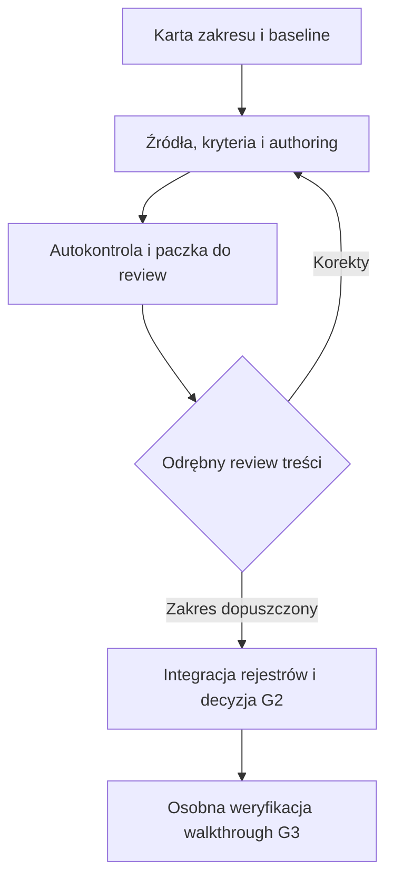

# M01 — Mapa tematów FL i backlog authoringu v0.1

**Projekt:** IREB CPRE Foundation Level Learning System  
**Data:** 2 listopada 2026, Europe/Warsaw  
**Status:** PROPOZYCJA PODZIAŁU I KOLEJNOŚCI PRAC / DO UŻYCIA W PLANOWANIU.  
**Zlecenie:** mapa całego FL i wzorcowy brief pojedynczego flow, równolegle z oczekiwaną recenzją C.  
**Baseline kontraktu:** B01–B04 v0.2 przyjęte w G1 przez R06. **Baseline treści:** C01–C04 v0.2, autorsko ukończone do review; niezaakceptowane w G2.  
**Bramki:** G1 zamknięte; G2, G3 i G4 otwarte. Niniejsza mapa ich nie zamyka.  
**Dokument towarzyszący:** M02_IREB_CPRE_Topic_Flow_Brief_Template_v0.1.md.

## 1. Decyzja projektowa i granice mapy

Rozbudowa ma sens jako kontrolowane opracowywanie tematów i ich wybranych zakresów, ze wspólną terminologią, źródłami, relacjami i rejestrem rodzin. Proponuje się **40 tematów redakcyjnych w 7 oficjalnych Educational Units, z przypisaniem wszystkich 70 EO** sylabusa 3.3.0. Wykaz obejmuje 36 EO L1, 27 EO L2 i 7 EO L3. To wynik inwentaryzacji identyfikatorów i poziomów, a nie wynik oceny uczniów.

Nie ustala się liczby pytań całego banku na podstawie liczby tematów. Liczby 40 i podział na fale są propozycją organizacji pracy. Można je zmienić po pierwszych flow, zachowując identyfikatory, historię i pełność przypisań. Mapowanie 70 EO nie oznacza jeszcze pełnego pokrycia FL: obowiązuje też osobny zakres foundational terms, a treści i wykonania muszą powstać oraz przejść review.

| Jednostka | Znaczenie | Reguła użycia |
|---|---|---|
| EU / EO | Oficjalny obszar / cel IREB | Wersja, poziom i zakres ustalane ze źródła |
| T01–T40 | Lokalny temat redakcyjny | Kontener wiedzy i odpowiedzialności za pokrycie, nie nowy EO |
| Zakres flow | Jedno ograniczone zlecenie wykonawcze | Może objąć cały mały temat albo część dużego; zakres i pominięcia jawne |
| Lokalne kryterium wykonania | Jednostka operacjonalizacji i ostrożnego wniosku | Nie tworzy fikcyjnego oficjalnego podnumeru EO |
| Rodzina zadań | Zapamiętywalny rdzeń rozumowania/sytuacji | Nie jest tożsama z tematem, EO, formatem ani nowym plikiem |
| Pakiet tematyczny | Treść, ocena, korekta, warianty, źródła i QA | Format A/P/K dobierany do kryterium; nie wymaga trzech formatów w każdym temacie |

Każdy EO ma niżej **jednego właściciela kontroli pełności**. Inne tematy mogą dostarczać jawnie ograniczony wkład do tego EO. Właściciel to przypisany temat, nie osoba ani fikcyjny recenzent. T17 jest celowym wkładem do EO3.4.5, którego pełność kontroluje T14.

## 2. Źródła, odczyt i pochodzenie podziału

Hierarchia: oficjalne źródła IREB ustalają EO, poziomy, terminologię i normy egzaminu; R06 ustala przyjęcie B; kanon pedagogiczny, FTC F13, Blueprint i przyjęte B określają kontrakt produktu. C v0.2 dostarcza rzeczywisty przykład do review. M01 i M02 są lokalną propozycją skalowania pracy i nie zastępują żadnej z tych podstaw.

| Referencja | Wersja, kontrola i faktycznie użyty zakres | Konkretne użycie tutaj |
|---|---|---|
| C-S01: [katalog IREB](https://cpre.ireb.org/en/downloads-and-resources/downloads) | Kontrola 2.11.2026 wpisów syllabus, glossary, regulations i handbook | Aktualność katalogowego profilu; nie źródło klucza |
| C-S02: [Syllabus EN](https://hub.ireb.org/media/pages/resources/cpre-foundation-level-syllabus/9c084b1cfd-1787039954/cpre_foundationlevel_syllabus_en_v.3.3.0.pdf) | 3.3.0, 1.04.2026; poziomy i foundational s.4, struktura s.5; odczyt 70 EO s.11/14/19/31/36/41/45 oraz użytych treści §§1–7 s.11–46 | Źródło przypisań i zakresów; osobne lokalizacje EO w §4 mapy |
| C-S03: [Syllabus PL](https://hub.ireb.org/media/pages/resources/cpre-foundation-level-syllabus/68b8837862-1787039957/cpre_foundationlevel_syllabus_pl_v.3.3.pdf) | 3.3.0, 1.04.2026; odczyt wszystkich wykazów EO s.11/14/19–20/32/38/43/47; kryteria jakości §3.8 s.30–31; właściwe fragmenty istniejącego C według C01 | Sprawdzenie 70 identyfikatorów i poziomów oraz terminów potrzebnych do briefu T21 |
| C-S04: [Examination Regulations](https://hub.ireb.org/media/pages/resources/cpre-foundation-level-and-agile-primer-examination-regulations/a7858da873-1787039946/cpre_fl_and_primer_examination_regulations_en_v5.6.2.pdf) | 5.6.2, 5.02.2024; odczyt całego dokumentu w C01, §2 s.4–6 | Obowiązek poprawnego scoringu A/P/K; bez kopiowania pytań |
| C-S05 / C-S06: [Glossary EN](https://hub.ireb.org/media/pages/resources/cpre-glossary/bb302c52fe-1787039949/ireb_cpre_glossary_en_2.2.pdf) / [Glossary PL](https://hub.ireb.org/media/pages/resources/cpre-glossary/d804142017-1787039952/ireb_cpre_glossary_pl_2.2.pdf) | 2.2.0, 1.10.2025; faktyczny dotychczasowy odczyt haseł i warunków w C01 | Kontrola znaczeń; nowy temat wymaga odczytania własnych haseł. Pełny inwentarz foundational jeszcze niewykonany |
| R06; B01–B04 v0.2 | R06 — zakres przyjęcia; B01-02/05/07–12; B02 FR-001–038; B04 B-DEC, K-04 i C-AC-01–14 | Jednostka pokrycia, relacje, kompletność pakietu, review i dopuszczenia |
| Kanon pedagogiczny; FTC; Blueprint; Deep Research | FTC F13 i F10–F12/F14; Blueprint FR/AC F09, scoring F11 i handoff; DR D2/D7/D10–12 | Retrieval, comparison, korekta, dowody, przepływy i ochrona oceny; lokalne reguły produktu |
| C01–C04 v0.2 | Aktualne pliki treści, standardu, praw i autokontroli z 2.11.2026 | Reuse istniejącego C; status review nie jest dziedziczoną akceptacją |

Lokalizacje oznaczają fizyczne strony PDF liczone od 1. PL ma 52 strony, EN 49. Zgodność list identyfikatorów i poziomów PL/EN nie jest deklaracją pełnego audytu semantycznego obu przekładów. Przed authoringiem każdego flow trzeba przeczytać rzeczywiście używane definicje, warunki i przykłady, a nie sam wykaz EO.

Autorzy sylabusa IREB: Stan Bühne, Martin Glinz, Hans van Loenhoud i Stefan Staal; autor Glossary: Martin Glinz. Przekład sylabusa PL: SJSI, z autorstwem i redakcją wskazanymi na s.2; polskie terminy Glossary: Monika Petri-Starego i Karolina Zmitrowicz. Podział T01–T40, fale i brief są autorskim opracowaniem projektu, nie podziałem zatwierdzonym przez IREB.

Zakres użycia źródeł: oryginalna mapa organizacyjna, własne krótkie opisy czynności i odsyłacze do dokumentów IREB e.V.; bez reprodukcji pytań, kluczy, tabel lub rysunków. Warunki konkretnego wykorzystania i ograniczenia publikacji pozostają w C01. Nie ustalono kanału publicznego/komercyjnego przyszłego produktu; niniejsze pliki służą planowaniu i review. Nie nadaje się im etykiety materiału zatwierdzonego przez IREB.

## 3. Katalog tematów i odpowiedzialności

Kolumna „podstawy” wskazuje użyteczne wejścia redakcyjne, comparisons lub wkład innych tematów. **Nie ustanawia przymusowej kolejności nauki.** Prerequisite R14 wymaga osobnego argumentu konieczności dla działania i review; znajomą podstawę można pominąć. Numer fali to propozycja kolejności produkcji, nie poziom trudności i nie waga egzaminacyjna.

### EU1 — Wprowadzenie i przegląd RE

| Temat | Oficjalny zakres właścicielski | Plan treści i czynności | Podstawy / fala / stan |
|---|---|---|---|
| **T01 — Podstawowe pojęcia RE** | EO1.1.1 L1 | Rozpoznawanie znaczeń requirement, specification, stakeholder, system i RE; odwołania do wspólnej terminologii. | T03, T05. W2. Brak treści tego tematu w obecnym pilocie C. |
| **T02 — Rodzaje wymagań** | EO1.1.2 L2 | Klasyfikacja functional requirement, quality requirement i constraint na podstawie przedmiotu wymagania; porównania i ograniczenia skrótów językowych. | T01. W1. C-P: zakres częściowy, do review. |
| **T03 — Wartość RE i skutki jego niedostatków** | EO1.2.1 L2, EO1.2.2 L1 | Wyjaśnienie wartości RE; rozpoznanie objawów niedostatecznego RE i związku z przyczynami opisanymi w treści sylabusa. | T01. W2. Brak treści tego tematu w obecnym pilocie C. |
| **T04 — Zastosowania i perspektywy RE** | EO1.3.1 L1 | Miejsca występowania wymagań i obszary zastosowania RE; perspektywy nie są nowymi rodzajami wymagań. | T01. W2. Brak treści tego tematu w obecnym pilocie C. |
| **T05 — Zadania RE, rola i kompetencje inżyniera** | EO1.4.1 L1, EO1.5.1 L1, EO1.6.1 L1 | Główne zadania, dostosowanie procesu, odpowiedzialności roli i obszary uczenia; bez certyfikowania kompetencji zawodowej jednym quizem. | T01, T03. W2. Brak treści tego tematu w obecnym pilocie C. |

### EU2 — Podstawowe zasady RE

| Temat | Oficjalny zakres właścicielski | Plan treści i czynności | Podstawy / fala / stan |
|---|---|---|---|
| **T06 — Przegląd zasad RE i ich terminologia** | EO2.1.1 L1, EO2.2.1 L1 | Rozpoznawanie dziewięciu zasad i pojęć z nimi związanych; utrwalenie L1, odrębne od ich wyjaśniania. | T01, T03. W2. Brak treści tego tematu w obecnym pilocie C. |
| **T07 — Wyjaśnianie dziewięciu zasad RE** | EO2.2.2 L2 | Dziewięć osobnych zakresów flow; argument zasady i konsekwencja w sytuacji. W1: kontekst; W2: pozostałe zakresy i audyt całości. | T06 oraz odsyłacze tematyczne PR01–09. W1/W2. C-A: tylko zasada kontekstu, do review. |

### EU3 — Artefakty i praktyki dokumentowania

| Temat | Oficjalny zakres właścicielski | Plan treści i czynności | Podstawy / fala / stan |
|---|---|---|---|
| **T08 — Artefakty RE: cel, postać, czas życia i planowanie** | EO3.1.1 L1, EO3.1.2 L1, EO3.1.5 L1, EO3.1.6 L1 | Typy work products, ich zastosowanie i czas życia, wskazówki dokumentowania oraz sens planowania zestawu artefaktów. | T01, T05. W2. Brak treści tego tematu w obecnym pilocie C. |
| **T09 — Abstrakcja, szczegółowość i aspekty opisu** | EO3.1.3 L2, EO3.1.4 L1 | Wyjaśnienie doboru abstrakcji i szczegółowości; rodzaje wymagań, struktura/dane, funkcja/przepływ, stan/zachowanie oraz kontekst, granice i interfejsy wraz z zależnościami. | T08, T02, T07/PR04. W2. Brak treści tego tematu w obecnym pilocie C. |
| **T10 — Wymagania w języku naturalnym** | EO3.2.1 L1, EO3.2.2 L2 | Zalety, ograniczenia i reguły formułowania. Reguły językowe wymagają warunków; nie ustanawiać absolutnego zakazu każdego kwantyfikatora lub strony biernej. | T02, T08, T21. W2. Brak treści tego tematu w obecnym pilocie C. |
| **T11 — Szablony: wymaganie i user story** | EO3.3.1 L1, EO3.3.2 L3 | Kategorie i ograniczenia szablonów; dwa rzeczywiste wykonania L3: pojedyncze wymaganie oraz user story z phrase template. | T02, T10. W2. Brak treści tego tematu w obecnym pilocie C. |
| **T12 — Use case w szablonie formularza** | EO3.3.3 L3 | Rzeczywiste sporządzenie prostego use case według form template; rubryka adekwatności i spójności przebiegu. | T08, T10, T11. W2. Brak treści tego tematu w obecnym pilocie C. |
| **T13 — Modele: cel, język, ograniczenia i wybór** | EO3.4.1 L2, EO3.4.2 L2, EO3.4.3 L1, EO3.4.4 L2 | Terminologia i dobór typu modelu do celu. Szerszy słownik modeli L1 nie staje się automatycznie listą modeli do samodzielnego tworzenia. | T08, T09. W3. Brak treści tego tematu w obecnym pilocie C. |
| **T14 — Interpretacja modeli: zakres wspólny i kontrola pełności** | EO3.4.5 L2 | Bezpośrednie flow: kontekst, use cases i use case diagrams, model dziedziny. Właściciel audytu siedmiu grup, z wkładem interpretacyjnym T15–T17. | T13, T23; wkład T15–T17. W3. Brak treści tego tematu w obecnym pilocie C. |
| **T15 — Dane i obiekty: diagram klas UML** | EO3.4.6 L3 | Interpretacja klas jako wkład do EO3.4.5; oddzielnie tworzenie prostego class diagram z rubryką L3 dla EO3.4.6. | T09, T13. W3. Brak treści tego tematu w obecnym pilocie C. |
| **T16 — Funkcja i proces: diagram aktywności UML** | EO3.4.7 L3 | Interpretacja activity/process models jako wkład do EO3.4.5; oddzielnie tworzenie UML activity diagram L3. BPMN nie jest dodatkowym obowiązkiem L3 tego EO. | T09, T13. W3. Brak treści tego tematu w obecnym pilocie C. |
| **T17 — Interpretacja stanów i przejść** | Wkład EO3.4.5 L2; właściciel T14 | Wkład do EO3.4.5: interpretacja prostego statechart. Temat nie otrzymuje fikcyjnego własnego EO ani obowiązku tworzenia modelu L3. | T13. W3. Brak treści tego tematu w obecnym pilocie C. |
| **T18 — Glosariusz w RE** | EO3.5.1 L2 | Wyjaśnienie celu i sposobu tworzenia glosariusza, uzgadniania znaczeń i utrzymania; homonimy i synonimy w kontekście. | T01, T10. W2. Brak treści tego tematu w obecnym pilocie C. |
| **T19 — Dokumenty i struktury specyfikacji** | EO3.6.1 L1, EO3.6.2 L2 | Rodzaje dokumentów i uzasadnienie struktury wobec celu, kontekstu oraz procesu; dokument nie jest jedyną postacią organizacji wymagań. | T08, T09. W2. Brak treści tego tematu w obecnym pilocie C. |
| **T20 — Prototypy i ich zastosowania** | EO3.7.1 L1 | Rozpoznanie rodzajów i przeznaczenia prototypów; fidelity oraz koszt wobec celu, exploratory versus evolutionary. | T08, T28. W2. Brak treści tego tematu w obecnym pilocie C. |
| **T21 — Jakość pojedynczego wymagania** | EO3.8.1 L1 | Sześć zalecanych kryteriów, znaczenie adekwatności i zrozumiałości oraz granice checklisty. L1; pełne przykładowe zlecenie w M02. | T02, T10; porównanie z T22. W1. Brak treści tego tematu w obecnym pilocie C. |
| **T22 — Jakość artefaktu obejmującego wiele wymagań** | EO3.8.2 L1 | Dodatkowe kryteria jakości zbioru/artefaktu; kompletność pojedynczego wymagania a brak znanych istotnych luk w zbiorze. | T21, T08. W1. Brak treści tego tematu w obecnym pilocie C. |

### EU4 — Praktyki opracowywania wymagań

| Temat | Oficjalny zakres właścicielski | Plan treści i czynności | Podstawy / fala / stan |
|---|---|---|---|
| **T23 — Wyznaczanie granic systemu** | EO4.1.1 L3 | Czynność L3 wyznaczenia granic dla prostego przypadku, uzasadnienia istotnego otoczenia i interfejsów; nie samo rozpoznanie definicji. | T07/PR04, T08. W1. C-A-L301: wykonanie częściowe, do review. |
| **T24 — Źródła, interesariusze i stakeholder list** | EO4.1.2 L1, EO4.1.3 L3, EO4.1.4 L2 | Źródła wymagań, identyfikacja ról i osób, sporządzenie listy L3 oraz wyjaśnienie korzyści stakeholder management. | T07/PR02, T23. W3. Brak treści tego tematu w obecnym pilocie C. |
| **T25 — Model Kano a pozyskiwanie wymagań** | EO4.2.1 L2 | Wyjaśnienie kategorii Kano i ich znaczenia dla elicitation; zależność od kontekstu i czasu, bez utożsamiania z functional/quality/constraint. | T02, T07/PR08. W3. Brak treści tego tematu w obecnym pilocie C. |
| **T26 — Techniki pozyskiwania i dobór do sytuacji** | EO4.2.2 L2, EO4.2.3 L2 | Gathering versus design/idea generation; uzasadnienie doboru i kombinacji technik do sytuacji. Nie podnosić oficjalnego L2 do L3 samą nazwą zadania. | T24, T25. W3. Brak treści tego tematu w obecnym pilocie C. |
| **T27 — Konflikty wymagań i ich rozwiązywanie** | EO4.3.1 L1, EO4.3.2 L2, EO4.3.3 L2 | Rodzaje konfliktów, działania i wyjaśnienie zastosowania odpowiedniej techniki wraz z dokumentowaniem decyzji. | T24, T07/PR03. W3. Brak treści tego tematu w obecnym pilocie C. |
| **T28 — Walidacja: cel i ważne aspekty** | EO4.4.1 L2, EO4.4.2 L1 | Dlaczego walidować; właściwi interesariusze, oddzielenie wykrycia od korekty, różne perspektywy i powtarzanie walidacji. | T07/PR06, T21, T22. W1. Brak treści tego tematu w obecnym pilocie C. |
| **T29 — Dobór technik walidacji** | EO4.4.3 L2 | Wyjaśnienie zastosowania review i technik eksploracyjnych oraz sample development; czynniki wyboru, koszty, formalność i ryzyka. | T28, T20. W1. Brak treści tego tematu w obecnym pilocie C. |

### EU5 — Proces i struktura pracy

| Temat | Oficjalny zakres właścicielski | Plan treści i czynności | Podstawy / fala / stan |
|---|---|---|---|
| **T30 — Czynniki kształtujące proces RE** | EO5.1.1 L1, EO5.1.2 L2 | Rozpoznanie czynników i wyjaśnienie wpływu na proces. Brak jednego uniwersalnego procesu dla wszystkich kontekstów. | T05, T24. W4. Brak treści tego tematu w obecnym pilocie C. |
| **T31 — Aspekty konfiguracji procesu** | EO5.2.1 L2 | Wyjaśnienie trzech facets: czas, cel i odbiorca/rynek; kryteria doboru są heurystykami, nie bezwyjątkowymi zakazami. | T30. W4. Brak treści tego tematu w obecnym pilocie C. |
| **T32 — Konfiguracja i zastosowanie procesu RE** | EO5.3.1 L1, EO5.3.2 L2, EO5.3.3 L3 | Typowe konfiguracje i kroki; wybór oraz zastosowanie konfiguracji do prostego kontekstu L3, z artefaktami i praktykami oraz rubryką. | T30, T31, T08. W4. Brak treści tego tematu w obecnym pilocie C. |

### EU6 — Praktyki zarządzania wymaganiami

| Temat | Oficjalny zakres właścicielski | Plan treści i czynności | Podstawy / fala / stan |
|---|---|---|---|
| **T33 — Zarządzanie wymaganiami i cykl życia** | EO6.1.1 L1, EO6.2.1 L2 | Cel requirements management oraz wyjaśnienie sensu statusów i modelu cyklu życia artefaktów. | T08, T07/PR07. W4. Brak treści tego tematu w obecnym pilocie C. |
| **T34 — Wersje, konfiguracje i baseline** | EO6.3.1 L2, EO6.4.1 L1 | Wyjaśnienie koncepcji wersjonowania w sytuacji projektowej; rozpoznanie przeznaczenia konfiguracji i baseline. | T33. W4. Brak treści tego tematu w obecnym pilocie C. |
| **T35 — Atrybuty i widoki wymagań** | EO6.5.1 L1, EO6.5.2 L2, EO6.5.3 L2 | Cel atrybutów, uzasadnienie ich zestawu i widoków; selective, projective i aggregating views jako odrębne pojęcia. | T33, T08. W4. Brak treści tego tematu w obecnym pilocie C. |
| **T36 — Śledzenie wymagań — traceability** | EO6.6.1 L1, EO6.6.2 L1, EO6.6.3 L1 | Powody, implicit/explicit i formy jawnego zapisu. Rozdzielenie sposobu zapisu, kierunku oraz celu relacji; istniejące C-K do review. | T08, T09, T34. W1. C-K: trzy EO częściowo, do review. |
| **T37 — Obsługa zmian** | EO6.7.1 L1 | Rozpoznanie obsługi zmian w podejściu liniowym i zwinnym; odpowiedzialności w kontekście, bez twierdzenia, że istnieje tylko jeden tryb zmiany. | T07/PR07, T33, T34. W4. Brak treści tego tematu w obecnym pilocie C. |
| **T38 — Priorytetyzacja** | EO6.8.1 L1, EO6.8.2 L1, EO6.8.3 L1 | Powody i kryteria oceny, kroki priorytetyzacji, kategorie technik. Nie dodawać obowiązku biegłego wykonania każdej techniki do L1. | T03, T33. W4. Brak treści tego tematu w obecnym pilocie C. |

### EU7 — Wsparcie narzędziowe

| Temat | Oficjalny zakres właścicielski | Plan treści i czynności | Podstawy / fala / stan |
|---|---|---|---|
| **T39 — Rodzaje wsparcia narzędziowego** | EO7.1.1 L1 | Rozpoznanie kategorii narzędzi RE i wspieranych zadań; mapa funkcji, bez rekomendowania konkretnych produktów. | T05, T08, T33. W4. Brak treści tego tematu w obecnym pilocie C. |
| **T40 — Wprowadzanie narzędzi RE** | EO7.2.1 L2 | Wyjaśnienie celu, kontekstu, odpowiedzialności, kosztów cyklu życia, pilota i szkolenia przy wprowadzaniu narzędzia. | T39, T30. W4. Brak treści tego tematu w obecnym pilocie C. |

## 4. Rejestr 70 EO — jedno przypisanie odpowiedzialności

Poniższe zdania są autorskimi skrótami planowanej czynności. Źródłem dokładnego zakresu pozostaje podany wykaz EO i odpowiednia treść sylabusa. „C częściowo” oznacza wyłącznie autorsko opracowany fragment oczekujący review. „Brak” oznacza brak treści w pilocie C, a nie twierdzenie o całej wiedzy posiadanej przez organizację. **Żaden EO nie otrzymuje tutaj statusu w pełni opracowanego lub zaakceptowanego.**

| EO | Poziom | Właściciel pełności | Planowana czynność | EO: EN / PL, strona PDF | Obecne C |
|---|---|---|---|---|---|
| EO1.1.1 | L1 | T01 | Rozpoznaje podstawowe pojęcia i ich sens w RE. | 11 / 11 | Brak |
| EO1.1.2 | L2 | T02 | Klasyfikuje rodzaj wymagania i uzasadnia różnicę. | 11 / 11 | C częściowo; review otwarte |
| EO1.2.1 | L2 | T03 | Wyjaśnia, skąd wynika wartość RE w kontekście. | 11 / 11 | Brak |
| EO1.2.2 | L1 | T03 | Wskazuje objawy niewystarczającego RE. | 11 / 11 | Brak |
| EO1.3.1 | L1 | T04 | Rozpoznaje obszary zastosowania i występowania wymagań. | 11 / 11 | Brak |
| EO1.4.1 | L1 | T05 | Wskazuje zadania RE i potrzebę dostosowania procesu. | 11 / 11 | Brak |
| EO1.5.1 | L1 | T05 | Charakteryzuje rolę i zadania Requirements Engineer. | 11 / 11 | Brak |
| EO1.6.1 | L1 | T05 | Wskazuje obszary wiedzy i umiejętności potrzebne w tej roli. | 11 / 11 | Brak |
| EO2.1.1 | L1 | T06 | Przywołuje dziewięć zasad RE. | 14 / 14 | Brak |
| EO2.2.1 | L1 | T06 | Rozpoznaje pojęcia związane z zasadami. | 14 / 14 | Brak |
| EO2.2.2 | L2 | T07 | Wyjaśnia sens i znaczenie każdej z dziewięciu zasad. | 14 / 14 | C częściowo; review otwarte |
| EO3.1.1 | L1 | T08 | Rozpoznaje cechy i typowe rodzaje artefaktów RE. | 19 / 19 | Brak |
| EO3.1.2 | L1 | T08 | Przywołuje zastosowanie i czas życia artefaktów. | 19 / 19 | Brak |
| EO3.1.3 | L2 | T09 | Wyjaśnia dobór abstrakcji i szczegółowości opisu. | 19 / 19 | Brak |
| EO3.1.4 | L1 | T09 | Rozpoznaje aspekty opisu i ich wzajemne związki. | 19 / 19 | Brak |
| EO3.1.5 | L1 | T08 | Przywołuje ogólne wskazówki dokumentowania. | 19 / 19 | Brak |
| EO3.1.6 | L1 | T08 | Opisuje korzyść z zaplanowania artefaktów. | 19 / 19 | Brak |
| EO3.2.1 | L1 | T10 | Rozpoznaje postacie, zalety i ograniczenia języka naturalnego. | 19 / 19 | Brak |
| EO3.2.2 | L2 | T10 | Wyjaśnia reguły formułowania dobrych wymagań. | 19 / 19 | Brak |
| EO3.3.1 | L1 | T11 | Rozpoznaje kategorie, korzyści i ograniczenia szablonów. | 19 / 19 | Brak |
| EO3.3.2 | L3 | T11 | Formułuje wymaganie oraz user story według phrase template. | 19 / 19 | Brak |
| EO3.3.3 | L3 | T12 | Sporządza use case według form template. | 19 / 19 | Brak |
| EO3.4.1 | L2 | T13 | Wyjaśnia rolę i użycie modeli w RE. | 19 / 19 | Brak |
| EO3.4.2 | L2 | T13 | Wyjaśnia korzyści i ograniczenia modelowania. | 19 / 19 | Brak |
| EO3.4.3 | L1 | T13 | Rozpoznaje wskazane pojęcia modelowania i notacji. | 19 / 19 | Brak |
| EO3.4.4 | L2 | T13 | Uzasadnia wybór rodzaju modelu do sytuacji. | 19 / 19 | Brak |
| EO3.4.5 | L2 | T14 | Interpretuje proste modele w siedmiu wskazanych grupach. | 19 / 19 | Brak |
| EO3.4.6 | L3 | T15 | Tworzy prosty diagram klas UML dla danych lub obiektów. | 19 / 19 | Brak |
| EO3.4.7 | L3 | T16 | Tworzy prosty diagram aktywności UML funkcji lub procesu. | 19 / 19 | Brak |
| EO3.5.1 | L2 | T18 | Wyjaśnia cel i sposób tworzenia glosariusza. | 19 / 19 | Brak |
| EO3.6.1 | L1 | T19 | Rozpoznaje często stosowane dokumenty wymagań. | 19 / 19 | Brak |
| EO3.6.2 | L2 | T19 | Wyjaśnia cel struktury dokumentu i kryteria jej doboru. | 19 / 19 | Brak |
| EO3.7.1 | L1 | T20 | Rozpoznaje rodzaje prototypów i ich zastosowanie. | 19 / 20 | Brak |
| EO3.8.1 | L1 | T21 | Rozpoznaje kryteria jakości pojedynczego wymagania. | 19 / 20 | Brak |
| EO3.8.2 | L1 | T22 | Rozpoznaje kryteria jakości artefaktu z wieloma wymaganiami. | 19 / 20 | Brak |
| EO4.1.1 | L3 | T23 | Wyznacza granice systemu dla rozpatrywanego przypadku. | 31 / 32 | C częściowo; review otwarte |
| EO4.1.2 | L1 | T24 | Przywołuje istotne źródła wymagań. | 31 / 32 | Brak |
| EO4.1.3 | L3 | T24 | Identyfikuje interesariuszy i sporządza stakeholder list. | 31 / 32 | Brak |
| EO4.1.4 | L2 | T24 | Wyjaśnia korzyści z zarządzania interesariuszami. | 31 / 32 | Brak |
| EO4.2.1 | L2 | T25 | Wyjaśnia pomoc modelu Kano w pozyskiwaniu wymagań. | 31 / 32 | Brak |
| EO4.2.2 | L2 | T26 | Wyjaśnia różnicę gathering versus design/idea generation. | 31 / 32 | Brak |
| EO4.2.3 | L2 | T26 | Uzasadnia dobór techniki pozyskiwania do sytuacji. | 31 / 32 | Brak |
| EO4.3.1 | L1 | T27 | Rozpoznaje rodzaje konfliktów. | 31 / 32 | Brak |
| EO4.3.2 | L2 | T27 | Wyjaśnia działania potrzebne do rozwiązania konfliktu. | 31 / 32 | Brak |
| EO4.3.3 | L2 | T27 | Wyjaśnia zastosowanie techniki rozwiązania konfliktu. | 31 / 32 | Brak |
| EO4.4.1 | L2 | T28 | Wyjaśnia potrzebę walidowania dokumentów wymagań. | 31 / 32 | Brak |
| EO4.4.2 | L1 | T28 | Przywołuje cztery ważne aspekty walidacji. | 31 / 32 | Brak |
| EO4.4.3 | L2 | T29 | Wyjaśnia zastosowanie odpowiedniej techniki walidacji. | 31 / 32 | Brak |
| EO5.1.1 | L1 | T30 | Rozpoznaje czynniki wpływające na proces RE. | 36 / 38 | Brak |
| EO5.1.2 | L2 | T30 | Wyjaśnia sposób i przyczynę wpływu tych czynników. | 36 / 38 | Brak |
| EO5.2.1 | L2 | T31 | Wyjaśnia facets używane przy konfigurowaniu procesu. | 36 / 38 | Brak |
| EO5.3.1 | L1 | T32 | Rozpoznaje typowe konfiguracje procesu RE. | 36 / 38 | Brak |
| EO5.3.2 | L2 | T32 | Wyjaśnia kroki konfigurowania procesu. | 36 / 38 | Brak |
| EO5.3.3 | L3 | T32 | Wybiera i stosuje konfigurację w prostym kontekście. | 36 / 38 | Brak |
| EO6.1.1 | L1 | T33 | Przywołuje zakres i potrzebę requirements management. | 41 / 43 | Brak |
| EO6.2.1 | L2 | T33 | Wyjaśnia potrzebę modelu statusów i cyklu życia. | 41 / 43 | Brak |
| EO6.3.1 | L2 | T34 | Wyjaśnia koncepcję wersjonowania dla sytuacji projektowej. | 41 / 43 | Brak |
| EO6.4.1 | L1 | T34 | Rozpoznaje zastosowanie konfiguracji i baseline. | 41 / 43 | Brak |
| EO6.5.1 | L1 | T35 | Przywołuje cel atrybutów wymagań. | 41 / 43 | Brak |
| EO6.5.2 | L2 | T35 | Wyjaśnia dobór zestawu atrybutów do potrzeb projektu. | 41 / 43 | Brak |
| EO6.5.3 | L2 | T35 | Wyjaśnia cel widoków i wskazuje ich rodzaje. | 41 / 43 | Brak |
| EO6.6.1 | L1 | T36 | Przywołuje powody śledzenia wymagań. | 41 / 43 | C częściowo; review otwarte |
| EO6.6.2 | L1 | T36 | Zestawia cechy implicit i explicit traceability. | 41 / 43 | C częściowo; review otwarte |
| EO6.6.3 | L1 | T36 | Rozpoznaje formy dokumentowania explicit traceability. | 41 / 43 | C częściowo; review otwarte |
| EO6.7.1 | L1 | T37 | Rozpoznaje obsługę zmian w podejściu liniowym i zwinnym. | 41 / 43 | Brak |
| EO6.8.1 | L1 | T38 | Przywołuje powody priorytetyzacji i sensowne kryteria oceny. | 41 / 43 | Brak |
| EO6.8.2 | L1 | T38 | Przywołuje kroki priorytetyzacji. | 41 / 43 | Brak |
| EO6.8.3 | L1 | T38 | Rozpoznaje kategorie technik priorytetyzacji. | 41 / 43 | Brak |
| EO7.1.1 | L1 | T39 | Rozpoznaje rodzaje narzędzi wspierających RE. | 45 / 47 | Brak |
| EO7.2.1 | L2 | T40 | Wyjaśnia kwestie istotne przy wprowadzaniu narzędzi RE. | 45 / 47 | Brak |

### Kontrola liczności

| EU | EO | L1 | L2 | L3 | Tematy |
|---|---:|---:|---:|---:|---:|
| EU1 | 8 | 6 | 2 | 0 | 5 |
| EU2 | 3 | 2 | 1 | 0 | 2 |
| EU3 | 24 | 12 | 8 | 4 | 15 |
| EU4 | 13 | 3 | 8 | 2 | 7 |
| EU5 | 6 | 2 | 3 | 1 | 3 |
| EU6 | 14 | 10 | 4 | 0 | 6 |
| EU7 | 2 | 1 | 1 | 0 | 2 |
| **Razem** | **70** | **36** | **27** | **7** | **40** |

## 5. Zakresy, których nie wolno zamknąć jednym ogólnym quizem

### T07: dziewięć zasad w EO2.2.2

T06 odpowiada za przywołanie zasad i terminologii na L1. T07 odpowiada za ich wyjaśnienie na L2. Każdy poniższy zakres potrzebuje rzeczywistego materiału i odpowiedniej oceny, a całość jednego audytu pokrycia. Oznaczenia PR są lokalnymi zakresami, nie oficjalnymi EO.

| Zakres flow | Zasada / pytanie kierujące | Odsyłacz do treści kanonicznej | Stan |
|---|---|---|---|
| T07/PR01 | Wartość: jaką korzyść wnosi wymaganie wobec kosztu pracy RE? | T03 | Do opracowania |
| T07/PR02 | Interesariusze: czyje potrzeby i role trzeba uwzględnić? | T24 | Do opracowania |
| T07/PR03 | Wspólne rozumienie: skąd wiadomo, że uczestnicy rozumieją to samo? | T18, T20, T27 | Do opracowania |
| T07/PR04 | Kontekst: dlaczego opis samego wnętrza systemu nie wystarcza? | T23, T14 | C-A częściowo; review |
| T07/PR05 | Problem–wymaganie–rozwiązanie: co rozdzielamy i jakie są zależności? | T02, T26 | Do opracowania |
| T07/PR06 | Walidacja: co trzeba sprawdzić wobec potrzeb i założeń? | T28, T29 | Do opracowania |
| T07/PR07 | Ewolucja: jak pogodzić dopuszczanie zmian i stabilność? | T33, T34, T37 | Do opracowania |
| T07/PR08 | Innowacja: jak ujawnić możliwości ponad wyrażone oczekiwania? | T25, T26 | Do opracowania |
| T07/PR09 | Praca systematyczna: dlaczego dopasowujemy praktyki do sytuacji? | T30–T32 | Do opracowania |

Podstawa: Syllabus EN 3.3.0 §2.1–2.2 s.14–18. Użycie krótkich etykiet zasad nie zastępuje wyjaśnienia ich znaczenia i powodów. Odsyłacz do tematu docelowego nie nadaje automatycznie pomiaru jego EO.

### T14: siedem grup interpretacji EO3.4.5

| Grupa | Bezpośredni autor zakresu | Co wykazać | Czego nie dopisywać |
|---|---|---|---|
| Context models | T14; reuse T23 | Interpretacja prostego modelu kontekstu | Samodzielne tworzenie dowolnej notacji jako nowy obowiązek L3 |
| Use cases i use case diagrams | T14; odsyłacz T12 | Interpretacja opisu i diagramu, w odpowiednim zakresie | Zastąpienie obu jednym pytaniem o nazwę aktora |
| Domain models | T14 | Interpretacja prostego opisu/modelu dziedziny | Automatyczne utożsamienie każdego modelu dziedziny z diagramem klas |
| Class models | T15 → T14 | Interpretacja modelu klas L2 | Uznanie samej interpretacji za wykonanie EO3.4.6 L3 |
| Activity models | T16 → T14 | Interpretacja działania i przepływu L2 | Tworzenie jako jedyny dowód rozumienia bez oceny interpretacji |
| Process models | T16 → T14 | Interpretacja modelu procesu L2 | Obowiązkowe tworzenie BPMN ponad EO3.4.7 |
| Statecharts | T17 → T14 | Interpretacja stanów, zdarzeń i przejść L2 | Deklaracja wymaganego tworzenia statechart L3 |

Podstawa: EO3.4.5 EN s.19 oraz §§3.4.2–3.4.5 s.26–27. T14 prowadzi jeden manifest siedmiu grup i wersji wkładów T15–T17. Brak wkładu jednej grupy pozostaje luką, nawet gdy w T14 istnieje wiele pytań o pozostałe modele. Numer sekcji §3.4.5 nie jest identyczny ze znaczeniem numeru EO3.4.5.

### Wszystkie siedem EO na L3

| EO / temat | Wymagana czynność wykonawcza | Minimalny przedmiot rubryki i kontrola granicy |
|---|---|---|
| EO3.3.2 / T11 | Utworzenie pojedynczego wymagania **oraz** user story z phrase template | Oba artefakty; zgodność z danymi, sensem i szablonem; sam wybór najlepszego zdania nie zamyka L3 |
| EO3.3.3 / T12 | Sporządzenie use case w form template | Aktor/cel, warunki i spójny przebieg w zakresie źródła; akceptowalne równoważne rozwiązania |
| EO3.4.6 / T15 | Utworzenie prostego UML class diagram | Poprawne elementy, relacje i odwzorowanie danych/obiektów; zakres notacji źródłowo ograniczony |
| EO3.4.7 / T16 | Utworzenie prostego UML activity diagram | Przepływ dla funkcji/procesu, warunki i spójność; nie wystarcza rozpoznanie symbolu |
| EO4.1.1 / T23 | Wyznaczenie granic systemu w sytuacji | Uzasadnione włączenie/wyłączenie, istotny kontekst i interfejsy; C-A-L301 pozostaje częściowym kandydatem |
| EO4.1.3 / T24 | Identyfikacja interesariuszy **i** sporządzenie stakeholder list | Źródła identyfikacji, role/osoby, istotne dane listy; fikcyjne dane scenariusza wyraźnie oznaczone |
| EO5.3.3 / T32 | Wybór **i zastosowanie** konfiguracji procesu w prostym kontekście | Czynniki → facets → konfiguracja → artefakty i praktyki; uzasadnione alternatywy, bez jednej mechanicznej odpowiedzi dla wszystkich kontekstów |

Rubryka musi zawierać konieczne elementy, dopuszczalne równoważności, błędy krytyczne i graniczne oraz metodę oceny. Wynik zadania otwartego pozostaje odrębny od punktacji normatywnej A/P/K. Zwiększenie liczby pytań zamkniętych nie zastępuje czynności L3. Zadanie otwarte jest lokalnym narzędziem edukacyjnym, nie twierdzeniem o formacie oficjalnego egzaminu.

## 6. Obowiązki przekrojowe poza samą listą EO

| Strumień | Zakres i wynik | Stan / odpowiedzialność integracji |
|---|---|---|
| X01 — Foundational terminology | Pełny inwentarz haseł oznaczonych foundational w Glossary 2.2.0, z kontrolą oznaczeń w PDF, parami PL/EN, lokalizacjami i przypisaniem do tematów; bez sztucznych EO | **Otwarty.** Normę potwierdza Syllabus EN s.4. Lista Terms na początku EU jest punktem wejścia i nie zastępuje pełnego inwentarza |
| X02 — Format, scoring i warunki próby | Reuse C02/B01-07 i regulaminu; ćwiczenie obsługi może mieć cel pomocniczy bez EO | Kontynuacja obecnego C; nie nazywać umiejętności zaznaczania dowodem wiedzy dziedzinowej |
| X03 — Spójność źródeł, terminologii i tożsamości | Jeden wspólny rejestr źródeł/terminów/ID/rodzin, wersjonowane propozycje zmian z flow; porównanie znaczeń i wpływu, nie tylko hashy | Aktualizacja wspólnych rejestrów po integracji, sekwencyjnie; autorzy tematów dostarczają delty |
| X04 — Ochrona oceny i przyszła rezerwa | Per osoba: znajomość itemu/rodziny, pomoc, nowość kontekstu, dwa czasy per kryterium; osobny plan nieujawnionych pozycji i pokrycia form | **Otwarty.** Brak uprawnionej deklaracji pełnej rezerwy lub gotowości egzaminacyjnej z obecnego pilota |

Początkowe kotwice terminologiczne z pól Terms w EU: EU1 — requirement, requirements specification, RE, stakeholder, system, Requirements Engineer; EU2 — context, shared understanding, validation i terminy wspólne; EU3 — work product, natural-language/template/model-based work products, glossary, quality criteria; EU4 — requirements source, system boundary/context, elicitation, requirements validation, Kano model, conflict resolution; EU5 — process, RE process; EU6 — requirements management, change management, traceability, attributes, life cycle, prioritization; EU7 — tool, RE tool. To routing do X01 i tematów, **nie kompletna lista foundational** ani nowy oficjalny polski słownik.

## 7. Reuse obecnego C i luka rzeczywistego korpusu

| Temat / EO | Rzeczywisty materiał C03 v0.2 | Działanie w nowym flow |
|---|---|---|
| T02 / EO1.1.2 częściowo | C-P-B01/F01/D01 oraz R01/S01; KRY-P01 | EXTEND po uwzględnieniu review; nie tworzyć równoległej definicji rodzajów wymagań. Delayed C-P-D01 ma format A |
| T07/PR04 / EO2.2.2 częściowo | C-A-B01/F01/D01 oraz R01/S01; KRY-A01 | Zachować zakres zasady kontekstu i przejrzeć jego granice; pozostałe osiem zasad wymaga authoringu |
| T23 / EO4.1.1 częściowo | C-A-L301, rubryka sześciu wymiarów; KRY-A02 | Rozszerzyć/naprawić według review; nie liczyć A jako dowodu wykonania L3 |
| T36 / EO6.6.1–3 częściowo | C-K-B01/F01/D01 oraz R01/S01; KRY-K01/K02/K03 | Review powodów, sposobu zapisu i form reprezentacji; bez automatycznej promocji ilustracji B |

Obecne C: **3 pakiety A/P/K, 9 zadań zamkniętych, 38 lokalnych rationale i 7 otwartych aktywności**; razem 16 aktywności. Trzy base, trzy follow-up, trzech kandydatów delayed, jedno wykonanie L3. Są to materiały do review, nie niezależnie zrecenzowany korpus. Stan ten wnosi częściowy materiał do czterech T oraz sześciu EO; 36 pozostałych tematów nie ma własnej treści w tym pilocie. Nie oblicza się z tego procentu gotowości FL.

Wydanie recenzenckie C03 ujawnia klucze i kandydatów delayed jego czytelnikowi. Nie jest dla tej osoby chronioną rezerwą. Status nowego flow zależy także od przeczytanych przez tę osobę treści, a nie tylko od nowej nazwy pliku.

K-04 pozostaje bez zmian: **wiersz 4 ILL-K01 / KRY-X01** jest pomocniczy, bez oficjalnego EO; historyczna ilustracja zachowuje cztery wiersze i swój scoring. Nie awansuje do rezerwy CPRE przez ukrycie etykiety. Nowe pozycje muszą mieć własny, źródłowo uzasadniony zakres.

## 8. Backlog i kolejność produkcji

| Fala | Tematy i prace | Cel i warunek przejścia |
|---|---|---|
| W0 — równolegle teraz | Odrębna recenzja istniejącego C; rozpoczęcie X01, utrwalenie wersji i rejestru ID; mapa M01 i brief M02 | Review C nie zostało wykonane w ramach M01/M02. Można pisać kolejne ograniczone flow; ustalenia review należy włączyć do standardu przed szeroką seryjną produkcją |
| W1 — rozszerzenie wokół pilota | **Najpierw T21**, następnie T22 i T28, potem T29; EXTEND/REPAIR T02, T07/PR04, T23 i T36 według review | Sprawdzić skalowanie na nowym zakresie i na reuse. T29 korzysta z potrzebnego fragmentu T20; brak pełnego T20 nie blokuje napisania tego fragmentu |
| W2 — fundament i dokumentowanie | T01, T03–T06, pozostałe PR01–03/05–09 w T07, T08–T12, T18–T20 | Uzupełnić pojęcia i artefakty; źródłowo ograniczyć zakresy i przygotować wykonania T11/T12. Przykłady zasad mogą odsyłać do późniejszych tematów bez wymagania ukończenia ich lekcji |
| W3 — modele i opracowywanie wymagań | T13–T17, T24–T27 | Wspólny audyt siedmiu grup w T14; interpretacja oddzielona od tworzenia; wykonania L3 T15/T16/T24 |
| W4 — proces, zarządzanie, narzędzia | T30–T35, T37–T40 | Wykonanie T32 L3, domknięcie zakresów management i tools; przegląd pokrycia wszystkich 70 EO oraz X01 |

Manifest fal: W1 — 8 przypisań, W2 — 14, W3 — 9, W4 — 10. T07 jest rozłożony na W1 i W2; pozostałe T mają jedną falę.

| Fala | Jawna lista identyfikatorów | Liczba przypisań |
|---|---|---:|
| W1 | T02, T07, T21, T22, T23, T28, T29, T36 | 8 |
| W2 | T01, T03, T04, T05, T06, T07, T08, T09, T10, T11, T12, T18, T19, T20 | 14 |
| W3 | T13, T14, T15, T16, T17, T24, T25, T26, T27 | 9 |
| W4 | T30, T31, T32, T33, T34, T35, T37, T38, T39, T40 | 10 |

T07 ma dwa przypisania etapów; suma przypisań fal jest większa od liczby unikalnych tematów. Manifest obejmuje 40 unikalnych T. Czas szkoleniowy EU z sylabusa nie jest estymatą czasu authoringu, liczbą zadań ani automatyczną proporcją punktów projektowanego banku. Estymatę pracy można oprzeć na rzeczywistym wykonaniu T21 i korektach review, bez fikcyjnych danych o produktywności.

## 9. Wspólne flow produkcji i integracji

Każdy przebieg korzysta z M02 i kończy się konkretną paczką do review. Oddzielne flow można uruchamiać w osobnych rozmowach. Rozdzielenie rozmów nie usuwa potrzeby wspólnej identyfikacji źródeł, treści i rodzin ani nie zapewnia samo w sobie niezależności review.

Decyzje G2/G3 podejmuje właściwy właściciel w wymaganym zakresie. Diagram przedstawia następstwo odpowiedzialności, nie dokonane odbiory. Równoległy authoring dalszych tematów jest możliwy przed G2, z jawnym ryzykiem późniejszej korekty zależności. G4 pozostaje osobnym otwartym etapem zgodnie z START/Blueprint.

Z jednego flow wychodzą dwa pliki o stabilnej tożsamości: `Txx_IREB_CPRE_<slug>_Content_v0.1.md` oraz `Txx_IREB_CPRE_<slug>_QA_and_Handoff_v0.1.md`. Kolejna rewizja aktualizuje te same pliki i historię; rozbicie na zakresy otrzymuje jawny przyrostek, np. T07_PR04. Autor zapisuje w QA proponowane delty do rejestru źródeł, terminologii, pokrycia i rodzin. Nie nadpisuje samodzielnie C01/C02 ani START podczas równoległej pracy.

Integracja sprawdza konkretne różnice znaczeń, kluczy, relacji i zakresu. Nowy numer wersji lub hash identyfikuje plik, ale nie dowodzi zgodności. Konflikt oficjalnego źródła z przyjętym znaczeniem B wymaga rejestru konfliktu i listy zależności; pozostałe niezależne części można kontynuować. Nie zmienia się po cichu B.

## 10. Warunki ukończenia flow i odbioru treści

Pakiet jest autorsko kompletny do review, gdy ma: zakres z EO/poziomem i kryteriami; source-backed objaśnienie z warunkami i granicami; potrzebne comparison/prerequisite, przykład/kontrprzykład; retrieval z metodą oceny; rzeczywiste zadania z pełnym kluczem/rationale/scoringiem; adekwatną korektę i znaczący follow-up; kandydata delayed z jawną rolą; rubryki dla deklarowanych wykonań; instancje wymaganych relacji; analizę rodzin i ujawnienia; rejestr źródeł/praw oraz autorski audyt wszystkich C-AC-01–14. Hipoteza pomyłki i sonda tylko przy uzasadnionej potrzebie, z alternatywami i statusem hipotezy.

Liczbę bazowych zadań i wariantów wyznacza pokrycie lokalnych kryteriów, nie szablon „trzy formaty na temat”. Dla każdego kryterium trzeba jawnie wskazać base, korektę/follow-up i plan późniejszej kontroli albo lukę. Jedno zadanie może służyć kilku kryteriom tylko z rozdzielonym zakresem decyzji i uzasadnieniem. Nie wolno nazywać całego EO pokrytym dlatego, że pytanie ma taki tag.

Odrębny review sprawdza treść, źródła, poziomy, język, ocenę, relacje, prawa i zamierzony użytek. Dopiero potem możliwe jest dopuszczenie redakcyjne w określonym zakresie. Eligibility konkretnego ucznia nadal wymaga jego rzeczywistej historii ekspozycji i pomocy. Punktacja nie jest automatycznie dowodem uczenia, retencji ani procentem mastery.

## 11. Rejestr decyzji, korekt i luk tej mapy

| ID | Ustalenie lub wykryta wada robocza | Rozstrzygnięcie / wpływ |
|---|---|---|
| M-DEC-01 | Temat i EO miałyby być traktowane 1:1 | 40 tematów, 70 EO; jeden właściciel pełności na EO, jawne wkłady z innych tematów |
| M-DEC-02 | Wymaganie A/P/K w każdym temacie powodowałoby sztuczne zadania | Dobór formatu do kryterium; zachowane pełne kontrakty każdego powstałego A/P/K |
| M-FIX-01 | Duże EO2.2.2 ukrywałoby osiem nieopracowanych zasad | Dziewięć zakresów T07; C-A obejmuje tylko fragment PR04 |
| M-FIX-02 | Jedna pozycja „modele” gubiłaby interpretację wybranych grup | T14 kontroluje siedem grup, T15–T17 dostarczają zidentyfikowane wkłady |
| M-FIX-03 | Interpretacja modelu mogłaby być uznana za jego stworzenie | Osobne wykonania i rubryki dla siedmiu EO L3 |
| M-FIX-04 | Robocza agregacja przypisywała aspekty opisu do ogólnego planowania artefaktów | EO3.1.4 przypisano T09 wraz z abstrakcją/szczegółowością; T08 zachowuje pozostałe wskazane EO3.1 |
| M-FIX-05 | Lista EO miałaby być równoznaczna z całością egzaminacyjnego słownika | X01 pozostaje obowiązkowym otwartym inwentarzem bez fikcyjnego EO |
| M-FIX-06 | C v0.1 nadal występuje w historycznych Project Sources | Aktualny baseline authoringu wskazano jako C v0.2. Nie zmieniono Sources ani START w tym zleceniu |
| M-FIX-07 | Roboczy brief przypisywał sylabusowi zdanie o niewyczerpującym charakterze listy kryteriów jakości, którego nie potwierdza §3.8 | Usunięto tę deklarację. T21 zachowuje źródłowo potwierdzony zalecany charakter listy i warunek stopnia spełnienia wobec wartości, bez dopisywania normy |
| M-K01 | PL §3.8 „kompletne (niezależne)”, EN „complete (self-contained)” | Brief T21 zachowuje sens kompletności pojedynczego wymagania, nie wyprowadza zakazu zależności/traceability. Szczegółowy przykład musi mieć własne źródłowe uzasadnienie |
| M-K02 | PL EO3.4.5 używa sformułowania przykładowego, EN wylicza wskazane typy | Mapa obejmuje siedem wspólnie wskazanych grup; nie rozszerza zakresu na dowolną notację. Rozbieżność brzmienia do sprawdzenia przy review modelowania; bez zmiany B |
| M-L01 | Brak odrębnego review samej mapy i briefu | Kontrola autorska; recenzja struktury może użyć M01/M02. Nie jest to recenzja treści C |
| M-L02 | Brak pełnego audytu semantycznego wszystkich EO PL/EN i foundational | Przed właściwym flow odczyt użytych fragmentów i haseł; X01 przed deklaracją pełnego FL |
| M-L03 | Brak ustalonego kanału publikacji | Dopuszczone planowanie i review; publiczne/komercyjne wydanie wymaga oceny konkretnego użycia źródeł |
| M-L04 | Brak materiałów większości tematów, rezerwy i danych empirycznych | Mapa jest backlogiem. Nie deklaruje gotowego kursu, kompletnego banku, nowej retencji ani gotowości egzaminacyjnej |

## 12. Kontrola autorska i następny krok

Wykonano maszynowe porównanie obu wykazów: 70 unikalnych EO, identyczne identyfikatory i poziomy PL/EN, po jednym przypisaniu właściciela; 40 unikalnych T, wszystkie przypisane do fal; oddzielony wkład T17; wszystkie 7 EO L3 mają plan czynności i rubryki. Przeliczono zestawienia EU i fal. Sprawdzono ograniczenia aktualnego C oraz G1/K-04, bez niezależnego review.

Najbliższa praca produkcyjna: uruchomić kartę T21 z M02 w osobnym flow i przekazać jego dwa rzeczywiste pliki do review, równolegle z odrębną recenzją C01–C04 v0.2. Wynik review obecnego C należy uzgodnić z T21 przed dopuszczeniem do punktowanego użycia. Właściciel rozstrzyga G2 na podstawie treści i review; G3 walkthrough pozostaje osobno.

**Propozycja wpisu do START — osobno, bez zastosowania:** „Dodano M01/M02 v0.1: proponowana mapa 40 tematów / 70 EO oraz brief flow z kartą T21. Dokumenty służą planowaniu authoringu, nie potwierdzają pełnego pokrycia FL. Aktualny C v0.2 oczekuje review G2; G3/G4 pozostają otwarte. Nowe flow używają B v0.2, R06 i aktualnego C v0.2, z zachowaniem K-04.”

## 13. Odtworzenie baseline

Rewizje poniżej identyfikują konkretne odczytane pliki. Skrót nie jest dowodem poprawności ani przyjęcia treści. B04 zawiera administracyjny zapis G1; znaczenie decyzji pozostaje w R06.

| Dokument | SHA-256 |
|---|---|
| B01 v0.2 | f29c2f3b61ce1ad86467a19153b648c50af8cac61b07ca19bb856d0dfe46323c |
| B02 v0.2 | dc089326e158d431520c7a8eb5cc2f6d8935c0513bee355ca8f9ab7c92dcfa94 |
| B03 v0.2 | af112d6e97ebe559264eb7ba6df4c6acc8a0c91ffe02f543b0f44123913114d1 |
| B04 v0.2 po zapisie G1 | 00d82a4f62d8b1c01931941a0dcfa8fccccd378b29c1990eb47d5fd3dc4988e2 |
| R06 v0.1 | 85181939cbbe1e9eb96170b416c732de83a5882864db63857e4de47c2dd593d0 |
| C01 v0.2 | 5bc472d6a8df25a7aa65561114ca23ed7defd00c03f7254bf76cc78181921f5a |
| C02 v0.2 | de488b934a6c65a22988d49636259d45a40331059800ccc44d9acf528d6681aa |
| C03 v0.2 | f249bf8e631afc8f4c2154920a1e6da4261adf1a9a7e5f831b0014429de4fec9 |
| C04 v0.2 | 63fa29fda5a7661b11b971be81b07eb56c6cd9529e789dd29f1f17b3fc9bd6ca |

## Historia

v0.1 — pierwsza mapa po wykonaniu autorskiego przekroju C v0.2; podział tematów, inwentarz 70 EO, backlog i reguły integracji. Nie modyfikowano B, C, D, START ani ich historii.
